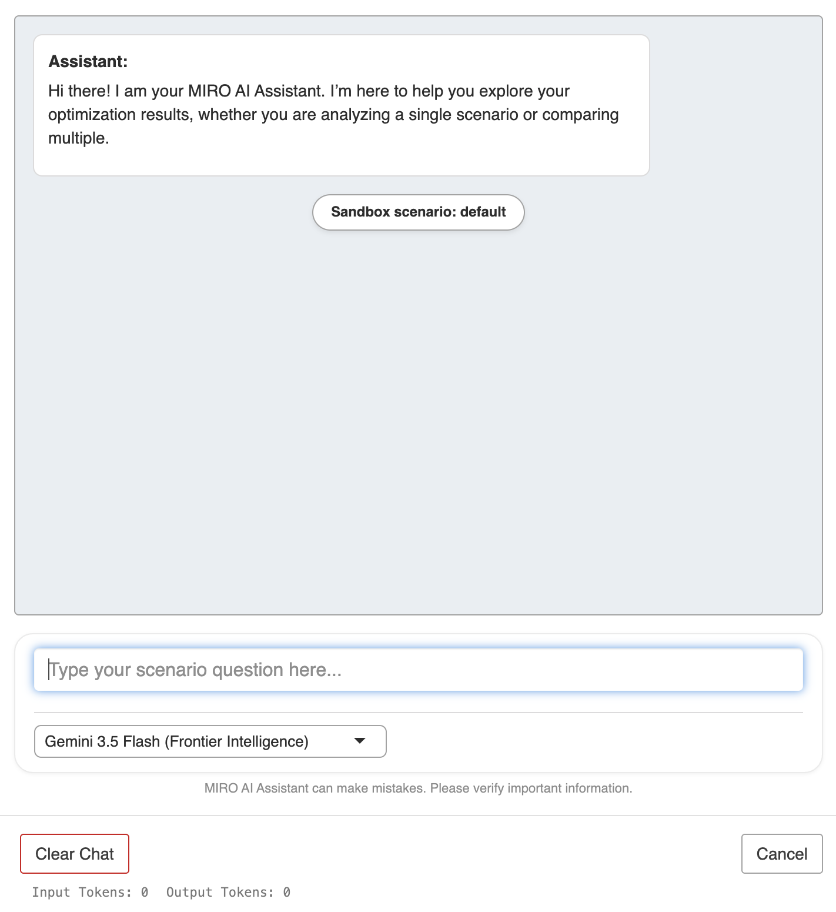
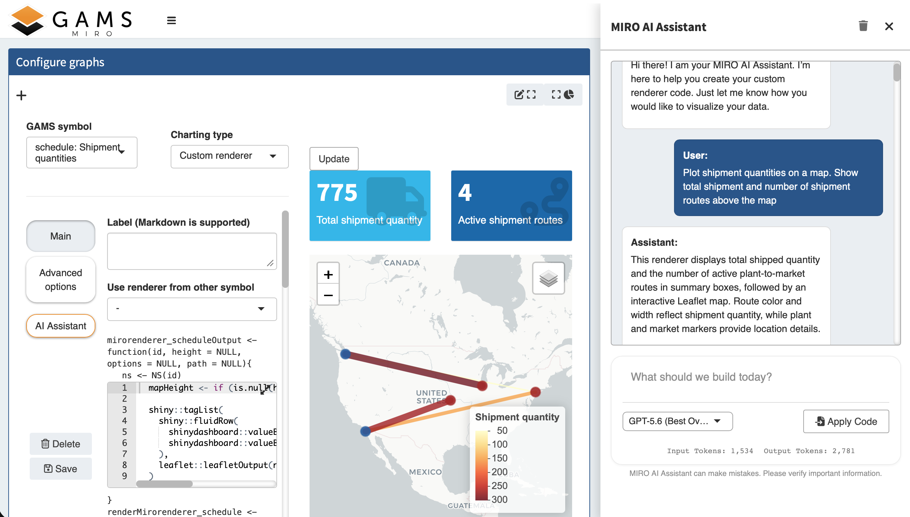

Mira (AI Assistant)
===================

.. _ai-assistant-introduction:

Introduction
------------

When we compare optimization results across scenarios, we usually already know roughly what we are looking for: did the objective improve, which constraints are binding, which inputs actually drove the change. Finding the answer, however, still means opening several output tables, cross-referencing them with the inputs, and doing the arithmetic ourselves. Mira, GAMS MIRO's AI assistant, lets us ask for that answer directly, in plain language, and get a grounded response back - computed from the actual scenario data, not guessed from a description of it.

Say we are working with the *transport* example model and have just loaded two scenarios that differ in their freight cost. MIRO's own `baseline comparison <./configuration_general.html#pivot-default-options>`__ feature already gives us a table of deltas between the two - but turning that table into an answer to "what actually changed and why" still means scanning it ourselves. Instead, we can open Mira and ask: *"Which routes changed the most between these two scenarios, and why?"* Mira queries the underlying scenario database for exactly the tables it needs, ranks the routes by how much they shifted, and reports back the answer directly together with the cost values driving that shift - the digging done for us, not a table we still have to read.

Mira is just as useful before we get to comparing scenarios at all. Before we even run a model, we can ask it to look over our inputs: *"Do any of the demand or supply values look off?"*. It reviews the input tables we point it to and calls out what stands out - missing values, unusual units, outliers, duplicates - the kind of typo or data-entry slip that is easy to miss by eye but often explains a model that solves to an unexpected result (or does not solve at all).

.. note::

   Mira answers questions about the scenarios currently loaded in the app (a single sandbox scenario or a comparison of several). It does not have access to scenarios you have not loaded, and it cannot change your model or your data - it only reads from the scenario database to answer your question.

.. _enabling-ai-assistant:

Enabling Mira
-------------

Mira talks to a third-party large language model (LLM) provider on our behalf, so before it shows up in any app we first have to tell MIRO which provider to use and give it an API key for that provider. MIRO currently supports OpenAI, Anthropic (Claude), Google (Gemini) and Azure AI Foundry - we only need a key for the provider(s) we intend to use. Microsoft Foundry runs models inside our own cloud tenant, so instead of a single key it needs our resource endpoint and the names of the model deployments we created there. On Microsoft Foundry, GAMS MIRO talks to Claude models via the Anthropic Messages API and to all other models via Chat Completions. It recognises a Claude deployment by its name, so the name must contain "claude" (the default name does).

Where we configure this key depends on how our MIRO app is deployed:

* **GAMS MIRO Desktop:** open the *Settings* dialog, enable *AI Features*, and enter the API key for the provider(s) we want to use. MIRO validates the key against the provider before saving it. For Microsoft Foundry, we recommend *Sign in with Microsoft* instead of an API key: each user signs in with their own work account in the browser, no secret is stored, and access follows the user's role on the Foundry resource (*Cognitive Services User*). This needs an app registration in our Entra tenant, set up once by our IT:

  * Platform *Mobile and desktop applications* with the redirect URI ``http://localhost``.
  * Under *API permissions* (*APIs my organization uses*), the delegated permission ``user_impersonation`` of *Azure Machine Learning Services* (application ID ``18a66f5f-dbdf-4c17-9dd7-1634712a9cbe``), which issues the tokens for ``https://ai.azure.com``. Without it, sign-in fails with ``AADSTS650057``. Then select *Grant admin consent*.

  We then enter its tenant ID and application (client) ID in MIRO.

  .. image:: ../assets/images/deployment/ai-settings.png
     :alt: AI Provider settings in MIRO Desktop
     :class: miro-image-max-height-300pt
     :align: center

* **GAMS MIRO Server:** an administrator opens the app's *Advanced Settings* dialog in the `Admin Panel <server_administration.html#app-environment>`__ and enters the provider API key(s) on the *Mira* tab there. Keys are configured per app, so different apps on the same server can use different providers, or none at all.

  .. image:: ../assets/images/server/ai-settings.png
     :alt: AI Provider settings in MIRO Server
     :class: miro-image-max-height-200pt
     :align: center

.. note::

   Mira sends data to a third-party provider outside of GAMS. Only the pieces of scenario data Mira explicitly queries to answer a given question are sent - MIRO never uploads a scenario wholesale - but if your data is sensitive, review the provider's data handling terms before enabling this feature. Requests are also billed by the provider based on usage; consult their pricing before rolling this out to a large group of users.

On MIRO Desktop, once at least one provider key is configured, Mira is available to every app installed on that machine. On MIRO Server, a key configured for one app has no effect on any other app. Either way, whether Mira is actually turned on for a given app is a separate, per-app setting, covered next.

.. _configuring-ai-assistant:

Configuring Mira for Your App
-----------------------------

With a provider key in place, we can tailor how Mira behaves for a specific app - whether it is enabled at all, and what background knowledge and instructions it is given. These settings live in `Configuration Mode <customize.html>`__'s *General* tab and are documented there, in `Mira <configuration_general.html#ai-assistant-config>`__.

.. _using-ai-assistant:

Using Mira
----------

Once enabled, a *Mira* button appears in the app's header, on every page. Clicking it opens Mira in a panel that slides in from the right, pre-loaded with the context of whatever we are currently looking at - a single sandbox scenario, or a comparison of however many scenarios we have loaded. The panel sits on top of the page rather than pushing it aside, so our tables and charts stay where they are while we ask about them. We can drag its left edge to make it wider (a double-click on the edge resets the width); on phones, it fills the screen.

To analyze or compare several database scenarios instead of just the sandbox scenario:

#. Open the *Load Scenarios* section.
#. Select the scenarios we want to analyze.
#. In the dialog that opens, click *Ask Mira*.

The selected scenarios are then loaded as context for Mira. We can ask questions that compare values across the scenarios, identify the most important changes, or explain which inputs could be associated with changes in the outputs. Only the scenarios we selected are available to Mira - it cannot query other database scenarios that have not been loaded into the current session (see `How Mira Works <#how-it-works>`__ for more on this access control).

We type a question and press Enter to send it. While Mira is working, a spinner appears and the input is disabled; a stop button lets us cancel a request that is taking too long or that we no longer need answered. Responses render as formatted Markdown, including tables and LaTeX-style math, and each message has a copy button so we can grab the raw text for a report or an email.

A model dropdown lets us switch between the providers and models an administrator has configured, and the token count at the top of the panel keeps a running total of what the conversation has cost so far - useful context, since providers bill by token. The *Clear Chat* button at the top of the panel resets the conversation (but keeps the app's current scenario context), which is the easiest way to start a fresh line of questioning without Mira carrying over unrelated earlier answers.

.. tip::

   Mira is a good starting point for a first pass over a result set - ask it to summarize what changed, then dig into the specific tables it points us to ourselves. As with any AI-generated content, we still verify anything we plan to rely on before acting on it.

.. _changing-input-data:

Changing Input Data
-------------------

Analysis usually ends in a question of the form "what if we changed this?". Instead of leaving the chat, finding the right table and editing it by hand, we can ask Mira to prepare the change for us: "increase demand in the EU by 10%", "halve the capacity of San Diego" or "set the maximum stock to 8".

Mira never writes to our data on its own. Instead, it puts a **proposal** into the chat, and nothing happens until we confirm it. Each proposal is a card that spells out exactly what would change:

* **What is affected** - the symbol, the column, and the rows the change applies to (if Mira restricted it to a subset), plus how many values that comes to.
* **The arithmetic** - whether the current values are multiplied, divided, increased, decreased, or replaced outright, and by which number. Mira works *with* our numbers rather than overwriting the table: multiplying a column by 1.1 keeps every individual value and scales it. For an input that holds a single selection rather than numbers - a dropdown - the proposal is simply the new selection, and it can only ever be one of the values that dropdown offers.
* **The exact result** - a before/after table of the values that would change, so we can see the new data before it exists. A change can span millions of rows, so the table shows the first of them and tells us how many there are in total.

*Apply* writes the new values into the sandbox scenario, exactly as if we had typed them ourselves: the input widgets update, the scenario is marked as modified, and we can solve, save, or undo it like any other manual edit. *Discard* leaves everything untouched. Each proposal is confirmed on its own, so we can accept one suggestion and reject the next.

A few things are deliberately out of Mira's reach. It can only change what we could change by hand: readonly symbols, individual columns a table marks as readonly, symbols without a numeric column and multi-select dropdowns are never offered, output data is never touched, and a value that would fall outside the bounds of its widget (a slider's minimum or maximum, for instance) is rejected before we ever see a proposal. Proposals are also tied to the data they were computed from - if the underlying data changes before we confirm, the card is marked as outdated rather than applied to values the preview never showed. In readonly mode, Mira cannot propose changes at all.

.. _how-it-works:

How Mira Works
--------------

Mira does not receive a dump of our scenario data up front. Its system prompt is built from a fixed set of context, plus tools to query MIRO's scenario database on demand and to propose changes to our sandbox input data:

* **The data contract** - all MIRO input and output symbols with their aliases, and each symbol's columns with their aliases and types. Where a symbol is configured as an input widget, its widget configuration is included too - e.g. a slider's minimum/maximum, a dropdown's choices, tooltips and labels.
* **Which scenarios are currently loaded** - names and tags.
* **Domain context** - by default, our app's full README. If the `Domain Context <configuration_general.html#ai-assistant-domain-context>`__ setting has been customized instead, that text is used, with the README still available via the ``[[README]]`` placeholder.
* **General instructions** - whatever is configured under `General Instructions <configuration_general.html#ai-assistant-instructions>`__, if anything.

When we ask a question, the model decides which symbols it needs, queries the database with a scoped request (a symbol, optionally filtered, grouped, or aggregated), reads the result, and either answers or queries again - so it only ever sees the specific slices of data it asked for, not the scenario as a whole.

Every query is checked against the scenarios we currently have loaded before it runs - Mira can only read scenarios that are part of our active session, never scenarios it has not been given access to, regardless of what it is asked. This is the same access control that governs every other part of MIRO; Mira does not bypass it.

Writing works the other way around: the model has no connection to our session at all, so a proposed change is only ever a description of an operation. It is the app, not the model, that resolves it against our live data, renders the before/after preview we confirm, and performs the edit - which is why every change needs our click, and why the same guardrails that apply to us editing a table by hand apply to Mira too (see `Changing Input Data <#changing-input-data>`__).

The conversation itself, together with the running token count, is kept for as long as the chat panel stays open (or until we hit *Clear Chat*). Closing the panel ends the conversation and cancels a request that is still running, so follow-up questions can build on earlier answers without us having to restate the context each time.

.. _ai-assisted-custom-renderers:

AI-Assisted Custom Renderers
----------------------------

The same chat interface also shows up while we are building a `custom renderer <configuration_advanced.html#custom-renderers>`__ in Configuration Mode. There, instead of answering questions about scenario data, Mira helps us write the R code for the renderer itself. It can help with tasks such as:

* Creating an initial custom renderer for a symbol
* Explaining existing renderer code
* Fixing errors in an existing renderer
* Adding filters, controls, labels, or formatting
* Further developing and refining an existing renderer

We describe the visualization or behavior we want, and Mira proposes R code that we can review. If the proposed changes are suitable, they can be inserted into the editor using the *Apply Code* button. Its context here is different from the main chat: it sees the data contract of our app, plus the renderer's current UI and server code, so it can build on what is already there rather than start from scratch.

To open the editor:

#. Open Configuration Mode.
#. Go to *Graphs*.
#. Select the symbol for which we want to create or modify a visualization.
#. Select *Custom Renderer*.

Mira can be opened directly from there.

It uses the same provider key(s) configured for the app, so nothing extra needs to be set up to use it once Mira itself is enabled.
