Graphs
======

.. _charts-introduction:

Introduction
------------

Besides the default tabular format, multidimensional GAMS symbols can be visualized as graphs. GAMS MIRO offers comprehensive visualization options. A lot of plotting types are available and only need to be configured, i.e. adapted to your model-specific data.

.. _symbol-dimensions:

.. dropdown:: Advanced: Symbol dimensions

   If you want to configure a graphic for a GAMS symbol, you have to be aware of how many dimensions your GAMS symbol has, as this influences the type of graph to choose. GAMS symbols sometimes have many dimensions. Different chart types allow you to visualize a different number of dimensions. Whereas a pie chart allows you to visualize two dimensions - a numerical one that defines the area of the slices and a categorical one that defines the labels of the slices - a bar chart allows three dimensions to be visualized: a numerical dimension that defines the height of the bars, a categorical one that defines the discrete set of bars on the x-axis, and another categorical one that defines the color of the bars. In fact, we could even display a fourth, numerical dimension that defines the width of the bars.

   As an example we can look at the parameter ``d(i,j) 'distance in thousands of miles'`` in the model *transport*. In addition to the domains '*i*' - the set of plants - and '*j*' - the set of markets - there is the value column, i.e. a total of 3 dimensions:

   .. image:: ../assets/images/configuration_mode/graphs_dimensions3.png
      :alt: Symbol d: three dimensions
      :class: miro-image-max-height-100pt
      :align: center

   We just learned that bar charts allow us to visualize 3 dimensions, so let's choose a bar chart:

   .. image:: ../assets/images/configuration_mode/graphs_dimensions.png
      :alt: Bar chart - three dimensions
      :class: miro-image-max-height-200pt
      :align: center

   What if we had a fourth domain, e.g. another categorical dimension? A scatter plot allows us to visualize a forth dimension in the form of the marker type (e.g. circle, square, triangle etc.).

   The more dimensions we try to plot in one chart, the harder it is to understand what is actually going on. Instead of trying to plot as many dimensions as possible in a single chart, we should think about reducing the number of dimensions. One way to do this is to `animate our chart <./charts.html#animation>`__ (e.g. to show how our data changes over time). Another way is to use a `filter <./charts.html#filter-option>`__ that allows us to select a particular slice of our data.

.. raw:: html

   <video id="configVideo" class="miro-video-responsive" playsinline autoplay muted loop>
     <source src="_static/configuration.mp4" type="video/mp4">
   </video>

The following sections show some examples for different chart types you can use in MIRO. It is not useful to describe all possible options MIRO supports. Instead, you should just explore it yourself! Start the Configuration Mode and play around with the data until you get a satisfactory result.

.. admonition:: Tip:
   :class: tip

   To create graphics that are perfectly tailored to your data and not available in MIRO yet, you can also implement your own renderers. More information can be found `here <./configuration_advanced.html#custom-renderers>`__.

.. _pivot-chart:

Pivot table
-----------

The default renderer for all symbols is the MIRO pivot table. This powerful tool offers many useful features that allow you to explore your data interactively. Its basic functionality is to filter, aggregate and pivot data. In addition, the tool includes a variety of rendering capabilities that enable dynamic data visualization and analysis. Options range from a traditional table to visually appealing displays such as heat maps, line charts, bar charts, pie charts, scatter plots, time series, and more, making it easy to create charts that meet your analytical needs. Moreover, you can integrate multiple chart types within a single view, allowing for comprehensive data exploration and interpretation. With a good balance between server and client resource usage, it is designed to handle very large amounts of data.

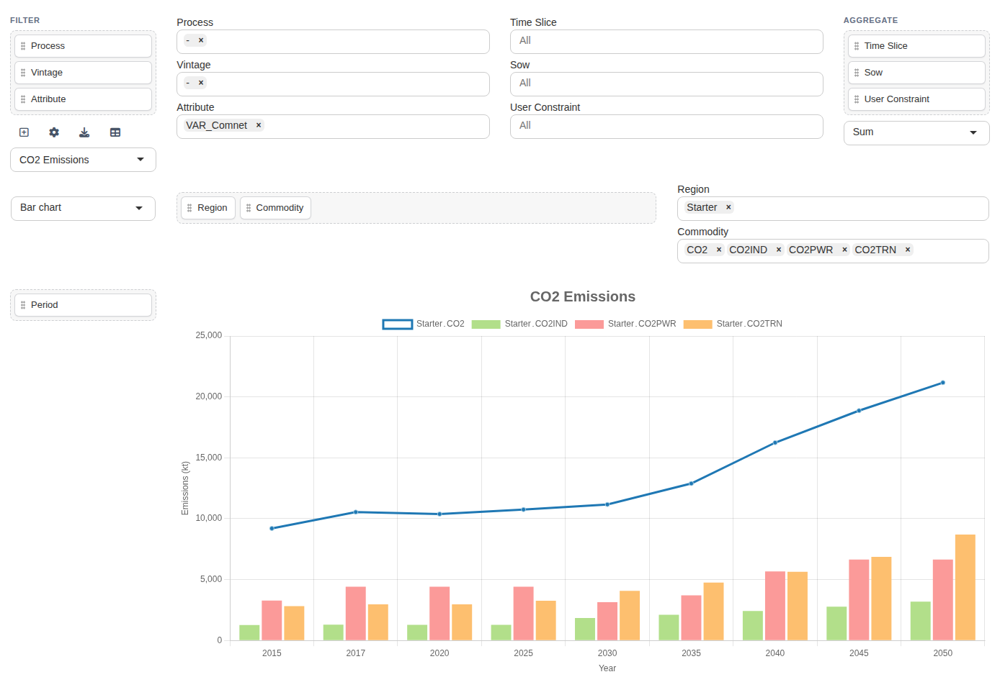

.. _pivot-view:

Pivot Table View
^^^^^^^^^^^^^^^^

The MIRO pivot table renderer offers the ability to store "views," which represent the current configuration of your data. These views can be saved to the database and reloaded alongside the scenario data. One of the key advantages of using views is that they allow you to:

- Save multiple customized representations of your data.

- Eliminate the need for repetitive data slicing and filtering every time you return to the data.

- View the data from different perspectives, enabling a deeper analysis based on specific needs or approaches.

- Quickly access frequently used data filters or specific graph types, which is especially useful when generating result reports or reviewing data in a consistent format.

- Compare and contrast multiple scenarios in the `pivot comparison mode <./start.html#compare-pivot>`__, making it easier to analyze different outcomes.

When you save a scenario, all associated views are saved as well, ensuring that your configurations are preserved. To load a view, simply click the "Load view" button and select the desired view from the list. A slice, or "view" of data can be exported as a PNG or CSV file.

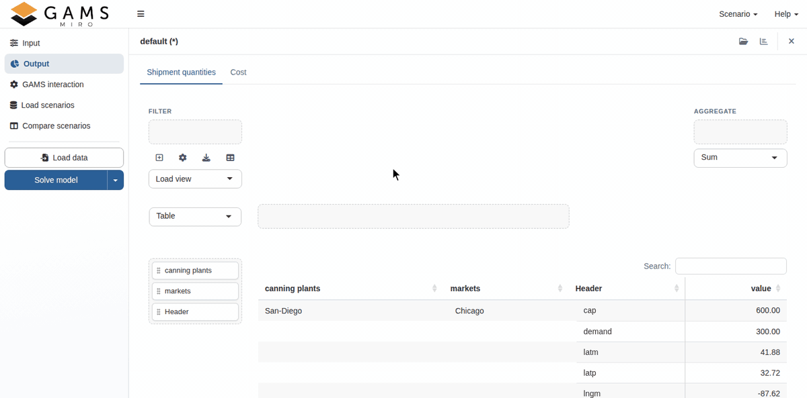

Views can either be bound to a scenario like attachments (*local view*) or registered app-wide (*global view*). Further general information on views can be found `here <./start.html#metadata-views>`__.

.. _pivot-views:

View Settings
^^^^^^^^^^^^^

Before configuring and saving a view, you need to first slice and dice the data - apply filters, set the desired data ranges, and choose the appropriate chart type. Once your data is prepared, click the "New View" button ( |Add view| ). In the opening dialog, you can assign a name to the view. Depending on the selected chart type, further optional settings are available.

- **General**: General settings such as the title displayed above the chart/table and axis labels. The tab also contains chart-specific settings such as showing a line chart as a step plot or grouping stacks by a dimension for stacked bar charts.

- **Axes**: Range limitations for axes, grid settings, axis scaling.

- **Combo chart**: Depending on the base chart type, you can render selected series as a bar/line/scatter chart.

- **Second Axis**: Plot selected series on an additional axis, the settings of which you can make here.

- **Series Styling**: Depending on the chart type, series-specific settings such as custom colours, line dash patterns and border widths can be made here.

.. _series-patterns:

.. admonition:: Tip:
   :class: tip

   In a chart, each series is defined by taking one entry from each dimension in the columns. The labels for these dimensions are concatenated using the "․" character (Unicode U+2024) as a separator. When you use features like combo charts or a secondary axis, you can select which series to show from a dropdown menu containing these concatenated labels.

   .. image:: ../assets/images/pivot_series_select.png
      :alt: Select series in MIRO Pivot Table
      :class: miro-image-responsive

   Beyond these automatically generated series, you can also create custom patterns by adding entries to the dropdown. This makes it possible to apply specific settings to any series that matches a certain subset of the dimension labels. For example, if you define a pattern named ``Topeka``, it will include all series whose labels contain "Topeka", such as ``Seattle.Topeka`` and ``San-Diego.Topeka``.

   .. image:: ../assets/images/pivot_series_select2.png
      :alt: Add series in MIRO Pivot Table
      :class: miro-image-responsive

   Custom series patterns can also be used to set custom chart colors, border widths, and dashed lines. However, note that only automatically generated series are displayed in the pivot tool. For label-specific series styling, you must edit the JSON directly.

When you save the scenario, all your views are automatically stored as well. Load a view by first clicking on the "Load view" button and then selecting which view to load. Note that as soon as the pivot table is changed, e.g. by changing a filter or moving a dimension, all view settings such as title, axis labels, etc. are reset.

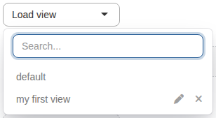

.. admonition:: Tip:
   :class: tip

   Views can either be bound to a scenario or registered app-wide. More on this `here <./start.html#metadata-views>`__.

.. _pivot-settings:

Pivot Table Settings
^^^^^^^^^^^^^^^^^^^^

A click on the settings ( |MIRO Pivot settings button| ) button opens the "Settings" menu. The menu is divided into the sections "General", "Tables" and "Charts". Available settings are:

.. _fixed-columns:

.. _baseline-comparison:

- **General**
  **Hide empty columns**: If enabled, this option allows you to hide empty table columns of the currently visible data. Read more about this option `here <#hide-empty-columns>`__.
  **Number of decimals**: Number of decimal places to be displayed in a chart/table. A negative value implies no rounding. If no value is provided, the `global setting <./configuration_general.html#decimal-places>`__ (default: 2 decimals) is used.
  **Dimension(s) to limit to a single-selection dropdown filter**: The data of each dimension of a pivot table - whether in the rows, columns or in the aggregation - can be filtered. By default, this filter is a multi-choice dropdown menu. This option allows to configure filter dimensions as single-choice dropdown menus.

- **Tables**
  **Table summary**: You can choose between several summary functions - such as sum, count, mean, and more - for both rows and columns. These summary functions allow you to quickly calculate key metrics about your table data.
  **Fix table columns to the left**: If this option is activated, the columns of the pivot table are fixed to the left side of the table and remain visible when scrolling horizontally. Note that this can cause display problems for very wide tables (e.g. with many columns), especially on small screens. For this reason, this option is automatically disabled for screens less than 768 pixels wide.

- **Charts**
  **Font size to use in charts**: Option to change the font size used in all charts of the pivot table.

- **Baseline Comparison**
  **Enable baseline comparison**: Enable this option to analyse every value relative to a user-defined reference.
  After switching the toggle on, pick the *Domain* (the pivot dimension) and the Baseline *record* within that domain; all other records will be compared against it. You may select up to two Comparison *metrics* - relative difference, absolute difference, normalization and/or raw values. In the table cell the **primary metric appears in bold**, followed - inside parentheses - by the secondary metric. Only the primary metric is exported or included in charts. The baseline domain cannot be aggregated: If dragged into the *Aggregate* area, MIRO automatically falls back to raw values and shows an error message.

.. admonition:: Tip:
   :class: tip

   As with the `view settings <./charts.html#pivot-view>`__, the pivot table settings are saved as part of a view and are automatically applied when a corresponding view is selected. However, in contrast to view settings, anything configured in the pivot table settings menu is retained if the pivot table is modified manually. For example, this ensures that configured single-choice dropdowns or specific table summary functions remain intact, even while interacting with the pivot table. The state only changes if the settings are manually adjusted through the settings menu ( |MIRO Pivot settings button| ) or if a different view is selected.

.. _presentation-mode:

Presentation Mode
^^^^^^^^^^^^^^^^^

A click on the |Export Show/hide pivot controls| button toggles the presentation mode, which allows the pivot tool to look like a normal graphic renderer without pivot controls. Only configured views and export buttons remain visible. The presentation mode can be very useful for users who do not want to play around with the data in the pivot tool, but only want to view predefined views/reports. The combination of predefined views and the presentation mode, which can be set as the default display in the Configuration Mode, offers extensive possibilities for data visualization and in-depth analyses.

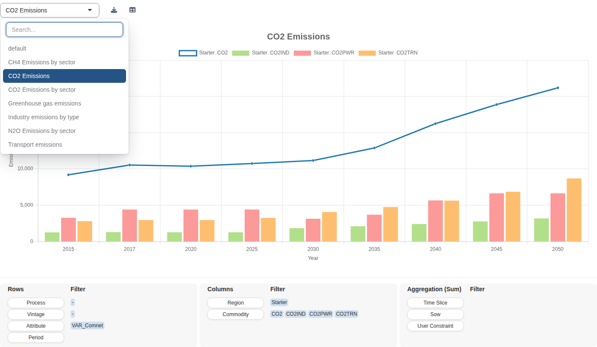

   Pivot tool in presentation mode with predefined views

.. _pivot-default-configuration:

Default Configuration
^^^^^^^^^^^^^^^^^^^^^

You can specify the default view (chart type, settings, etc.) of the pivot table in the Configuration Mode. There are a few `configuration options <#configuration-options>`__ available but unlike other charting tools, you configure most of the MIRO pivot table directly in the preview on the right. For the most comfortable handling, it is advisable to use the preview page across the entire width of the screen by clicking on the switch panel (pie chart symbol) at the top right. Drag and drop the domains where you want them to be, make further `general- <./charts.html#pivot-settings>`__ or `chart-type-specific settings <./charts.html#pivot-view>`__ (optional) and click on "Save". The symbol is loaded in MIRO with the same view that you have set up in the Configuration Mode.

Example: Model *Transport*, parameter *shipment quantities in cases*

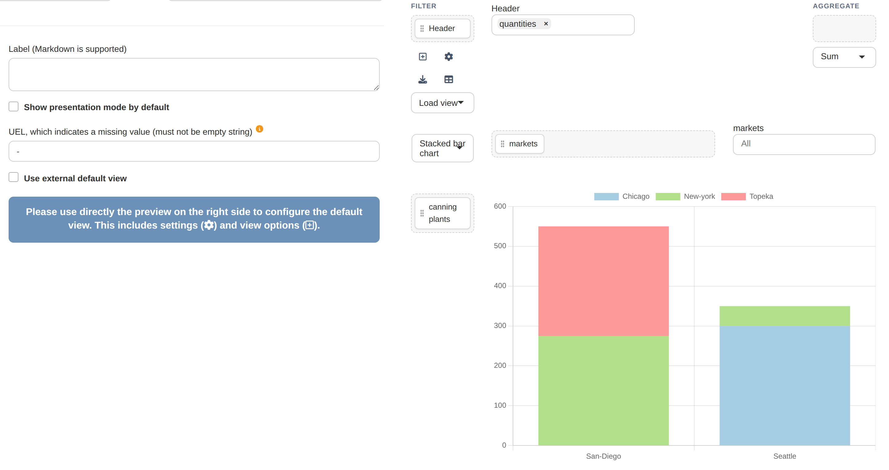

.. _configuration-options:

Configuration Options
"""""""""""""""""""""

.. _presentation-mode-default:

**Show presentation mode by default:**

If this option is enabled, the `presentation mode <#presentation-mode>`__ will be shown per default. The pivot controls can be displayed at any time by clicking on the |Export Show/hide pivot controls| button.

.. _missing-value-uel:

**UEL, which indicates a missing value:**

Data in a pivot table that indicates a missing value. This is needed when you want to `hide empty columns <#hide-empty-columns>`__ in the table.

.. _external-default-view:

**Use external default view:**

If this option is enabled, a scenario-specific or global `view <./start.html#metadata-views>`__ is used as the default view for this symbol. If the specified view does not exist, the default configuration for this symbol is used.

JSON example
^^^^^^^^^^^^

.. code-block:: json

   {
     "dataRendering": {
       "schedule": {
         "height": 700,
         "options": {
             "aggregationFunction": "sum",
             "cols": {
                 "j": null
             },
             "emptyUEL": "-",
             "filter": {
                 "Hdr": "quantities"
             },
             "fixedColumns": true,
             "hideEmptyCols": false,
             "hidePivotControls": true,
             "pivotRenderer": "stackedbar",
             "rows": "i",
             "tableSummarySettings": {
                 "colEnabled": true,
                 "colSummaryFunction": "sum",
                 "rowEnabled": true,
                 "rowSummaryFunction": "sum"
             }
         },
         "outType": "miroPivot"
       }
     }
   }

.. _hide-empty-columns:

**Hide empty columns:**

The switch to hide empty columns in the `settings menu <#pivot-settings>`__ allows to hide *empty* columns in a table. This is especially useful if you use the MIRO Pivot Table for a *data cube*. A *data cube* is a collection of GAMS parameters that are combined to form a large cube. For example, if you have location information in the two parameters: ``ilocData(i,locHdr)`` and ``jlocData(j,locHdr)``, you can combine them into a cube with four dimensions: one dimension to store the name of the GAMS symbols: ``symname`` and the three dimensions ``i``, ``j`` and ``locHdr``. Note that the dimension ``i`` is missing in the parameter ``jlocData`` and vice versa. So we end up with a sparse cube:

.. list-table::
   :header-rows: 1

   * - symname
     - i
     - j
     - locHdr
     - value
   * - ilocData
     - Seattle
     - \-
     - lat
     - 47.61
   * - ilocData
     - Seattle
     - \-
     - lng
     - -122.33
   * - jlocData
     - \-
     - New-York
     - lat
     - 40.73
   * - jlocData
     - \-
     - New-York
     - lng
     - -73.94

You probably noticed that in this example missing dimensions in a symbol are filled with ``-``. But we could have chosen any other UEL to indicate missing values. If you would visualize the data of this parameter with the MIRO Pivot Table, you might not want to see columns containing only ``-``. Therefore, the MIRO Pivot Table has the options to hide these *empty* columns. If enabled, the button to hide/show empty columns is located in the settings |MIRO Pivot settings button| dialog.

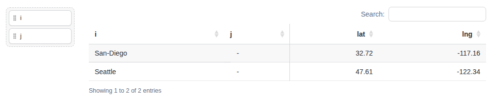

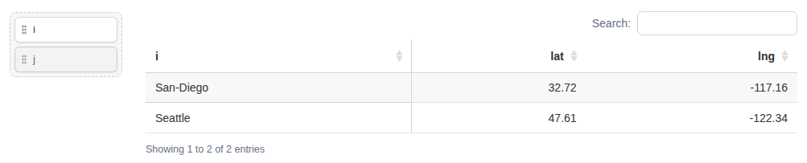

.. _pie-chart:

Pie chart
---------

MIRO uses `Plotly <https://plot.ly/r/pie-charts/>`__ to render pie charts.

.. rubric:: Configuration

Any GAMS symbol with a value column can be displayed as a pie chart.

Example: Model *Pickstock*, parameter *weight*

.. code-block:: gams

   Set         symbol           'stock symbol';
   Variable    w(symbol)        'what part of the portfolio';

   $onExternalOutput
   Parameter   weight(symbol)   'weight of stock';
   $offExternalOutput

   stock_weight(s) = w.l(s);

In a resulting *GDX* this parameter looks as follows:

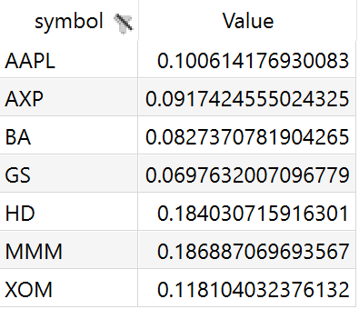

In the Configuration Mode we can then configure a pie chart.

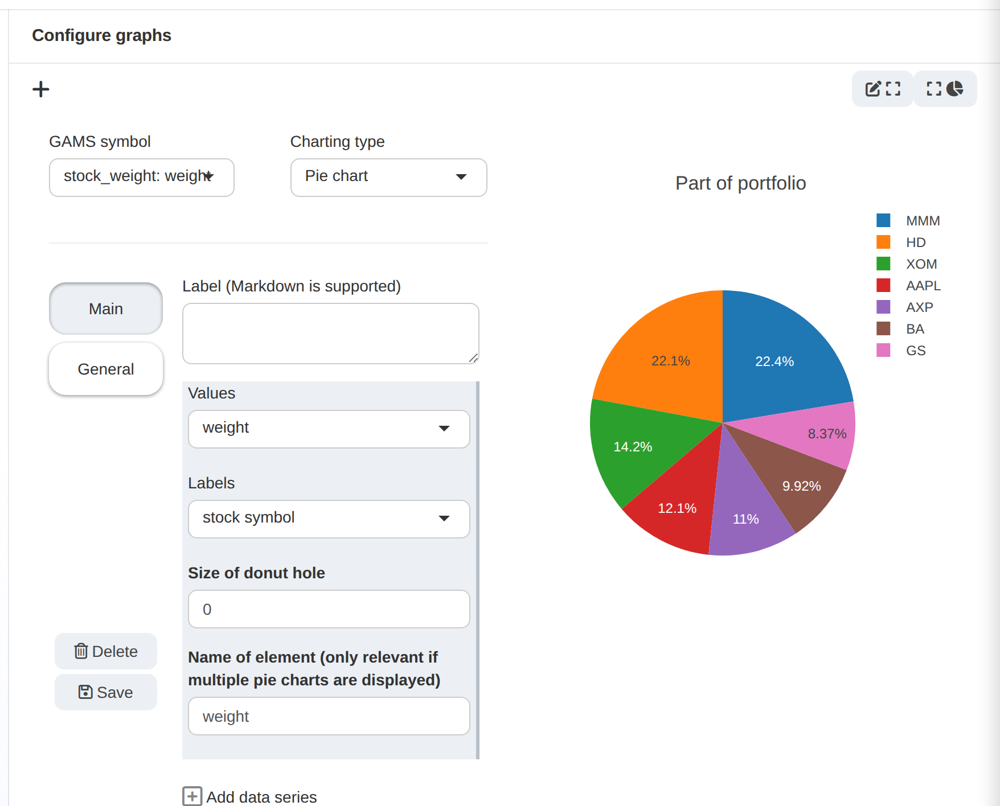

**Note:**

Instead of the parameter *weight*, to which you assign the values of the variable *w*, you could have used a pie chart directly for the levels of variable *w*. However, this variable also contains all the zero values (due to nonzero upper bounds and scale factors) that would then become visible in the pie chart, see below. If you assign the levels of the variable *w* (``w.l(symbol)``) to the parameter *weight* instead, zeros will be squeezed out.

.. _pie-variable:

.. image:: ../assets/images/configuration_mode/pie_variable.png
   :alt: Pie chart with variable
   :class: miro-image-max-height-175pt

.. _multi-pie-chart:

**Multi-pie chart:**

In a pie chart only one dimension, i.e. one column of a table, can be displayed. However, it is possible to display several pie charts for one symbol at the same time. This makes it possible to easily distribute a multidimensional symbol over several pie charts. This is comparable to e.g. a line chart, where new lines can be displayed by including new table headers.

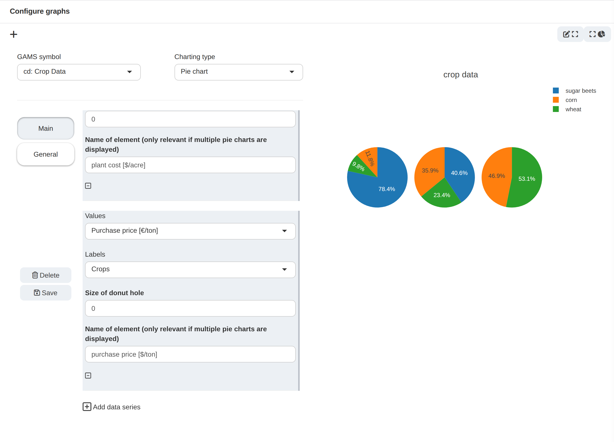

.. rubric:: JSON example

.. code-block:: json

   {
     "dataRendering": {
       "stock_weight": {
         "outType": "dtGraph",
         "graph": {
           "title": "Portfolio composition",
           "tool": "plotly",
           "type": "pie",
           "traces": {
             "1": {
               "labels": "symbol",
               "values": "value",
               "hole": 0,
               "name": "weight"
             }
           },
           "showlegend": true,
           "staticPlot": false
         },
         "height": 700
       }
     }
   }

.. _donut-chart:

Donut chart
-----------

MIRO uses `Plotly <https://plot.ly/r/pie-charts/#donut-chart>`__ to render donut charts.

.. rubric:: Configuration

A donut chart is a pie chart with a "hole". In the Configuration Mode the donut chart is therefore to be found under *pie chart*. In addition to a standard pie chart, only the size of the donut "hole" can be configured.

Example: Model *Pickstock*, parameter *weight*

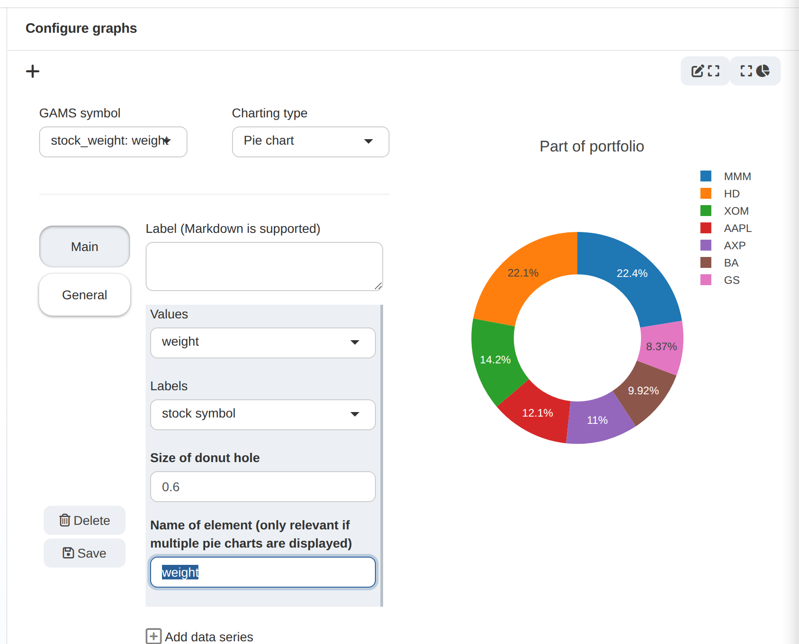

.. rubric:: JSON example

.. code-block:: json

   {
     "dataRendering": {
       "stock_weight": {
         "outType": "dtGraph",
         "graph": {
           "title": "Portfolio composition",
           "tool": "plotly",
           "type": "pie",
           "traces": {
             "1": {
               "labels": "symbol",
               "values": "value",
               "hole": 0.6,
               "name": "weight"
             }
           },
           "showlegend": true,
           "staticPlot": false
         },
         "height": 700
       }
     }
   }

.. _bar-chart:

Bar chart
---------

MIRO uses `Plotly <https://plot.ly/r/bar-charts/>`__ to render bar charts.

.. rubric:: Configuration

If a symbol is to be visualized as a bar chart, an index must be specified for the x-axis as well as for the y-axis. Several data series can be plotted together on the x-axis.

Example: Model *Pickstock*, parameter *weight*

.. code-block:: gams

   Set         symbol           'stock symbol';
   Variable    w(symbol)        'what part of the portfolio';

   $onExternalOutput
   Parameter   weight(symbol)   'weight of stock';
   $offExternalOutput

   stock_weight(s) = w.l(s);

In a resulting *GDX* this parameter looks as follows:

In the Configuration Mode we then can configure a bar chart.

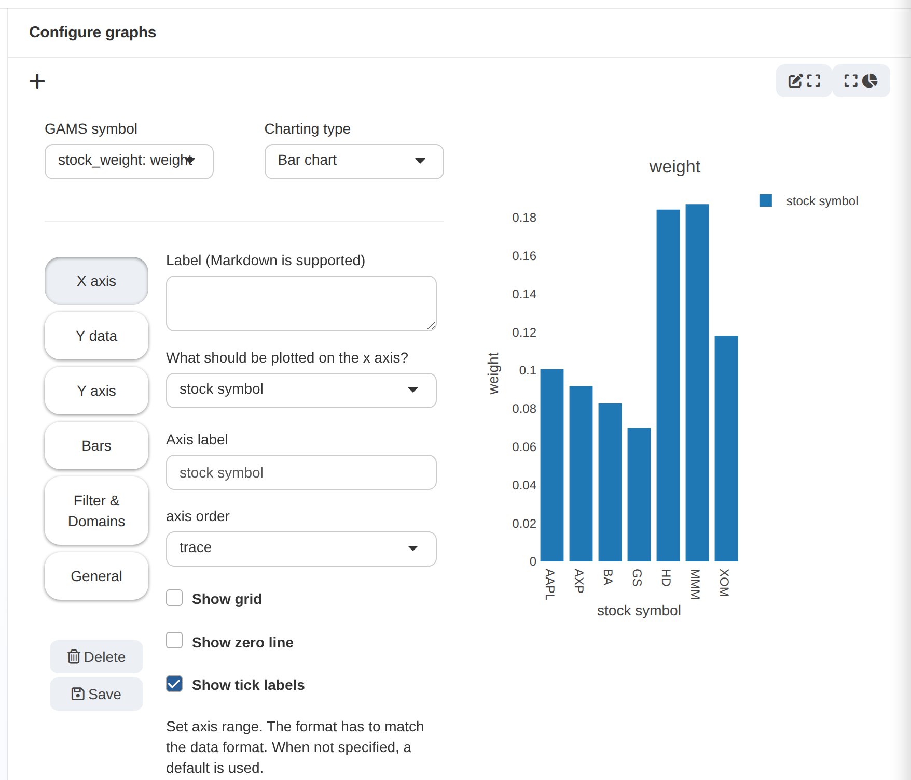

**Note:**

Instead of the parameter *weight*, to which you assign the values of the variable *w*, you could have used a bar chart directly for the levels of variable *w*. However, this variable also contains all the zero values that would then become visible in the chart, see the `pie chart example <#pie-variable>`__.

.. rubric:: JSON example

.. code-block:: json

   {
     "dataRendering": {
       "stock_weight": {
         "outType": "graph",
         "graph": {
           "title": "Portfolio composition",
           "tool": "plotly",
           "type": "bar",
           "barmode": "group",
           "ydata": {
             "value": {
               "label": "weight",
               "mode": "lines",
               "marker": {
                 "line": {
                   "width": 0
                 },
                 "color": "#ed0652"
               }
             }
           },
           "xdata": "symbol",
           "showlegend": false,
           "xaxis": {
             "title": "stock symbol",
             "showgrid": false,
             "zeroline": false,
             "showticklabels": true,
             "categoryorder": "trace"
           },
           "yaxis": {
             "title": "weight",
             "showgrid": false,
             "zeroline": false,
             "showticklabels": true,
             "categoryorder": "trace"
           }
         },
         "height": 700
       }
   }

.. _scatter-chart:

Scatter plot
------------

MIRO uses `Plotly <https://plot.ly/r/line-and-scatter/>`__ to render scatter plots.

.. rubric:: Configuration

Example: Model *Pickstock*, parameter *absolute error*

The parameter to plot represents the absolute errors in the training phase.

We define a parameter ``abserror(td, 'absolute error train')`` (last row), to which we assign the values of the parameter ``error(d)``, but only those values where ``ord(d) <= trainingdays``.

.. code-block:: gams

   Set         date           'date';
   Parameter   error(date)    'Absolute error';

   td(d)     = ord(d) <= trainingdays;
   ntd(d)    = not td(d);

   solve pickStock min obj using mip;

   error(d)  = abs(index(d)-fund(d));

   Set errHdr    'stock symbol header'    / 'absolute error train', 'absolute error test' /;

   $onExternalOutput
   Table abserror(date,errHdr)          'absolute error';
   $offExternalOutput

   abserror(td, 'absolute error train')   = error(td);
   abserror(ntd,'absolute error test')    = error(ntd);

In a resulting *GDX* this parameter looks as follows:

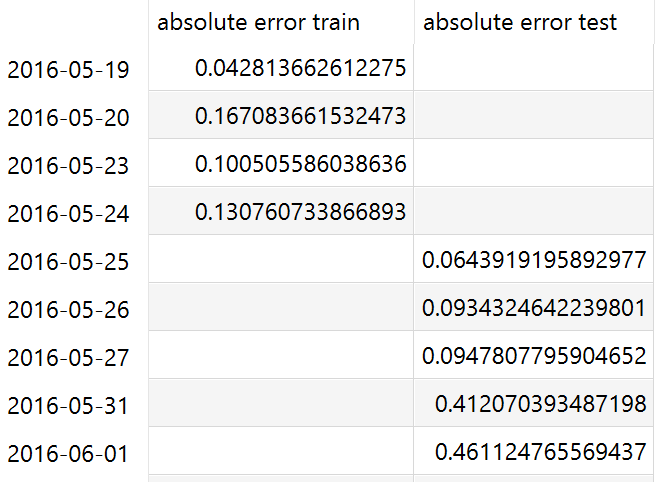

In the Configuration Mode we then can configure a scatter plot.

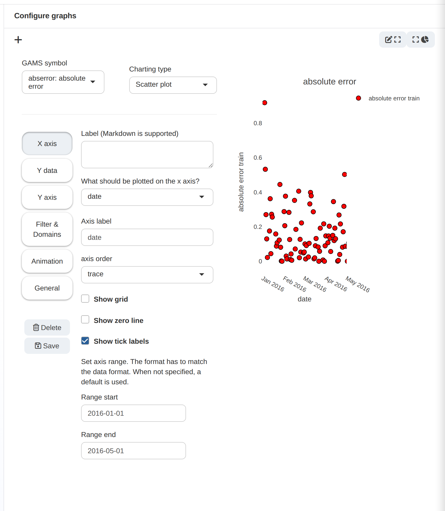

.. rubric:: JSON example

.. code-block:: json

   {
     "dataRendering": {
       "abserror": {
         "outType": "graph",
         "graph": {
           "title": "Absolute error",
           "tool": "plotly",
           "type": "scatter",
           "ydata": {
             "absolute error train": {
               "label": "absolute error train",
               "mode": "markers",
               "fill": "none",
               "marker": {
                 "symbol": "circle",
                 "opacity": 1,
                 "size": "12",
                 "line": {
                   "width": "2",
                   "color": "#000000"
                 },
                 "color": "#ff0000"
               },
               "showlegend": false
             }
           },
           "xdata": "date",
           "showlegend": true,
           "xaxis": {
             "title": "date",
             "showgrid": false,
             "zeroline": false,
             "showticklabels": true,
             "categoryorder": "trace",
             "rangefrom": "2016-01-01",
             "rangeto": "2016-05-01"
           },
           "yaxis": {
             "title": "absolute error train",
             "showgrid": false,
             "zeroline": false,
             "showticklabels": true,
             "categoryorder": "trace"
           }
         },
         "height": 700
       }
     }
   }

.. _line-chart:

Line chart
----------

MIRO uses `Plotly <https://plot.ly/r/line-and-scatter/>`__ to render line charts.

.. rubric:: Configuration

Line charts also include area charts.

Example: Model *Pickstock*, parameter *absolute error*

For an example in GAMS, see the `scatter plot example <#scatter-chart>`__.

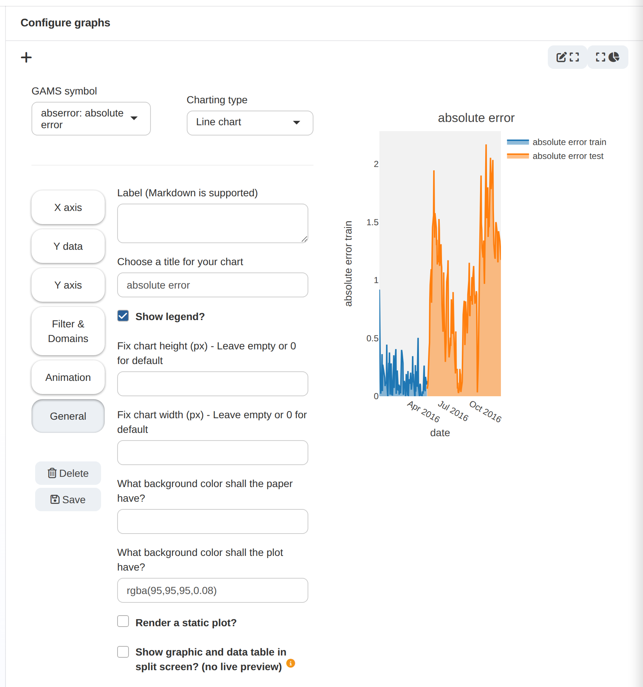

.. rubric:: JSON example

.. code-block:: json

   {
     "dataRendering": {
       "abserror": {
         "outType": "graph",
         "graph": {
           "title": "Absolute error",
           "tool": "plotly",
           "type": "scatter",
           "ydata": {
             "absolute error train": {
               "label": "absolute error train",
               "mode": "lines",
               "line": {
                 "width": 2,
                 "shape": "linear",
                 "dash": "solid"
               },
               "showlegend": false,
               "fill": "tozeroy"
             },
             "absolute error test": {
               "label": "absolute error test",
               "mode": "lines",
               "line": {
                 "width": 2,
                 "shape": "linear",
                 "dash": "solid"
               },
               "showlegend": false,
               "fill": "tozeroy"
             }
           },
           "xdata": "date",
           "showlegend": true,
           "xaxis": {
             "title": "date",
             "showgrid": false,
             "zeroline": false,
             "showticklabels": true,
             "categoryorder": "trace"
           },
           "yaxis": {
             "title": "absolute error train",
             "showgrid": false,
             "zeroline": false,
             "showticklabels": true,
             "categoryorder": "trace"
           },
           "plot_bgcolor": "rgba(95,95,95,0.08)"
         },
         "height": 700
       }
     }
   }

.. _bubble-chart:

Bubble chart
------------

MIRO uses `Plotly <https://plot.ly/r/bubble-charts/>`__ to render bubble charts.

.. rubric:: Configuration

A bubble chart is a scatter diagram with an additional dimension in the form of the size of the "bubbles".

Example: Model *Pickstock*, parameter *absolute error*

For an example in GAMS, see the `scatter plot example <#scatter-chart>`__.

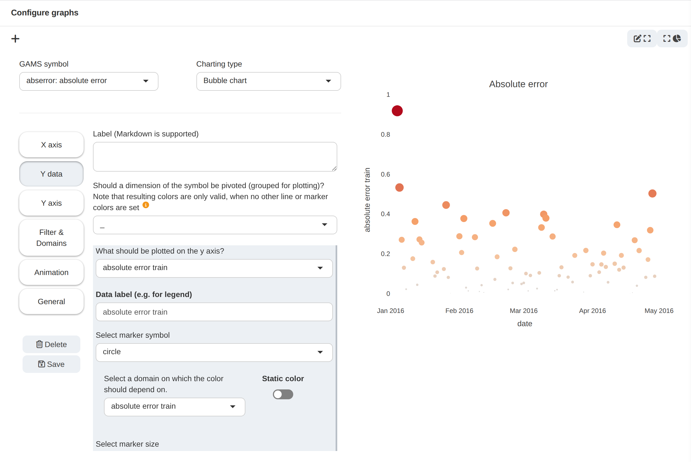

.. rubric:: JSON example

.. code-block:: json

   {
     "dataRendering": {
       "abserror": {
         "outType": "graph",
         "graph": {
           "title": "Absolute error",
           "tool": "plotly",
           "type": "bubble",
           "ydata": {
             "absolute error train": {
               "label": "absolute error train",
               "mode": "markers",
               "marker": {
                 "symbol": "circle",
                 "opacity": 1,
                 "size": "absolute error train",
                 "color": "absolute error train",
                 "line": {
                   "width": 0
                 },
                 "maxsize": 20
               },
               "showlegend": false
             }
           },
           "xdata": "date",
           "showlegend": false,
           "xaxis": {
             "title": "date",
             "showgrid": false,
             "zeroline": false,
             "showticklabels": true,
             "categoryorder": "trace",
             "rangefrom": "2016-01-01",
             "rangeto": "2016-05-01"
           },
           "yaxis": {
             "title": "absolute error train",
             "showgrid": false,
             "zeroline": false,
             "showticklabels": true,
             "categoryorder": "trace"
           }
         },
         "height": 700
       }
     }
   }

.. _histogram-chart:

Histogram
---------

MIRO uses `Plotly <https://plot.ly/r/histograms/>`__ to render histograms.

.. rubric:: Configuration

Example: Model *Pickstock*, parameter *absolute error*

For an example in GAMS, see the `scatter plot example <#scatter-chart>`__.

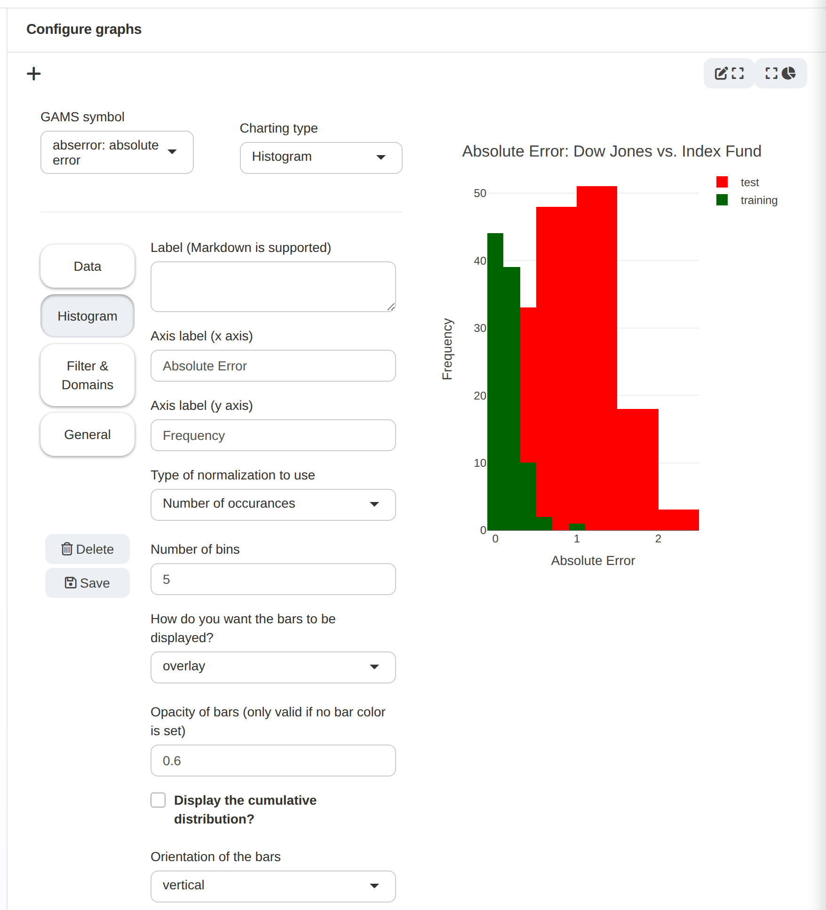

.. rubric:: JSON example

.. code-block:: json

   {
     "dataRendering": {
       "abserror": {
         "outType": "graph",
         "graph": {
           "title": "Absolute error",
           "tool": "plotly",
           "type": "hist",
           "xdata": {
             "absolute error train": {
               "labels": "absolute error train",
               "color": "rgba(40,181,35,0.73)"
             },
             "absolute error test": {
               "labels": "absolute error test",
               "color": "rgba(255,0,0,0.62)"
             }
           },
           "histnorm": "",
           "nbins": 5,
           "barmode": "overlay",
           "alpha": 0.6,
           "xaxis": {
             "title": "absolute error train"
           },
           "cumulative": false,
           "horizontal": false,
           "yaxis": {
             "title": "Frequency"
           },
           "showlegend": true
         },
         "height": 700
       }
     }
   }

.. _map-chart:

Map
---

MIRO uses `Leaflet <https://rstudio.github.io/leaflet/>`__ to render maps.

.. rubric:: Configuration

Example: Model *Transport*, parameter *shipment quantities in cases*

The parameter to plot represents the shipment quantities between canning plants and markets.

.. code-block:: gams

   Set
       i           'canning plants'
       j           'markets'
       scheduleHdr 'schedule header' / 'lngP', 'latP', 'lngM', 'latM', 'cap', 'demand', 'quantities' /;

   $onExternalOutput
   Table  schedule(i,j,scheduleHdr) 'shipment quantities in cases';
   $offExternalOutput

   schedule(i,j, 'lngP')       = iLocData(i,'lng');
   schedule(i,j, 'latP')       = iLocData(i,'lat');
   schedule(i,j, 'lngM')       = jLocData(j,'lng');
   schedule(i,j, 'latM')       = jLocData(j,'lat');
   schedule(i,j, 'cap')        = a(i);
   schedule(i,j, 'demand')     = b(j);
   schedule(i,j, 'quantities') = x.l(i,j);

To be able to set markers on a map, the map tool requires latitude and longitude information. By declaring the parameter ``schedule`` as a ``table``, the elements of the last index set ``scheduleHdr`` (``lngP, latP, lngM, latM, cap, demand, quantities``) can be used for the map configuration. You can find a detailed example `here <./model.html#table-miro>`__.

In a resulting *GDX* this parameter looks as follows:

.. _map-data:

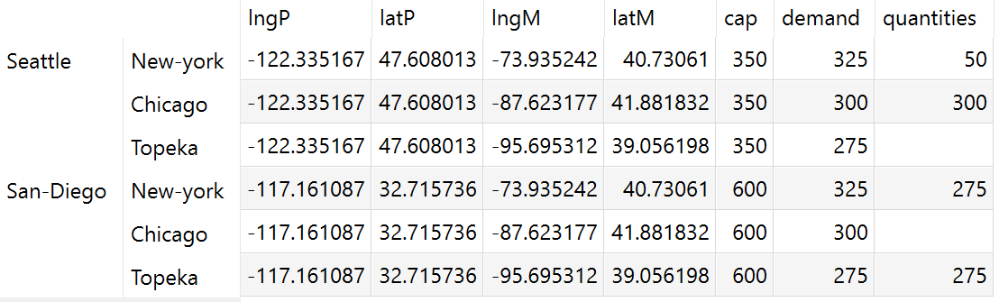

In the Configuration Mode we then can configure a map.

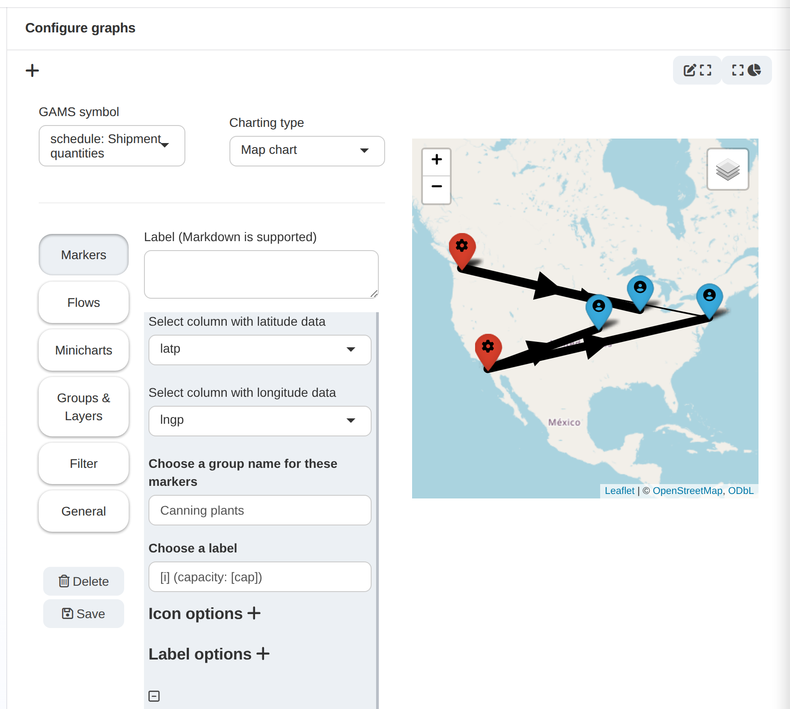

.. admonition:: Tip:
   :class: tip

   Instead of a table with the geographic information in the header, we can also use a parameter or even a set that contains all latitude and longitude information in separate domains:

   .. code-block:: gams

      $onExternalOutput
      Parameter schedule(i,j,latP, lngP, latM, lngM) 'shipment quantities in cases';
      $offExternalOutput

      schedule('Seattle',  'New-York', '47.608013', '-122.335167', '40.730610', '-73.935242') = 50;
      schedule('Seattle',  'Chicago',  '47.608013', '-122.335167', '41.881832', '-87.623177') = 300;
      schedule('San-Diego','New-York', '32.715736', '-117.161087', '40.730610', '-73.935242') = 275;
      schedule('San-Diego','Topeka',   '32.715736', '-117.161087', '39.056198', '-95.695312') = 275;

   The geographic information is then no longer available in numerical form, but the map tool interprets the data properly.

With regard to map-based graphics, a multitude of possible visualizations are conceivable. In the Configuration Mode of MIRO, the following features can be realized on a map:

.. _unique-flow-label:

- **Markers**
  Markers can be set. For this purpose, the position of the markers must be available in the data as longitude and latitude information (see `table above <#map-data>`__). Marker labels can be set dynamically, i.e. based on data. In the following example, the marker label is set to *Market: [j]*. If you now click on a marker on the resulting map, the label will not be *Market: [j]*. Instead, the *[j]* is replaced with the element of the GAMS index set belonging to the marker (here: *Chicago*).

  .. image:: ../assets/images/configuration_mode/map_markers.png
     :alt: Map markers
     :class: miro-image-responsive

  The second index of the symbol *schedule* contains the markets *j*. The indices *lngM* and *latM* were selected as longitude and latitude data. For a given longitude-latitude combination, the corresponding element from the second index *j* is now displayed as label.

- **Flows**
  Flows can be displayed between different points on the map. If configured accordingly, the thickness of the arrows can depend on the flow data. The data overview from the `table above <#map-data>`__ also helps to understand this: In the example below the flows have been configured to point from *lngP*/*latP* to *lngM*/*latM*. The thickness depends on the data in the column *quantities*.

  .. admonition:: Note:
     :class: warning

     Flows cannot be configured for sets, since numeric values are required for the flow data.

  .. image:: ../assets/images/configuration_mode/map_flows.png
     :alt: Map flows
     :class: miro-image-responsive

  **Unique flow labels**:

  When configuring flows, you can optionally specify a unique label for each flow. This label appears when you click on a flow. It is important that the label is different for each flow. If this is not the case, only one flow is displayed for each duplicated label. A suitable configuration for a label is to specify the originator and the recipient for each flow. You can achieve this by using the square brackets syntax to address the symbol/data domains. In the example above the symbol *schedule* is used to display a map:

  .. code-block:: gams

     Set
         i           'canning plants'
         j           'markets'
         scheduleHdr 'schedule header' / 'lngP', 'latP', 'lngM', 'latM', 'cap', 'demand', 'quantities' /;

     $onExternalOutput
     Table  schedule(i,j,scheduleHdr) 'shipment quantities in cases';
     $offExternalOutput

  Originator and recipient in this case are the domains *i* and *j* of the symbol *schedule*. If you configure the label as follows: ``From [i] to [j]`` - then the originator and recipient cities appear as labels for each arrow:

  .. image:: ../assets/images/configuration_mode/map_flows_label.png
     :alt: Unique label
     :class: miro-image-responsive

- **Charts**
  You can display small diagrams on your map. The following example shows a pie chart for each of the 16 German states.

  Example: Model *Simple* (see `GAMS MIRO gallery <https://miro.gams.com>`__), parameter *energy mix report*

  .. image:: ../assets/images/configuration_mode/map_charts.png
     :alt: Map charts
     :class: miro-image-responsive

  The graph is based on the data below:

  .. image:: ../assets/images/configuration_mode/map_charts2.png
     :alt: Map charts data
     :class: miro-image-max-height-350pt

  The position of each pie chart results from a longitude/latitude combination. The data of the pie chart for each state were determined in Configuration Mode with *Renewable* and *Fossil*.
  You also have the option to define a time dimension in the charts. The data of the example covers a period of one year with a resolution of one hour. The first column was defined as the time dimension (starting with *t001*. In this way, a separate pie chart is displayed for each period for each state (see play button at the bottom right of the map).

  .. admonition:: Note:
     :class: warning

     Charts on maps cannot be configured for sets, because numeric values are required for the chart data.

  **Note** that all data of your entire graph must come from the same GAMS symbol. If you want to have more sophisticated graphics, it may make sense to combine data from different symbols in one symbol. Or you can use our `R API <./configuration_advanced.html#custom-renderers>`__ and create your own graphics.

**Layers**

For map visualizations it can be helpful to display different layers, e.g. with markers. In Configuration Mode you can specify such layers. In the resulting graphic you can select the different layers and display only the corresponding markers.

Example: Model *Transport*, parameter *shipment quantities in cases*

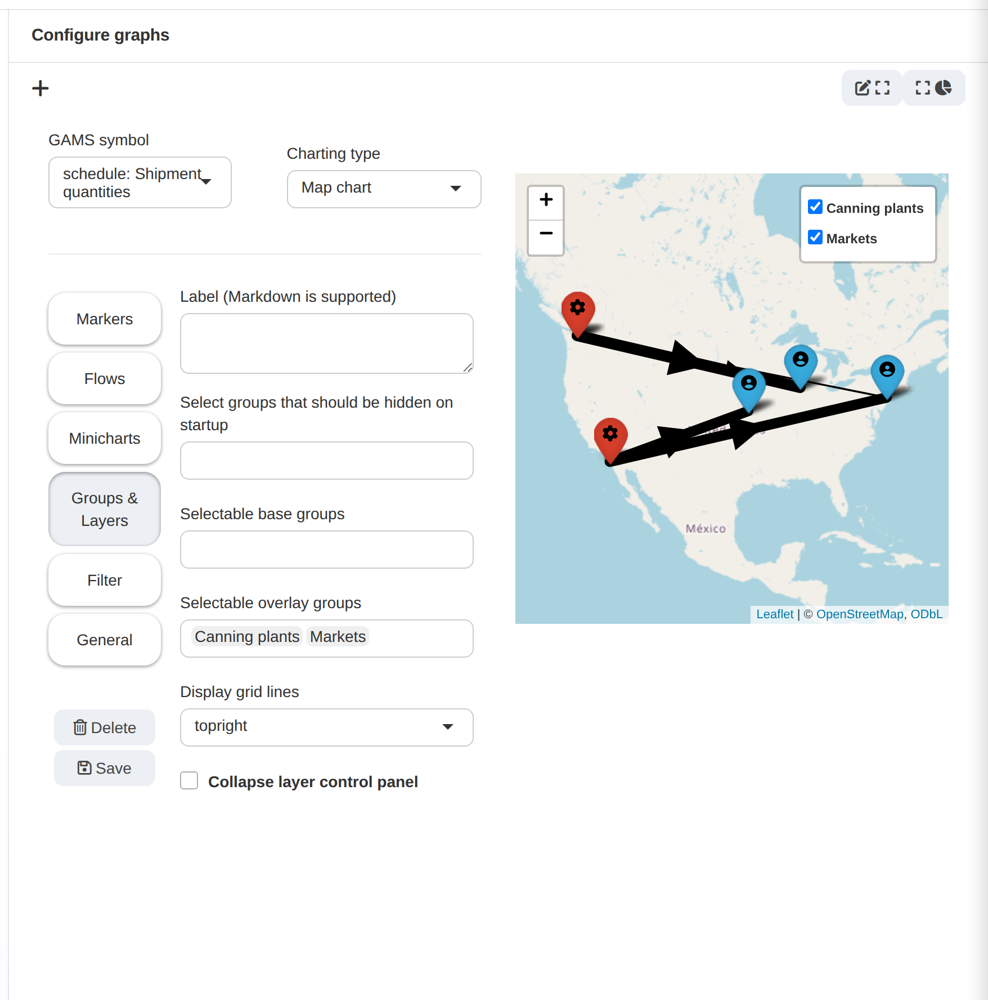

.. rubric:: JSON example

.. code-block:: json

   {
     "dataRendering": {
       "schedule": {
         "outType": "graph",
         "graph": {
           "title": "shipment quantities in cases",
           "tool": "leaflet",
           "layersControl": {
             "options": {
               "collapsed": true
             },
             "position": "topright",
             "baseGroups": ["plants", "markets"]
           },
           "markers": {
             "1": {
               "lng": "lngp",
               "lat": "latp",
               "labelOptions": {
                 "textsize": "12px",
                 "permanent": false
               },
               "label": "Plant [i]",
               "group": "plants"
             },
             "2": {
               "lng": "lngm",
               "lat": "latm",
               "labelOptions": {
                 "textsize": "12px",
                 "permanent": false
               },
               "label": "Market [j]",
               "group": "markets"
             }
           },
           "flows": {
             "1": {
               "lng0": "lngp",
               "lat0": "latp",
               "lng1": "lngm",
               "lat1": "latm",
               "flow": "quantities",
               "color": "#0000ff",
               "minThickness": 1,
               "maxThickness": 10
             }
           }
         },
         "height": 700
       }
     }
   }

.. _timeseries-chart:

Time series diagram
-------------------

MIRO uses `DyGraphs <https://rstudio.github.io/dygraphs/>`__ to render time series diagrams.

.. rubric:: Configuration

As the name of the graphic type suggests, this chart type is useful if you want to visualize time series data. An important property of such time series is the format of the data. You should make sure that the elements of the index set, which should represent the time component of your graphic, have their data available in a date format or at least can be formatted into such a format. A suitable syntax for a date would be *yyyy-MM-dd*, e.g. *2014-07-13*. For a finer granularity, the format *yyyy-MM-dd HH:mm:ss* is recommended.

Example: Model *Pickstock*, parameter *dow jones vs. index fund*

.. code-block:: gams

   Set date      'date'
       fHdr      'fund header'   / dj 'dow jones','index fund'  /;

   $onExternalOutput
   Table   dowVSindex(date,fHdr)  'dow jones vs. index fund';
   $offExternalOutput

   dowVSindex(d,'dj')             = index(d);
   dowVSindex(d,'index fund')     = fund(d);

The index set *date* looks as follows:

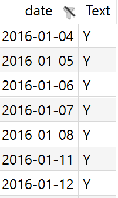

The parameter *dowVSindex*:

.. image:: ../assets/images/configuration_mode/timeseries_data.png
   :alt: Time series diagram data
   :class: miro-image-max-height-140pt

In the Configuration Mode we then can configure a time series diagram:

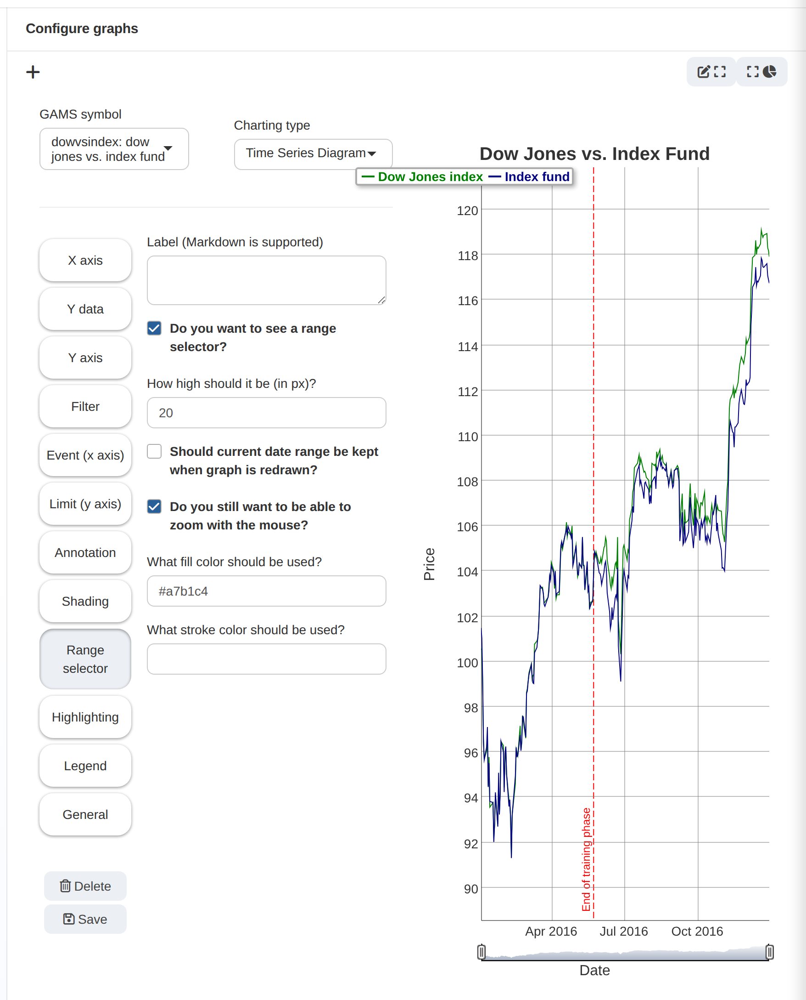

The picture in this example shows a red dotted vertical line showing the "last day of training phase". A scalar output value has been integrated into the graph to define this event.

**Note:** To use such a scalar in the graphic, MIRO must of course know this symbol. You therefore need to tag it with ``$onExternalInput`` / ``$offExternalInput`` or ``$onExternalOutput`` / ``$offExternalOutput`` in the GAMS model.

.. admonition:: Tip:
   :class: tip

   You want to use a scalar value in a graph but not in the scalars table in MIRO? You can do this by `hiding that symbol <./configuration_symbols.html#hidden-scalars>`__.

The tool for creating time series diagrams supports the integration of static or dynamic scalar values. A static value could show a limit in the data in the form of a horizontal line. A dynamic scalar can be a date which results from the model calculations (i.e. output scalar) and is displayed in the graphic as an vertical event line.

.. admonition:: Note:
   :class: warning

   Dynamic scalar values can only be displayed in graphics of output symbols!

The following options are available:

- **Event line**

  .. figure:: ../assets/images/configuration_mode/timeseries_event.png
     :alt: Vertical event
     :class: miro-image-responsive

     1 symbol with the event date, 2 label, 3 label position, 4 line color, 5 stroke pattern, 6 resulting event line.

- **Limit line**

  .. figure:: ../assets/images/configuration_mode/timeseries_limit.png
     :alt: Horizontal line
     :class: miro-image-responsive

     1 limit value, 2 label, 3 label position, 4 line color, 5 stroke pattern, 6 resulting limit line.

- **Annotation**

  .. figure:: ../assets/images/configuration_mode/timeseries_annotation.png
     :alt: Annotation
     :class: miro-image-responsive

     1 symbol to annotate, 2 label, 3 tooltip, 4 width and height, 5 attach to x axis, 6 resulting annotation.

- **Shading**

  .. figure:: ../assets/images/configuration_mode/timeseries_shading.png
     :alt: Shading
     :class: miro-image-responsive

     1 lower bound, 2 upper bound, 3 axis, 4 shading color, 5 resulting shaded area.

.. rubric:: JSON example

.. code-block:: json

   {
     "dataRendering": {
       "dowvsindex": {
         "outType": "graph",
         "graph": {
           "title": "Dow Jones vs. Index fund",
           "tool": "dygraphs",
           "xdata": "date",
           "ydata": {
             "dj": {
               "label": "dow jones",
               "stemPlot": false,
               "stepPlot": false,
               "fillGraph": false,
               "drawPoints": false,
               "pointShape": "dot",
               "pointSize": 2
             },
             "index fund": {
               "label": "index fund",
               "stemPlot": false,
               "stepPlot": false,
               "fillGraph": false,
               "drawPoints": false,
               "pointShape": "dot",
               "pointSize": 2
             }
           },
           "dyOptions": {
             "includeZero": false,
             "logscale": false,
             "drawGrid": true,
             "stepPlot": false,
             "stemPlot": false,
             "fillGraph": false,
             "fillAlpha": 0.15,
             "drawPoints": false,
             "pointShape": "dot",
             "pointSize": 2
           },
           "dyHighlight": {
             "highlightCircleSize": 3,
             "highlightSeriesBackgroundAlpha": 0.5,
             "hideOnMouseOut": true
           },
           "xaxis": {
             "title": "date"
           },
           "yaxis": {
             "title": "dow jones"
           },
           "dyRangeSelector": {
             "height": 30,
             "strokeColor": "#808fab",
             "fillColor": "#a7b1c4",
             "retainDateWindow": false,
             "keepMouseZoom": true
           },
           "dyEvent": {
             "lastdaytraining": {
               "labelLoc": "top",
               "color": "rgb(255,0,0)",
               "strokePattern": "dashed",
               "label": "last day of training phase"
             }
           }
         },
         "height": 700
       }
     }
   }

.. _gantt-chart:

Gantt chart
-----------

MIRO uses `timevis <https://github.com/daattali/timevis>`__ to render gantt charts.

.. rubric:: Configuration

The GAMS symbol whose data is to be visualized as a Gantt chart must contain the following index sets:

- Start
  Each event must have a start date. The GAMS elements of this set must be in date format, e.g. *yyyy-mm-dd hh:mm:ss* (*hh:mm:ss* is not required).

- Content
  Each event must have a content which is then shown as a label. The GAMS elements of the underlying set can be of any format.

Optional index sets of the GAMS Symbol:

- End
  If an event is not a single point in time, but rather a range, you can specify an end date. The GAMS elements of this set must be in date format.

- Title
  A title is shown when you hover over an item. The GAMS elements of this set can be of any format.

- Group
  When a group variable is specified, elements of the same group are grouped together. The GAMS elements of this set can be of any format.

.. admonition:: Note:
   :class: warning

   The index sets of the GAMS symbol do not have to be named *start*, *end*, *content* etc. Only the mapping you define in the Configuration Mode is relevant.

As an example we use a GAMS Parameter *gantt* with index sets *id*, *start*, *end*, *content* and *group*:

.. code-block:: gams

   Set
      id       'gannt_id'      / 1, 2, 3, 4, 5, 6 /
      start    'gannt_start'   / '2016-01-04 10:00:00', '2016-01-05 10:30:00', '2016-01-06 10:50:00', '2016-01-07 14:00:00', '2016-01-08 14:45:00', '2016-01-09 19:00:00' /
      end      'gannt_end'     / '2016-01-05 10:00:00', '2016-01-06 10:30:00', '2016-01-07 10:50:00', '2016-01-08 14:00:00', '2016-01-09 14:45:00', '2016-01-10 19:00:00' /
      content  'gannt_content' / test1, test2, test3, test4, test5, test6 /
      group    'gantt_group'   / a, b /
      ;

   $onExternalOutput
   Parameter gantt(id, start, end, content, group) 'Gantt chart parameter' ;
   $offExternalOutput

   gantt('1', '2016-01-04 10:00:00', '2016-01-05 10:00:00', 'test1', 'a') = 1;
   gantt('2', '2016-01-05 10:30:00', '2016-01-06 10:30:00', 'test2', 'a') = 1;
   gantt('3', '2016-01-06 10:50:00', '2016-01-07 10:50:00', 'test3', 'a') = 1;
   gantt('4', '2016-01-07 14:00:00', '2016-01-08 14:00:00', 'test4', 'b') = 1;
   gantt('5', '2016-01-08 14:45:00', '2016-01-09 14:45:00', 'test5', 'b') = 1;
   gantt('6', '2016-01-09 19:00:00', '2016-01-10 19:00:00', 'test6', 'b') = 1;

In a resulting *GDX* this parameter looks as follows:

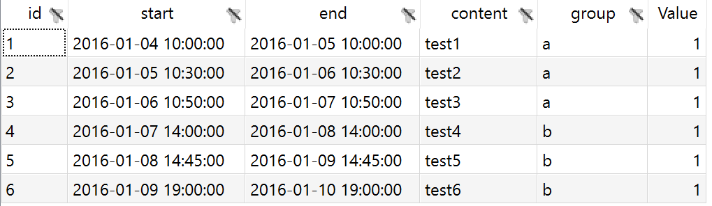

In the Configuration Mode we can then configure a Gantt chart.

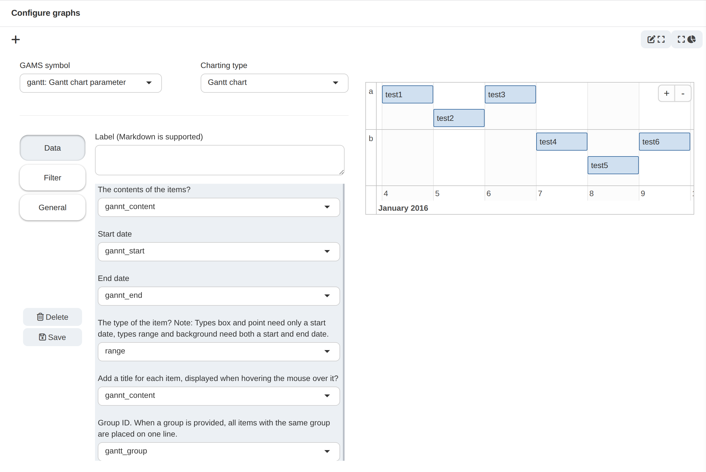

More information on the tool we use for Gantt charts can be found `here <https://github.com/daattali/timevis>`__.

.. rubric:: JSON example

.. code-block:: json

   {
     "dataRendering": {
       "gantt": {
         "outType": "graph",
         "graph": {
           "title": "",
           "tool": "timevis",
           "showZoom": true,
           "fit": true,
           "zoomFactor": 0.5,
           "series": {
             "1": {
               "content": "content",
               "start": "start",
               "type": "range",
               "end": "end",
               "title": "content",
               "group": "group",
               "groupTitle": "group"
             }
           },
           "editable": false,
           "multiselect": false,
           "showCurrentTime": false
         },
         "height": 700
       }
     }
   }

.. _valuebox:

Value box
---------

.. rubric:: Configuration

Example: Model *Pickstock*, scalars *error_train*, *error_test* and *error_ratio*, singleton sets *firstDayTraining* and *lastDayTraining*

Value boxes are special in the sense that only scalar output values (including singleton sets declared as output data) can be displayed as such. The other way around, scalar output values can only be visualized as value boxes in addition to the classic table.

The three scalars to plot represent the absolute error in the entire training phase, the absolute error in the entire testing phase and the ratio between both values.

The scalar ``error_train`` is equivalent to the objective function value ``obj.l``. The absolute error in entire testing phase ``error_test`` is the sum of all errors in this time: ``sum(ntd, error(ntd))``. The ratio of both values is calculated with ``error_ratio = error_test/error_train;``.

In addition to these numerical values, two singleton sets are used to indicate the dates of the beginning and end of the training period.

.. code-block:: gams

   $onExternalOutput
   Scalar error_train                     'Absolute error in entire training phase'
          error_test                      'Absolute error in entire testing phase'
          error_ratio                     'Ratio between error test and error train';

   Singleton Set
          firstDayTraining(date)          'first date of training period'
          lastDayTraining(date)           'last date of training period';
   $offExternalOutput

   error_train                            = obj.l;
   error_test                             = sum(ntd, error(ntd));
   if(error_train > 0,
      error_ratio = error_test/error_train;
   else
      error_ratio = inf;);

   lastDayTraining(td)                    = td.pos = card(td);
   firstDayTraining(td)                   = td.pos = 1;

In the Configuration Mode we can configure the value boxes by selecting the symbol *Output Scalars*:

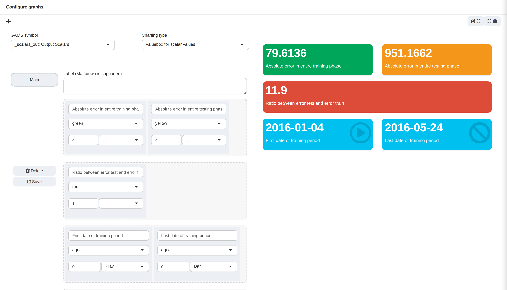

For a value box, the descriptive text (default: explanatory text of the symbol), the color of the box, an optional icon and the rounding behavior can be configured. The width of a value box results from the number of boxes in a row. Each box can be placed in the desired position by drag & drop. Free rows are ignored.

.. rubric:: JSON example

.. code-block:: json

   {
     "dataRendering": {
       "_scalars_out": {
         "outType": "valueBox",
         "options": [
           {
             "error_train": {
               "description": "Absolute error in entire training phase",
               "color": "green",
               "icon": {
                 "name": "_",
                 "lib": "font-awesome"
               },
               "round": 4
             },
             "error_test": {
               "description": "Absolute error in entire testing phase",
               "color": "yellow",
               "icon": {
                 "name": "_",
                 "lib": "font-awesome"
               },
               "round": 4
             }
           },
           {
             "error_ratio": {
               "description": "Ratio between error test and error train",
               "color": "red",
               "icon": {
                 "name": "_",
                 "lib": "font-awesome"
               },
               "round": 1
             }
           },
           {
             "firstdaytraining": {
               "description": "first date of training period",
               "color": "aqua",
               "icon": {
                 "name": "circle-play",
                 "lib": "font-awesome"
               },
               "round": 0
             },
             "lastdaytraining": {
               "description": "last date of training period",
               "color": "aqua",
               "icon": {
                 "name": "ban",
                 "lib": "font-awesome"
               },
               "round": 0
             }
           }
         ]
       }
     }
   }

Dashboard
---------

A dashboard is an interactive tool with different data views. It is navigated via the 'tiles' (value boxes) on the right-hand side of the screen. A data view is shown if the corresponding value box is clicked. It can display multiple charts and tables. Further possible interactions include:

- Interactive filtering of the displayed data

- Toggling between a range of chart/table types

- Exporting the chart/data as a png/csv file

In contrast to other types of visualization, data from several symbols can be displayed in the dashboard (similar to a custom renderer). However, note that, as with a custom renderer, this is in fact a visualization for one symbol (i.e. one tab in your application) and is configured accordingly.

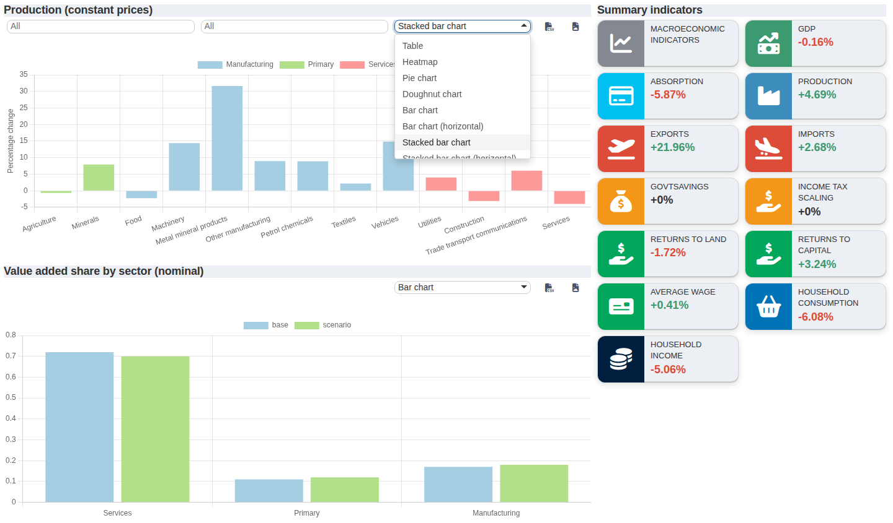

.. _dashboard-configuration:

Configuration
^^^^^^^^^^^^^

The dashboard configuration takes place in the ``dataRendering`` section of the ``<modelname>.json`` file. The configuration includes:

- Configuration of the tiles (value boxes), which are used to navigate between views in the dashboard. The boxes can display scalar values (optional).

- Configuration of the view to be displayed when clicking on a value box. A view can contain several charts/tables.

- Configuration of the individual charts/tables.

The layout of the configuration is as follows:

.. code-block:: text

   {
     "dataRendering": {
       "<lowercase_symbolname>": {
         "outType": "dashboard",
         "additionalData": [],
         "options": {
           "valueBoxesTitle": "",
           "valueBoxes": {
               ...
           },
           "dataViews": {
               ...
           },
           "dataViewsConfig": {
               ...
           }
         }
       }
     }
   }

The JSON schema, against which the configuration of the ``"options"`` object is validated when the application is started, can be found `here <https://github.com/GAMS-dev/miro/blob/master/src/conf/config_schema.json>`__ (search for ``dashboardOptions`` in section ``definitions``)

In the following, the dashboard configuration is demonstrated using a parameter ``macrolevel(mac,sim_miro)``.

.. _dashboard-additionaldata:

additionalData
""""""""""""""

A dashboard can display the data of other GAMS input and output symbols that are included in MIRO. For the dashboard to access this data, the corresponding symbols must be specified under ``"additionalData"``. Note that only multidimensional symbols should be listed here, as all scalar data is available to the renderer anyway. Example:

.. code-block:: text

   {
     "dataRendering": {
       "macrolevel": {
         "outType": "dashboard",
         "additionalData": ["macroperc", "npergdpcomp", "rpergdpcomp", "nperabsorpcomp", "rperabsorpcomp", "qxpc"],
         "options": {
           "valueBoxesTitle": "",
           "valueBoxes": {
               ...
           },
           "dataViews": {
               ...
           },
           "dataViewsConfig": {
               ...
           }
         }
       }
     }
   }

.. admonition:: Tip:
   :class: tip

   If data from other output symbols is only to be displayed in the dashboard, it is a good idea to hide their own tabs. This can be done with the `hiddenOutputSymbols <./configuration_symbols.html#hidden-symbols>`__ option for multidimensional output symbols and `hiddenOutputScalars <./configuration_symbols.html#hidden-scalars>`__ for scalar output symbols.

.. _dashboard-valueboxestitle:

valueBoxesTitle
"""""""""""""""

Title to be displayed above the value boxes section in the dashboard.

Example:

.. code-block:: text

   {
     "dataRendering": {
       "macrolevel": {
         "outType": "dashboard",
         "additionalData": ["macroperc", "npergdpcomp", "rpergdpcomp", "nperabsorpcomp", "rperabsorpcomp", "qxpc"],
         "options": {
           "valueBoxesTitle": "Summary indicators",
           "valueBoxes": {
               ...
           },
           "dataViews": {
               ...
           },
           "dataViewsConfig": {
               ...
           }
         }
       }
     }
   }

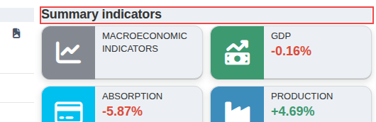

.. _dashboard-valueboxes:

valueBoxes
""""""""""

Configuration for the value boxes (tiles) in the dashboard. A value box can display a title and a scalar value (optional). A value box can be linked to a data view that is displayed when the box is clicked.

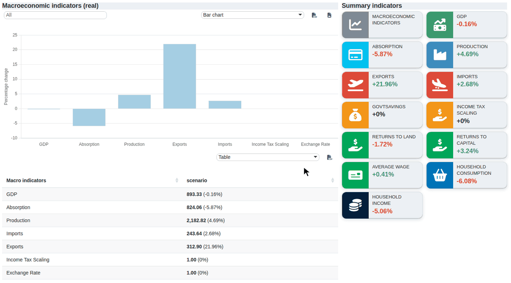

A value box has several properties that can be configured. Each property of the ``"valueBoxes"`` configuration must always be specified so that all arrays have the same length. An example will be given below.

- ``"id"``: Each value box needs a unique id. The id of a data view (with charts and tables) is linked to the id of a value box. This can be any string without spaces. Value boxes can also be used without a corresponding view.

- ``"title"``: Title that is displayed in the value box.

- ``"color"``: Each value box can have an individual color. The color code can either be provided as `hexadecimal color code <https://en.wikipedia.org/wiki/Web_colors#HTML_color_names>`__ (e.g. '#29B675') or can be chosen from the following options: 'red', 'yellow', 'aqua', 'blue', 'light-blue', 'green', 'navy', 'teal', 'olive', 'lime', 'orange', 'fuchsia', 'purple', 'maroon', 'black'.

- ``"icon"``: Each value box can have an individual icon. For all available icons see `fontawesome.com <https://fontawesome.com/search?o=r&m=free>`__.

- ``"valueScalar"``: If the value box should display a value, this needs to be configured here. Valid *valueScalar* entries are scalar output symbols of the model, which are used in MIRO. The level of `scalar variables or equations <./model.html#display-scalar-vareq>`__ can also be displayed. To enable this, the joint symbol data ``_scalarsve_out`` must be specified under `"additionalData" <./charts.html#dashboard-additionaldata>`__. Names must be specified in lower case.

- ``"prefix"``: Any string that is displayed before the value. If '+' is defined as a prefix, a '+' is appended to a positive value. If the value is negative, the sign automatically changes to '-'.

- ``"postfix"``: String that is displayed after the value.

- ``"redPositive"``: Positive values are displayed in green by default, negative values in red. If this logic should be reversed (positive: red, negative: green), the *redPositive* property of the value box must be set to *true*, otherwise *false*.

- ``"noColor"``: If the value of the value box should not have a red/green color, but should be gray instead, the *noColor* property needs to be set to *true*, otherwise *false*.

- ``"decimals"``: Number of decimal places that should be displayed for a value. A negative value implies no rounding. If ``null`` is provided, the `global setting <./configuration_general.html#decimal-places>`__ (default: 2 decimals) is used.

Example:

.. code-block:: text

   {
     "dataRendering": {
       "macrolevel": {
         "outType": "dashboard",
         "additionalData": ["macroperc", "npergdpcomp", "rpergdpcomp", "nperabsorpcomp", "rperabsorpcomp", "qxpc"],
         "options": {
           "valueBoxesTitle": "Summary indicators",
           "valueBoxes": {
             "id": ["summary","gdp","absorption","production"],
             "color": ["#848991","olive","aqua","#3c8dbc"],
             "icon": ["chart-line","money-bill-trend-up","credit-card","industry"],
             "title": ["MACROECONOMIC INDICATORS","GDP","ABSORPTION","PRODUCTION"],
             "prefix": ["+","+","+","+"],
             "postfix": ["%","%","%","%"],
             "redPositive": [false,false,false,false],
             "noColor": [false,false,false,false],
             "valueScalar": [null,"gdp","absorption","production"],
             "decimals": [2,2,2,2]
           },
           "dataViews": {
               ...
           },
           "dataViewsConfig": {
               ...
           }
         }
       }
     }
   }

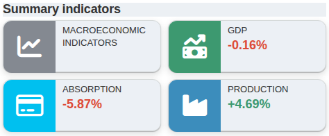

.. _dashboard-dataviews:

dataViews
"""""""""

A data view is shown if the corresponding value box is clicked in the dashboard. It can display multiple charts and tables. In ``"dataViews"`` you define how many charts/tables a view should contain. The actual configuration of the charts/tables is done in ``"dataViewsConfig"`` (see below).

The id of a data view (e.g. ``"summary"`` in the example below) must match the id of a value box in ``"valueBoxes"``. This represents the link between the value box and the view. The elements within the ID array (or object) identify the individual charts/tables. After such an id of an individual chart, (e.g. ``"macro1"`` in the example below), the title is specified, which is displayed above the chart/table in the dashboard. One can also use the empty string ``""`` to display no header. Note that IDs must not contain spaces.

Example:

.. code-block:: text

   {
     "dataRendering": {
       "macrolevel": {
         "outType": "dashboard",
         "additionalData": ["macroperc", "npergdpcomp", "rpergdpcomp", "nperabsorpcomp", "rperabsorpcomp", "qxpc"],
         "options": {
           "valueBoxesTitle": "Summary indicators",
           "valueBoxes": {
             "id": ["summary","gdp","absorption","production"],
             ...
           },
           "dataViews": {
             "summary": [
               {"macro1": "Macroeconomic indicators (real, percentage change)"},
               {"macro2": ""}
             ],
             "gdp": [
                 {"gdp1": "Composition of GDP (nominal, percentage change)"},
                 {"gdp2": "Composition of GDP (real, percentage change)"}
             ],
             "absorption": [...],
             "production": [...]
           },
           "dataViewsConfig": {
               ...
           }
         }
       }
     }
   }

.. admonition:: Note:
   :class: warning

   All keys in the <modelname>.json file are sorted alphabetically when the Configuration Mode is started. In order to leave the order of charts/ tables within a dataView in the dashboard unaffected by this, we recommend using an array of objects for the dataViews.

.. _dashboard-dataviewsconfig:

dataViewsConfig
"""""""""""""""

All individual charts/tables are configured here. A separate configuration in ``"dataViewsConfig"`` is required for each chart listed in the ``"dataViews"``. The IDs need to be the same.

A data view configuration describes how the underlying data should be filtered, pivoted, aggregated and which renderer should be used per default. The configuration of a chart is almost the same as that of a configured `view <./start.html#metadata-views>`__ in the pivot table (learn more about pivot table views `here <./charts.html#pivot-chart>`__). The easiest way to configure a dashboard chart is therefore as follows:

1. Start the MIRO app, load a scenario with results data (or solve first).

2. Navigate to the symbol that should be used for the desired chart/table. The renderer of the symbol must be a `pivot table <./charts.html#pivot-chart>`__ (default).

3. In the pivot table, slice and dice data as desired, select a charting type and save the view by clicking on the ``+`` on the left side of the pivot table.

   .. image:: ../assets/images/dashboard/configure_view.png
      :alt: Configure a view
      :class: miro-image-responsive

4. Click on ``Scenario`` → ``Edit metadata`` in the top right corner of the app and switch to the ``View`` tab in the dialog box that opens.

5. Select the configured view (or several views) by clicking on it and click on ``Download views``.

6. Open the downloaded json file and auto-format the contents if necessary. The result can look like this:

   .. code-block:: json

      {
        "macroperc": {
            "macro1": {
                "aggregationFunction": "sum",
                "pivotRenderer": "bar",
                "domainFilter": { "default": null },
                "tableSummarySettings": {
                  "rowEnabled": false, "rowSummaryFunction": "sum", "colEnabled": false, "colSummaryFunction": "sum"
                },
                "rows": "mac",
                "filter": { "sim_miro": "scenario" },
                "chartOptions": { "title": "Macroeconomic indicators (real, percentage change)" }
            }
        }
      }

7. Many settings of a view can be copied 1:1 for the configuration of a chart in the dashboard (see example below). Note that the ``"title"`` in ``"chartOptions"`` is ignored. Instead, the title provided in ``"dataViews"`` is used. ``"domainFilter"`` is ignored as well.

8. In addition to the attributes of the downloaded pivot-table view, there are further attributes available in the dashboard configuration:

   .. _dashboard-custom-labels-order:

   1. ``"data"``: Symbol name that the data should come from. If not provided, it is assumed that the symbol that the renderer is based on should be used.

   2. .. _dashboard-dropdown-filter:

      ``"userFilter"``: Adds one or more dropdown filters to a chart/table so users can limit what's rendered.

      .. image:: ../assets/images/dashboard/user_filter.png
         :alt: user filter
         :class: miro-image-responsive

      Dropdown filters are configured as a list of filter objects:

      .. code-block:: json

         "userFilter": [
           {
             "dimension": "dimA",
             "multiple": true,
             "placeholder": "All items",
             "selected": {
               "mode": "explicit",
               "values": ["a_Agriculture", "a_Food", "a_Services"]
             }
           },
           {
             "dimension": "dimB",
             "multiple": false,
             "selected": {
               "mode": "position",
               "values": "first"
             }
           }
         ]

      - ``"dimension"`` *(string, required)*

        The symbol dimension to filter on (e.g., ``"mac"``, ``"region"``).

      - ``"multiple"`` *(boolean, optional; default:* ``true``)

        Whether the dropdown allows multiple selection.

      - ``"label"`` *(string, optional; default:* ``null``)

        A label that is displayed above the dropdown filter.

      - ``"placeholder"`` *(string, optional; default:* ``"All"`` *when* ``"multiple": true``)

        A placeholder that is displayed inside the dropdown filter as long as nothing is selected.

      - ``"selected"`` *(object, optional)* - initial selection.

        - ``"mode": "explicit"``

          ``"values"`` is an array of strings matching actual option values.

          .. code-block:: json

             "selected": { "mode": "explicit", "values": ["a_Agriculture", "a_Food", "a_Services"] }

        - ``"mode": "position"``

          ``"values"`` can be:

          - ``"first"`` or ``"last"``

          - a 1-based integer (e.g., ``1``, ``3``)

          - an array combining the above (e.g., ``["first", 3, "last"]``)

      Instead of providing individual dropdown filters, one can also reference another view's filters by using its ``"dataViewsConfig"`` ID. The current view will then not render its own filter inputs; it mirrors whatever the referenced view selects. Example:

      .. code-block:: text

         {
         "macroperc": {
             "macro1": {
                 ...,
                 "data": "macroperc",
                 "userFilter": [
                   { "dimension": "mac" }
                 ]
               },
               "macro2": {
                 ...,
                 "data": "macroperc",
                 "userFilter": "macro1"
             }
           }
         }

      In this example, the ``"macro1"`` chart will have a filter drop down menu based on all elements in the ``"mac"`` dimension of the symbol ``"macroperc"``. Filters selected in that chart will automatically be applied to ``"macro2"`` as well since it uses ``"userFilter": "macro1"``.

      Legacy format: array of dimensions (still supported):

      .. code-block:: json

         "userFilter": ["dimA", "dimB"]

      Equivalent to the list of lists format with defaults (multiple: true, no default selection).

   3. ``"customLabels"``: Listing of individual elements that should be relabeled in the chart/table. Note that applying custom labels to a dataset can be compute-intensive depending on the amount of data. The time it takes to render the output might increase significantly. It is always a good idea to use appropriate labels in the GAMS model already. Example:

      .. code-block:: text

         {
           "macroperc": {
               "macro1": {
                   ...,
                   "chartOptions": {
                     "customLabels": {
                        "a_Agr": "Agriculture",
                        "a_Const": "Construction"
                      }
                   }
               }
           }
         }

   4. ``"customLabelsOrder"``: Labels named here are displayed in charts/tables in the order specified by the user. Labels that are not mentioned retain the original sort order and are positioned after the explicitly listed labels. If labels that have already been given a new name using ``"customLabels"`` are to be sorted, the new name can be used in ``"customLabelsOrder"`` as well as the original label. Example:

      .. code-block:: text

         {
           "macroperc": {
               "macro1": {
                   [...],
                   "chartOptions": {
                     "customLabels": {
                        "a_Agr": "Agriculture",
                        "a_Const": "Construction"
                      },
                      "customLabelsOrder": ["Construction", "Agriculture"]
                   }
               }
           }
         }

      For a more detailed example see `here <./charts.html#custom-order>`__.

      Note: If a parameter spans multiple dimensions in the rows, the entries in ``"customLabelsOrder"`` can either:

      - include the corresponding labels for each dimension, concatenated with a ``․`` (Unicode Character U+2024) as a separator. Labels are provided as an array. Example:

        .. raw:: html

           <pre><code class="language-json">  {
               &quot;customLabelsOrder&quot;:
               [
                &quot;Services․Construction&quot;,
                &quot;Primary․Agriculture&quot;
               ]
             }</code></pre>

        .. image:: ../assets/images/dashboard/custom_labels_order_multiple.png
           :alt: custom labels order with multiple dimensions
           :class: miro-image-responsive

      - be specified on a per-dimension basis using an object. Each dimension's name becomes a key, and the value is an array indicating the desired order of labels for that dimension. For example:

        .. raw:: html

           <pre><code class="language-json">  {
               &quot;customLabelsOrder&quot;:
               {
                 &quot;agrp&quot;:
                 [
                   &quot;Primary&quot;, &quot;Manufacturing&quot;, &quot;Services&quot;
                 ]
               }
             }</code></pre>

        Here, ``agrp`` is the dimension name, and the array lists the labels in the order they should appear.

        .. image:: ../assets/images/dashboard/custom_labels_order.png
           :alt: custom labels order with single dimensions
           :class: miro-image-responsive

   5. ``"customSeriesOrder"``: Allows an individual order in which selected series are plotted in a chart or in which order selected columns are displayed in a table/heatmap. Series/columns that are not mentioned retain the original sort order and are positioned after the explicitly listed series/columns. Example:

      .. code-block:: text

         {
           "macroperc": {
               "macro1": {
                   [...],
                   "chartOptions": {
                      "customSeriesOrder": ["Primary", "Manufacturing", "Services"]
                   }
               }
           }
         }

      For a more detailed example see `here <./charts.html#custom-order>`__.

   6. ``"hideLegend"``: If set to ``true``, no legend is displayed in the corresponding chart. This can be useful, for example, to avoid ``value`` legend entries for individual data series. Example:

      .. code-block:: text

         {
           "macroperc": {
               "macro1": {
                   [...],
                   "chartOptions": {
                     "hideLegend": true
                   }
               }
           }
         }

   7. ``"heatmapType"``: If set to ``2``, an alternative heatmap renderer will be used that shows different colors for positive and negative values. Example:

      .. code-block:: text

         {
           "macroperc": {
               "macro1": {
                   [...],
                   "chartOptions": {
                     "heatmapType": 2
                   }
               }
           }
         }

   8. ``"decimals"``: Number of decimal places to be displayed in a chart/table. A negative value implies no rounding. If no value is provided, the `global setting <./configuration_general.html#decimal-places>`__ (default: 2 decimals) is used.

   9. ``"colWidth"``: Specifies the width of the chart. Must be between 1 and 12. If not provided, the chart uses the entire available width (12). If a view contains 2 graphics with a *colWidth* of 6 each, they are displayed next to each other.

   10. ``"height"``: Specifies the height of the chart. Must be any valid css height, e.g. ``"40vh"`` or ``"450px"``. If not provided, the chart uses 33% of the height of the viewport (``"33vh"``).

**Example 1:** General configuration

.. code-block:: text

   {
     "dataRendering": {
       "macrolevel": {
         "outType": "dashboard",
         "additionalData": ["macroperc", "npergdpcomp", "rpergdpcomp", "nperabsorpcomp", "rperabsorpcomp", "qxpc"],
         "options": {
           "valueBoxesTitle": "Summary indicators",
           "valueBoxes": {
             "id": ["summary","gdp","absorption","production"],
             ...
           },
           "dataViews": {
             "summary": [
                 {"macro1": "Macroeconomic indicators (real, percentage change)"},
                 {"macro2": ""}
             ],
             ...
           },
           "dataViewsConfig": {
             "macro1": {
               "aggregationFunction": "sum",
               "pivotRenderer": "bar",
               "tableSummarySettings": { "rowEnabled": false, "rowSummaryFunction": "sum", "colEnabled": false, "colSummaryFunction": "sum" },
               "rows": "mac",
               "aggregations": { "sim_miro": null },
               "chartOptions": { "title": "Macroeconomic indicators (real, percentage change)" },
               "data": "macroperc",
               "userFilter": "mac",
               "decimals": 2
             },
             "macro2": {
               "aggregationFunction": "sum",
               "pivotRenderer": "table",
               "tableSummarySettings": { "rowEnabled": false, "rowSummaryFunction": "sum", "colEnabled": false, "colSummaryFunction": "sum" },
               "rows": "mac",
               "aggregations": { "sim_miro": null },
               "data": "macroperc",
               "userFilter": "macro1",
               "decimals": 2
             }
           }
         }
       }
     }
   }

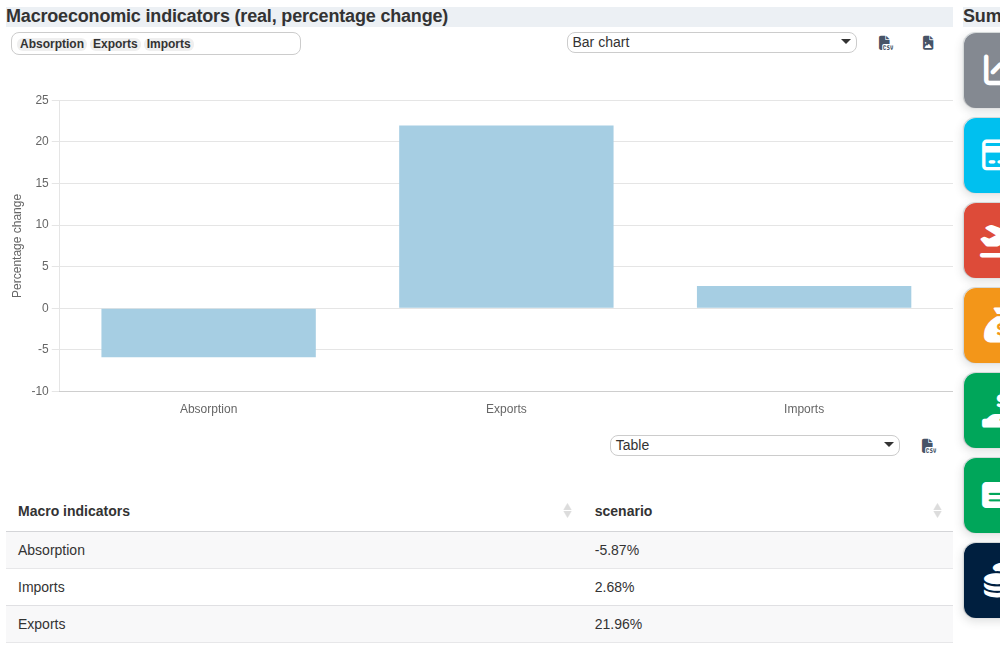

.. _custom-order:

**Example 2:** Custom labels, custom labels order, custom series order

Imagine the following chart:

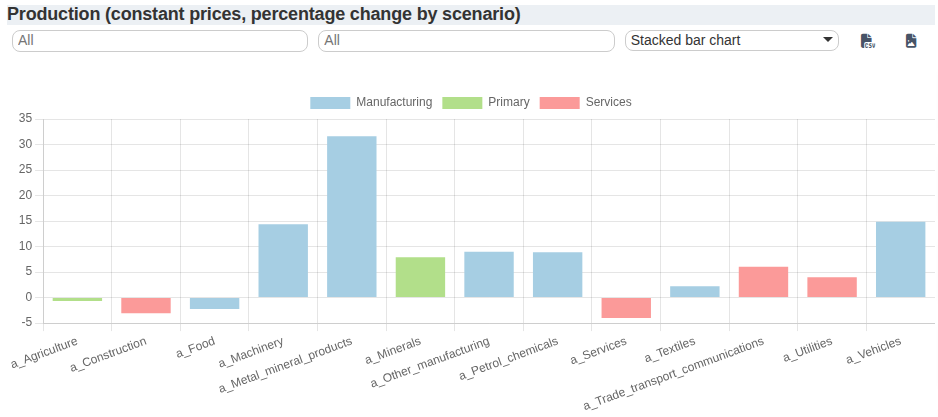

Now three settings are applied:

- ``customSeriesOrder``: The series order should be changed from ``Manufacturing``, ``Primary``, ``Services`` to ``Primary``, ``Manufacturing``, ``Services``.

- ``customLabels``: Even though the labels in the model were already relatively well chosen, they should be slightly adapted here.

- ``customLabelsOrder``: The order of the labels is adjusted. Note that the labels that have already been adapted are used, but the original labels could be used as well. Also note that labels of the ``Services`` series are not listed at all. They are therefore placed at the very end of the order.

.. code-block:: text

   {
     "dataRendering": {
       "macrolevel": {
         "outType": "dashboard",
         "additionalData": ["qxpc", ...],
         "options": {
           [...],
           "dataViewsConfig": {
             "production1": {
               "aggregationFunction": "sum",
               "pivotRenderer": "stackedbar",
               "rows": "sector",
               "filter": {
                   "sim_miro": "scenario"
               },
               "cols": {
                   "agrp": null
               },
               "chartOptions": {
                 "customSeriesOrder": [
                    "Primary", "Manufacturing", "Services"
                 ],
                 "customLabels": {
                    "a_Food": "Food",
                    "a_Machinery": "Machinery",
                    "a_Metal_mineral_products": "Metal mineral products",
                    "a_Other_manufacturing": "Other manufacturing",
                    "a_Petrol_chemicals": "Petrol chemicals",
                    "a_Textiles": "Textiles",
                    "a_Vehicles": "Vehicles",
                    "a_Agriculture": "Agriculture",
                    "a_Minerals": "Minerals",
                    "a_Construction": "Construction",
                    "a_Services": "Services",
                    "a_Trade_transport_communications": "Trade transport communications",
                    "a_Utilities": "Utilities"
                 },
                 "customLabelsOrder": [
                    "Agriculture",
                    "Minerals",
                    "Food",
                    "Machinery",
                    "Metal mineral products",
                    "Other manufacturing",
                    "Petrol chemicals",
                    "Textiles",
                    "Vehicles"
                 ]
               },
               "data": "qxpc",
               "userFilter": ["sector", "agrp"],
               "decimals": 2
             }
           }
         }
       }
     }
   }

The resulting chart looks like this:

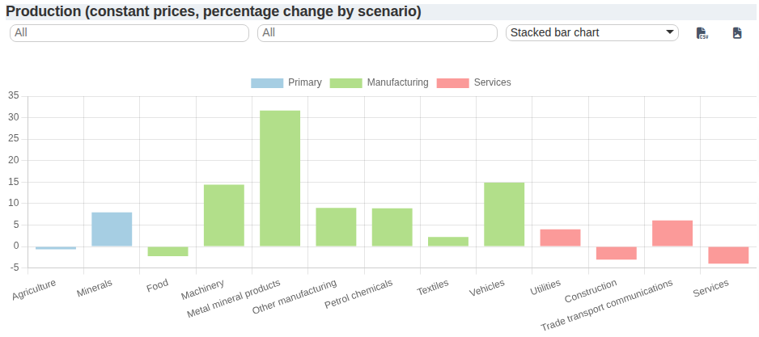

.. _dashboard-custom-code:

**Using custom code in the dashboard**

Besides a chart configuration based on a pivot table view in ``"dataViewsConfig"``, one can also provide custom R code, which is rendered at the corresponding position. The dashboard renderer has been prepared in such a way that this requires minimal effort.

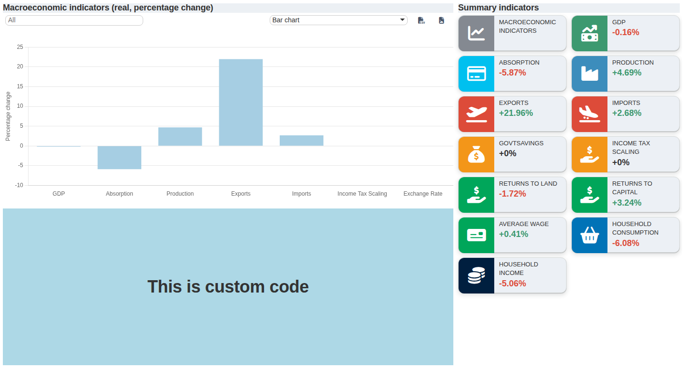

In order to add custom code to the dashboard, the entire dashboard renderer must be used as a custom renderer. The following steps are necessary for this:

1. Download the `latest dashboard renderer file <https://github.com/GAMS-dev/miro/blob/master/src/modules/renderers/dashboard.R>`__ from the MIRO repository on GitHub and put it into your ``renderer_<modelname>`` directory. If the folder does not already exist, you can create it manually.

2. In the dashboard.R file, make the following changes:

   .. code-block:: diff

      - dashboardOutput <- function(id, height = NULL, options = NULL, path = NULL) {
      + mirorenderer_macrolevelOutput <- function(id, height = NULL, options = NULL, path = NULL) {
          ns <- NS(id)
          ...
        }
      - renderDashboard <- function(id, data, options = NULL, path = NULL, rendererEnv = NULL, views = NULL, outputScalarsFull = NULL, roundPrecision = 2L, ...) {
      + renderMirorenderer_macrolevel <- function(input, output, session, data, options = NULL, path = NULL, rendererEnv = NULL, views = NULL, attachments = NULL, outputScalarsFull = NULL, roundPrecision = 2L, ...) {
      -   moduleServer(
      -     id,
      -     function(input, output, session) {
              ns <- session$ns
              ...

      # These are the last three lines of code in the file
      - }
      -)
      }

   In this example the dashboard is rendered for the symbol ``macrolevel``. Make sure to replace ``macrolevel`` with your symbol name.

3. In the ``dataRendering`` section of the ``<modelname>.json`` file change the ``"outType"`` of the symbol to render from ``"dashboard"`` to ``"mirorenderer_<symbolname>"``

   .. raw:: html

      <pre><code class="language-diff">  {
         &quot;dataRendering&quot;: {
           &quot;macrolevel&quot;: {
      -      &quot;outType&quot;: &quot;dashboard&quot;,
      +      &quot;outType&quot;: &quot;mirorenderer_macrolevel&quot;,
             &quot;additionalData&quot;: [...],
             &quot;options&quot;: {...}
           }
         }
       }</code></pre>

4. That's it. You can now extend the dashboard renderer as a custom renderer. Of course, all the code can be customized here. The aforementioned preparation of the dashboard renderer with regard to custom code instead of a pivot table view can be addressed as follows.

To use custom R code instead of a pivot table view, the ``"dataViewsConfig"`` ID in the ``<modelname>.json`` file must not be assigned a view (list) as before, but any string, e.g. ``"macro2": "customCode"``:

.. code-block:: text

   {
     ...
     "dataViews": {
       "summary": [
           {"macro1": "Macroeconomic indicators (real, percentage change)"},
           {"macro2": ""}
       ]
     },
     "dataViewsConfig": {
       "macro1": {...},
       "macro2": "customCode"
     }
   }

Note that the title that has been provided in the corresponding ``"dataViews"`` configuration is ignored in this case.

Custom R code can now be written in the renderer file, which is then rendered in the dedicated data view. The ID of the chart is used as the ID for the output function. Make sure that you place the custom code within the renderer function (here: within ``renderMirorenderer_macrolevel{}``). Example:

.. code-block:: r

   renderMirorenderer_macrolevel <- function(input, output, session, data, options = NULL, path = NULL, rendererEnv = NULL, views = NULL, attachments = NULL, outputScalarsFull = NULL, ...) {
     [...]

     output[["macro2"]] <- renderUI({
       tagList(
         column(12,
                tags$h1("This is custom code",
                        style ="height: 33vh;text-align: center;background-color: lightblue;line-height: 33vh;")
         )
       )
     })
   }

The output is as shown in the screenshot above. Of course, the entire view can also be customized instead of just part of it:

.. code-block:: text

   {
     ...
     "dataViews": {
       "summary": [
           {"macro2": ""}
       ]
     },
     "dataViewsConfig": {
       "macro2": "customCode"
     }
   }

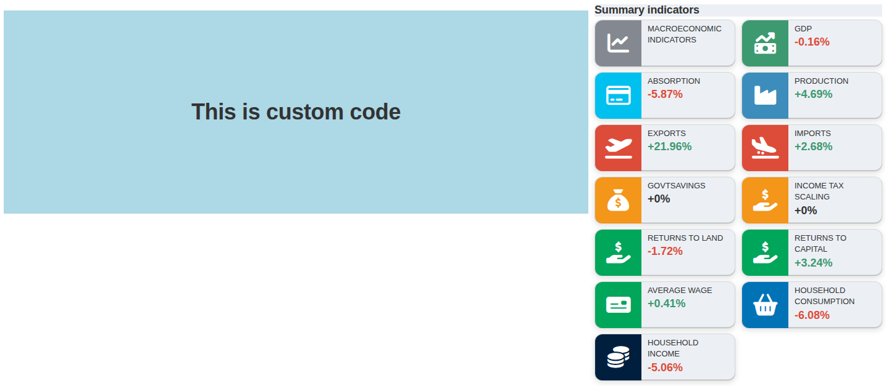

.. admonition:: Tip:
   :class: tip

   If you are using the dashboard with custom code, it is best to take a look at the chapter on `custom renderers <./configuration_advanced.html#custom-renderers>`__ too.

.. _custom-graphics:

Custom renderer
---------------

.. rubric:: Configuration

Section `Custom graphics <./configuration_advanced.html#custom-renderers>`__ gives examples and explains in detail how to deal with custom renderers in general.

The Configuration Mode can help you create your own renderers. If a symbol is selected for the use of a custom renderer in Configuration Mode, the following screen appears:

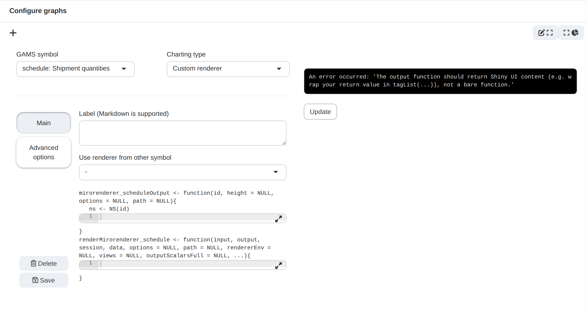

With the custom renderer editor you can write your own renderer and see the result immediately. The upper editor defines the placeholder or output function, while the lower editor is for the renderer function. If you are not yet familiar with the concept of output and render function, please read the corresponding `section <./configuration_advanced.html#custom-renderers>`__ first. When you click the "Update" button, the code is executed in both cells and the graph appears on the right (or an error message if you made a mistake). As an example consider the map created for the transport model below

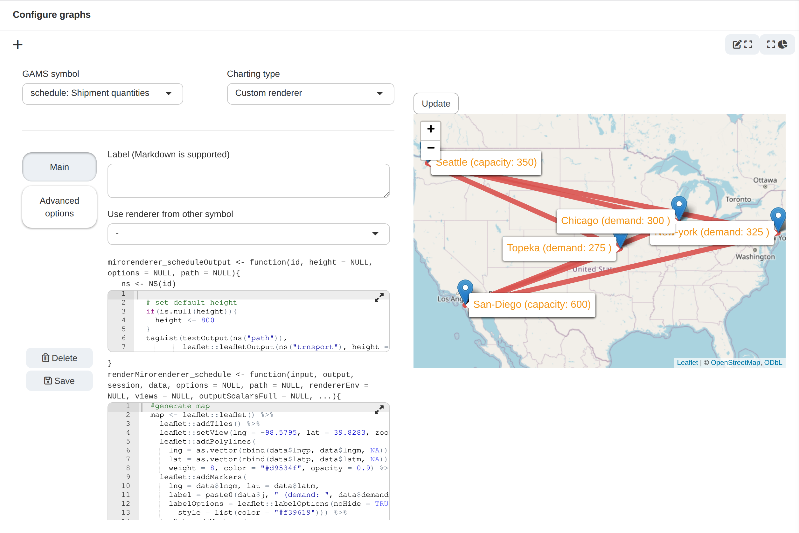

To save your renderer, click the "Save" button at the bottom left. If it does not already exist, MIRO creates the folder ``renderer_<modelname>`` in your current working directory and saves your code in a file called: ``mirorenderer_<symbolname>.R``.

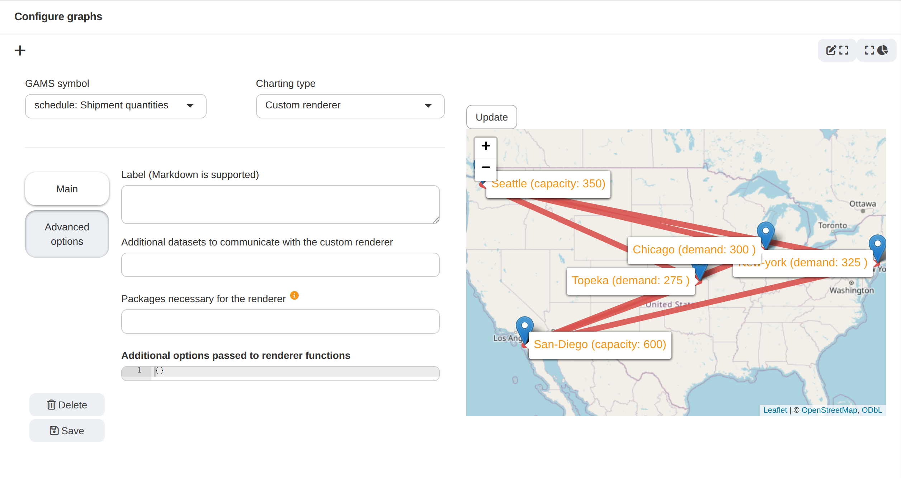

On the Advanced Options tab, you can add additional symbols to be used by your renderer, specify R packages that are not included in MIRO but are required by your renderer, and set additional options that will be available in your renderer (read `here <./configuration_advanced.html#custom-renderers>`__ to learn more). Additional options are especially useful when you share your renderer between different symbols.

The resulting JSON snippet for our transport example looks like this:

.. code-block:: json

   {
      "dataRendering":{
         "schedule": {
            "outType": "transportMap",
            "packages": "leaflet",
            "additionalData": ["ilocdata", "jlocdata"],
            "options":{
               "title":"Optimal transportation schedule"
            }
         }
      }
   }

.. admonition:: Tip:
   :class: tip

   MIRO looks for a custom renderer function for your symbol in the folder ``renderer_<modelname>``. If a renderer was configured but is not found in this directory, the application doesn't start. To solve this you can always delete the configured renderer using the Configuration Mode (or remove it manually from the JSON file).

.. _graph-options:

Options
-------

As already mentioned, not all the options available for the different graphs are explained here. Nevertheless, some options are given as examples, especially those that are applicable to several graphic types.

.. _group-domain:

.. dropdown:: Group domain

   With some graphic types, a symbol dimension can be internally pivoted. This makes the graphic independent of the data.

   In the model Pickstock there is the parameter *Price*, which contains all stock symbols of the Dow Jones index with their daily prices for a period of one year:

   .. code-block:: gams

      Set       date                 'date'
              symbol               'stock symbol';
      $onExternalInput
      Parameter price(date<,symbol<) 'Price';
      $offExternalInput

   *Price* is not declared as a table but as a normal parameter. For MIRO, this means that the data is available in list format with the headers *date* and *symbol*. The individual stocks are listed in the rows:

   .. image:: ../assets/images/single-col-line-table.png
      :alt: Parameter Price
      :class: miro-image-max-height-250pt

   We want to configure a line chart in which the price trend of each stock symbol is plotted separately. Now MIRO needs the price information of each symbol for each date. The problem is that MIRO only knows about one value column: *Price*. Hence, we cannot distinguish between the prices of individual stocks. In the resulting line chart a single line is plotted which contains all prices of all stock symbols:

   .. image:: ../assets/images/single-col-line.png
      :alt: Line chart configuration without Table statement
      :class: miro-image-max-height-250pt

   In the category *Y data* we can select a domain we want to pivot internally. If we select the domain *stock symbol* here, the tool plots a line for each individual stock symbol:

   .. image:: ../assets/images/single-col-line-domain.png
      :alt: Line chart configuration without Table statement
      :class: miro-image-max-height-300pt

   With this option, the chart configuration is completely independent of the data. We could even import data from another stock index - say the French CAC40 - and plot these accordingly.

   The internal pivoting is available for the chart types `Bar chart <./charts.html#bar-chart>`__, `Scatter plot <./charts.html#scatter-chart>`__, `Line chart <./charts.html#line-chart>`__, `Bubble chart <./charts.html#bubble-chart>`__, `Histogram <./charts.html#histogram-chart>`__ and `Time series diagram <./charts.html#timeseries-chart>`__.

   Please also see the chapter about `tables in MIRO <./model.html#table-miro>`__ to understand the difference between the MIRO-internal pivoting done here and the GAMS Table statement.

.. _filter-option:

.. dropdown:: Filter graph

   One dimension of a symbol visualized as a graphic can be configured as a filter dimension. Its elements can then be selected via a (multi-)drop-down menu. Only the data belonging to this selection is displayed in the graphic.

   Example: Model *Pickstock*, parameter *price*

   The Parameter *price* has the dimensions *date* and *symbol*: ``Parameter price(date,symbol) 'Price';``. With the previous option `Group domain <#group-domain>`__ we made sure that each stock is displayed as a separate line (and the graphic is therefore independent of the data). Now we can activate the checkbox *Should one domain of the symbol be selectable via a dropdown menu?* in the category *Filter & Domains* (*Filter* for time series diagrams) and select the dimension *stocks* as filter dimension. In the result a (multi-) dropdown menu appears above the chart, in which we can select the individual stocks. Only those stocks are displayed which are selected in the filter.

   .. image:: ../assets/images/configuration_mode/filter-graph.png
      :alt: Filter graph by domain
      :class: miro-image-responsive

   .. admonition:: Tip:
      :class: tip

      If your filter dimension contains data in date format (e.g. *2020-05-06*), you will see a date range selector instead of a multi-dropdown menu for selection.

.. _table-graph-split-screen:

.. dropdown:: Show graphic and data table in split screen

   If you have configured a graphical representation of your data, you can always switch between plot and data table by clicking on the |Switch to tabular view button| button in the upper right corner:

   .. image:: ../assets/images/configuration_mode/table-graph-separate.png
      :alt: Table and chart separated
      :class: miro-image-responsive

   With the option *Show graphic and data table in split screen* in the section *General* in Configuration Mode, both data representations can be displayed next to each other:

   .. image:: ../assets/images/configuration_mode/table-graph-split.png
      :alt: Table and chart in split screen
      :class: miro-image-responsive

.. _animation:

.. dropdown:: Animation

   Chart data can be animated in order to show how the data changes over time. Example: We want to animate a chart that shows the individual stocks of the Dow Jones index over time. The Y axis shows the price of a stock, the X axis shows the date. Now we want to display all stocks one after the other with an animation. For this we select in the category *Y data* under *Use a data dimension for animation (as frames)* the dimension that should be used for the single frames. Since we want to show all stock symbols one after the other, we choose *stock symbol*:

   .. image:: ../assets/images/configuration_mode/animation_y_axis.png
      :alt: Data dimension to animate
      :class: miro-image-responsive

   After the selection the animation is rendered and a slider with play button appears under the graphic.

   **Note**: The animation of graphics can require a lot of computing power. It is therefore possible that it takes a little time until the preview graphics are rendered. This is especially true if you select a dimension for animation that consists of many individual values.

   Under *Animation* we can further customize the animation, for example by setting the number of frames per second or the type of transition between two frame transitions.

   .. image:: ../assets/images/configuration_mode/animation_options.png
      :alt: Animation customization
      :class: miro-image-responsive

   .. admonition:: Tip:
      :class: tip

      When using animations, it is often useful to define the visible areas for both axes in the corresponding axis categories. Otherwise it can happen that areas are pre-selected in which no data is visible.

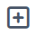
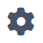
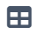
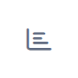
