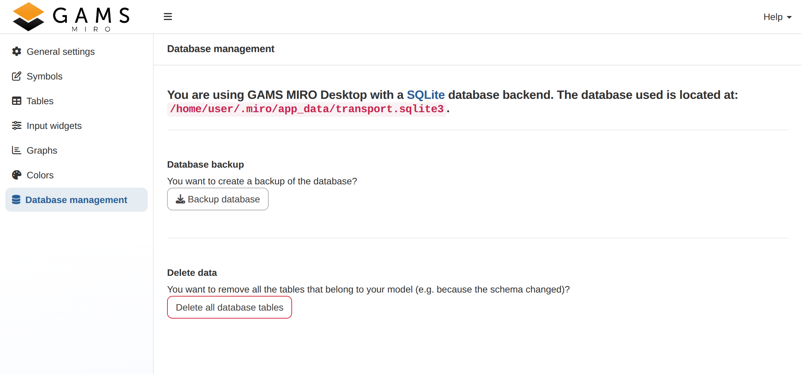

Database Management
===================

.. _db-operations:

Backup, Remove or Restore a Database
------------------------------------

Here you can backup or clear the database of your MIRO
app. In MIRO Desktop, the database can also be replaced
by a previously saved one. The database path is displayed
to the user.

.. admonition:: Warning:
   :class: warning

   Deleting data from the database cannot be undone!

