General Settings
================

Introduction
------------

Here you can customize the general behavior and appearance of MIRO.
Changes made in this category are automatically saved.

User Interface
--------------

.. _application-title:

Title
~~~~~

This option allows you to customize the title of the application that is
displayed in the browser window. If a
`$title <https://www.gams.com/latest/docs/UG_DollarControlOptions.html#DOLLARtitle>`__
has been defined in the GAMS model, this is used by default.

|Application title|

.. _app-logo:

Logo
~~~~

Upload a custom logo (png/jpg file) for your MIRO app, which is
displayed in the upper left corner. Best ratio: 4,6:1.

|App logo|

.. _dark-mode:

Color Mode
~~~~~~~~~~

Allows you to choose between MIRO light and dark mode as well as the
dynamic adaptation of the theme based on the user's system settings.

Default light mode:

|Light mode|

Default dark mode:

|Dark mode|

.. admonition:: Tip:
   :class: success

   In addition to the color mode, various color themes can be selected.
   This setting is done for all apps in the `global MIRO
   settings <./deployment.html#sbs-customize-app>`__.

Custom CSS
~~~~~~~~~~

Allows you to include a custom
`CSS <https://en.wikipedia.org/wiki/CSS>`__ file in your MIRO app. The
file must be named *custom.css* and located in the *static\_<modelname>*
directory.

.. _app-readme:

Readme File
~~~~~~~~~~~

You have the possibility to integrate a README file into the MIRO
application. Its content is displayed in the input section in the first
tab and is therefore the first thing the user sees after starting the
application. This tab can be used by the developer to introduce and
explain the MIRO application or the underlying GAMS model before the
user starts working with it.

|README file|

| **Usage:**
| The readme file must be a
  `Markdown <https://guides.github.com/features/mastering-markdown/>`__
  or HTML document which is located in the model directory. The README
  option must be activated in the Configuration Mode. Three options are
  available:

- **README tab title** (mandatory)
  With this option you can customize the title of the README tab in the
  input section. Default: *README*

- **README file name** (mandatory)
  With this option you specify the name of the readme file that you want
  to display (minimum 4 characters).

- | **Enable mathematical typesetting?** (optional)
  | In case you want to use mathematical notation in your README file,
    activate this checkbox. You can use inline math by wrapping your
    equations between ``$`` signs. To render the equation centered on its
    own line, use two dollar signs: ``$$``.

  | **Example:**
  | This integral ``$\def\f#1{f(#1)} \f{x} = \int_{-\infty}^\infty\hat \f\xi\,e^{2 \pi i \xi x}\,d\xi$`` is rendered inline.
    is rendered as: This integral ``$\def\f#1{f(#1)} \f{x} = \int_{-\infty}^\infty\hat \f\xi\,e^{2 \pi i \xi x}\,d\xi$`` is rendered inline.

  A list of all TeX functions supported by MIRO can be found
  `here <https://katex.org/docs/supported.html>`__. To write a literal
  dollar sign, you must escape it with a backslash: ``\$``.

The readme file can be created or edited directly in Configuration Mode:

|Readme editor|

.. admonition:: Note:
   :class: warning

   If you want to include images in your readme file, they must be located
   in the folder *static\_<modelname>* in your model directory. In the
   Markdown/HTML file, the path of the images used must be prefixed with
   "static\_<modelname>".

.. _generate-input-graphs:

Generate Input Graphs Automatically
~~~~~~~~~~~~~~~~~~~~~~~~~~~~~~~~~~~

If this option is activated, a pivot table is created for each input
symbol in addition to the table. If a graph is configured for a symbol
explicitly, it will be used instead.

Default Output Renderer
~~~~~~~~~~~~~~~~~~~~~~~

Without further configuration, a pivot table for data visualization can
be displayed automatically for each output symbol. If a graph is
configured for a symbol explicitly, it will be used instead.

Custom Language
~~~~~~~~~~~~~~~

This feature allows you to personalize the user interface by overriding
the default text, labels, and messages. You can tailor terminology,
create translations for unsupported languages, or simply change any
wording you prefer.

GAMS MIRO uses a fallback mechanism. When a piece of text needs to be
displayed, it first looks for it in the custom language file. If the
entry is found, the custom text is displayed. If the entry is not found,
it automatically falls back to the text from the default language file.
This means you only need to include the specific labels you wish to
change in your custom file, not the entire set of translations.

The custom file must be a valid JSON file (.json) and follow the exact
structure of the default language files. The different language files to
use as a template can be found here here:
https://github.com/GAMS-dev/miro/tree/master/src/conf. For a technical
definition of the required structure, the JSON schema is available
`here <https://github.com/GAMS-dev/miro/blob/master/src/conf/language_schema.json>`__.
Save your custom language file <customLanguage>.json in the
<modeldirectory>/static\_<modelname> directory. If that folder does not
exist, you need to create it manually.

Example: The default
`en.json <https://github.com/GAMS-dev/miro/blob/master/src/conf/en.json>`__
file contains the following labels which define the text that is
displayed in the sidebar menu.:

.. code:: text

   {
     ...
     "nav":{
       ...
       "sidebarMenu":{
         "inputScreen":"Input",
         "outputScreen":"Output",
         "gams":"GAMS interaction",
         "load": "Load scenarios",
         "scen":"Compare scenarios"
       },
       "sidebarButtons":{
         "importInput":"Load data",
         "solve":"Solve model",
         ...
       },
       ...
     }
   }

If you only want to change these labels, your custom language file
(e.g., *custom.json*) would look like this:

.. code:: json

   {
     "nav":{
       "sidebarMenu":{
         "inputScreen":"My custom input",
         "outputScreen":"My custom output",
         "gams":"My custom interaction",
         "load": "My custom scenarios",
         "scen":"My custom comparison"
       },
       "sidebarButtons":{
         "importInput":"My custom data",
         "solve":"My custom solve"
       }
     }
   }

|Custom language|

Scenario Data and Attachments
-----------------------------

Default Scenario
~~~~~~~~~~~~~~~~

Allows you to pre-populate tables and widgets with data when starting
MIRO. If this option is set and a scenario name is specified, MIRO looks
for the corresponding scenario in the database at the application
startup and automatically loads all data into the interface. In case
always the same input data is used as base data, the step of importing
data into MIRO can be skipped with this option.

.. _local-upload:

Local Data Upload
~~~~~~~~~~~~~~~~~

If the local data upload module is enabled, scenario data can be loaded
via local files.

|Import local data|

Attachments
~~~~~~~~~~~

Allow users to add and save file attachments to scenarios. Read more
about this in the *File attachments* section
`here <./start.html#file-attachments>`__.

.. _general-output-attach:

Output Attachments
~~~~~~~~~~~~~~~~~~

Output attachments allow you to automatically attach files after a GAMS
run has been successfully completed. This lets you store additional
results alongside the ones displayed in the UI. In addition, MIRO gives
you the option to choose what should happen when an attachment is not
found after a successful GAMS run. Should the user be informed of this
by an error message or should it be silently ignored. You can also
choose to automatically extract the attachment to the working directory
when you start another GAMS run with this scenario. This function adds a
state to your scenarios. Per default, scenarios in MIRO are stateless.
This means that running two consecutive GAMS runs with the same input
data will result in the same output data. By adding an attachment to the
scenario that GAMS is allowed to read on consecutive executions, the
results may no longer be the same.

Let's have a look at a simple (toy) example:

.. code:: gams

   $if exist report.put $abort "Report was found"

   File report;
   put report;
   put "This is a report."
   putclose;

When you run this GAMS model for the first time, it creates a file
``report.put``. When running it a second time, it aborts with a compilation
error: "Report was found". If you add the file ``report.put`` as an output
attachment and select to extract it into the working directory whenever
you run this scenario again, your scenario will carry a state. This
gives you the possibility to implement processes of any complexity in
your MIRO application.

.. admonition:: Note:
   :class: warning

   When this option is activated, additional files will be saved to each
   solved scenario. You should make sure that the disk space used does not
   become excessive (e.g. by limiting the output written to the lst file).

.. _general-temp-dir:

Access Temporary Directory
~~~~~~~~~~~~~~~~~~~~~~~~~~

This option specifies whether all temporarily created files of the model
run (like solution reports or the lst and log files) can be accessed by
the user. If set to true, the files can be downloaded individually or as
a ZIP archive with a click on the |Download temporary files| button.

|Output data screen - scalars|

.. _include-metadata:

Excel Export: Metadata
~~~~~~~~~~~~~~~~~~~~~~

Include a metadata sheet in the Excel file when exporting a scenario.
The metatdata sheet contains information about the user name, the
scenario name and the time the scenario was created.

|Metadata sheet|

.. _include-empty:

Excel Export: Empty Sheets
~~~~~~~~~~~~~~~~~~~~~~~~~~

This option specifies whether empty sheets should be included when
exporting a scenario. Sheets can be empty e.g. when a scenario contains
only input data (has not been solved).

Decimal Places
~~~~~~~~~~~~~~

Number of decimal places used for rounding numerical values. This is a
global setting and has an effect on all `output
tables <./configuration_tables.html#output-tables>`__, `Big Data input
tables <./widgets.html#input-bigdata-table>`__ and the table for
`finding and loading scenarios <./start.html#scenario-loading>`__.

Note that this only applies to symbols that are treated as numerical
values by MIRO. For example, elements of GAMS *Sets* may contain
numbers, but they are not treated as such but as strings. These are
therefore not affected by the maximum decimal place set.

.. _numerical-tolerance:

Numerical Tolerance
~~~~~~~~~~~~~~~~~~~

Numerical accuracy threshold used to treat values close to zero as exactly
zero. This is a global setting used by the `baseline comparison
<./configuration_general.html#pivot-default-options>`__ feature in both the
Dashboard and MIRO Pivot renderers: when computing a percentage difference or
normalized value against a baseline, a baseline value that is only nonzero due
to floating-point noise can otherwise blow up or inflate the result. Values
whose absolute value is smaller than this threshold are treated as exactly
``0`` for that computation.

The slider sets the number of decimal places *N* of that threshold, i.e. a
value is treated as zero if it is smaller than 10 :sup:`-N`. It ranges from
``3`` to ``15``; the default is ``6`` (a threshold of ``1e-6``). Raise this
value if your model legitimately produces baseline values very close to (but
not meant to be treated as) zero; lower it if you see inflated or
division-by-zero-like results in baseline comparisons.

Job Submission
--------------

.. _activate-hcube:

Hypercube Mode
~~~~~~~~~~~~~~

This option enables the submission of `Hypercube
jobs <./hc-module.html>`__. Note that you must use GAMS MIRO with a
`GAMS Engine backend <./server.html>`__ (GAMS MIRO Server or GAMS MIRO
Desktop - boosted by GAMS Engine) when you want to submit Hypercube
jobs.

.. _command-line-args:

Extra Command Line Arguments
~~~~~~~~~~~~~~~~~~~~~~~~~~~~

With this option, command line arguments can be specified that are set
for each GAMS/GAMSPy run that is started from MIRO. This can be GAMS
options like limrow=10 or threads=4 but also custom double-dash
parameters. Note, that the these command line arguments are static; they
can not be changed by the user from MIRO.

.. admonition:: Note:
   :class: warning

   MIRO always sets the command-line parameter
   `logOption <https://www.gams.com/latest/docs/UG_GamsCall.html#GAMSAOlogoption>`__
   (synonym "lo") to 3 (log output to standard output). This option cannot
   be overridden.

For more information about command line parameters that can be set from
MIRO using widgets like sliders, dropdown menus, checkboxes etc. click
`here <./model.html#command-line>`__.

Log Files
---------

.. _show-log:

Log File
~~~~~~~~

Determine whether the GAMS *log* file is displayed in the section *GAMS
interaction* or not.

|GAMS Log file|

.. _miro-syntax-stdout:

Parse log file for MIRO log syntax
~~~~~~~~~~~~~~~~~~~~~~~~~~~~~~~~~~

Determine whether the *log* file shall be parsed for `MIRO log
syntax <#miro-log-syntax>`__.

.. _show-lst:

Listing File
~~~~~~~~~~~~

Determine whether the GAMS listing (*lst*) file is displayed in the
section *GAMS interaction* or not.

.. _miro-log:

Custom Log File
~~~~~~~~~~~~~~~

You can write a custom MIRO log file and display this in MIRO. Per
default, the GAMS *log* and *listing* (*lst*) files are visible in the
*GAMS interaction* section. Besides these files generated by GAMS you
can also write your own log (e.g. with the `Put Writing
Facility <https://www.gams.com/latest/docs/UG_Put.html>`__). If you
already use your own report in your GAMS model, you can easily integrate
it into MIRO with this option.

All you have to do is specify the name of this file. The file must be a
text file and needs to be located in the MIRO working directory at the
end of the model run in order to be included.

| **Example:**
| In this example we extend our transport model with a few lines of code
  for creating a report *transport.dat*:

.. code:: gams

   File log /transport.dat/;
   put log;
   put '--------------------------------'/;
   put '            Report'/;
   put '--------------------------------'/;
   put / / 'Transportation Model parameters' / /
       'Freight cost  ', f,
       @1#6, 'Plant capacity'/;
   loop(i, put @3, i.tl, @15, a(i)/);
   put /'Market demand'/;
   loop(j, put @3, j.tl, @15, b(j)/);

   put  / / 'Transportation Model Results' / / ;
   loop((i,j), put i.tl, @12, j.tl, @24, x.l(i,j):8:4 /);

To integrate this into MIRO, we open the Configuration Mode and specify
the name of the report file in the general settings ("Log Files" tab).
The next time the model is solved, the report will be displayed in the
GAMS interaction section within MIRO:

|Configure a custom log file in MIRO|

.. admonition:: Note:
   :class: warning

   Ensure the custom log file is cleared with each GAMS run; otherwise,
   MIRO may display data from a previous run, as the working directory is
   reused.

.. admonition:: Note:
   :class: warning

   If the `Parse log for MIRO log syntax <#miro-syntax-stdout>`__ option is
   enabled, only the standard log is parsed for `MIRO log
   syntax <#miro-log-syntax>`__.

.. _miro-log-syntax:

Data validation
^^^^^^^^^^^^^^^

Data validation is a critical component of any optimization model and
plays a key role in ensuring the accuracy, reliability, and user
acceptance of your application. The log files are particularly suitable
for the validation of input data. Checking the consistency of input data
and providing reports when inconsistencies are found is a critical
factor in avoiding end-user frustration.

If the MIRO log (or the standard log, when the `Parse log for MIRO log
syntax <#miro-syntax-stdout>`__ option is enabled) follows the specified
syntax, any invalid data can be highlighted directly above the
corresponding input data sheet in MIRO:

.. _input-data-validation:

|MIRO log|

| This works as follows:
| In the Pickstock model we create, as in the previous transport
  example, a reporting file. We want to inform the user when we detect
  invalid price data. We classify a price as incorrect if it is
  negative, i.e. < 0. Since the data validation should take place before
  solving the model, the code must be placed before the solve statement.
  If we find inconsistent data, we abort the execution with an error
  message.

.. code:: gams

   * input validation
   set error01(date, symbol);

   error01(date, symbol) = price(date, symbol) < 0;

   file log / miro.log /;
   put '------------------------------------'/;
   put '        Data validation'/;
   put '------------------------------------'/;
   if(card(error01),
     put log 'price:: No negative prices allowed!'/;
     loop(error01(date, symbol),
         put log / ' Symbol ' symbol.tl:4 ' has negative price at the date: ' date.tl:0;
       );
     abort "Data errors detected."
   );
   putclose log;

If the data validation log is integrated in MIRO, the following happens:
If you now have a negative price in the input data and click solve, this
negative price is detected in the data validation and the model run is
aborted. Instead of remaining in the *GAMS interaction* section, MIRO
now switches the view and displays the input table with the first
validation error detected. The corresponding message specified in the
log file is also displayed (see `picture
above <#input-data-validation>`__).

The log file also displays further information about the incorrect data
if defined accordingly:

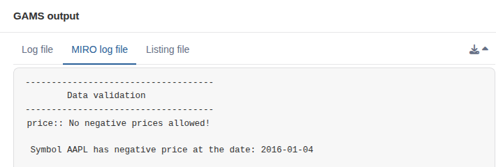

In this way, erroneous data can be found quickly and corrected by the
user before an expensive calculation is carried out.

The syntax that must be used for MIRO to jump directly to the table with
the incorrect data is as follows:

``'symbolname:: Error message'``

In the example above this was:

``'price:: No negative prices allowed!'``

The name of the symbol whose data is incorrect, followed by two colons,
signals MIRO to jump to the table of the corresponding symbol if the
model run is aborted. The specified error message that follows the
colons is then displayed above the table.

.. _general-duration:

Log File Storage Duration
~~~~~~~~~~~~~~~~~~~~~~~~~

If you want to save the log and lst files of individual GAMS jobs, you
can use this option to specify how long the files should be saved in the
database (in days). 0 means files are not stored at all, 999 means files
are stored indefinitely. This setting is ignored when the attachment
module is not active.

Scenario Comparison
-------------------

Default Scenario Comparison Mode
~~~~~~~~~~~~~~~~~~~~~~~~~~~~~~~~

This option sets the default comparison method for scenarios (more
information about scenario comparison can be found
`here <./start.html#scenario-comparison>`__). Regardless of the selected
option, you can always switch between split view, tab view, pivot view
and any other configured compare modes within the MIRO application.

.. _hidden-compare-symbols:

Hide Symbols in Scenario Comparison
~~~~~~~~~~~~~~~~~~~~~~~~~~~~~~~~~~~~

This option lets you select input and/or output symbols that should not be
displayed as a tab in the `split <./start.html#compare-split>`__, `tab
<./start.html#compare-tab>`__ and `pivot <./start.html#compare-pivot>`__
scenario comparison modes. Selected symbols are still displayed normally
everywhere else - this option only affects scenario comparison mode. It is
useful for symbols that are relevant on their own but are not meaningful to
compare across scenarios, so we can keep scenario comparison focused on what
matters.

.. _pivot-default-options:

Pivot Compare Mode: Default Options
~~~~~~~~~~~~~~~~~~~~~~~~~~~~~~~~~~~

Because the pivot compare mode settings apply globally rather than to
individual symbols, configuring the default settings differs slightly
from `configuring settings for a specific
symbol <./charts.html#pivot-default-configuration>`__. You can define
the following global default settings:

.. _enable-presentation:

Show presentation mode by default
^^^^^^^^^^^^^^^^^^^^^^^^^^^^^^^^^

This option activates the `presentation
mode <./charts.html#presentation-mode>`__ by default in pivot compare
mode. In this mode, all pivot controls are hidden so that the chart or
table takes center stage. Only configured views and export buttons
remain visible. The presentation mode can be very useful for users who
do not want to play around with the data in the pivot tool, but only
want to view predefined views/reports. You can switch between the
standard view and the presentation mode at any time by clicking on
|Refresh scenarios button| .

Show table summary
^^^^^^^^^^^^^^^^^^

You can choose between several summary functions — such as sum, count,
mean, and more — for both rows and columns. These summary functions
allow you to quickly calculate key metrics about your table data.

Fix table columns to the left
^^^^^^^^^^^^^^^^^^^^^^^^^^^^^

If this option is activated, the columns of the pivot table are fixed to
the left side of the table and remain visible when scrolling
horizontally. Note that this can cause display problems for very wide
tables (e.g. with many columns), especially on small screens. For this
reason, this option is automatically disabled for screens less than 768
pixels wide.

Hide empty columns
^^^^^^^^^^^^^^^^^^

If enabled, this option allows to hide empty table columns of the
currently visible data. Read more about this option
`here <./charts.html#hide-empty-columns>`__.

Font size to use in charts
^^^^^^^^^^^^^^^^^^^^^^^^^^

Option to change the font size used in all charts of the pivot table.

UEL, which indicates a missing value
^^^^^^^^^^^^^^^^^^^^^^^^^^^^^^^^^^^^

Data in a pivot table that indicates a missing value. This is needed
when you want to `hide empty
columns <./charts.html#hide-empty-columns>`__ in the table.

.. _ai-assistant-config:

AI Assistant
------------

With a provider key configured (see the `AI Assistant <./ai_assistant.html#enabling-ai-assistant>`__ chapter for how to set one up), we can tailor how the assistant behaves for this specific app.

.. _ai-assistant-enable:

Enable AI Assistant
~~~~~~~~~~~~~~~~~~~

This checkbox turns the assistant on or off for the current app. It is on by default (existing apps are not locked out of the feature once a provider key is configured), so if we want to keep a specific app free of AI features regardless of the server-wide key, we switch it off here explicitly.

.. _ai-assistant-domain-context:

Domain Context
~~~~~~~~~~~~~~

Domain Context gives the assistant background knowledge about our model: the business or scientific problem it solves, the terminology we use, and how the model operates. The more context the assistant has, the more relevant and specific its analysis will be. We can use the placeholder ``[[README]]`` anywhere in this field, and MIRO replaces it with the current content of our app's README - so if we already documented the model there, we do not have to duplicate that work.

.. _ai-assistant-instructions:

General Instructions
~~~~~~~~~~~~~~~~~~~~

General Instructions let us set concrete rules for how the assistant should respond - formatting preferences ("Always report monetary values in millions of dollars"), tone, or steps it should take when it spots a data inconsistency ("Flag negative values in the demand table as an error"). Where Domain Context describes our model, General Instructions describe how we want the assistant to talk about it.

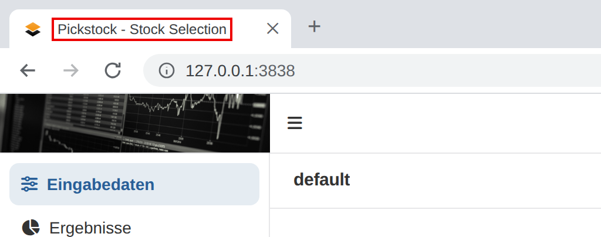
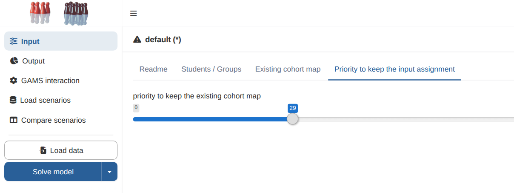
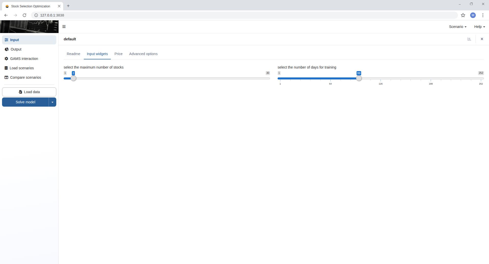
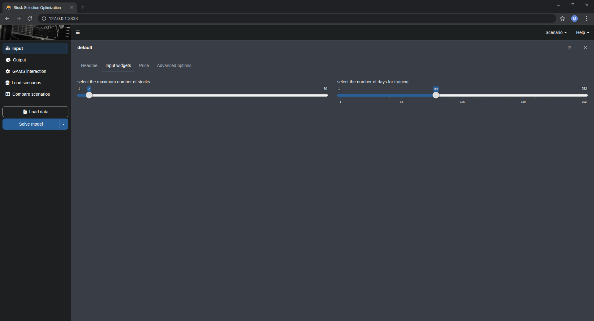
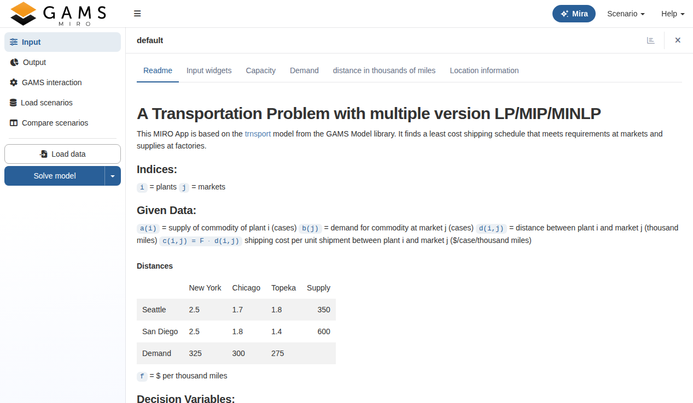
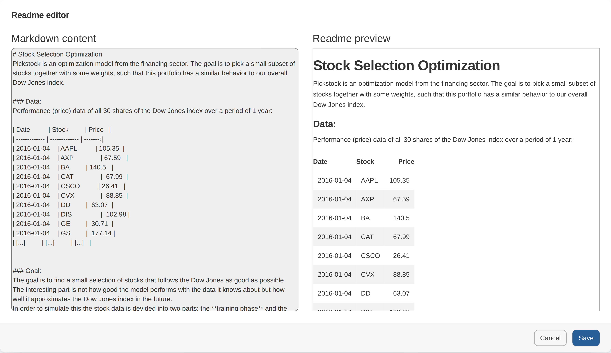
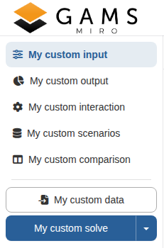
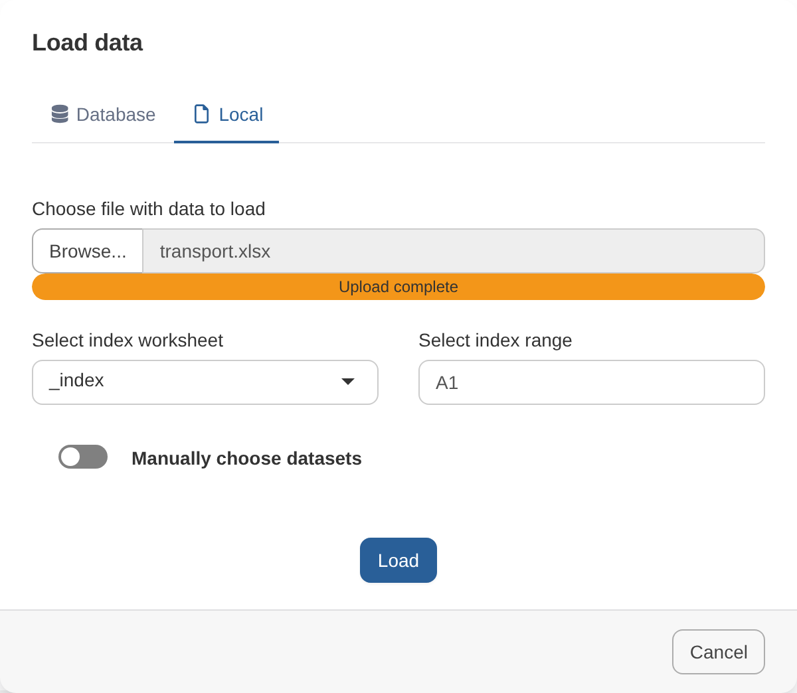

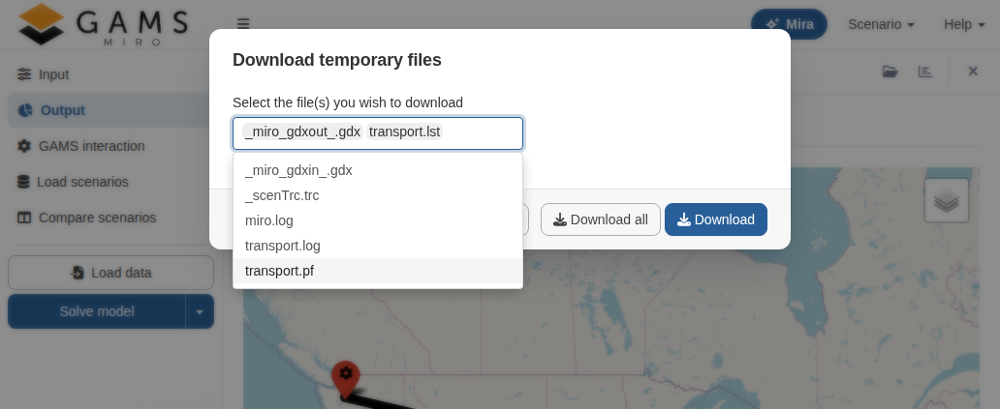
.. |Metadata sheet| image:: ../assets/images/configuration_mode/general_export_metadata.png
   :class: miro-image-max-height-50pt
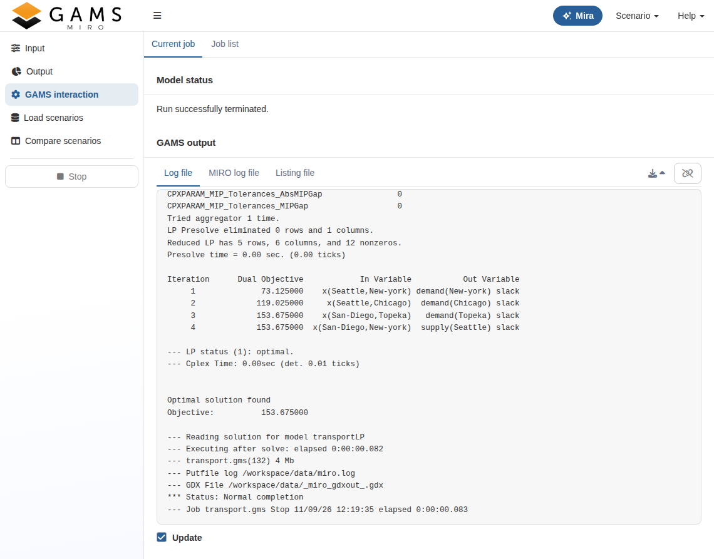
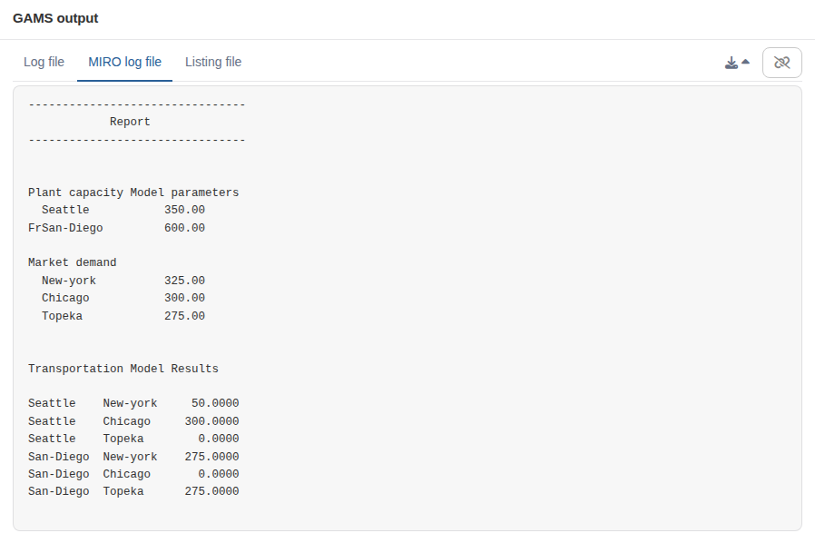
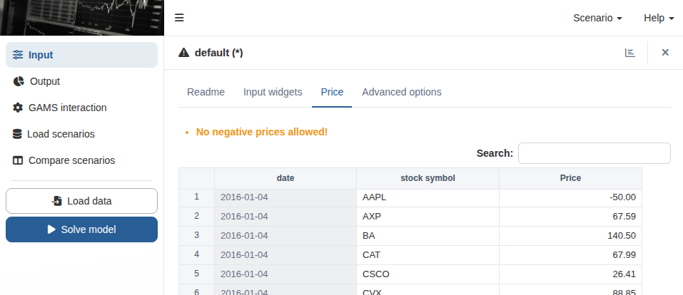
.. .. image:: ../assets/images/configuration_mode/general_mirolog1.png
   :alt: MIRO log
   :class: miro-image-max-height-200pt image:: ../assets/images/configuration_mode/general_mirolog1.png
   :class: miro-image-max-height-200pt

