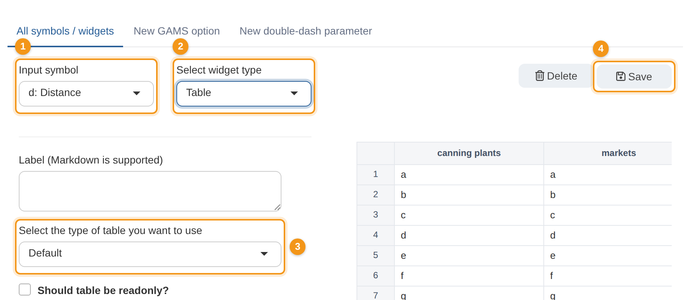
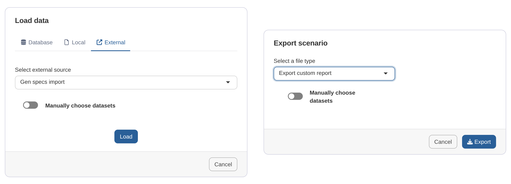
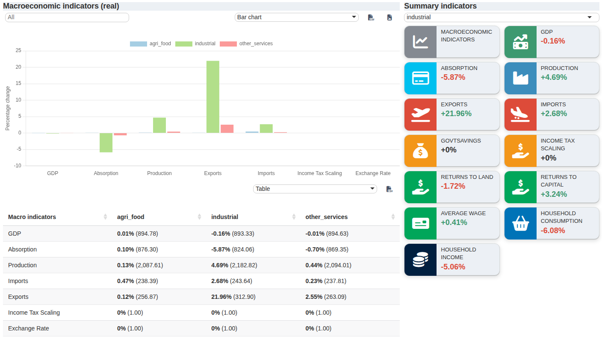
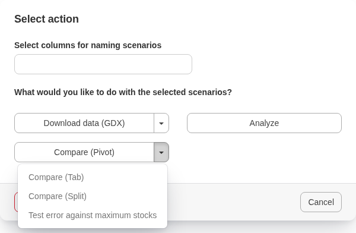
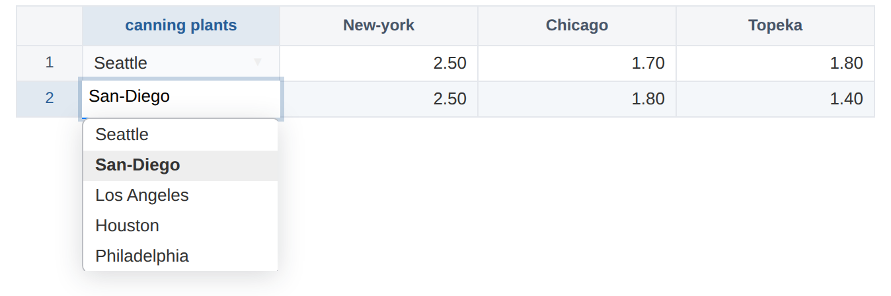
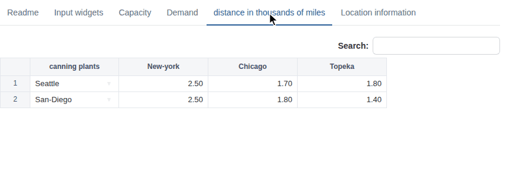
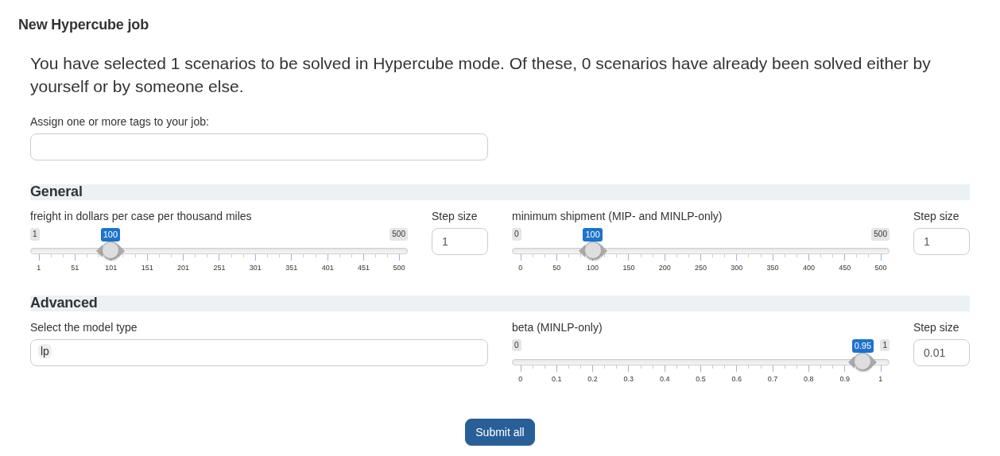

Options not Available in Configuration Mode
===========================================

.. _custom-import-export:

Custom data connectors
----------------------
MIRO allows you to `import <./start.html#import-data>`__ and `export <./start.html#save-export-delete>`__ scenario data in several file formats. However, your data may be in a format
that MIRO does not support, or you may want to pull and push data directly from an external database. In these cases, you need to write your own data connector in the form of an R function that you
can connect to MIRO. Custom data connectors should be saved as ``miroimport.R`` or ``miroexport.R`` files and placed in the ``renderer_<modelname>`` directory.

You can define multiple import and export functions. They are accessible via the *Load data* and *Export scenario* dialogs.

|Custom data import and export functions displayed in the data load and export dialogs|

Custom import functions
~~~~~~~~~~~~~~~~~~~~~~~

The custom import function should have the following signature:

.. code-block:: r

   miroimport_<importerName> <- function(symNames, localFile = NULL, views = NULL, attachments = NULL, metadata = NULL, customRendererDir = NULL, ...) {

   }

where *importerName* can be any name of your choice to identify the importer, *symNames* is a character vector with the names of the symbols to fetch data for and *localFile* is an optional data
frame with one row for each uploaded file and the columns: *name* that specifies the name of the uploaded file, *size* that specifies the file size in bytes, *type* that provides the MIME type
reported by the browser and *datapath* with the temporary path where the file was uploaded to. In addition, you have access to the
`metadata <configuration_advanced.html#custom-renderer-metadata>`__, `attachments <configuration_advanced.html#custom-renderer-attachments>`__ and
`views <configuration_advanced.html#custom-renderer-views>`__ of the sandbox scenario. The directory ``renderer_<modelname>`` can be accessed via the *customRendererDir* argument (e.g. to access
additional files placed in the same directory).

The custom import function should return a named list of data frames or tibbles, where the names are the symbol names. Any errors thrown by your custom import function will be caught by MIRO and a
generic error message will be displayed to the user. If you want to give the user a more informative error message, you can trigger a custom error with the ``abortSafe(msg = "")`` function. The *msg*
will be displayed to the user.

Let's create a custom import function for our *transport* example that allows us to upload data in the form of JSON files. We will use the *jsonlite* package to parse the JSON data. First, we
create a file ``miroimport.R`` in the ``renderer_transport`` directory. Second, we write our own import function:

.. code-block:: r

   miroimport_JSON <- function(symbolNames, localFile = NULL, views = NULL, attachments = NULL, metadata = NULL, customRendererDir = NULL, ...) {
     if (is.null(localFile) || !identical(length(localFile$datapath), 1L)) {
       abortSafe("Please upload a single, valid JSON file")
     }
     tryCatch(
       {
         jsonData <- jsonlite::read_json(localFile$datapath, simplifyVector = TRUE)
       },
       error = function(e) {
         abortSafe("Could not parse JSON file. Is the syntax correct?")
       }
     )
     dataTmp <- lapply(symbolNames, function(symbolName) {
       if (!symbolName %in% names(jsonData)) {
         return(NULL)
       }
       tryCatch(
         {
           return(tibble::as_tibble(jsonData[[symbolName]]))
         },
         error = function(e) {
           abortSafe("Could not parse JSON file. It does not seem to follow the expected structure.")
         }
       )
     })
     names(dataTmp) <- symbolNames
     return(dataTmp)
   }

To use our newly created custom import function, we need to add the following configuration to our ``transport.json`` file:

.. code-block:: json

   {
     "customDataImport": [
       {
         "label": "JSON import",
         "functionName": "miroimport_JSON",
         "symNames": ["a", "b"],
         "localFileInput": {
           "label": "Please upload your JSON file here",
           "multiple": false,
           "accept": [".json", "application/json"]
         }
       }
     ]
   }

The ``label`` is used in the Data Import section as the identifier for our custom importer. ``functionName`` must be set to the name of the import function, in our case: ``miroimport_JSON``.

Also, we can use the ``symNames`` setting to restrict which symbols our import function supports. If we omit this setting, MIRO assumes that our import function supports any input and output symbol.

The optional ``localFileInput`` object tells MIRO that our custom import function expects a local file to be uploaded. If the importer does not need a file (e.g. if it only fetches current values
from a remote database), we can omit this object.

Below is the full schema against which your configuration of custom import functions is validated.

.. note::

   To communicate scalars (and 0- or 1-dimensional singleton sets) via custom data importers, you can either specify them explicitly in the ``symNames`` array and send them individually with a
   1-dimensional character, integer or numeric vector, or combine them in a tibble. The tibble must have the name ``_scalars`` and the columns: ``scalar`` and ``value`` (both of type ``character``). The
   names of the scalars must be stored in the ``scalar`` column and the values in the ``value`` column. Note that if you communicate the ``_scalars`` table, you should include all scalars (as well as
   GAMS options and double dash parameters) in this table. If you only want to communicate a subset of scalars, define these explicitly via the array *symNames*.

   If you do not specify ``symNames``, MIRO assumes that you provide the scalars in the form of the tibble described above (with key ``_scalars``).

.. raw:: html

   

.. _customDataImport-json-schema:

.. dropdown:: JSON validation schema for custom import functions

   .. code-block:: json

      "customDataImport": {
        "description": "Import data using a custom function",
        "type": "array",
        "items": {
          "type": "object",
          "additionalProperties": false,
          "required": [
            "label",
            "functionName"
          ],
          "properties": {
            "label": {
              "description": "Label that is displayed when selecting the custom importer",
              "type": "string",
              "minLength": 1
            },
            "symNames": {
              "description": "Names of the symbols to import. Defaults to all symbols (input and output) if not provided or empty.",
              "type": [
                "array",
                "string"
              ],
              "minLength": 1,
              "uniqueItems": true,
              "items": {
                "type": "string",
                "minLength": 1
              }
            },
            "functionName": {
              "description": "Name of custom R function to call (required function signature: miroimport(symNames, localFile = NULL, ...), must return named list of data frames with correct number/type of columns). The names of the list must be identical to the names provided by symNames argument.",
              "type": "string",
              "default": "miroimport",
              "minLength": 1
            },
            "localFileInput": {
              "description": "Enable user to provide local file.",
              "type": "object",
              "additionalProperties": false,
              "required": [
                "label"
              ],
              "properties": {
                "label": {
                  "description": "Label of the local file input.",
                  "type": "string"
                },
                "multiple": {
                  "description": "Whether user is allowed to upload multiple files.",
                  "type": "boolean"
                },
                "accept": {
                  "description": "A character vector of unique file type specifiers which gives the browser a hint as to the type of file the server expects. Many browsers use this to prevent the user from selecting an invalid file.",
                  "type": "array",
                  "items": {
                    "type": "string"
                  }
                }
              }
            }
          }
        }
      }

Custom export functions
~~~~~~~~~~~~~~~~~~~~~~~

For exporting data, a custom export function with the following signature should be used:

.. code-block:: r

   miroexport_<exporterName> <- function(data, path = NULL, views = NULL, attachments = NULL, metadata = NULL, customRendererDir = NULL, ...) {

   }

where ``data`` is a named list of tibbles, where the names are the names of the symbols (the same structure as the return value of a custom import function), and ``path`` is the (optional) path of the
(temporary) file provided to the user for download. In addition, you have access to the `metadata <configuration_advanced.html#custom-renderer-metadata>`__,
`attachments <configuration_advanced.html#custom-renderer-attachments>`__ and `views <configuration_advanced.html#custom-renderer-views>`__ of the sandbox scenario. The directory
``renderer_<modelname>`` can be accessed via the ``customRendererDir`` argument (e.g. to access additional files placed in the same directory).

Let's write a JSON export function that creates JSON files that can be re-imported using the custom import function from earlier. To do so, we first create a file ``miroexport.R`` in the
``renderer_transport`` directory. Then we write the custom export function:

.. code-block:: r

   miroexport_JSON <- function(data, path = NULL, views = NULL, attachments = NULL, metadata = NULL, customRendererDir = NULL, ...) {
     jsonlite::write_json(data, path = path, dataframe = "columns")
   }

and add the following to the ``transport.json`` file:

.. code-block:: json

   {
     "customDataExport": [
       {
         "label": "JSON export",
         "functionName": "miroexport_JSON",
         "localFileOutput": {
           "filename": "output.json",
           "contentType": "application/json"
         }
       }
     ]
   }

The configuration object is very similar to that of the custom import functions, except that the optional ``localFileOutput`` object now specifies the properties of the file to
be downloaded. We can omit this object if our export function does not create a file to be downloaded, but forwards the data to a remote service, for example.

Below is the validation schema for custom exporters:

.. raw:: html

   

.. _customDataExport-json-schema:

.. dropdown:: JSON validation schema for custom export functions

   .. code-block:: json

      "customDataExport": {
        "description": "Export data using a custom function",
        "type": "array",
        "items": {
          "type": "object",
          "additionalProperties": false,
          "required": [
            "label",
            "functionName"
          ],
          "properties": {
            "label": {
              "description": "Label that is displayed when selecting the custom exporter",
              "type": "string",
              "minLength": 1
            },
            "symNames": {
              "description": "Names of the symbols to export. Defaults to all symbols (input and output) if not provided or empty.",
              "type": [
                "array",
                "string"
              ],
              "minLength": 1,
              "uniqueItems": true,
              "items": {
                "type": "string",
                "minLength": 1
              }
            },
            "functionName": {
              "description": "Name of custom R function to call (required function signature: miroexport(data, ...) where data is a named list of data frames, where the names are the names of the symbols).",
              "type": "string",
              "default": "miroexport",
              "minLength": 1
            },
            "localFileOutput": {
              "description": "Enable user to download file.",
              "type": "object",
              "additionalProperties": false,
              "required": [
                "filename"
              ],
              "properties": {
                "filename": {
                  "description": "Name of the file (including extension) that users web browser should default to.",
                  "type": "string",
                  "minLength": 1
                },
                "contentType": {
                  "description": "MIME type of the file to download. Defaults to application/octet-stream if file extension is unknown.",
                  "type": "string",
                  "minLength": 1
                }
              }
            }
          }
        }
      }

.. note::

      If you need to use credentials in your custom import/export functions (for example, to connect to a remote database service), you can provide them using environment variables (`MIRO Desktop <./deployment.html#custom-environments>`__ / `MIRO Server <./server_administration.html#admin-panel-lang>`__).

.. _custom-input-widgets:

Custom input widgets
--------------------
MIRO has an API that allows you to use custom input widgets such as charts to produce input data. This means that input data to your GAMS model can be generated by interactively modifying a chart,
a table or any other type of renderer.

Before reading this section, you should first study the chapter about `custom renderers <./configuration_advanced.html#custom-renderers>`__. Custom widgets are an extension of custom renderers that
allow you to return data back to MIRO.

.. note::

   The API of the custom input widgets has been changed with MIRO 2.0. Documentation for API version 1 (MIRO 1.x) can be found in the `MIRO GitHub repository <https://github.com/GAMS-dev/miro/blob/v1.3.2/doc/customize.html>`__.

To understand how this works, we will look at an example app that allows you to solve `Sudokus <https://en.wikipedia.org/wiki/Sudoku>`__. We would like to visualize the Sudoku in a 9x9 grid that is
divided into 9 subgrids of 3x3 cells each. We will use the same tool that MIRO uses to display input tables, but we could have used any other R package or even a combination of packages. Let's
first look at the boilerplate code required for any custom input widget:

.. code-block:: r

   mirowidget_<symbolName>Output <- function(id, height = NULL, options = NULL, path = NULL){
     ns <- NS(id)
   }

   renderMirowidget_<symbolName> <- function(input, output, session, data, options = NULL, path = NULL, rendererEnv = NULL, views = NULL, ...){
     return(reactive(data()))
   }

The boilerplate code for custom widgets is almost identical to that of `custom renderers <./configuration_advanced.html#custom-renderers>`__. The main difference from a custom
renderer is that we now have to return the input data to be passed to GAMS. Note that we return the data wrapped inside a `reactive
expression <https://shiny.posit.co/r/getstarted/shiny-basics/lesson6/>`__. This will ensure that you always return the current state of your data. When the user interacts with your widget, the
data is updated.

The other important difference from custom renderers is that the ``data`` argument here is also a reactive expression (or a list of reactive expressions in case you specified additional
datasets to be communicated with your widget), NOT a `tibble <https://cran.r-project.org/web/packages/tibble/vignettes/tibble.html>`__.

Another difference from custom renderers is that the render function of a custom input widget with ``"apiVersion": 2`` is called only once per session. When the data changes (e.g.
because the user loads a scenario), MIRO does not call your function again. Instead, it updates the reactive expressions in ``data``. Therefore, only access ``data()`` inside
``reactive()``, ``observe()``, a render function like ``renderRHandsontable()`` or ``isolate()``. If you access it directly in the body of your render function, the whole function
is called again every time the data changes, and your observers are registered multiple times. As long as your render function is called only once, you do not need to assign
your observers to ``rendererEnv``.

Let's get back to the Sudoku example we mentioned earlier. We place a file ``mirowidget_initial_state.R`` in the custom renderer directory of our app: ``<modeldirectory>/renderer_sudoku``. The output
and render functions for custom widgets should be named ``mirowidget_<symbolName>Output`` and ``renderMirowidget_<symbolName>`` respectively, where ``symbolName`` is the lowercase name of the GAMS symbol
for which the widget is defined.

To tell MIRO which input symbol(s) should use our new custom widget, we have to edit the ``sudoku.json`` file located in the ``<modeldirectory>/conf_<modelname>`` directory. To use our custom widget
for an input symbol named ``initial_state`` in our model, the following needs to be added to the configuration file:

.. code-block:: json

   {
   "inputWidgets": {
       "initial_state": {
         "widgetType": "custom",
         "rendererName": "mirowidget_initial_state",
         "alias": "Initial state",
         "apiVersion": 2,
         "options": {
           "isInput": true
         }
       }
     }
   }

We specified that we want an input widget of type ``custom`` for our GAMS symbol ``initial_state``. Furthermore, we declared an alias for this symbol which defines the tab title. We also
provided a list of options to our renderer functions. In our Sudoku example, we want to use the same renderer for both input data and output data. Thus, when using our new renderer for the input
symbol ``initial_state``, we pass an option ``isInput`` with the value ``true`` to our renderer function.

.. note::

   For backward compatibility reasons, you currently need to explicitly specify that you want to use API version 2 for custom input widgets. In a future version of MIRO, this will become the default.

Let's concentrate again on the renderer functions and extend the boilerplate code from before:

.. code-block:: r

   mirowidget_initial_stateOutput <- function(id, height = NULL, options = NULL, path = NULL){
     ns <- NS(id)
     rHandsontableOutput(ns('sudoku'))
   }

   renderMirowidget_initial_state <- function(input, output, session, data, options = NULL, path = NULL, rendererEnv = NULL, views = NULL, ...){
     output$sudoku <- renderRHandsontable(
       rhandsontable(if(isTRUE(options$isInput)) data() else data,
                     readOnly = !isTRUE(options$isInput),
                     rowHeaders = FALSE))
     if(isTRUE(options$isInput)){
       return(reactive(hot_to_r(input$sudoku)))
     }
   }

Let's dissect what we just did: First, we defined our two renderer functions ``mirowidget_initial_stateOutput`` and ``renderMirowidget_initial_state``. Since we want to use the R package
`rhandsontable <https://jrowen.github.io/rhandsontable/>`__ to display our Sudoku grid, we have to use the placeholder function ``rHandsontableOutput`` as well as the corresponding renderer function
``renderRHandsontable``. If you are wondering what placeholder and renderer functions are, read the section on `custom renderers <./configuration_advanced.html#custom-renderers>`__.

Note that we use the option ``isInput`` we specified previously to determine whether our table should be read-only or not. Furthermore, we only return a reactive expression when we use the
renderer function to return data, i.e., for a custom input widget. Note that for input widgets, we need to run the reactive expression (``data()``) to get the tibble with our input
data. Whenever the data changes (for example, because the user uploaded a new CSV file), the reactive expression is updated, which in turn causes our table to be re-rendered with the new data (due
to the reactive nature of the ``renderRHandsontable`` function). The concept of reactive programming is a bit difficult to understand at first, but once you do, you'll appreciate how handy it is.

A detail you might stumble upon is the expression ``hot_to_r(input$sudoku)``. This is simply a way to `deserialize <https://en.wikipedia.org/wiki/Serialization>`__ the data coming from the UI that the
`rhandsontable <https://jrowen.github.io/rhandsontable/>`__ tool provides. What's important is that we return an R data frame that has exactly the number of columns MIRO expects our input symbol to
have (in this example ``initial_state``).

That's all there is to it! We configured our first custom widget. To use the same renderer for the results that are stored in a GAMS symbol called ``result``, add the following lines to the
``sudoku.json`` file. Note that we do not set the option ``isInput`` here.

.. code-block:: json

   "dataRendering": {
       "results": {
         "outType": "mirowidget_initial_state"
       }
     }

The full version of the custom widget described here as well as the corresponding GAMS model *Sudoku* can be found in the MIRO model library. There you will also find an example of how to create a
widget that defines multiple symbols. In this case, the ``data`` argument is a named list of reactive expressions, where the names are the lowercase names of the GAMS symbols. Similarly,
you must also return a named list of reactive expressions. Defining a custom input widget for multiple GAMS symbols is as simple as listing all the additional symbols you want your widget to define
in the ``"widgetSymbols"`` array of your widget configuration. Below is the configuration of the ``initial_state`` widget as used in the Sudoku example.

.. code-block:: json

   "initial_state": {
     "widgetType": "custom",
     "rendererName": "mirowidget_initial_state",
     "alias": "Initial state",
     "apiVersion": 2,
   "widgetSymbols": ["force_unique_sol"],
     "options": {
       "isInput": true
     }
   }

In addition to defining a widget for multiple symbols, MIRO also allows you to access values from (other) input widgets from your code. To do this, you must list the symbols you want to access in
the ``"additionalData"`` array of your configuration.

MIRO cannot tell from your code whether your widget lets users edit its data. If it doesn't, set ``"readonly": true`` in the ``"options"`` of the widget configuration. The AI assistant `Mira <./ai_assistant.html#changing-input-data>`__ then never proposes changes to the symbol of the widget or to any of its ``"widgetSymbols"``. Note that Mira only proposes changes to ``"widgetSymbols"`` of widgets with ``"apiVersion": 2``.

Note that custom widgets cannot be automatically expanded to use them for `Hypercube jobs <./hc-module.html>`__. Therefore, if you include scalar symbols in custom widgets (either as the symbol for
which the widget is defined or via ``"widgetSymbols"``) and still want to include these symbols in the Hypercube job configuration, you must also define a scalar widget configuration for Hypercube
jobs. You can do this with the ``"hcubeWidgets"`` configuration option. Below is an example of the scalar ``force_unique_sol``, which is used both as a custom widget and as a checkbox in
the `Hypercube module <./hc-module.html>`__:

.. code-block:: json

   {
     "activateModules": {
       "hcube": true
     },
     "hcubeWidgets": {
       "force_unique_sol": {
         "widgetType": "checkbox",
         "alias": "Force initial solution",
         "value": 1,
         "class": "checkbox-material"
       }
     },
     "inputWidgets": {
       "force_unique_sol": {
         "widgetType": "custom",
         "rendererName": "mirowidget_force_unique_sol",
         "alias": "Initial state",
         "apiVersion": 2,
         "widgetSymbols": ["initial_state"],
         "options": {
           "isInput": true
         }
       }
     }
   }

The checkbox is then expanded to a dropdown menu in the Hypercube submission dialog (see `this table <./hc-module.html#widget-expansion-table>`__ for which widgets are supported and how they are
expanded in the Hypercube submission dialog).

.. _dashboard-compare:

Dashboard scenario comparison
-----------------------------
The dashboard scenario comparison is a tool that displays the data of several selected scenarios in an interactive dashboard. To be able to use this scenario comparison mode, an
application-specific configuration is required. All information about the dashboard and its configuration can be found in the section on the regular `dashboard
renderer <./charts.html#dashboard>`__.

|Configured dashboard comparison|
If you have already configured a dashboard for an output symbol, the effort for a counterpart in the scenario comparison is very low. Almost the entire configuration can be adopted 1:1. The
scenario comparison configuration only differs from the regular dashboard in a few respects (also see examples below):

- The configuration in the ``<modelname>.json`` file is not carried out under ``dataRendering``, but in a separate section ``compareModules``.

- Unlike a standard renderer, a scenario comparison module is not configured for an individual symbol, but is symbol-unspecific. Consequently, the scenario comparison module always has access to
  all input and output symbol data. It is therefore not necessary to list all the desired symbols whose data is to be accessed in the dashboard under ``additionalData``.

- Instead of the ``"outType"`` in the dashboard configuration, a ``"type": "dashboard"`` is specified here.

- A ``"label"`` is assigned which is displayed when you select the scenario comparison mode (next to split view, tab view, pivot view).

- Set ``"selectBaseline": true`` to let users select a baseline scenario when loading scenarios into the dashboard comparison. In a ``baselineComparison`` with domain ``_scenName``, use the record ``_baseline`` to compare all scenarios against the selected baseline scenario. The sandbox scenario is then only included if the user selects it.

  Example: dashboard and dashboard comparison configuration

  .. code-block:: text

       {
         "dataRendering": {
           "<lowercase_symbolname>": {
             "outType": "dashboard",
             "additionalData": [],
             "options": {
               "valueBoxesTitle": "",
               "valueBoxes": {
                   ...
               },
               "dataViews": {
                   ...
               },
               "dataViewsConfig": {
                   ...
               }
             }
           }
         },
         "compareModules": [
         {
           "type": "dashboard",
           "label": "",
           "options": {
             "valueBoxesTitle": "",
             "valueBoxes": {
                 ...
             },
             "dataViews": {
                 ...
             },
             "dataViewsConfig": {
                 ...
             }
           }
         }
         ]
       }

A few notes on the specifics of the ``"dataViewsConfig"`` configuration:

- In principle, you can adopt the complete configuration of a standard dashboard and also use it in the scenario comparison. Note, however, that your data displayed in tables and charts now has one
  more dimension, namely the scenario dimension, in which the scenarios to be compared are identified by name. This additional ``"_scenName"`` dimension must be added in the views under
  ``"dataViewsConfig"``. To show all selected scenarios instead of preselecting one, leave the value at ``null``.
- The additional scenario dimension will also change the appearance of the charts. Some visualizations that were suitable for normal output no longer make sense for displaying multiple scenarios.
  In this case, the view configuration (distribution of the dimensions in rows/cols/aggregation, etc.) can be adjusted if necessary. The `pivot comparison mode <./start.html#compare-pivot>`__ can
  help here to prepare the views.
- If the value boxes are to display numbers (``"valueScalar"`` property), a dropdown menu appears in the dashboard above the value boxes. Here you can select the scenario from which the values are to
  be displayed.
- As the dashboard is not configured for a specific symbol, the symbol data to be used for a chart/table must be specified in each view in ``"dataViewsConfig"`` (``"data"`` property).

Based on the example from the regular dashboard, the configuration for the scenario comparison could look as follows:

.. code-block:: text

     {
       "compareModules": [
       {
         "type": "dashboard",
         "label": "Dashboard comparison",
         "options": {
           "valueBoxesTitle": "Summary indicators",
           "valueBoxes": {
             "id": ["summary",...],
             [...]
           },
           "dataViews": {
             "summary": [
                 {"macro1": "Macroeconomic indicators (real, percentage change)"},
                 {"macro2": ""}
             ],
             [...]
           },
           "dataViewsConfig": {
             "macro1": {
               "aggregationFunction": "sum",
               "pivotRenderer": "bar",
               "tableSummarySettings": { "enabled": false, "rowSummaryFunction": "sum", "colSummaryFunction": "sum" },
               "rows": "mac",
               "cols": {"_scenName": null},
               "aggregations": { "sim_miro": null },
               "chartOptions": { "title": "Macroeconomic indicators (real, percentage change)" },
               "data": "macroperc",
               "userFilter": "mac",
               "decimals": 2
             },
             "macro2": {
               "aggregationFunction": "sum",
               "pivotRenderer": "table",
               "tableSummarySettings": { "enabled": false, "rowSummaryFunction": "sum", "colSummaryFunction": "sum" },
               "rows": "mac",
               "cols": {"_scenName": null},
               "aggregations": { "sim_miro": null },
               "data": "macroperc",
               "userFilter": "macro1",
               "decimals": 2
             }
           }
         }
       }
       ]
     }

.. tip::

   You can have multiple dashboards for scenario comparison.

.. _custom-dashboard-compare:

**Using custom code in the dashboard comparison**
As in the regular dashboard, you can also provide custom R code, which is rendered instead of the charts/tables configured in ``"dataViewsConfig"``. To do this, proceed as follows:

#. Download the `latest dashboard scenario comparison renderer file <https://github.com/GAMS-dev/miro/blob/master/src/modules/renderers/mirocompare_dashboard.R>`__ from the MIRO repository on
   GitHub and put it into your renderer\_<modelname> directory. If the directory does not exist yet, create it manually.

#. In the mirocompare_dashboard.R file, make the following changes:

   .. code-block:: diff

      - dashboardCompareOutput <- function(id, height = NULL, options = NULL, path = NULL, ...) {
      + mirocompare_<id>Output <- function(id, height = NULL, options = NULL, path = NULL, ...) {
        [...]
      }
      - renderDashboardCompare <- function(input, output, session, data, options = NULL, path = NULL, rendererEnv = NULL, views = NULL, roundPrecision = 2L, numericalTolerance = 1e-6, ...) {
      + renderMirocompare_<id> <- function(input, output, session, data, options = NULL, path = NULL, rendererEnv = NULL, views = NULL, roundPrecision = 2L, numericalTolerance = 1e-6, ...) {
        [...]
      }

   Replace the <id> above with any id that you want to use for your custom scenario comparison. You will need this ``id`` again in step 4.

#. In the <modelname>.json file, add a section ``customCompareModules`` and move the dashboard configuration from ``compareModules`` into it. If you only have the one dashboard configuration in
   ``compareModules``, then you can simply rename compareModules to customCompareModules.

#. Instead of the ``"type"`` in the dashboard scenario comparison configuration, add an entry ``"id"`` and give it the name you used in step 2. As before, the label is displayed when you select the
   scenario comparison mode (next to split view, tab view, pivot view).

   Changes in the <modelname>.json file:

   .. code-block:: diff

      {
      - "compareModules": [
      + "customCompareModules": [
        {
      -   "type": "dashboard",
      +   "id": "custom",
          "label": "Dashboard compare",
          "options": {
            [...]
          }
        }
        ]
      }

#. That's it. You can now extend the dashboard scenario comparison renderer as a custom scenario comparison module. Since the procedure is identical to the regular dashboard renderer from now on,
   please refer to the second half of the `corresponding section <./charts.html#dashboard-custom-code>`__.

.. _custom-dashboard-compare-select-baseline:

.. warning::

   **Enabling baseline selection in an existing custom comparison dashboard:**

   The previous standard dashboard comparison renderer always excluded the first scenario because it was the sandbox. Custom comparison dashboards based on that renderer may therefore contain the same logic, such as ``data$get(symbolName)[-1]`` and ``data$getMetadata()[-1]``. With ``"selectBaseline": true``, the first scenario is the baseline selected by the user, and the sandbox is included only if explicitly selected.

   Before enabling this option, review and adapt any code that unconditionally removes the first scenario. Otherwise, your dashboard will discard the selected baseline instead of the sandbox. Keep the baseline data available for comparison calculations, and exclude it from the displayed results only if intended. The order of the scenarios is the same for all symbols and the metadata.

   Leaving ``selectBaseline`` disabled preserves the previous behavior: the sandbox remains the first scenario.

.. _custom-compare-mode:

Custom scenario comparison
--------------------------
GAMS MIRO natively supports three (+ one `configurable <./configuration_json_only.html#dashboard-compare>`__) modes for scenario comparison: split view, tab view, and pivot view. But what if you
are interested in different statistics or charts tailored to compare multiple scenarios? For this purpose, you can define custom scenario comparison modules. The data can be loaded into the custom
comparison modules via the `Batch Load <./start.html#scenario-loading>`__ module. The dropdown menu for selecting the comparison mode is extended accordingly.

|Custom comparison module selection in Batch Load module|
Custom scenario comparison modules work in a similar way to `custom renderers <./configuration_advanced.html#custom-renderers>`__. Therefore, we strongly recommend that you read the chapter on
custom renderers first. Just like a custom renderer, a custom scenario comparison module consists of a JSON configuration block and an *.R* file containing the code in your application's renderer
directory (renderer\_<modelname>). Let's go through this process by creating a new comparison module for the *pickstock* model.

We start by creating the boilerplate code for our renderer in a new file ``mirocompare_<id>.R`` inside the ``renderer_pickstock`` directory, where ``<id>`` is the ID of our custom comparison module. The ID
can be freely chosen. It must be 2-20 characters long and contain only ASCII lowercase letters or digits. We choose the name ``maxstock1`` for our example and create the file ``mirocompare_maxstock1.R``
accordingly.

Just like custom renderers, custom scenario comparison modules consist of two functions: the placeholder or output function and the renderer function:

.. code-block:: r

   mirocompare_<id>Output <- function(id, height = NULL, options = NULL, path = NULL) {
     ns <- NS(id)
   }

   renderMirocompare_<id> <- function(input, output, session, data, options = NULL, path = NULL, rendererEnv = NULL, views = NULL, ...) {
   }

If you have already written your own renderers, the argument list of the output and renderer functions will look familiar. Therefore, we will focus on the differences: First, unlike custom
renderers, the ``data`` argument is not a data frame, but an `R6 <https://r6.r-lib.org/index.html>`__ object of class ``CustomComparisonData``. The different methods of this class are described in the `next
section <#custom-comparison-data>`__. Second, you have access to the attachment data of the scenarios via the ``data$getAttachmentData()`` method instead of a separate object.

`Views <configuration_advanced.html#custom-renderer-views>`__ can be used in custom comparison renderers just like in custom renderers for output data.

Let's return to our example and write an initial renderer that plots the relative test error against the maximum number of stocks.

.. code-block:: r

   mirocompare_maxstock1Output <- function(id, height = NULL, options = NULL, path = NULL) {
     ns <- NS(id)
     return(plotOutput(ns("maxstockVsErrorTest")))
   }

   renderMirocompare_maxstock1 <- function(input, output, session, data, options = NULL, path = NULL, rendererEnv = NULL, views = NULL, ...) {
     scalarsPivoted <- dplyr::bind_rows(lapply(data$get("_scalars"), tidyr::pivot_wider, names_from = "scalar", values_from = "value", id_cols = character()))
     scalarsOutPivoted <- dplyr::bind_rows(lapply(data$get("_scalars_out"), tidyr::pivot_wider, names_from = "scalar", values_from = "value", id_cols = character()))
     scalars <- suppressWarnings(dplyr::mutate(dplyr::bind_cols(scalarsPivoted, scalarsOutPivoted), across(everything(), as.numeric)))
     scalars[["error_test_rel"]] <- scalars[["error_test"]] / scalars[["trainingdays"]]

     output$maxstockVsErrorTest <- renderPlot(boxplot(error_test_rel ~ maxstock, scalars, main = options$chartTitle))
   }

We first use the ``get()`` method of the data object to retrieve input and output scalars. Scalars are treated specially in that they are bundled into a single data frame with the columns: ``scalar``,
``description`` and ``value``. Therefore, we must first pivot them and merge the input and output scalars. Then we can calculate a new derived column ``error_test_rel`` and create a boxplot with this relative
test error against the maximum number of stocks.

In order to use this custom comparison module in MIRO, we have to append the following JSON configuration to the *pickstock.json* file in the *conf_pickstock* directory:

.. code-block:: json

   {
     "customCompareModules": [
       {
         "id": "maxstock1",
         "label": "Test error against maximum stocks",
         "options": {
           "chartTitle": "Testing error (rel.) vs maximum number of stocks"
         }
       }
     ]
   }

The only mandatory fields are ``"id"`` and ``"label"``. The label is displayed when selecting the comparison mode and the ``id`` is used internally to identify your module. You can specify an optional object with
``options`` provided to the output and renderer functions. This is especially useful if you want to reuse the same renderer function with different ``options``. In this case, the ``id`` of the comparison
module is not the same as the ``id`` of the output/renderer function. Therefore, you must specify the ``id`` of the renderer function using the ``externalRendererId`` field. Additional R ``packages`` required for
your comparison module can be specified via the ``packages`` field. Set ``selectBaseline`` to ``true`` to let users select a baseline scenario when loading scenarios into your comparison module. The baseline scenario is always the first scenario passed to your renderer function, and the sandbox scenario is only included if the user selects it. If your renderer is based on the previous dashboard comparison renderer, read the `migration note <#custom-dashboard-compare-select-baseline>`__ before enabling this option.

Below is the full schema used to validate the configuration of your custom comparison modules.

.. _custom-comparison-json-schema:

.. dropdown:: JSON validation schema for custom comparison modules

   .. code-block:: json

      "customCompareModules":{
        "type":"array",
        "items":{
            "type":"object",
            "description":"Custom scenario comparison modules",
            "additionalProperties":false,
            "properties":{
              "id":{
                  "description":"Unique identifier of analysis module (a-z0-9)",
                  "type":"string",
                  "minLength":2,
                  "maxLength":20
              },
              "label":{
                  "description":"Label to identify this analysis module",
                  "type":"string",
                  "minLength":1
              },
              "externalRendererId":{
                  "description":"If you want to use the same renderer multiple times (e.g. with different options), you can specify the id of the renderer to be used here. If provided, the output function should be named mirocompare_<externalRendererId>Output, the renderer function: renderMirocompare_<externalRendererId>.",
                  "type":"string",
                  "minLength":2,
                  "maxLength":20
              },
              "packages":{
                  "description":"Packages that need to be installed",
                  "type":[
                    "array",
                    "string"
                  ],
                  "minLength":2,
                  "minItems":1,
                  "uniqueItems":true,
                  "items":{
                    "type":"string",
                    "minLength":2
                  }
              },
              "options":{
                  "description":"Additional options",
                  "type":"object"
              },
              "selectBaseline":{
                  "description":"Let users select a baseline scenario when loading scenarios into this comparison module. The baseline scenario is passed to the renderer as the first scenario. The sandbox scenario is then only included if selected by the user (default: false).",
                  "type":"boolean",
                  "default":false
              }
            },
            "required": ["id", "label"]
        }
      }

.. _custom-comparison-data:

Custom comparison data
~~~~~~~~~~~~~~~~~~~~~~
The following section describes the different methods of the ``CustomComparisonData`` R6 class. An instance of this class is passed to custom comparison renderers in the form of the ``data`` argument.

Get symbol names
^^^^^^^^^^^^^^^^

.. code-block:: r

     data$getAllSymbols()

.. rubric:: Value

A character vector with the names of all available (input and output) symbols.

.. rubric:: Description

This method allows you to get the names of all available symbols.

Get symbol data
^^^^^^^^^^^^^^^

.. code-block:: r

     data$get(symbolName)

.. rubric:: Arguments

.. list-table::
   :widths: 20 80

   * - symbolName
     - The (lowercase) name of the GAMS symbol (or the special symbol(s) ``_scalars`` for all input scalars or ``_scalars_out`` for all output scalars). In case the specified symbol does not exist, an error with class ``error_invalid_symbol`` is thrown.

.. rubric:: Value

An unnamed list of data frames (tibbles).

.. rubric:: Description

This method allows you to retrieve the data of the specified symbol for all loaded scenarios. The first element is the sandbox scenario or, if ``selectBaseline`` is enabled for your module, the baseline scenario selected by the user. To get the metadata (e.g. scenario name, scenario
owner, etc.) of the different scenarios, use the ``getMetadata()`` method. The order of the scenarios is the same for all symbols and the metadata.

Get metadata
^^^^^^^^^^^^

.. code-block:: r

     data$getMetadata()

.. rubric:: Value

An unnamed list of data frames (tibbles) with columns: ``_sid`` (integer: internal scenario ID), ``_uid`` (character: username of scenario owner), ``_sname`` (character: scenario name), ``_stime`` (character:
timestamp of the last change, format: yyyy-mm-dd HH:MM:SS), ``_stag`` (character: comma-separated list of scenario tags).

.. rubric:: Description

This method allows you to retrieve the metadata (e.g. scenario name, scenario owner, etc.) for all loaded scenarios. The order is the same as for the ``data$get(symbolName)`` method.

Get attachment (meta)data
^^^^^^^^^^^^^^^^^^^^^^^^^

.. code-block:: r

     data$getAttachmentData(scenIds = NULL, fileNames = NULL, includeContent = FALSE, includeSandboxScen = NULL)

.. rubric:: Arguments

================== ==========================================================================================================================
scenIds            integer vector of scenario IDs (as returned by ``getMetadata()`` method) or ``NULL`` to include all loaded scenarios
fileNames          character vector of attachment filenames to filter or ``NULL`` to include all attachments
includeContent     boolean specifying whether to include ``fileContent`` column with attachment data
includeSandboxScen boolean specifying whether to include attachments of the sandbox scenario (will be included with scenario ID (``_sid``) of ``0``) or ``NULL`` to include them only if the sandbox scenario is part of the comparison
================== ==========================================================================================================================

.. rubric:: Value

A data frame (tibble) with columns: ``_sid`` (integer: internal scenario ID, 0 for sandbox scenario), ``fileName`` (character: filename of the attachment), ``execPerm`` (logical: whether model is allowed to
read attachment), ``fileContent`` (`blob <https://cran.r-project.org/web/packages/blob/index.html>`__: attachment data, only included if ``includeContent`` is ``TRUE``).

.. rubric:: Description

This method allows you to retrieve the attachments (metadata and, optionally, content) of the loaded scenarios.

.. _table-dropdown:

Dropdown menu in input table
----------------------------
An input table can be configured so that the cells are not freely editable by the user, but can only be modified via a dropdown menu. This can greatly improve the usability of input tables. When
used properly, dropdown menus also prevent invalid or inconsistent user input.

Dropdown menus are configured column by column. In the following figure, the column 'canning plants' (GAMS symbol ``Table d(i,j) 'distance in thousands of miles'``) has been
configured to use a dropdown menu:

|Dropdown menu instead of normal cell|
The choices of a dropdown menu can be either predefined (static choices) or filled dynamically:

- **Static choices:**
  Static choices are predefined in the `<modelname>.json <./configuration_advanced.html#jsonfiles>`__ file by the app developer. The following configuration results in the dropdown menu in the
  figure above:

  .. code-block:: json

     {
       "inputWidgets": {
         "d": {
           "widgetType": "table",
           "alias": "distance in thousands of miles",
           "pivotCols": "j",
           "dropdownCols": {
             "i": {
               "static": ["Seattle", "San-Diego", "Los Angeles", "Houston", "Philadelphia"],
               "colType": "dropdown"
             }
           }
         }
       }
     }

  The configuration is done in the "inputWidgets" section for each input table (here: *d*) separately. In "dropdownCols", we specify the table columns (here: column "i") that should have
  dropdown menus. The key "static" followed by an array defines the static dropdown choices. For the "colType" key you can choose between "dropdown" and "autocomplete" (default). While "dropdown"
  always displays all choices at once, "autocomplete" filters the displayed choices as the user types.

  .. tip::

     If your configuration file does not yet have any entries for the table to be configured, you can simply create an initial configuration using the Configuration Mode. Under "Input widgets" → "All symbols / widgets", select the desired symbol (1), choose the widget type "Table" (2), make sure that "Default" is selected as the table type (3) and click on save (4).

     |Table configuration|

- **Dynamic choices:**

  Choices are dynamically filled by the cells of a column in another table. In the following example, the GAMS symbol ``Table d(i,j) 'distance in thousands of miles'`` is configured so that the
  column *i* ("canning plants") displays a dropdown menu whose choices are fetched from the entries in the column of the same name in the symbol table *a* ("Capacity").

  This is what happens in the app: In the table "Capacity", the user can make any entries. If they edit the column "canning plants", the entries are passed as choices to the dropdown menu of
  the "distance in thousands of miles" table:

  |Dynamic dropdown choices|

  The configuration of this table looks as follows:

  .. code-block:: json

     {
       "inputWidgets": {
         "d": {
           "widgetType": "table",
           "alias": "distance in thousands of miles",
           "pivotCols": "j",
           "dropdownCols": {
             "i": {
               "symbol": "a",
               "column": "i",
               "colType": "dropdown"
             }
           }
         }
       }
     }

  Instead of a "static" key, there are now two keys "symbol" and "column". The value of the "symbol" key ("a" → "capacity" table) defines the symbol table whose "column" ("i" → "canning plants") is
  to be used to fill the dropdown menu.

.. raw:: html

   

.. _dropdownCols-json-schema:

.. dropdown:: Advanced: JSON validation schema for dropdown menu columns

   .. code-block:: json

      "dropdownCols":{
        "description":"Columns where only certain values are allowed to be selected (only supported for default tables)",
        "type":"object",
         "additionalProperties":{
            "type":"object",
            "properties":{
              "colType":{
                "description": "Column type (default is 'autocomplete')",
                "type":"string",
                "enum":["autocomplete", "dropdown"]
              },
              "static":{
                "description": "Arrays of static choices allowed for this column",
                "type":["array", "string"],
                "minLength":1,
                "items":{
                  "type":"string",
                  "minLength":1
                }
              },
              "symbol":{
                "description": "Symbol to fetch choices from",
                "type":"string",
                "minLength":1
              },
              "column":{
                "description": "Column (of symbol) to fetch choices from",
                "type":"string",
                "minLength":1
              }
            }
         }
      }

.. note::

   * The dropdown menu feature is only supported for the default input table type, not for big data tables or pivot tables.
   * User data is validated only during manual edits, i.e. when the user directly edits the values of individual cells. When the data is imported from external files or the database, there is no validation between the data and the dropdown menu choices.
   * If you have edited the table configuration of a symbol manually in the `<modelname>.json <./configuration_advanced.html#jsonfiles>`__ file, you should not use the Configuration Mode for this symbol anymore. This could overwrite your manual edits!

.. _table-validate-columns:

Column validation in input table
--------------------------------
In addition to using `dropdown menus <./configuration_json_only.html#table-dropdown>`__, numeric columns of an input table can be configured to validate manual edits by the user against predefined
criteria. As with dropdown menu columns, the configuration is done column by column. The following criteria are available:

- min: Minimum value to accept
- max: Maximum value to accept
- choices: A vector of acceptable numeric choices. It will be evaluated after min and max if specified.
- exclude: A vector of unacceptable numeric values
- allowInvalid: Logical specifying whether invalid data will be accepted. Invalid data cells will then be colored red.

The configuration is done in the ``inputWidgets`` section for each input table separately. In ``validateCols``, we specify the table columns to be validated. In the following
example, a symbol ``d`` is used. Column 'new-york' has been configured so that only values between 1 and 10 are considered valid, excluding 9. If the user enters an invalid value, MIRO accepts it, but
highlights the corresponding cell in red. In the column 'topeka' only the values 11, 12 and 14 are accepted.

.. code-block:: json

     "inputWidgets": {
       "d": {
         "widgetType": "table",
         "tableType": "default",
         "readonly": false,
         "hideIndexCol": false,
         "heatmap": false,
         "validateCols": {
           "new-york": {
             "min": 1,
             "max": 10,
             "exclude": 9,
             "allowInvalid": true
           },
           "topeka": {
             "choices": [11, 12, 14],
             "allowInvalid": false
           }
         }
       }
     }

.. tip::

   If your configuration file does not yet have any entries for the table to be configured, you can simply create an initial configuration using the Configuration Mode. Under "Input widgets" → "All symbols / widgets", select the desired symbol (1), choose the widget type "Table" (2), make sure that "Default" is selected as the table type (3) and click on save (4).

.. _dropdownCols-json-schema-2:

.. dropdown:: Advanced: JSON validation schema for column validation

   .. code-block:: json

      "validateCols":{
        "description":"Column values are validated against custom user criteria (only supported for default tables)",
        "type":"object",
         "additionalProperties":{
            "type":"object",
            "properties":{
              "min":{
                "description": "Minimum value allowed for this column",
                "type":["number"]
              },
              "max":{
                "description": "Maximum value allowed for this column",
                "type":["number"]
              },
              "choices":{
                "description": "Array of acceptable numeric values for this column",
                "type":["array", "number"],
                "minLength":1,
                "items":{
                  "type":"number",
                  "minLength":1
                }
              },
              "exclude":{
                "description": "Array of unacceptable numeric values for this column",
                "type":["array", "number"],
                "minLength":1,
                "items":{
                  "type":"number",
                  "minLength":1
                }
              },
              "allowInvalid":{
               "description":"Boolean that specifies whether invalid data will be accepted. Invalid data cells will be colored red.",
               "type":"boolean"
              }
            }
         }
      }

.. note::

   * The column validation feature is only supported for the default input table type, not for big data tables or pivot tables.
   * User data is validated only during manual edits, i.e. when the user directly edits the values of individual cells. Data imported from external files or the database is not validated.
   * If you have edited the table configuration of a symbol manually in the `<modelname>.json <./configuration_advanced.html#jsonfiles>`__ file, you should not use the Configuration Mode for this symbol anymore. This could overwrite your manual edits!

.. _table-colwidths:

Column width of an input table
------------------------------
With the ``colWidths`` option, you can adjust the column widths (in pixels) of individual tables. The Configuration Mode supports the specification of one column width for all columns of the
table. To specify the width of each column individually, the `<modelname>.json <./faqs.html#file-config>`__ file must be modified manually. Note that using individual column widths is not
compatible with the `pivotCols <./widgets.html#table-option-pivot>`__ option.

Example:

.. code-block:: json

   {
     "inputWidgets": {
       "d": {
         "widgetType": "table",
         "tableType": "default",
         "readonly": false,
         "hideIndexCol": false,
         "heatmap": false,
         "colWidths": [165, 200, 50]
       }
     }
   }

.. _pivot-compare-default-view:

Default Views in Pivot Compare Mode
-----------------------------------
Just as you can configure an `external default view <./charts.html#external-default-view>`__ for an input/output symbol with a `MIRO Pivot renderer <./charts.html#pivot-chart>`__, you can also
select a default view for the same symbol in `Pivot compare mode <./start.html#compare-pivot>`__. The external view can be either a local (scenario-specific) or a global (app-wide)
`view <./start.html#metadata-views>`__.

Note that the symbol name has to be prefixed with *\_pivotcomp\_* to indicate that it is a pivot comparison mode view configuration. Also note that the symbol has an additional dimension with the
special name *\_scenName*, where the information about the scenario name is stored.

Below is an example configuration for the output symbol ``schedule`` of the *transport* example:

.. code-block:: json

   {
     "_pivotcomp_schedule": {
       "test": {
         "rows": ["i", "j"],
         "cols": {
           "_scenName": null
         },
         "filter": {
           "Hdr": "quantities"
         },
         "pivotRenderer": "bar"
       }
     }
   }

To make this the default view, store the view configuration either as a scenario-specific *local* view or as a *global* view in the ``conf_transport/views.json`` file. Then add the following
configuration to your ``conf_transport/transport.json`` configuration file:

.. code-block:: json

   {
     "pivotCompSettings": {
       "symbolConfig": {
         "schedule": {
           "externalDefaultView": "test"
         }
       }
     }
   }

.. _hcube-widget-groups:

Hypercube module: Widget groups
-------------------------------
If you want more control over the layout of the widgets in the `Hypercube module <./hc-module.html>`__, you can use the configuration option ``"hcubeWidgetGroups"``. This option accepts an array of
objects, where each object must contain the ``"name"`` (string) of the group as well as the ``"members"`` (array of strings). The members must be names of symbols for which you have defined scalar
input widgets that are `supported by the Hypercube module <./hc-module.html#widget-expansion-table>`__.

Below is a sample configuration for the *transport* example:

.. code-block:: json

   {
     "activateModules": {
       "hcube": true
     },
     "inputWidgets": {
       "f": {
         "widgetType": "slider",
         "label": "freight in dollars per case per thousand miles",
         "min": 1,
         "max": 500,
         "default": 100,
         "step": 1
       },
       "mins": {
         "widgetType": "slider",
         "label": "minimum shipment (MIP- and MINLP-only)",
         "min": 0,
         "max": 500,
         "default": 100,
         "step": 1,
         "minStep": 0
       },
       "beta": {
         "widgetType": "slider",
         "label": "beta (MINLP-only)",
         "min": 0,
         "max": 1,
         "default": 0.95,
         "step": 0.01
       },
       "type": {
         "widgetType": "dropdown",
         "label": "Select the model type",
         "selected": "lp",
         "choices": [
           "lp",
           "mip",
           "minlp"
         ]
       }
     },
     "hcubeWidgetGroups": [
       {
         "name": "General",
         "members": [
           "f",
           "mins"
         ]
       },
       {
         "name": "Advanced",
         "members": [
           "type",
           "beta"
         ]
       }
     ]
   }

This configuration leads to the following Hypercube submission dialog:

|Hypercube widget groups Example|

.. _pivot-truncation:

MIRO Pivot: Truncation Thresholds
---------------------------------
To keep the browser responsive, `MIRO Pivot <./charts.html#pivot-chart>`__ truncates the data it plots or displays once it grows beyond a threshold, showing a warning instead of silently dropping data. These thresholds are global (they apply to every MIRO Pivot instance in the app: output renderers, input widgets, and pivot compare mode alike) and can only be set via JSON, not in Configuration Mode:

.. code-block:: json

   {
     "pivotTruncation": {
       "maxCategories": 500,
       "maxTimeseriesPoints": 20000,
       "maxPieSlices": 40,
       "maxSeries": 40,
       "maxTableColumns": 300
     }
   }

You can set any subset of these; unset thresholds keep their defaults:

- ``maxCategories`` (default: ``500``) - the maximum number of categories (data points along the axis) a line, scatter, area, bar, radar or similar chart can plot.
- ``maxTimeseriesPoints`` (default: ``20000``) - the same limit, but for the timeseries chart type, which is built to handle much larger series.
- ``maxPieSlices`` (default: ``40``) - the maximum number of slices a pie or doughnut chart can plot.
- ``maxSeries`` (default: ``40``) - the maximum number of data series a chart can display.
- ``maxTableColumns`` (default: ``300``) - the maximum number of columns the table/heatmap renderer can display.

.. warning::

   Raising these limits can significantly impact performance and may cause the app to become unresponsive, especially on less powerful client devices. Only increase them if you have confirmed that your users' browsers can handle the additional load.
