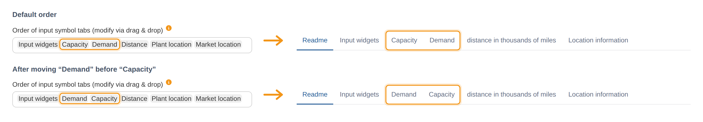
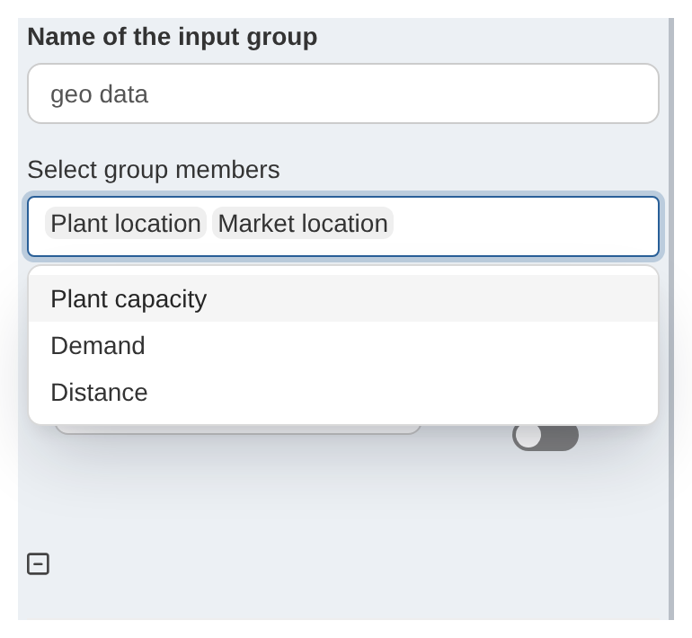
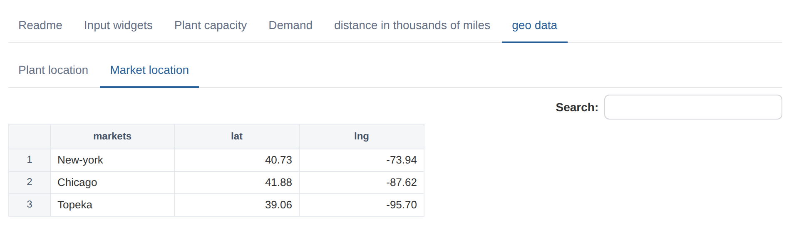
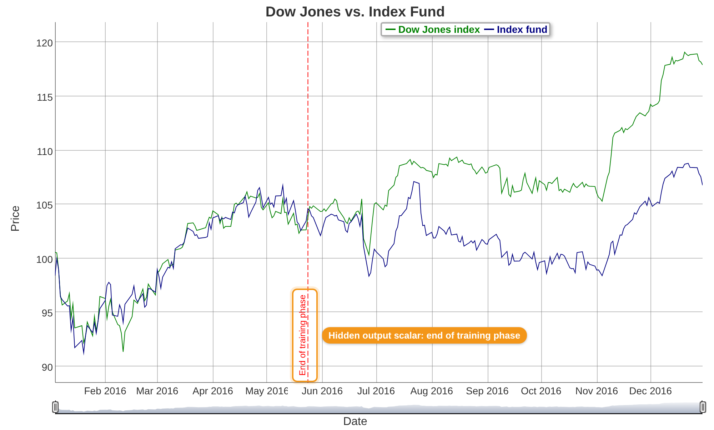

Symbols
=======

.. _general-symbols:

Introduction
------------

In this category, settings can be made that affect the symbols displayed in MIRO in terms of their name or arrangement. Changes made in this category are automatically saved.

.. _naming:

Symbol and Column Names
-----------------------

The section *Symbol and Column Names* lets you customize the names of GAMS symbols and their columns displayed in MIRO. You can change the labels for the symbol tabs and the headers of the data tables.

- *Specify symbol alias:*

  Change the labels that appear on the symbol tabs.

  .. image:: ../assets/images/configuration_mode/general_naming_tab.png
     :alt: Symbol alias in Configuration Mode and the resulting tab label

- *Specify column headers:*

  Change the headers for the columns within a symbol's table.

.. _tab-ordering:

Symbol Order
------------

Here you can adjust the tab order in which the symbols are to be displayed in MIRO. To do this, simply drag and drop the symbols into the desired order.

.. admonition:: Note:
   :class: warning

   If symbols have been grouped using the `grouping option <#tab-grouping>`__, only the individual symbols and not the configured groups are displayed here. If you want to change the position of a group, drag and drop the symbols that belong to this group to the desired position.

.. _tab-grouping:

Symbol Groups
-------------

Multiple tabs of input symbols (or output symbols) can be grouped together. All symbols in a group are either displayed in a separate tab or on the same tab.

If you decide to display symbols on the same tab, you can also select how many symbols should be displayed per row (side by side).

`Input widgets <./widgets.html>`__ can also be grouped. The order of the widgets can be changed directly when specifying the group members.

Note that adding or removing widgets does not automatically update the dropdown menus for selecting group members. You must restart the Configuration Mode for these changes to be reflected here.

**Example:**

For the input data of the transport model, one might want to group the symbols with geodata together:

Which is displayed in the MIRO App as follows:

.. _aggregate-widgets:

Aggregate Scalar Widgets
------------------------

If enabled, all scalar input widgets (slider, dropdown menu, etc.) are displayed in the same tab and separated otherwise.

.. _hidden-symbols:

Hide Output Symbol Tabs
-----------------------

For some charts, it may be desirable to use additional data of an output symbol that should not be displayed in the user interface. Currently, only `custom renderers <./configuration_advanced.html#custom-renderers>`__ support using data from more than one symbol (also hidden ones). Note that the data of hidden symbols belongs to a scenario just like visible symbols and is therefore also stored in the database. They are only hidden in the user interface.

.. _hidden-scalars:

Hide Output Scalars
-------------------

You can use data of scalar output symbols in some charts, while not displaying the scalars themselves in the scalars table. In the following example from the Pickstock model, the scalar output value "end of training phase" was integrated into the chart to mark the end of the training phase:

In this case you may not want to see the value in the scalars table, but it is required for this chart. With this option you can do exactly that, i.e. use scalar values in charts that are otherwise not visible in MIRO.

.. _symbol-links:

Use Output Data as Input Data
-----------------------------

In some situations you may want to run a model and use the results of the run as input for the next run. Such an iterative process is possible by creating a link between the output and input symbol. By doing so, input data for a symbol (*"target"*) can be populated from an output sheet (*"source"*).

Populating an input table from the linked dataset can be initiated by clicking the |Symbol link button| button.

The following rules must be observed when configuring symbol links:

- The source symbol needs to be an output symbol
- The number of dimensions of "source" and "target" symbol must be identical
- The header types (string / numeric) of linked symbols need to be identical
- Neither "source" nor "target" may be a table in which scalar values are grouped. This includes the input scalars table, the output scalars table and the table in which scalar variables and equations are gathered.
- An output dataset can only link to a single input table
- An input table can be populated by different output datasets

