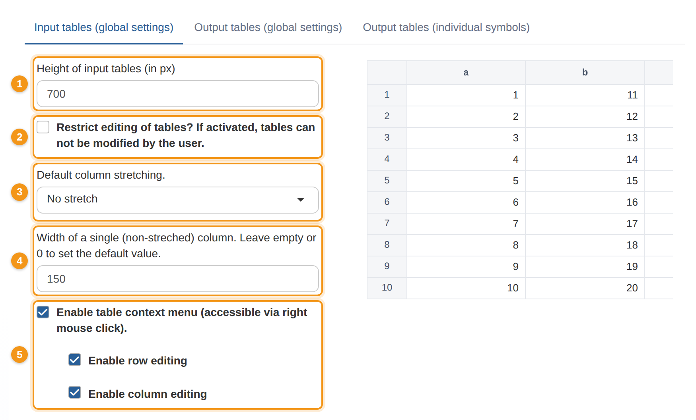
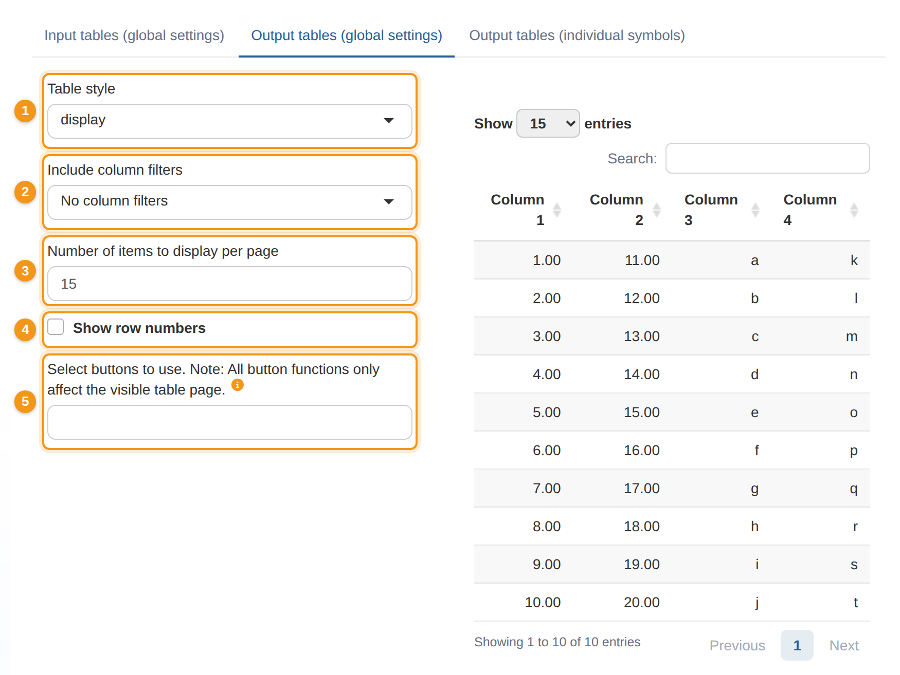
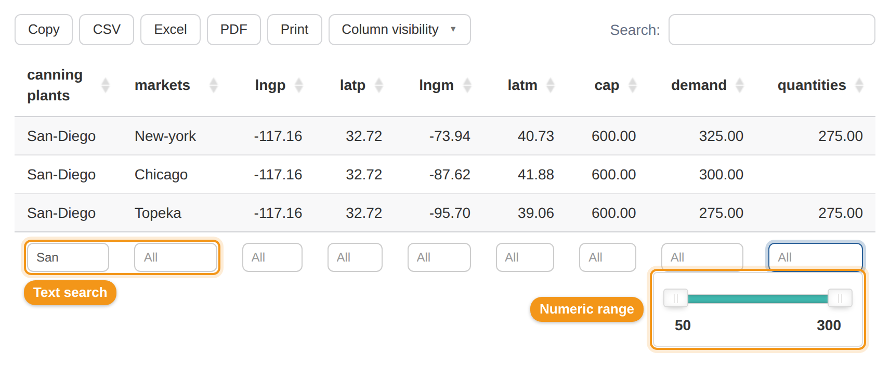
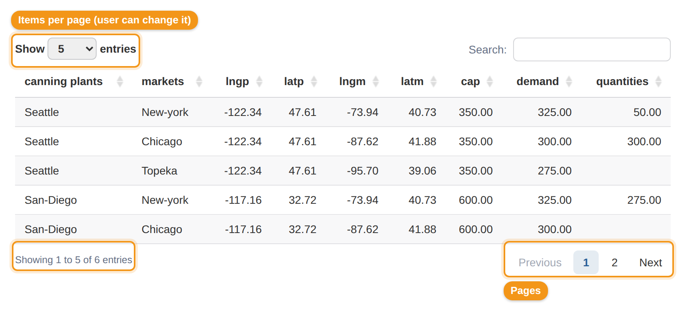
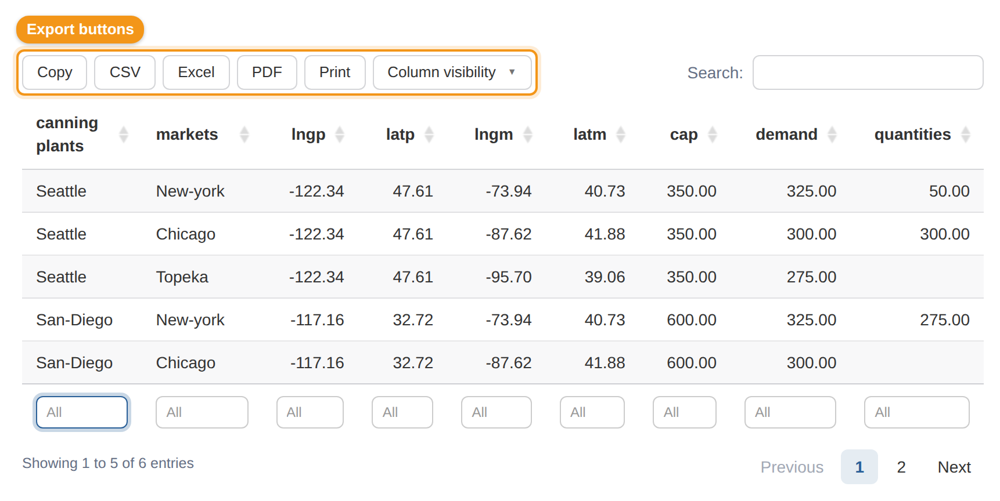

Tables
======

.. _table-settings:

Introduction
------------

In this section, you can customize the general configuration of input and output tables (global settings) as well as the individual settings of output tables. Tables for individual input symbols are configured in the `Input widgets <./widgets.html#widget-table>`__ category.

.. _global-input-tables:

Input Tables (global settings)
------------------------------

   The numbers refer to the settings described below.

.. _input-table-height:

Height of input tables
~~~~~~~~~~~~~~~~~~~~~~

Sets the height of the table. If the table content is higher than the configured height, a scroll bar is displayed.

.. _restrict-edit:

Restrict editing of tables
~~~~~~~~~~~~~~~~~~~~~~~~~~

Sets all input tables to read-only. No manual edits can be made by the user. Database scenarios or local data can still be loaded.

.. _column-streching:

Column stretching
~~~~~~~~~~~~~~~~~

Sets the general stretch behavior of columns. Available options are *no stretch*, *stretch last column* and *stretch all columns*. Stretched columns mean that the table always fills the entire window width. With large tables, this can have a negative effect on the performance of the application. Columns that are not set to stretch have a default column width of 200px.

.. _column-widths:

Column Widths
~~~~~~~~~~~~~

Here, you can adjust the default width of non-stretched columns (default: 200px). Avoid column widths that are too small; otherwise, the table contents may not be displayed correctly.

.. _context-menu:

Context Menu
~~~~~~~~~~~~

Enabling the context menu (accessible by right-clicking in the table) allows you to access various functions, such as adding or deleting a table row, or undoing the last modifications.

.. _output-tables:

Output Tables (global settings)
-------------------------------

   The numbers refer to the settings described below.

.. _table-style:

Table style
~~~~~~~~~~~

Several designs are available for output tables. Example:

.. grid:: 1 1 2 2
   :gutter: 2

   .. grid-item::

      **Table style:** *display* (default)

      .. image:: ../assets/images/configuration_mode/tables_style_display.png
         :alt: Table style: display (default)

   .. grid-item::

      **Table style:** *compact*

      .. image:: ../assets/images/configuration_mode/tables_style_compact.png
         :alt: Table style: compact

.. _column-filters:

Column Filters
~~~~~~~~~~~~~~

Table filters can be used to search each table column individually for entries. If there are strings in the column, the filter is a text search. For numeric values, a numeric range can be specified as the filter with the help of a slider. The filters can be displayed above or below the table or can be deactivated completely.

.. _numer-of-items:

Number of Items to Display
~~~~~~~~~~~~~~~~~~~~~~~~~~

Specifies how many rows are displayed per table page by default. Users can change this value in the MIRO application.

.. _row-numbers:

Show Row Numbers
~~~~~~~~~~~~~~~~

Determines whether row numbers are displayed.

.. _export-buttons:

Export Buttons
~~~~~~~~~~~~~~

The export buttons *copy*, *CSV*, *Excel*, *PDF* and *print* are available. Additionally, you can hide/show individual columns with the *column visibility* button.

.. admonition:: Note:
   :class: warning

   Only the currently visible data is exported! If a symbol contains multiple table pages, a button only affects the currently visible page. We recommend using the native export functionality of MIRO instead.

.. _symbol-table:

Output Tables (individual symbols)
----------------------------------

Global table settings can be overridden for each individual symbol. The available options are almost identical to those of the `global settings <#output-tables>`__. The only additional options are the number of decimal places to display and a setting to disable graphics for the symbol. Note that in contrast to the global settings, a symbol-specific configuration needs to be applied by clicking on the corresponding save button!

Some options for an output symbol table are listed below. For all other options, please consult the section on `global table settings <#output-tables>`__.

.. _output-table-option-decimals:

Decimal Places
~~~~~~~~~~~~~~

Adjusts the number of decimal places to display for table columns with numeric values.

.. _output-table-option-pivot:

Pivot a Column
~~~~~~~~~~~~~~

Allows you to pivot a table column of a symbol, i.e. to create a new column for each element in this column. Unlike the `table statement <./model.html#table-miro>`__ in the GAMS model itself (``Table symbolname;``), this option does not affect the `data contract <./model.html#data-contract>`__ between GAMS and MIRO. Hence, the columns of the symbol remain variable, since the symbol itself is communicated in list format. The pivoting of the configured column then happens "live" in the MIRO application.

.. _output-table-option-no-graphic:

Display no graphic
~~~~~~~~~~~~~~~~~~

If no specific graphic is configured for an output symbol, a `pivot table <./charts.html#pivot-chart>`__ is always displayed alongside the table by default. With this option, you can prevent the display of any graphics, so that the symbol is only visualized as a table.
