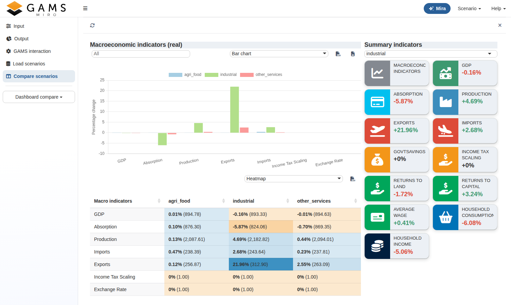
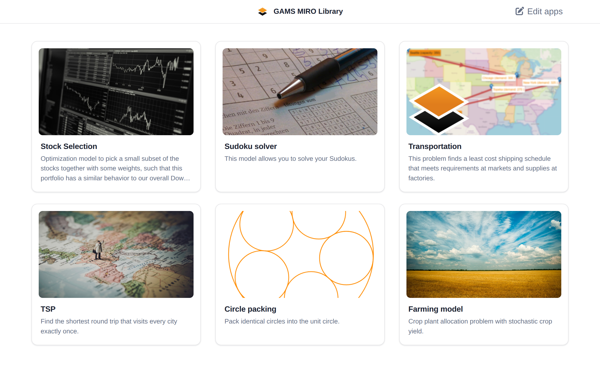
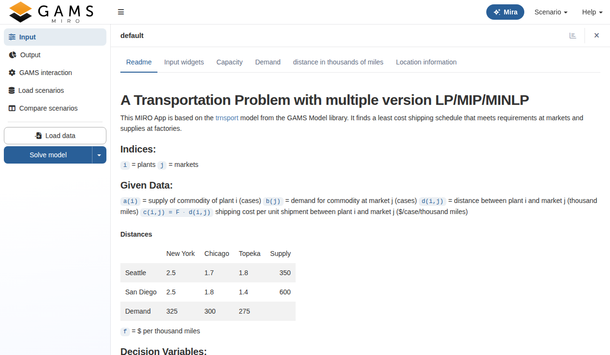

GAMS MIRO Quick Start Guide
===========================

Introduction
------------

Welcome to the GAMS MIRO Quick Start Guide. This guide provides a fast, reliable onboarding path to help you transform your existing GAMS or GAMSPy optimization models into fully functional, interactive web applications.

In the following sections, we will walk you through the essential stages of building your first MIRO app. You will learn how to establish a data contract to seamlessly link your model's inputs and outputs to the MIRO interface, launch your application to immediately interact with your data, and customize the user experience using widgets and charts. Finally, we will cover how to package and deploy your application so it can be easily shared with end users.

This quick start guide covers the most important aspects of MIRO application development. The individual aspects are explained in more detail in the linked chapters.

.. note::

   For a complete walkthrough from the implementation of a GAMSPy model to a simple MIRO app and sophisticated custom visualizations, see the `step-by-step tutorial <./step_by_step_tutorial.html>`__.

.. _miro-components:

Core Components of GAMS MIRO
----------------------------

GAMS MIRO consists of several components that work together to turn GAMS and GAMSPy models into interactive applications. Understanding these components helps clarify how models, user interfaces, and deployment workflows interact during development and operation.

In the simplest setup, all MIRO components run locally on the same machine as GAMS or GAMSPy. This setup is referred to as *GAMS MIRO Desktop*.

.. admonition:: Supported Platforms:
   :class: tip

   GAMS MIRO Desktop is available for Windows, macOS, and Linux.

.. raw:: html

   

MIRO User Interface
^^^^^^^^^^^^^^^^^^^

The most visible component is the MIRO user interface (MIRO UI). It provides the interactive application shown in the browser, where users can:

- Modify model input data
- Run optimization jobs
- Analyze model results
- Create and compare scenarios

.. _miro-connector:

GAMS/MIRO Connector
^^^^^^^^^^^^^^^^^^^

The GAMS/MIRO connector is responsible for the communication between the optimization model and the MIRO interface. It manages the MIRO data contract and transfers model input and output data between GAMS or GAMSPy and the MIRO application.

.. _miro-library:

MIRO Desktop Library
^^^^^^^^^^^^^^^^^^^^

Locally deployed MIRO applications are managed through the MIRO Desktop Library. It acts as a central launcher for installed applications and also provides access to global settings such as language preferences, paths, and browser configuration.

.. _cloud-setups:

Cloud and Enterprise Setups
^^^^^^^^^^^^^^^^^^^^^^^^^^^

Besides local desktop usage, MIRO applications can also be deployed in centralized cloud and enterprise environments using `GAMS MIRO Server <./server.html>`__. In this setup, applications are hosted on a server and accessed directly through the browser, eliminating the need for local deployment on end-user machines. Optimization jobs are executed by `GAMS Engine <https://www.gams.com/products/gams-engine/>`__, which acts as the scalable backend infrastructure for MIRO Server and provides enterprise-grade job scheduling, execution, and user management capabilities.

Prerequisites
-------------

- **GAMS or GAMSPy**: A working installation of the GAMS system (including GAMS Studio) or a Python environment with GAMSPy installed.
- **File Encoding**: Ensure your model files are encoded in **UTF-8**. Other encodings are not supported and will cause errors. In GAMS Studio you can change the encoding of your file via *Edit* → *Encoding* → *convert to* ... → *UTF-8*.

.. _installation-setup:

Installation and Setup
----------------------

.. _install-paths:

Download and Path Configuration
^^^^^^^^^^^^^^^^^^^^^^^^^^^^^^^

`Download <https://www.gams.com/miro/download.html>`__ and install GAMS MIRO Desktop. After installation, make sure that MIRO and your modeling environment know about each other.

.. tab-set::

   .. tab-item:: GAMS
      :selected:

      .. _install-path-gams:

      If you work with GAMS Studio, go to *File* → *Settings* → *Remote* and check whether the MIRO installation location is correct.

      .. image:: ../assets/images/studio/miro_path.png
         :alt: MIRO installation location
         :class: miro-image-max-height-330pt
         :align: center

      On the MIRO side, open MIRO Desktop and go to *Preferences* → *Paths*. Ensure that the location of the correct GAMS version is specified. Restart MIRO if you change the path.

      .. image:: ../assets/images/gams_path.png
         :alt: GAMS installation location
         :class: miro-image-max-height-370pt
         :align: center

   .. tab-item:: GAMSPy

      .. _install-path-gamspy:

      If MIRO is installed in one of the standard locations on Windows or macOS, GAMSPy usually detects it automatically. On Linux or when using a custom installation location, set the ``MIRO_PATH`` environment variable to the path of your MIRO executable. Alternatively, pass the path each time you call the GAMSPy CLI using the ``--path`` argument.

      Typical executable paths are ``C:\Program Files\GAMS MIRO\GAMS MIRO.exe`` on Windows, ``/Applications/GAMS MIRO.app`` on macOS, ``/usr/bin/com.gams.miro`` on Debian/Ubuntu if installed via a ``.deb`` file, or an AppImage path such as ``~/GAMS-MIRO-2.9.0.AppImage`` on other Linux distributions.

      On the MIRO side, open MIRO Desktop and go to *Preferences* → *Paths*. Ensure that the location of the correct Python version, i.e. the environment in which GAMSPy is installed, is specified.

      .. image:: ../assets/images/python_path.png
         :alt: Python installation location
         :class: miro-image-max-height-370pt
         :align: center

.. _licensing:

Licensing Setup
^^^^^^^^^^^^^^^

For GAMS-based MIRO applications, ensure that your license includes the GAMS MIRO connector. You can check this using the `Licensing dialog <https://www.gams.com/latest/docs/T_STUDIO.html#STUDIO_GAMS_LICENSING>`__ in GAMS Studio.

.. admonition:: GAMSPy users:
   :class: tip

   No separate MIRO connector license is required when using GAMSPy. MIRO support is built into GAMSPy and is available with a valid GAMSPy license.

To install a GAMS license, use one of the following methods:

- Using `GAMS Studio <https://www.gams.com/latest/docs/T_STUDIO.html#STUDIO_GAMS_LICENSING>`__ (network connection required).
- Offline or behind an HTTP Proxy: If your machine is not connected to the internet or an HTTP proxy is blocking the connection to the GAMS license server, you need to activate the license on a different machine. You can find all necessary steps `here <https://www.gams.com/latest/docs/UG_License.html#UG_License_install_activation_without_network_communication>`__.

.. _getting-apps:

Choose How to Get Started with MIRO
^^^^^^^^^^^^^^^^^^^^^^^^^^^^^^^^^^^

Once your environment is set up, there are several ways to start working with GAMS MIRO:

- **Explore Demo Applications:** You can try out pre-deployed MIRO demo apps to instantly see the capabilities of the interface. To add these apps to your MIRO Library, open MIRO Desktop and click **Edit → Add example apps**. Launch any app by clicking on one of the app tiles. You can find an overview of how to work with a GAMS MIRO app `here <start.html>`__.
- **Add an Existing MIRO App:** If you already have a fully deployed MIRO application (a ``.miroapp`` file), you can add it directly to your MIRO Library. Simply double-click the ``.miroapp`` file or use **Edit apps** in MIRO Desktop to import it. See `Installing and Running a Developed MIRO App <#install-run-app>`__ for details.
- **Develop Your First App:** If you want to turn your own GAMS or GAMSPy model into a MIRO application, continue with the development workflow starting at `Step 1: Prepare Your Model <#step-1>`__. Pre-configured demo applications are also available as reference implementations and starting points for your own projects. You can download them `here <https://www.gams.com/miro/download.html#demo-section>`__.

.. _install-run-app:

Installing and Running a Developed MIRO App
^^^^^^^^^^^^^^^^^^^^^^^^^^^^^^^^^^^^^^^^^^^^

**To install a MIRO app:**

- Simply double-click on the ``<app_name>.miroapp`` file.

*Alternatively:*

- Open GAMS MIRO Desktop and click on **Edit apps** in the top right-hand corner.
- Click the plus (+) symbol in the box that appears.
- Browse for and select the ``<app_name>.miroapp`` file and click **Add app**.

**Once the app is installed:**

- Click on the ``<app_name>`` tile in MIRO Desktop to start the interface.
- If no default scenario is loaded, click on **Load data** in the navigation bar and select one.
- Click on **Solve model** to generate results.

.. _demo-applications:

Using Demo Applications as Starting Points
~~~~~~~~~~~~~~~~~~~~~~~~~~~~~~~~~~~~~~~~~~

Demo applications are a useful way to explore MIRO before building an app from scratch. They are also helpful reference projects because they show how the data contract, app configuration, and model execution fit together.

.. tab-set::

   .. tab-item:: GAMS
      :selected:

      .. _demo-apps-gams:

      To work with the GAMS demo applications outside the MIRO Library, download the demo applications `here <./download.html#demo-section>`__, unzip the archive, and place the extracted *miro_lib* folder in your user model library directory. In GAMS Studio, you can find this directory under *File* → *Settings* → *Misc.* → *user model library*.

      .. image:: ../assets/images/miro_lib.png
         :alt: MIRO model library
         :class: miro-image-max-height-150pt
         :align: center

      Then open *GAMS* → *Model Library Explorer* in GAMS Studio and select *GAMS MIRO model collection*. From the command line, you can access an app with:

      .. code-block:: text

         > gamslib -lib /location/to/the/miro_lib/mirolib.glb <modelname>

   .. tab-item:: GAMSPy

      .. _demo-apps-gamspy:

      To work with the GAMSPy demo applications, download the demo applications `here <./download.html#demo-section>`__ and unzip the archive. The apps are located in the *miro_lib_gamspy* directory and can be launched directly with the GAMSPy CLI.

.. _step-1:

Step 1: Prepare Your Model
--------------------------

Before you can launch a model as a MIRO application, the model must define which symbols (sets, parameters, variables, or equations) should be available as inputs and outputs in the MIRO interface. This connection between the model and MIRO is called the "Data Contract". Symbols that are not part of the data contract are not shown in the app.

.. tab-set::

   .. tab-item:: GAMS
      :selected:

      .. _gams-1:

      In our example we use the classic `transportation problem <https://www.gams.com/latest/gamslib_ml/libhtml/gamslib_trnsport.html>`__ from the GAMS model library. The only thing we have to do in the model is to tell MIRO which symbols we want to see in the application. We do this by wrapping the corresponding *symbol declarations* with the tags ``$onExternalInput`` / ``$offExternalInput`` for input data and ``$onExternalOutput`` / ``$offExternalOutput`` for output data. These tags can be used multiple times within a model. Symbols that are not tagged are not visible in MIRO.

      .. code-block:: gams
         :class: miro-code-max-height-300px

         Set
            i 'canning plants' / seattle,  san-diego /
            j 'markets'        / new-york, chicago, topeka /
         ;

         $onExternalInput
         Parameter
            a(i) 'capacity of plant i in cases'
                 / seattle    350
                   san-diego  600 /
            b(j) 'demand at market j in cases'
                 / new-york   325
                   chicago    300
                   topeka     275 /;
         Table d(i,j) 'distance in thousands of miles'
                       new-york  chicago  topeka
            seattle         2.5      1.7     1.8
            san-diego       2.5      1.8     1.4
         ;

         Scalar f 'freight in dollars per case per thousand miles' / 90 /;
         $offExternalInput

         Parameter c(i,j) 'transport cost in thousands of dollars per case';
         c(i,j) = f*d(i,j)/1000;

         $onExternalOutput
         Variable
            x(i,j) 'shipment quantities in cases'
            z      'total transportation costs in thousands of dollars'
         ;
         $offExternalOutput

         Positive Variable x;

         Equation
            cost      'define objective function'
            supply(i) 'observe supply limit at plant i'
            demand(j) 'satisfy demand at market j';

         cost..      z =e= sum((i,j), c(i,j)*x(i,j));
         supply(i).. sum(j, x(i,j)) =l= a(i);
         demand(j).. sum(i, x(i,j)) =g= b(j);

         Model transport / all /;
         solve transport using lp minimizing z;
         display x.l, x.m;

   .. tab-item:: GAMSPy

      .. _gamspy-1:

      In our example we use the classic `transportation problem <https://gamspy.readthedocs.io/en/latest/user/notebooks/trnsport.html>`__. All you need to do to use your GAMSPy models in GAMS MIRO is to annotate your MIRO input and output symbols. For example, the following code snippet declares symbol ``d`` as a MIRO input and symbol ``x`` as a MIRO output:

      .. code-block:: python
         :class: miro-code-max-height-300px

         ...
         ...
         data preparation
         ...
         ...

         a = Parameter(m, name="a", domain=[i], records=capacities)
         b = Parameter(m, name="b", domain=[j], records=demands)
         d = Parameter(m, name="d", domain=[i, j], records=distances, is_miro_input=True)

         x = Variable(m, name="x", domain=[i, j], type="Positive", is_miro_output=True)
         ...
         ...
         model.solve()

      Symbols that are not annotated are not visible in MIRO.

Once your model is prepared for MIRO, continue with the next step and launch it in Base Mode to verify that the app starts correctly.

After launching MIRO for the first time, all selected symbols are automatically available in tabular form. Even without additional configuration, you can already:

- Load and modify input data
- Run or stop optimization jobs
- Inspect logs and generated files
- Analyze model results
- Store and compare scenarios

The complete workflow for preparing a model for MIRO, including detailed examples for GAMS and GAMSPy, is described `here <./model.html>`__.

.. _step-2:

Step 2: Launch Your First App (Base Mode)
-----------------------------------------

Run the model in MIRO Base Mode to verify that your data contract works and generates a default interface.

.. tab-set::

   .. tab-item:: GAMS
      :selected:

      .. _run-miro-gams:

      In GAMS Studio, open the model and choose *Run Base Mode* from the MIRO menu.

      .. image:: ../assets/images/studio/launch-miro-btn.png
         :alt: Launch MIRO button
         :class: miro-image-max-height-175pt
         :align: center

      .. admonition:: Note:
         :class: warning

         If you start MIRO via GAMS Studio, make sure that the model file you want to run is marked as the main file in the corresponding project group. If needed, right-click the file in the project explorer and select *set as main file*.

         .. image:: ../assets/images/studio/studio_main_file.png
            :alt: Set as main file in Studio
            :class: miro-image-max-height-200pt
            :align: center

   .. tab-item:: GAMSPy

      .. _run-miro-gamspy:

      After you mark your MIRO symbols with ``is_miro_input`` and ``is_miro_output``, you can run MIRO. Navigate to your model directory and launch MIRO from the command line:

      .. code-block:: text

         > gamspy run miro --model <path_to_your_model> [--path <path_to_your_MIRO_installation>]

      You can omit ``--path`` if MIRO is installed in one of the standard locations on Windows or macOS, or if you configured the ``MIRO_PATH`` environment variable.

This creates the data contract, initializes the default values of your GAMS MIRO app, and then launches the app.

.. admonition:: Expected Output:
   :class: tip

   MIRO Base Mode will open. You will see an interactive interface where you can load input data, click "Solve model," and examine the outputs.

.. _skip-model-execution:

Skip Model Execution
^^^^^^^^^^^^^^^^^^^^

GAMS Studio and the GAMSPy CLI can start MIRO without executing the model first. This can be helpful for large models, but it should be used with caution: if model execution is skipped, the GAMS/MIRO data contract is not created or refreshed. Changes to MIRO input or output symbols are therefore not communicated to MIRO.

.. tab-set::

   .. tab-item:: GAMS
      :selected:

      .. _skip-model-execution-gams:

      .. image:: ../assets/images/studio/skip_model_execution.png
         :alt: Skip model execution
         :class: miro-image-max-height-150pt
         :align: center

      For long-running GAMS models, consider compiling the model instead of skipping execution completely. You can use the GAMS option `a=c <https://www.gams.com/latest/docs/UG_GamsCall.html#GAMSAOaction>`__ to update the data contract without solving the model. In this case, a new default scenario is created with input data only.

      .. _start-via-command-line:

      .. dropdown:: Advanced: Start MIRO using the command line

         To launch MIRO from the command line, the data contract between GAMS and MIRO must be created first (`\<modelname\>_io.json <./faqs.html#file-io>`__). This happens when the model is called in GAMS with the option ``IDCGenerateJSON=path/to/conf_<modelname>/<modelname>_io.json``.

         For the *transport* model this would result in the following call:

         .. code-block:: text

            > gams transport.gms IDCGenerateJSON=conf_transport/transport_io.json

         While GAMS Studio automatically creates the required folder *conf_modelname* when launching MIRO, this does not happen when GAMS is called from the command line, so you have to create it manually. Once the model has been run with ``IDCGenerateJSON``, the file *conf_<modelname>/<modelname>_io.json* has been created.

         **Note**: Whenever changes are made to the model that are relevant for MIRO (i.e. symbols tagged with ``$onExternalInput`` / ``$offExternalInput`` or ``$onExternalOutput`` / ``$offExternalOutput`` have been changed), the data contract must be updated!

         .. admonition:: Tip:
            :class: tip

            When launching MIRO via GAMS Studio, you will find a scenario named *default* in the database after the startup. When starting MIRO via the command line you can create this default scenario with the GAMS option ``IDCGenerateGDX=data_<modelname>/default.gdx``.

         Before you can start MIRO, a few environment variables need to be set. On Windows, the default installation location is ``C:\Program Files\GAMS MIRO\GAMS MIRO.exe`` or ``C:\Users\<user>\AppData\Local\Programs\GAMS MIRO\GAMS MIRO.exe`` depending on whether MIRO was installed for all users or not.

         .. tab-set::

            .. tab-item:: Windows
               :selected:

               .. _windows:

               .. code-block:: text

                  > set MIRO_DEV_MODE=true
                  > set MIRO_MODEL_PATH=C:\Users\<user>\Documents\GAMSStudio\workspace\transport.gms
                  > set MIRO_MODE=base
                  > "C:\Program Files\GAMS MIRO\GAMS MIRO.exe"

            .. tab-item:: macOS

               .. _macos:

               .. code-block:: text

                  > export MIRO_DEV_MODE=true
                  > export MIRO_MODEL_PATH="/Users/<user>/Documents/model/transport/transport.gms"
                  > export MIRO_MODE=base
                  > "/Applications/GAMS MIRO.app/Contents/MacOS/GAMS MIRO"

            .. tab-item:: Linux

               .. _linux:

               .. code-block:: text

                  > export MIRO_DEV_MODE=true
                  > export MIRO_MODEL_PATH=/home/<user>/model/transport/transport.gms
                  > export MIRO_MODE=base
                  > ./GAMS-MIRO-1.0.AppImage

         .. admonition:: Note:
            :class: warning

            By default, MIRO uses the GAMS version that is in the PATH of your operating system. By setting the environment variable *GAMS_SYS_DIR*, you can tell MIRO where to look for GAMS instead. Note that at least GAMS version 30.2 is required to use MIRO.

   .. tab-item:: GAMSPy

      .. _skip-model-execution-gamspy:

      .. code-block:: text

         > gamspy run miro --mode="base" --model <path_to_your_model.py> --skip-execution [--path <path_to_your_MIRO_installation>]

      Use this option only if the current data contract is already up to date.

.. _miro-structure:

Structure of GAMS MIRO
^^^^^^^^^^^^^^^^^^^^^^

After launching an app, the MIRO interface is divided into a navigation bar and a main window. The navigation bar lets you switch between the main app views and trigger common actions such as loading data or solving the model.

Navigation Bar
~~~~~~~~~~~~~~

The navigation bar provides access to the main views of a MIRO application:

#. **Input:**
   Visualization and configuration of input data for the next model run.
#. **Output:**
   Visualization of output data.
#. **GAMS interaction:**
   Status information, logs, and listing files while the model is being solved. Listing files are not displayed when using GAMSPy.
#. **Load scenarios:**
   Explore and manage scenarios stored in the MIRO database.
#. **Compare scenarios:**
   Compare scenarios in split view, tab view, pivot view or custom comparison modes.

The navigation bar also contains the main action buttons:

#. **Load data:**
   Load input data for a model run. This can be a local file or an existing scenario from the database.
#. **Solve model:**
   Solve the model with the current input data and collect the results after the run has finished.

Main Window and Header
~~~~~~~~~~~~~~~~~~~~~~

The main window displays the content of the selected view. Depending on the app configuration, this can include input widgets, output charts, scenario comparisons, logs, or a README section shown to users.

Additional functions are available in the header bar:

- **Scenario:**
  Scenario management, including loading, saving, editing, deleting, and exporting scenario data.
- **Help:**
  Links to this documentation, the GAMS Forum, the command palette with keyboard shortcuts, and license information.

.. admonition:: Tip:
   :class: tip

   Take a look at `Working with GAMS MIRO <./start.html>`__ or our `fact sheets <./index.html#cheatsheets>`__ to get to know the MIRO interface and its components better.

.. _step-3:

Step 3: Customize the App (Configuration Mode)
----------------------------------------------

The default interface is fully functional, but you can enhance it by assigning widgets (sliders, dropdown menus), defining charts, and setting global options. Read about the app configuration in detail `here <./customize.html>`__.

- **In GAMS Studio**: Launch the app using **Configuration Mode** instead of **Base Mode**.
- **Using GAMSPy CLI**: Run the following command:

  .. code-block:: text

     > gamspy run miro --mode="config" --model <path_to_your_model.py>

You will enter a configuration screen. Any change you save (e.g., turning a scalar input into a slider, or configuring a default Pivot chart) is automatically written to a ``<modelname>.json`` file in your model's *conf_<modelname>* directory.

- General settings:
  Appearance and general behavior of the app.
- Symbols:
  Symbol naming, ordering, grouping, etc.
- Tables:
  Global table and individual output table settings.
- Input Widgets:
  Input widgets can be used to communicate input data with GAMS/GAMSPy. Examples of such widgets include: tables, sliders, dropdown menus, date selectors or checkboxes.
- Graphs:
  GAMS/GAMSPy symbols can be visualized as graphs. Many chart types are available and only need to be configured, i.e. adapted to your model-specific data. To create graphics that are perfectly tailored to your data and not available in MIRO yet, you can also write your own custom renderer.
- Colors:
  Configure custom themes.
- Database management:
  Backup, restore or remove the database.

.. _step-4:

Step 4: Deploy and Distribute
-----------------------------

When the MIRO app is completely configured, i.e. all graphics have been created, options have been set and adjustments have been made, the app can be packaged into a ``.miroapp`` file so that it can be easily shared and used in the daily business of your end users. No further changes to the model or the configuration can be made once it is deployed.

.. tab-set::

   .. tab-item:: GAMS
      :selected:

      .. _gams-2:

      Deploying MIRO applications can be done directly `from within GAMS Studio <./studio.html#studio-deploy>`__. In the MIRO menu, select *Assembly and Deploy*. In the dialog that opens, you first need to specify which files belong to your model. These are the main model file and all other files that are used by the model during a model run. Select all relevant files in the file selection window and click *Create*. The information is then stored in the *model assembly file*. Optionally, choose your execution environment (e.g., *Single-user* or *Multi-user*) and then click *Deploy*. See `Deployment <./deployment.html>`__ for more information.

   .. tab-item:: GAMSPy

      .. _gamspy-2:

      To deploy a GAMSPy MIRO app, you first need to specify which files belong to your model. These are the main model file and all other files that are used by the model during a model run. Read more about this `here <./deployment.html#model-assembly-file>`__. Once the *model assembly file* has been created, you can package all model files together with the app configuration into an app bundle. For this, run the GAMSPy command-line utility with ``--mode=deploy``:

      .. code-block:: text

         > gamspy run miro --mode="deploy" --model <path_to_your_model> [--path <path_to_your_MIRO_installation>]

The result is a single *.miroapp* file which can be sent to the end user(s) of the application.

.. admonition:: Expected Output:
   :class: tip

   A ``<modelname>.miroapp`` file is created. Users can install it simply by double-clicking the file or by dragging and dropping it into their MIRO Desktop library.

.. _further-reading:

Further Reading
---------------

This quick start guide covers the essential workflow for building and deploying a MIRO application. The following resources provide more detailed information about specific topics:

- `Preparing Models for MIRO <./model.html>`__
  Learn how to define the MIRO data contract and prepare GAMS and GAMSPy models for MIRO.
- `Working with GAMS MIRO <./start.html>`__
  Learn how to use MIRO applications, manage scenarios, compare results, and work with input and output data.
- `Customizing MIRO Applications <./customize.html>`__
  Configure widgets, charts, layouts, themes, custom renderers, and advanced app behavior.
- `Deployment <./deployment.html>`__
  Learn how to package, distribute, and deploy MIRO applications locally or via MIRO Server.
- `GAMS MIRO Cheat Sheets <./index.html#cheatsheets>`__
  Quick references for the MIRO interface, configuration workflow, and common tasks.
- `FAQs <./faqs.html>`__
  Frequently asked questions, troubleshooting tips, and solutions to common problems.
