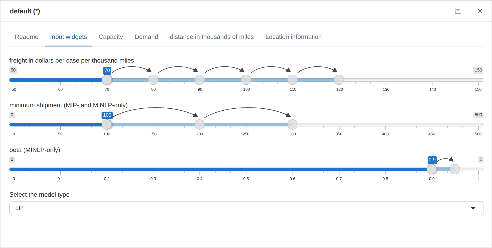
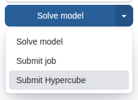
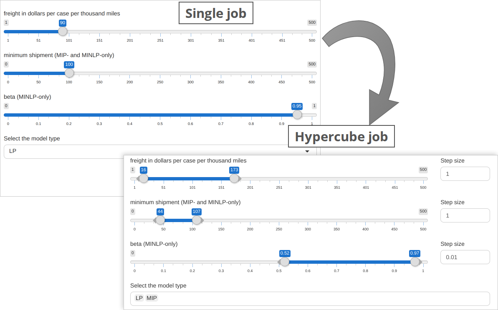
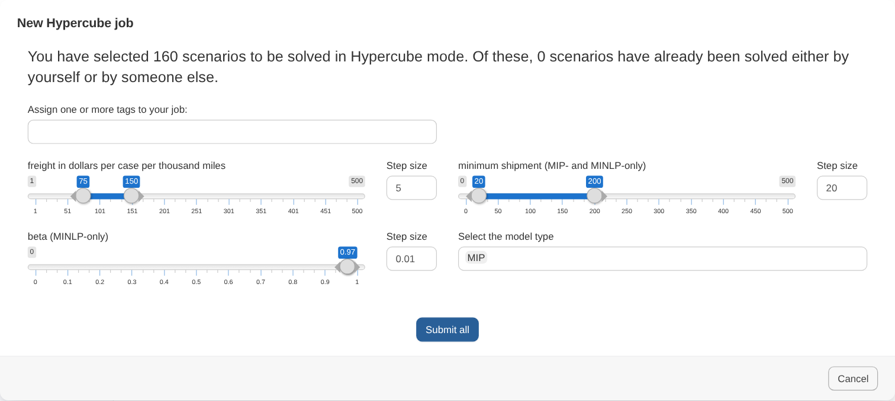
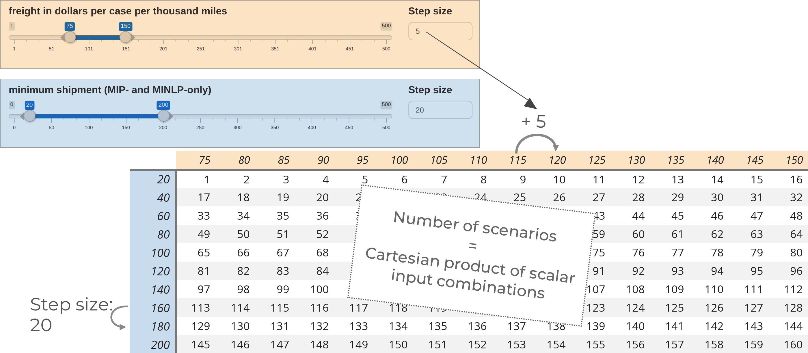

Hypercube Job
=============

.. _hypercube-introduction:

Introduction
------------

.. note::

   As of MIRO 2.1, the Hypercube Mode is deprecated
   and no longer exists as a separate mode. You can now
   submit Hypercube jobs from the Base Mode if you are using
   GAMS MIRO with a `GAMS Engine backend <./server.html>`__
   (GAMS MIRO Server or GAMS MIRO Desktop - boosted by GAMS
   Engine).

If MIRO is connected to `GAMS
Engine <https://gams.com/engine>`__, it is also possible to
configure and evaluate so-called *Hypercube jobs*. A Hypercube
job describes the automated execution of a certain number of
automatically generated scenarios that differ with regard to
their parameterization.

Let's get back to our *transport* example: Among other things,
we have seen that we can determine the freight costs for
transporting goods from suppliers to markets. We also learned
that MIRO allows us to submit this particular scenario and
fetch the results once it is done. But what if we want to solve a
multitude of such scenarios with different parameterizations?
Say we want to find out how our model responds to changes
in freight costs and other input parameters. To avoid having to configure and solve each
scenario individually, we can configure a *Hypercube job*. A
Hypercube job allows us to automatically solve and examine a
subset of the parameter space of our model. This is done by
varying scalar model parameters (zero-dimensional GAMS
parameters) within a given range. As a consequence, a large
number of scenarios can be configured and analyzed at once.

.. _hypercube-scengen:

.. _hcube-submit:

Submission of a Hypercube job
-----------------------------

A `scenario <./faqs.html#def-scenario>`__ is characterized by a
particular set of model input (and output) parameters. If, for
example, for a run of the *transport* model, the freight cost
is set to 90 and the minimum shipment of goods is set to 100,
then this parameterization characterizes the scenario (together
with the other input parameters as well as attachments). The
Hypercube configuration discussed here makes it possible to
automatically submit several of those scenarios at once.

.. _hcube-config:

Job configuration
~~~~~~~~~~~~~~~~~

If MIRO runs with a GAMS Engine backend, you can submit jobs
via "Solve model" (synchronous execution) and "Submit job"
(asynchronous execution) by default. If the `Activate
Hypercube
module <./configuration_general.html#activate-hcube>`__
option is set, there is a third option: "Submit Hypercube".

Clicking on it opens a modal dialog. This dialog shows
all scalar input widgets (sliders, dropdown menus,
checkboxes, etc.) configured for the MIRO app.
However, some widgets look different because they have
been transformed automatically:

When we submit a normal job, we can specify the freight cost
as well as the minimum amount of goods to ship. Those are
zero-dimensional values. The same scalars can now be
specified within a given range: The sliders have now become
slider ranges. In addition, we can set a *step size* for
each slider range. Furthermore, the single dropdown menu for
selecting the problem type has been replaced by a multi
dropdown menu.

.. tip::

   Input widgets you defined for your scalars in the Base
   Mode are automatically expanded when submitting a
   Hypercube job.

.. _widget-expansion-table:

The table below gives an overview of the scalar input
widgets and their different appearance when submitting a
Hypercube job.

+----------------------+-----------------------------------------------+
| Single job           | Hypercube job                                 |
+======================+===============================================+
| Single slider        | Slider range with step size selection         |
+----------------------+-----------------------------------------------+
| Slider range         | Slider range with step size and               |
|                      | combination-type selection                    |
+----------------------+-----------------------------------------------+
| Single dropdown menu | Multi dropdown menu                           |
+----------------------+-----------------------------------------------+
| Multi dropdown menu  | Not supported yet                             |
+----------------------+-----------------------------------------------+
| Checkbox             | Multi dropdown menu with options *yes* and    |
|                      | *no*                                          |
+----------------------+-----------------------------------------------+
| Date selector        | Date selector                                 |
+----------------------+-----------------------------------------------+
| Date range selector  | Date range selector                           |
+----------------------+-----------------------------------------------+
| Text input           | Text input                                    |
+----------------------+-----------------------------------------------+
| Numeric input        | Numeric input                                 |
+----------------------+-----------------------------------------------+
| Parameter table      | Parameter table                               |
+----------------------+-----------------------------------------------+

The transformation of input widgets has the following
implication for the submission of Hypercube jobs: `Unless
explicitly specified <#nobatch>`__ in the MIRO
configuration of the model, each scalar input widget is
expanded and the cartesian product over all scalars set
by the user defines a Hypercube job.

.. _hcube-dialog:

.. _job-configuration:

.. _hcube-example:

In this example, the slider for *freight in dollars per
case per thousand miles* was set to a range from 75
to 150 with a step size of 5. The slider configured in
this way leads to 16 different variants.

- Variant 1: *freight* = 75
- Variant 2: *freight* = 80
- Variant 3: *freight* = 85

[...]

- Variant 16: *freight* = 150

.. _stepsize:

For the scalar *minimum shipment* the slider was set to a
range between 20 and 200 with a step size of 20. The
resulting variants would therefore be:

- Variant 1: *minimum shipment* = 20
- Variant 2: *minimum shipment* = 40
- Variant 3: *minimum shipment* = 60

[...]

- Variant 10: *minimum shipment* = 200

The third slider for the scalar parameter ``beta`` is not
set to a range but to a single value. Due to the
non-existent variation of the scalar, only one variant
results from it. The same is true for the last widget, a
multi dropdown menu where we specify to only consider the
``MIP`` version of our model.

The cartesian product that results from the combination
of all variations is now calculated: It is created from
the different variants of the symbols *freight in dollars
per case per thousand miles* (16), *minimum shipment*
(10), *beta* (1) and *Select model type* (1) resulting in
16 x 10 x 1 x 1 = 160 individual scenarios.

.. _nobatch:

It becomes clear that the number of scenarios resulting
from a particular Hypercube job configuration can
increase rapidly with the number of scalars that are
expanded. Depending on how computationally intensive the
underlying GAMS model is, the scenarios should be
carefully configured.

.. note::

   The maximum number of scenarios that can be
   submitted in one job is limited to 10,000.

You may want to prevent certain input widgets from being
transformed. This can be done in the MIRO `Configuration
Mode <./customize.html#configurationMode>`__ by
unchecking the widget-specific option `Should element be
expanded automatically when submitting Hypercube
jobs? <./widgets.html#slider-option-expand>`__. If this
option is disabled, the widget will not be displayed in
the "Submit Hypercube" dialog, but can still be set as
usual in the input section.

.. _multi-dim-symbols:

.. admonition:: Multidimensional Symbols:
   :class: success

   Unlike scalar values, multidimensional symbols such
   as sets, parameters and multidimensional singleton
   sets cannot be varied within a Hypercube job
   configuration. The data remains fixed in every
   created scenario of a job. However, this does not
   mean that Hypercube jobs can only be used for
   zero-dimensional symbols. To vary data of
   multidimensional symbols in a Hypercube job, you can
   implement this in the GAMS model itself. For example, you can use a scalar in the
   model and assign different data to a
   multidimensional parameter in the model depending
   on the value of that scalar. If this scalar value
   is now varied in a Hypercube job, this also affects
   the multidimensional parameter.

.. _job-submission:

Job submission
~~~~~~~~~~~~~~

In the `modal dialog <#hcube-dialog>`__ for submitting a
Hypercube job you can see two more things besides the actual
job configuration:

.. _job-tag:

**Job tags:**

When submitting a Hypercube job, you can optionally
specify job tags, i.e. identifiers attached to all
scenarios of a Hypercube job. They can help you identify
scenarios of a certain job or a group of jobs with similar
attributes. This means that you can use those tags as part
of your `database
queries <./start.html#scenario-loading>`__ in order to
easily find certain scenarios that you are interested in.

**Scenarios that have already been solved:**

MIRO looks into the database where your scenarios are
stored and checks whether a subset of the scenarios you
want to submit have already been saved. If it finds
results from previous runs, MIRO asks if it should submit
only the scenarios that have not yet been executed, or if
it should submit all of them again.
There are a number of reasons why you might want to
re-submit certain scenarios. We will elaborate on these
reasons in the next section that discusses the technical
details of how MIRO sets up a Hypercube job. If you are
reading this documentation for the first time, you might
want to skip the following advanced section. If you are
interested, click on its headline to expand it.

.. dropdown:: Advanced: How MIRO identifies Hypercube jobs
   :name: hash-generation

   You might be wondering how MIRO knows whether a job
   has already been submitted or rather how a job is
   identified. Each scenario is characterized by the
   set of all input datasets that are populated by
   MIRO. This means that when you change something in
   your model or your execution environment that is not
   known to MIRO, it will not be detected as a
   different scenario. Let's consider the case where
   you want to run a certain set of scenarios on
   different compute clusters in order to perform some
   performance analyses. Since all of the input
   datasets that come from MIRO remain the same, MIRO
   thinks that the scenarios are identical. No
   attribute "compute environment" is known to MIRO.

   A scenario is identified by a 256-bit
   `SHA-2 <https://en.wikipedia.org/wiki/SHA-2>`__ hash
   value that MIRO computes from all inputs (scalar,
   command line parameters, tabular data, attachments)
   that the model receives from MIRO. An example of
   such a hash could be the following:

   ``7f14dcce0c726d215adae54daa2690b6a86b540cf4e3efaf9f97e8f4f3ab90a5``.
   We end up with a (relatively) compact identifier of a
   scenario while also making sure that we have a valid
   file/directory name without any reserved characters.
   The obvious disadvantage is that there is no way to
   derive the input parameters from the hash.

Once you are happy with the setup of your Hypercube job,
you can submit it. This triggers the expansion of all
scenarios resulting from your configuration and sets up your
Hypercube job. When a Hypercube job has been submitted, it
is shown in the `Job
list <./server_general.html#job-list>`__ in the GAMS
interaction section.

.. tip::

   You can customize the layout of the widgets in the
   Hypercube submission dialog by grouping them. Read
   `here <./configuration_json_only.html#hcube-widget-groups>`__
   to learn more!
