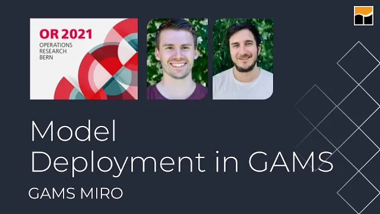

.. container:: miro-documentation-center

   .. rubric:: Documentation Center

   .. button-link:: download.html
      :color: primary

      Get GAMS MIRO 2.13.5

Welcome!
--------

.. container:: miro-welcome-text

   GAMS MIRO is a deployment environment for `GAMS <https://www.gams.com/>`__ and `GAMSPy <https://gamspy.readthedocs.io/en/latest/index.html>`__ models that enable you to build interactive optimization applications with powerful visualization and scenario management capabilities.

   If you are new to GAMS MIRO, start with the `Quick Start Guide <getting_started.html>`__. For an overview of the product, features, and deployment options, visit the official `GAMS MIRO product page <https://www.gams.com/products/gams-miro/>`__.

   You can also watch the recording of our `MIRO talk <#video-wrapper>`__ for a first introduction.

.. _cards-wrapper:

.. grid:: 1 1 2 3
   :gutter: 2

   .. grid-item-card::
      :link-type: doc
      :text-align: center
      :link: getting_started

      .. raw:: html

         <i class="miro-card-icon fa-solid fa-paper-plane" aria-hidden="true"></i>

      Quick Start Guide
      ^^^

      Transform optimization models into interactive web applications

   .. grid-item-card::
      :link-type: doc
      :text-align: center
      :link: download

      .. raw:: html

         <i class="miro-card-icon fa-solid fa-arrow-alt-circle-down" aria-hidden="true"></i>

      Download & installation
      ^^^

      Get GAMS MIRO for Windows, macOS or Linux

   .. grid-item-card::
      :link-type: doc
      :text-align: center
      :link: step_by_step_tutorial

      .. raw:: html

         <i class="miro-card-icon fa-solid fa-book-open" aria-hidden="true"></i>

      Walkthrough
      ^^^

      A comprehensive guide from creating GAMSPy models to sophisticated applications.

   .. grid-item-card::
      :link-type: doc
      :text-align: center
      :link: start

      .. raw:: html

         <i class="miro-card-icon fa-solid fa-desktop" aria-hidden="true"></i>

      Working with GAMS MIRO
      ^^^

      Learn how to work with MIRO applications and scenarios

   .. grid-item-card::
      :link-type: doc
      :text-align: center
      :link: model

      .. raw:: html

         <i class="miro-card-icon fa-solid fa-pen-to-square" aria-hidden="true"></i>

      Model preparation
      ^^^

      Use your own GAMS or GAMSPy model with MIRO

   .. grid-item-card::
      :link-type: doc
      :text-align: center
      :link: customize

      .. raw:: html

         <i class="miro-card-icon fa-solid fa-screwdriver-wrench" aria-hidden="true"></i>

      Configuration
      ^^^

      Learn how to customize a GAMS MIRO app

   .. grid-item-card::
      :link-type: doc
      :text-align: center
      :link: deployment

      .. raw:: html

         <i class="miro-card-icon fa-solid fa-box-open" aria-hidden="true"></i>

      Deployment
      ^^^

      Learn how to deploy a MIRO app

   .. grid-item-card::
      :link-type: doc
      :text-align: center
      :link: hc-module

      .. raw:: html

         <i class="miro-card-icon fa-solid fa-cube" aria-hidden="true"></i>

      Hypercube Jobs
      ^^^

      Execution of automatically generated scenarios

   .. grid-item-card::
      :link-type: doc
      :text-align: center
      :link: server

      .. raw:: html

         <i class="miro-card-icon fa-solid fa-cloud" aria-hidden="true"></i>

      GAMS MIRO Server
      ^^^

      Full flexibility through the cloud and remote execution

   .. grid-item-card::
      :link-type: doc
      :text-align: center
      :link: studio

      .. raw:: html

         <i class="miro-card-icon fa-solid fa-file-code" aria-hidden="true"></i>

      GAMS Studio integration
      ^^^

      The easiest way to develop a MIRO application

   .. grid-item-card::
      :link-type: doc
      :text-align: center
      :link: release

      .. raw:: html

         <i class="miro-card-icon fa-solid fa-code-branch" aria-hidden="true"></i>

      Release notes
      ^^^

      Check out the latest features and bug fixes

   .. grid-item-card::
      :link-type: doc
      :text-align: center
      :link: faqs

      .. raw:: html

         <i class="miro-card-icon fa-solid fa-life-ring" aria-hidden="true"></i>

      FAQs
      ^^^

      Frequently asked questions

GAMS MIRO Gallery
-----------------

.. grid:: 1 1 1 2
   :gutter: 3

   .. grid-item::

      .. image:: ../assets/images/gallery.png
         :alt: GAMS MIRO gallery
         :class: miro-image-max-height-350pt

   .. grid-item::

      Explore interactive demo applications and discover what can be built with MIRO.

      Test the MIRO applications directly in your browser, even mobile!

      .. button-link:: https://miro.gams.com
         :color: primary

         Go to gallery

.. _why-section:

Why GAMS MIRO?
--------------

GAMS MIRO helps you transform optimization models into interactive applications with minimal development effort. It combines automated deployment workflows with powerful visualization, scenario management, and customization capabilities.

* Rapid deployment of GAMS and GAMSPy models
* Interactive dashboards, charts, and widgets
* Scenario generation, management, and comparison
* Cloud and server-based execution support
* Highly customizable application interfaces
* Integration with GAMS Studio and GAMSPy workflows

.. note::

   If you have questions, encounter bugs, or have suggestions for improvement, please contact `miro@gams.com <mailto:miro@gams.com>`__.

.. _video-wrapper:

Learn more
----------

Watch the recording of our MIRO talk "Model Deployment in GAMS" (2021-09-06):

*(The video will open on youtube.com)*

.. _cheatsheets:

Fact sheets
-----------

Lazy to read the documentation or just want a compact summary of the most important features of GAMS MIRO?

Have a look at our fact sheets:

.. grid:: 1 1 1 3
   :gutter: 2

   .. grid-item::

      .. raw:: html

         

      The Interface

   .. grid-item::

      .. raw:: html

         

      Development & Deployment

   .. grid-item::

      .. raw:: html

         

      GAMS MIRO Server

.. toctree::
   :caption: Getting started
   :maxdepth: 2
   :hidden:

   getting_started
   download
   step_by_step_tutorial

.. toctree::
   :caption: Using and developing MIRO apps
   :maxdepth: 2
   :hidden:

   start
   model
   Configuration <customize>
   deployment
   hc-module
   studio

.. toctree::
   :caption: MIRO Server
   :maxdepth: 2
   :hidden:

   server

.. toctree::
   :caption: Reference and support
   :maxdepth: 2
   :hidden:

   file_formats
   faqs
   release
   license
   license-server
   schema
   security_ci_report
