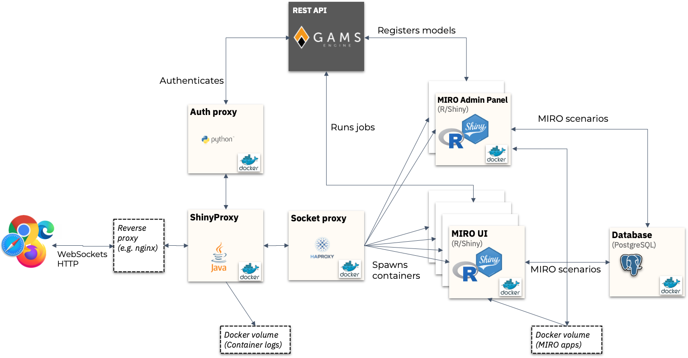

Architecture
============

.. _server-introduction:

Introduction
------------

`GAMS MIRO Server <./server.html>`__ is a containerized application that provides a web interface that can be accessed by any modern web browser ("client") that supports communication via WebSockets. It consists of several components that run in Docker containers. They communicate with each other via Docker networks. The data is kept in Docker volumes.

The above illustration shows all components. We will discuss these in detail below.

.. _shinyproxy:

ShinyProxy
----------

`ShinyProxy <https://www.shinyproxy.io>`__ is an open-source project developed to spawn Shiny applications that run in Docker containers (in MIRO Server we use a `custom version <https://github.com/GAMS-dev/shinyproxy/tree/v3.2>`__ of this project). It provides an option to authenticate users via a REST API (implemented in the Auth proxy container described below).

A new Docker container is created for each user requesting access to a MIRO application. All traffic (HTTP/WebSocket) from these containers is then forwarded to the client via ShinyProxy. This architecture results in each MIRO session running in its own container. Requests to the Docker API are proxied via the Socket proxy. Logs (stdout/stderr) of containers spawned by ShinyProxy are written to a Docker volume.

.. _auth-proxy:

Auth proxy
----------

The Auth proxy provides a REST API that is used by the ShinyProxy container to authenticate users. Authentication requests are then forwarded to the GAMS Engine REST API (user management is done in GAMS Engine). If the authentication is successful, the user groups are queried from GAMS Engine and returned to the ShinyProxy container.

This REST API can also be used for registering/updating MIRO applications or for uploading/downloading MIRO scenarios.

.. _socket-proxy:

Socket proxy
------------

The socket proxy is used to deny requests to any Docker API endpoints that ShinyProxy does not need access to (e.g. the volumes API). The socket proxy is only accessible from the ShinyProxy container (ensured by an internal Docker network).

.. raw:: html

   

MIRO Admin Panel
----------------

The MIRO Admin Panel container is accessible only to admins (ensured by ShinyProxy's authorization system). It can be used to register new MIRO apps as well as to update or remove existing ones. It has read/write access to a Docker volume to write app data as well as the database to store scenarios. It communicates with GAMS Engine to register/update/remove models.

.. _miro-ui:

MIRO UI
-------

The MIRO UI container hosts the MIRO UI. App configuration is read from a Docker volume to which the UI container has read-only access. All scenario data is stored in a PostgreSQL database. The MIRO UI container is based on `R/Shiny <https://shiny.posit.co/>`__ and uses WebSockets to communicate with the client. Static resources (JS/CSS/images/...) are sent over HTTP. It communicates with GAMS Engine to run jobs and retrieve results.

.. _database:

Database
--------

A PostgreSQL database is used to store MIRO scenario data. A new PostgreSQL schema and a user with read/write access to this schema are created for each MIRO application. When a new MIRO UI container is created, the database credentials of this user are passed to the container via environment variables. This means that if a MIRO UI container is compromised, only the data of this MIRO app can be accessed.
