Working with GAMS MIRO
======================

.. raw:: html

   

Introduction
------------

This chapter explains how to work with an existing GAMS MIRO application. It focuses on the everyday workflow after an app has been created or installed: loading input data, editing data in the
interface, solving the model, inspecting results, saving and exporting scenarios, and comparing different scenarios.

If you are new to MIRO, want to install MIRO Desktop, add demo applications, or turn your own GAMS or GAMSPy model into a MIRO application, start with the `GAMS MIRO Quick Start
Guide <./getting_started.html>`__ first. It covers installation, model preparation, Base Mode, Configuration Mode, and deployment.

Once you have a MIRO app available, the sections below show how to use it in practice.

.. _workflow-section:

Application Workflow
--------------------

There are several ways to use GAMS MIRO. However, a typical workflow could look like this:

#. Import input data
#. Modify the data
#. Solve GAMS model
#. Inspect the results (in the form of tables and/or charts)
#. Save the sandbox scenario or discard the results

- In addition, already saved scenarios can be re-imported and compared at any time.

.. admonition:: What is a scenario? What is a sandbox scenario? What data is used for a model run?

   To understand the MIRO data concept, what a scenario is and how it differs from a sandbox scenario, you should have a look at the sections `data concept <#data-concept>`__ and `scenario
   concept <#scenario-concept>`__!

.. _import-data:

Import data
~~~~~~~~~~~

A GAMS MIRO app is quite useful if there is data to be visualized, e.g. in the form of tables, diagrams or other charts. This applies to output data as well as input data. Data that is to be
visualized in MIRO can be imported either from existing scenarios in the database or via a local file (currently, this can be a MIROSCEN file, a GDX container, an Excel spreadsheet, or CSV files).

.. _miroscen:

A MIROSCEN file is a special file format used by MIRO to export and import a complete MIRO scenario. In contrast to other supported file formats like GDX, Excel or CSV, a MIROSCEN file includes
`metadata <#scenario-metadata>`__ such as tags, `views <#metadata-views>`__, `attachments <#file-attachments>`__ etc.
To import such data, click on the *Load data* button in the navigation bar. The following dialog pops up:

.. grid:: 1 1 2 2
   :gutter: 2

   .. grid-item::

      .. image:: ../assets/images/import-db.png
         :alt: Database import
         :class: img-fluid

   .. grid-item::

      .. image:: ../assets/images/import-local.png
         :alt: Local Import
         :class: img-fluid

.. _database-import:

Database Scenarios
^^^^^^^^^^^^^^^^^^

Scenarios that you have previously named and saved in the MIRO database will be displayed in *Database*. When you start a GAMS MIRO app for the first time, GAMS automatically extracts the data from
your model and loads this data into the database. This happens every time you rebuild your MIRO app i.e. every time you launch it in the `development mode <./model.html#development-mode>`__ via
GAMS Studio or the command line. A special scenario with the name *default* is created for this purpose and overridden every time you rebuild your app!

.. admonition:: Tip

   Every time you start a MIRO app in `development mode <./model.html#development-mode>`__ (via GAMS Studio or the command line), the data relevant to MIRO is extracted from your model and stored
   in the MIRO database as a special scenario named *default*.

.. _file-import:

Local Files
^^^^^^^^^^^

To import a file from your local machine, either in the form of a MIROSCEN file, a GDX container, an Excel spreadsheet or a CSV file, select the menu item *Local* and click on *browse*. Navigate to
the directory where your file resides and select it. Confirm the data import with a click on *import*. If you started with an empty sheet, a new, unnamed scenario is now shown in the interface. To
save it, click on *Save as* and give it a name.

.. admonition:: Note

   When importing CSV data, delimiters other than the comma are also supported. The currently supported delimiters are: ``,`` ``tab`` ``;`` ``|``
   ``:``.

.. _excel-import-rules:

.. dropdown:: Excel spreadsheet - import rules

   If you want to import data from a spreadsheet, it must either contain an index sheet describing the layout of your data, or it must meet certain criteria regarding the format in which the data is
   provided.

   .. rubric:: Workbook without index sheet

   If you do not want to create an index sheet, your Excel file must meet strict requirements:

   - Only one GAMS symbol per worksheet
   - The name of a sheet must be identical to the symbol name
   - The first line must contain the column headers. The names of the column headers are ignored.
   - All symbols must be in list view (no columns may be pivoted). The only exceptions to this rule are `tables <model.html#table-miro>`__, where the last column must be pivoted.

   The image below shows a valid spreadsheet for the transport model:

   .. image:: ../assets/images/import_excel_file.png
      :alt: Valid Excel file
      :class: miro-image-max-height-175pt

   For scalars there are 2 possibilities:

   - Either all scalar values are combined in one tab named ``_scalars`` or ``_scalars_out`` (separate sheets for input and output scalars). These tables must have 3 columns: *scalar*, *description* and *value*.

     .. image:: ../assets/images/import_excel_scalars.png
        :alt: All scalars in one sheet
        :class: miro-image-max-height-175pt

   - Alternatively, each scalar value is stored in a separate sheet as with other symbols (tab name = symbol name). The "table" then consists only of the scalar value in cell A1. There is therefore no header.

     .. image:: ../assets/images/import_excel_scalars_sep.png
        :alt: Separate sheets per scalar
        :class: miro-image-max-height-175pt

   - If you want to import command line parameters/GAMS options, the symbol name must be preceded by ``_gmspar_`` or ``_gmsopt_`` (see screenshot above).

   - To import scalar output variables and/or equations, the sheet name must be ``_scalarsve_out``. The table has to have 7 columns: *scalar*, *description*, *level*, *marginal*, *lower*, *upper*, *scale*.

     .. image:: ../assets/images/import_excel_vareq.png
        :alt: Scalar variable / equation
        :class: miro-image-max-height-175pt

   .. rubric:: Workbook with index sheet

   If you want more flexibility, you must create an index sheet that describes your layout. If you are already familiar with `GDXXRW <https://www.gams.com/latest/docs/T_GDXXRW.html>`__, this will
   already be familiar to you. You can skip most of this chapter, but be aware of the differences between GDXXRW and MIRO that we list `below <#gdxxrw-miro-diff>`__. We encourage everyone to read the
   documentation of GDXXRW, especially the chapter about `the index option <https://www.gams.com/latest/docs/T_GDXXRW.html#GDXXRW_EXAMPLES_READ_SPREADSHEET_INDEX>`__, as it covers the topic in much
   greater detail than we will do here.

   When the layout of your data differs from the default layout described above, you need to tell MIRO where to find what. This can be achieved by a so-called index. Here you list all the GAMS symbols
   that are included in your workbook as well as the layout they are in.

   .. admonition:: Note

      Unlike GDXXRW, MIRO already knows a lot about your data from the `GAMS/MIRO data contract <model.html#data-contract>`__. This means that information such as the dimensions of your symbols is
      known to MIRO and does not need to be specified again.

   The first three columns of the index range have a fixed interpretation: dataType, symbol identifier and dataRange. Even though MIRO does not need and ignores the dataType information (except
   ``dSet``, see info box below), it is a good practice to specify it because it allows your worksheet to be read by both MIRO and GDXXRW.

   The fourth and subsequent columns can be used for additional options. The column heading indicates the option name and the cell contents indicate the option value. Note that although GDXXRW allows
   options also in a comma-separated option=value format, MIRO does not support this.

   .. admonition:: Domain Sets (dSet)

      Just like GDXXRW, MIRO supports reading a set as *domain set* by specifying it as type ``dSet``. This option is supported only for one-dimensional sets. Duplicates and set text are
      ignored. The ``dSetText`` option is also supported by MIRO (`documentation <https://www.gams.com/latest/docs/T_GDXXRW.html#GDXXRW_OPTIONS_DSETTEXT>`__).

      Note that in most cases, it is preferred to use the `Implicit Set Definition <https://www.gams.com/latest/docs/UG_SetDefinition.html#UG_SetDefinition_ImplicitSetDefinition>`__ feature of GAMS!
      This avoids domain violations caused by having to maintain two tables in MIRO.

   Let's look at an example:

   .. image:: ../assets/images/import-wb-index.png
      :alt: Example of index sheet
      :class: miro-image-max-height-200pt

   The first thing you may notice is the name of the index sheet: ``_index``. Although the index could be on any sheet and in any range, MIRO can automatically recognize it if the sheet is named
   ``_index`` and the index table starts in the upper left corner: *A1*. The most important information MIRO requires is the symbol name, range (columns *B* and *C*) and one of ``rDim``
   (row dimension) or ``cDim`` (column dimension). If neither ``rDim`` nor ``cDim`` is supplied, MIRO will assume a default of *1* for ``cDim``. This means that the
   last column is pivoted as is the case for the parameter ``d``:

   .. image:: ../assets/images/import-wb-d.png
      :alt: Layout of parameter d
      :class: miro-image-max-height-125pt

   You can see that the last column (index ``j``) is pivoted. Also note that we can ignore rows and columns via the ``ignoreRows`` and ``ignoreColumns`` options. In this example, we want
   to ignore the row *16* because it does not belong to the data for ``d``, but for the set ``j``, which is also read from the same range (*sheet1!L15:N16*). This brings us to
   the next option: ``values``. Each tuple in a set can have associated text. To read a set from a spreadsheet, the ``values`` option is used to indicate whether there is data, and if so,
   whether the data should be interpreted as associated text or as an indicator of whether or not the tuple should be included in the set. In our example here, we use the *YN* option, which specifies
   that only tuples that have a data cell that is not empty and does not contain *0*, *N*, or *No* will be included. This means that in our example *j* only the tuple *New-York* is read. MIRO supports
   all options GDXXRW supports: *auto*, *noData*, *YN*, *sparse* and *dense*. See the `related section of the GDXXRW
   documentation <https://www.gams.com/latest/docs/T_GDXXRW.html#GDXXRW_EXAMPLES_READ_SPREADSHEET_SET_DATATEXT>`__ for more information on the other options. Below you find a list of all options
   supported by MIRO.

   .. rubric:: Supported options

   .. list-table::
      :widths: 20 60 20
      :header-rows: 1

      * - Option
        - Description
        - Allowed values
      * - range
        - Excel range: Open and closed ranges are supported. It must be of the form SheetName!TopLeft:BottomRight . If the sheet name is omitted, the first sheet in the workbook is used by default. If the BottomRight corner is omitted, the data is read until skipEmpty +1 empty rows/columns are found. If range is omitted, an open range with left upper corner A1 is assumed.
        -
      * - ``rDim``
        - Row dimension: the number of columns in the data range that will be used to define the labels for the rows. The first rDim columns of the data range will be used for the labels.
        - 0..dim
      * - ``cDim``
        - Column dimension: the number of rows in the data range that will be used to define the labels for the columns. The first cDim rows of the data range will be used for labels.
        - 0..dim
      * - ``values``
        - How set data is handled. See the related section of the `GDXXRW documentation <https://www.gams.com/latest/docs/T_GDXXRW.html#GDXXRW_EXAMPLES_READ_SPREADSHEET_SET_DATATEXT>`__ for more details.
        - auto , noData , YN , sparse , dense
      * - ``ignoreRows``
        - Rows to ignore
        - comma-separated list of positive integers
      * - ``ignoreColumns``
        - Columns to ignore
        - comma-separated list of positive integers or column letters
      * - ``skipEmpty``
        - When reading an open range, controls how many empty rows or columns will be ignored before the next empty row or column indicates the end of the block
        - 0 , 1
      * - squeeze
        - Controls whether zeros are squeezed out/removed
        - y , 1 , n , 0
      * - ``dSetText``
        - This controls the reading of explanatory text for set elements of domain sets. By default, no text is read for domain sets. If this option is activated this is changed. If an element appears more than once, the first one defines the explanatory text read.
        - y , 1 , n , 0

   .. rubric:: Reading scalars

   In addition to reading each scalar individually as supported by GDXXRW, MIRO also supports reading in table form. To read an entire table of scalars, you must do so using the special
   ``_scalars``/``_scalars_out`` symbols for input and output scalars, respectively. In this way MIRO reads scalars grouped in a table with 3 columns: ``Scalar``, ``Description``,
   ``Value``. The ``Description`` column can also be omitted. Let's look at our example again:

   .. image:: ../assets/images/import-wb-scalars.png
      :alt: Layout of individual and grouped scalars
      :class: miro-image-max-height-125pt

   If we look at the corresponding index sheet again, we see that both the output scalar ``total_cost`` and the input scalar table ``_scalars`` are defined on this sheet. In this example, the
   table is pivoted (scalar names in the columns) and the ``Description`` column has been omitted.

   Note that you can mix the declaration of table and individual scalars. Scalars that are missing from the table are appended if they are individually declared. If a scalar is found both in one of
   the special tables and individually declared, the scalar in the table takes precedence and the individually declared scalar is ignored.

   .. admonition:: Note

      Command line parameters/GAMS options are treated like *normal* input scalars with the special prefixes ``_gmspar_`` and ``_gmsopt_``.

   .. _gdxxrw-miro-diff:

   .. rubric:: Differences between GDXXRW and MIRO

   Below we list the important differences you need to be aware of when migrating from GDXXRW to MIRO or vice versa.

   - Global options are not supported by MIRO: all options are symbol-specific and must be part of the symbol declaration row
   - The only special values supported by MIRO are: +Inf and -Inf. Eps, YES, NO, NA, Undef, etc. are not properly recognized when used in MIRO
   - Acronyms are not supported
   - The only options supported by MIRO are: rDim, cDim, dim, values, ignoreRows, ignoreColumns, skipEmpty, squeeze
   - Option=value columns are not supported and will be skipped. Please specify the option names as column headers and the values as cell contents.
   - *skipEmpty* must be specified for each symbol individually. The state of this option is not transferred to the next symbols as with GDXXRW.
   - Named ranges are not supported.
   - Ranges with *..* instead of *:* as separator between *TopLeft* and *BottomRight* corner are not supported.
   - *skipEmpty* > 1 is not supported i.e. only values *0* and *1* can be used
   - It is possible to read variables/equations with MIRO. They are treated like normal parameters, with an additional dimension that must contain at least one of the following elements:
     ``level``, ``marginal``, ``upper``, ``lower`` and ``scale``. These do not all have to be assigned, i.e. you can skip some.
   - When reading scalars, you can either declare them individually as in GDXXRW, or you can use the special symbol names ``_scalars``/``_scalars_out`` to read input/output scalars grouped in a
     table with 3 columns: ``Scalar``, ``Description``, ``Value``. The ``Description`` column can be omitted. You can also mix declaration of individual scalars and scalar tables.
     Scalars that are missing in the scalar table are appended if they are declared individually. If an individually declared scalar is also in a scalar table, the individually declared scalar is
     ignored.
   - In tables/variables/equations, if squeeze=1, empty cells and NA are indistinguishable
   - Output scalar variables and equations must be in a single table named ``_scalarsve_out`` with dimensions: ``scalar``, ``description``, ``type``, where type must not contain any
     elements other than: ``level``, ``marginal``, ``upper``, ``lower``, ``scale``. Please note that the ``Description`` dimension must be present (unlike the
     ``_scalars``/``_scalars_out`` tables), but is ignored when MIRO imports it.

   Instead of importing all the datasets for your model, you can also select the symbols to import manually. To do so, click on *Manually choose datasets* and choose those symbols to be imported from
   the uploaded spreadsheet. This will cause MIRO to ignore other datasets.

.. _startup-import:

Import multiple scenarios on startup
^^^^^^^^^^^^^^^^^^^^^^^^^^^^^^^^^^^^

In addition to the options mentioned above, which can be accessed directly from MIRO, (multiple) scenarios can also be imported automatically when starting an application. To do this, the scenarios
to be imported (MIROSCEN, GDX, CSV or Excel files) must be put in the folder ``data_<modelname>`` (located in the model directory). With the next start of MIRO, those scenarios are imported
automatically. Note that in development mode MIRO skips the import of files that have not changed since the last start.

In addition to scenario data, `views <#metadata-views>`__ can also be imported together with the scenario data. Simply place the JSON file with the view data here as well. The file has to be named
``<scenarioName>_views.json``. For example if you want to provide data in the form of a GDX file and views for a scenario with the name ``my_scenario``, you have to place both ``my_scenario.gdx`` and
``my_scenario_views.json`` into the ``data_<modelname>`` directory.

.. _data-manipulation:

Data manipulation
~~~~~~~~~~~~~~~~~

| The tables that were empty before are now populated. In the upper part of the main window, you can navigate between different tabs to switch through the different GAMS symbols that you have
  specified in your model.
| We can now change the input data. You may want to edit individual cells, sort by a different column or add/remove entire records (rows in the table). In our *transport* demo you have the option
  to edit the capacities, the demand, the distance matrix and several scalar values:

|Input data screen| With the help of sliders and a dropdown menu we can now adjust the freight costs and the model type to be used. If we are satisfied with the settings we can start the GAMS run.

.. _data-cleaning:

Data cleaning
~~~~~~~~~~~~~

Your input data must not contain duplicate records. MIRO can help you automatically find and remove duplicate records in your input data sets using the *Scenario* → *Remove duplicates* menu in the
header. MIRO first checks if any of your input records contain duplicate records, and gives you the option to keep only the first or only the last occurrence of the duplicate.

.. _solve-model:

Solve the model
~~~~~~~~~~~~~~~

| A click on the *Solve model* button starts the model run. In the background GAMS is called and the model ``transport.gms`` is started. The values set by us in MIRO now serve as input data for the
  model.
| During the calculations, MIRO automatically switches to the section *GAMS interaction*. There you can see the current GAMS ``log`` and ``lst`` files (`documentation <https://www.gams.com/latest/docs/UG_GAMSOutput.html>`__). If you specified a `custom log <./configuration_general.html#miro-log>`__ this is also shown here.

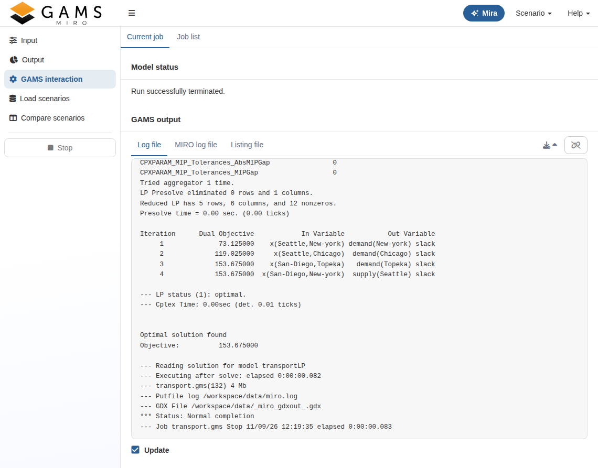

.. admonition:: Note

   Since the models of the demo applications are solved very quickly, this step is sometimes hardly visible. The menu entry *GAMS interaction* can also be viewed at any time after a model run.

| As long as the calculations are running in GAMS, the *Stop* button on the left can be clicked. A first click on this button sends an interrupt request to the running job in order to perform a
  graceful stop and collect an incumbent result back from the execution if the solver supports this feature. A second click sends a request to stop the running job immediately.
| After the run, the view changes again to the *Output* section.

.. _inspect-results:

Inspect results
~~~~~~~~~~~~~~~

| In the *Output* section the results are visualized. As with the input data, a distinction is made between GAMS parameters and scalar values. The GAMS parameters are each visualized in a separate
  tab and the scalars are summarized in a table.
| If you have configured a graphical representation of your data, you can also see it here. In the model *Transport* a plot for the transport schedule is configured in the form of a map, see figure
  below.

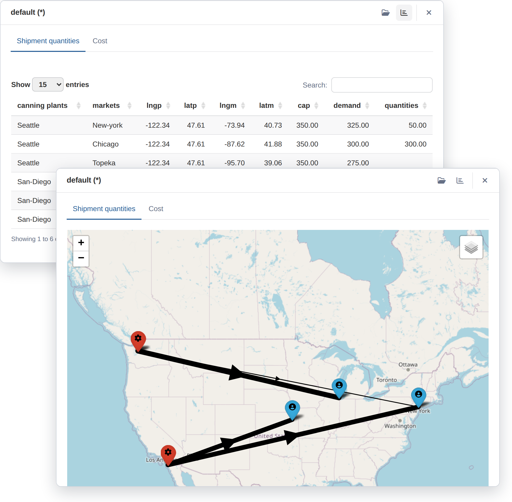

With a click on the |Switch to tabular view button| button in the upper right corner you can switch between a plot and the tabular representation of the data.

The *Costs* tab shows the objective function value of the model calculation in a tile. Like before, you can switch between graphical and tabular representation with a click on the |Switch to
tabular view button| button.

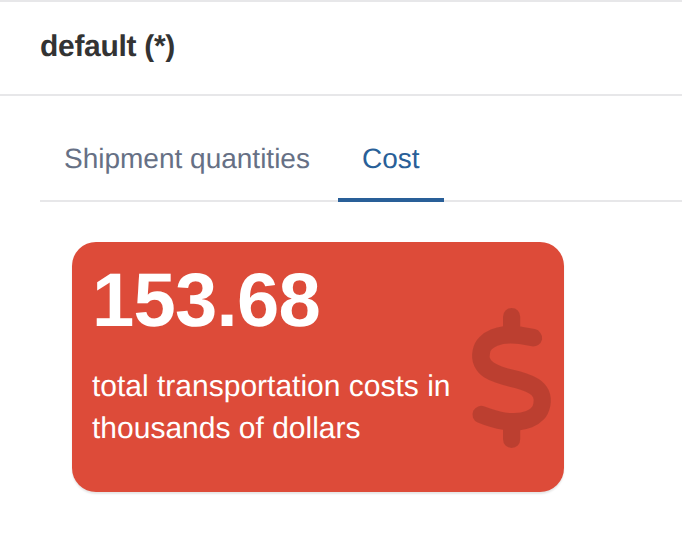

Download temporary files:
^^^^^^^^^^^^^^^^^^^^^^^^^

If this `option <./configuration_general.html#general-temp-dir>`__ is enabled, all temporarily created files of the model run (like solution reports or the ``lst`` and ``log`` files) can be downloaded
either separately or as a ZIP archive with a click on the |Download temporary files| button.

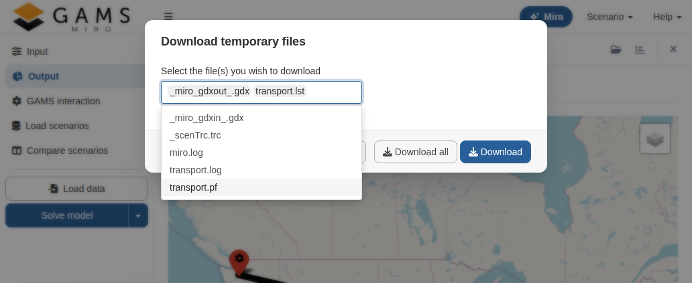

.. _save-export-delete:

Save / export / delete a scenario
~~~~~~~~~~~~~~~~~~~~~~~~~~~~~~~~~

.. _save-general:

The set of all the input and output data is what we call a scenario. Data that is currently loaded in the MIRO interface (in memory) is what we call a *sandbox scenario* (more on this
`here <#scenario-concept>`__). A sandbox scenario can be saved at any point. The menu where you can interact with your currently active scenario can be found in header bar of your MIRO app:

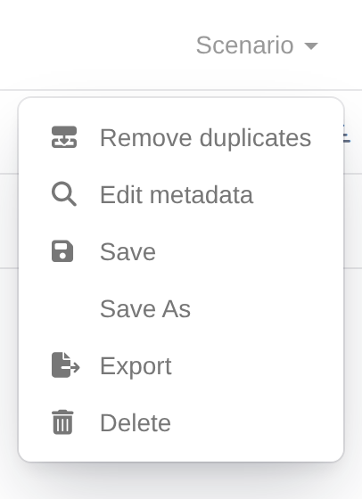

.. _metadata:

.. _save:

.. _save-as:

- **Edit metadata:** Allows you to edit scenario metadata, i.e. the scenario name and/or the tags assigned as well as file attachments and scenario access permissions. Read more about scenario metadata `here <#scenario-metadata>`__.

- **Save:** Saves the currently active sandbox scenario under an already specified name. Data of the initially loaded scenario is overwritten.

  .. admonition:: Tip

     Unless otherwise configured, the ``log`` and ``lst`` file of the GAMS run will also be saved and can be accessed when re-loading the corresponding scenario.

- **Save As:** Saves the currently active sandbox scenario under an new name. If the sandbox scenario has no name yet, only this option is available for saving.

  .. image:: ../assets/images/scenario_saveas.png
     :alt: Save sandbox scenario in database
     :class: miro-image-max-height-250pt

  Optionally, you can add tags to the scenario. Tags are stored together with the scenario data. If you want to find a scenario later on, you can search for a given tag. This may help you to better find a certain scenario or a set of scenarios that share certain attributes. Also, if your sandbox scenario contains `attachments <#file-attachments>`__ or you have defined `user access permissions <#access-permissions>`__, you can adopt these settings for the scenario to be saved.

- **Export:** Download of the scenario data in the form of a MIROSCEN file, a GDX container, as an Excel spreadsheet or as CSV files.

- **Delete:** Delete the scenario from the database.

.. _scenario-loading:

Finding and loading scenarios
~~~~~~~~~~~~~~~~~~~~~~~~~~~~~

To help you find and load exactly the scenarios you are interested in, MIRO has a powerful *Batch Load* module that graphically assists you create and execute complex database queries.

Filters can be applied to scenario metadata such as the creation time, scenario name, or optional tags you have assigned to a scenario. You can also filter by any input and output scalars defined
in your model as well as any Double-dash parameters and GAMS options. You can combine any of these filters with the logical operators AND and OR:

.. admonition:: Tip

   You can search for empty entries (*NA*) by leaving the field empty if it is a numeric field, or by using the ``exists`` and ``doesn't exist`` operators for character fields!

You can execute your query by clicking on the *Fetch results* button. After the results have been retrieved, the page will be updated and you will see a table with the scenarios that correspond to
your query.

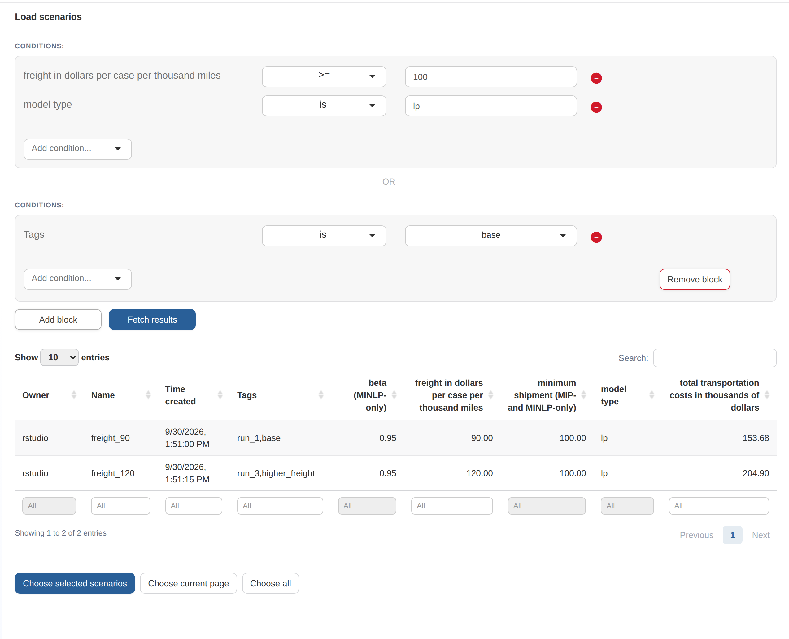

.. admonition:: Tip

   You can change the name and/or job tag(s) of a scenario by double-clicking the corresponding cell in the table. This can be especially useful for scenarios that were generated via a Hypercube
   Job and have a (SHA-256) hash as name by default.

Once you have found the scenarios you were looking for, you can do one of the following:

- **Delete scenarios:**
  Remove the selected scenarios.
- **Download data:**
  Download scenario data for external analysis. `Here <https://nbviewer.jupyter.org/urls/www.gams.com/external/jupyter_examples/PickStockAnalysisR.ipynb>`__ you can find an example of such an
  external analysis. The data of selected scenarios were analyzed using R in combination with Jupyter Notebook.
- **Analyze:**
  Run one of your customized batch analysis scripts (only visible if you have custom analysis scripts set up).
- **Load into sandbox:**
  Load the selected scenario into the `sandbox <#scenario-concept>`__ (only visible if you have selected exactly one scenario).
- **Compare:**
  `Interactive scenario comparison <#scenario-comparison>`__: Compare different scenarios directly in split, tab or pivot view. Best suited for a small number of scenarios to be compared (maximum
  allowed number of scenarios: 10).

.. admonition:: Tip

   When comparing or downloading multiple scenarios, it is sometimes useful to name them according to a common naming scheme based on input/output scalars or other metadata such as creation time.
   This is especially useful for `Hypercube scenarios <hc-module.html>`__, since their names are generated automatically. MIRO allows you to choose one or more columns of the Batch Load table to be
   used for naming scenarios. For example, if we select the "freight Cost" and "minimum shipment" columns to name our scenarios, the first scenario (25E3641B...) in the above image will be named
   "86_100", the second (da1a8c4b...) will be named "85_100", and so on. As soon as at least one column has been selected for naming the scenarios, another text field appears in which you can
   additionally specify a (static) prefix for the scenario names.

.. _scenario-comparison:

Scenario comparison
~~~~~~~~~~~~~~~~~~~

The scenario comparison mode is useful if you want to compare the input and/or output data of different model runs. Scenarios from the database as well as the currently loaded sandbox scenario can
be used for comparison. There are three different types of comparison available, split view, tab view and pivot view mode.

.. admonition:: Tip

   In case you want to compare multiple scenarios in a different way than the default comparison modes (split view, tab view and pivot view mode) allow, MIRO also supports `custom scenario
   comparison modes <configuration_json_only.html#custom-compare-mode>`__.

.. _compare-pivot:

Pivot view
^^^^^^^^^^

Unlike the split view and tab view, which take your chart configuration into account, here all records are displayed as `pivot tables <./charts.html#pivot-chart>`__. Also note that the pivot view
comparison mode always compares the sandbox scenario with other scenarios. The sandbox scenario is therefore also called *base scenario* in this context.

The data of the sandbox scenario and all selected scenarios are merged into a single table with an additional domain: *Scenario*. You can add/remove scenarios at any time by clicking the |Add
scenarios button| button in the upper left corner. To close the scenarios currently loaded in the pivot mode, click the |Close scenarios button| button in the upper right corner. If you have made
changes to your sandbox scenario and want to update the data in the pivot view, click the |Refresh scenarios button| button.

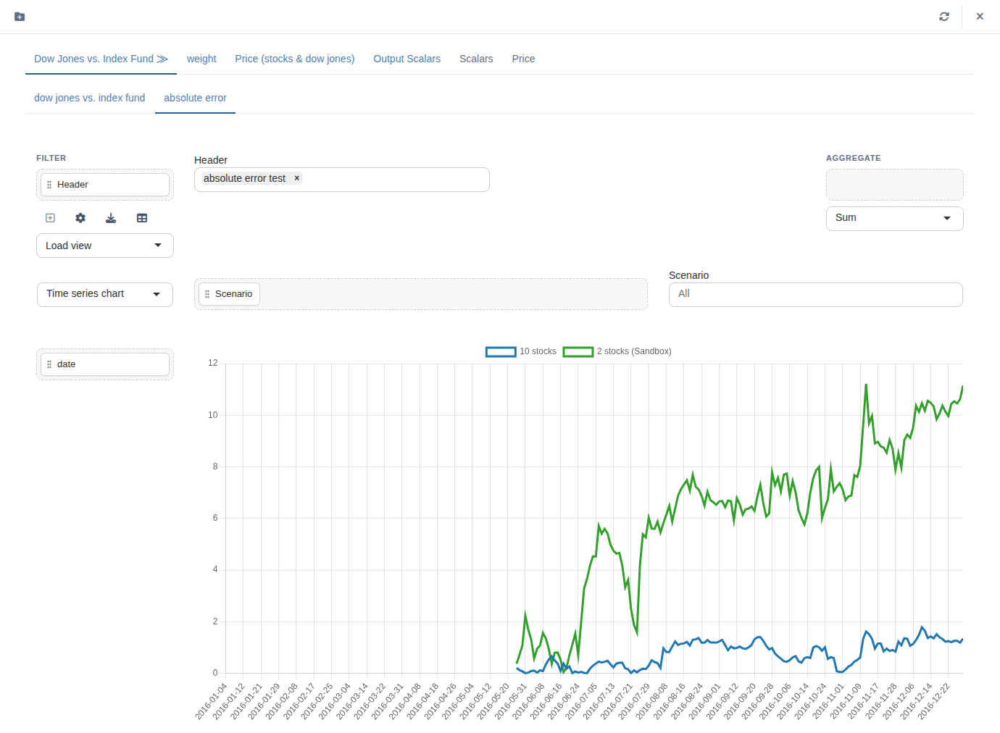

`Views <./start.html#metadata-views>`__ can also be used in pivot view mode. They are attached to the sandbox/base scenario. Thus, the scenario you currently have in your sandbox determines what
views will be available to you in the pivot view scenario comparison. To save a new view, you only need to save your sandbox scenario once the new view has been added.

Views from the pivot view comparison mode can be managed (imported/exported/deleted) just like *normal* views via the *Views* dialog in the *Scenario* → *Edit Metadata* menu. You can learn more
about views `here <./start.html#metadata-views>`__.

.. admonition:: Tip

   If you have opened scenarios in the split or tab view mode and switch to the pivot view, the scenarios from these modes are pre-selected in the *load* dialog so that you can easily continue
   using them.

.. _compare-split:

Split view
^^^^^^^^^^

If two scenarios are to be compared, the split-screen view is particularly suitable. Here the data of two scenarios can be compared side by side.

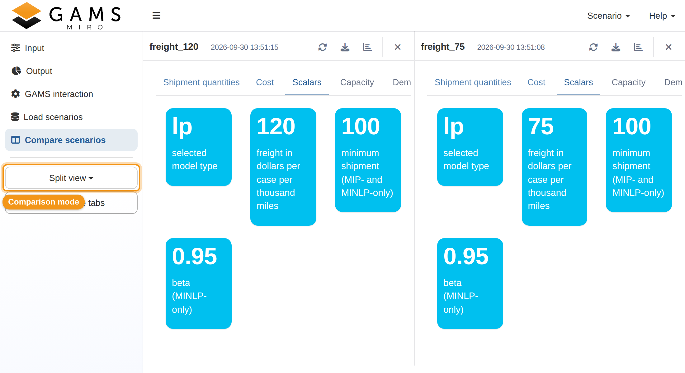

You can choose between:

- Load scenario:
  Load saved scenario data from the database.
- Load sandbox:
  Load the sandbox scenario which is opened in the Input / Output section.

.. admonition:: Tip

   If you have opened scenarios in the pivot or tab view mode and switch to the split view, the scenarios from these modes are shown in a "Local" tab.

.. _compare-tab:

Tab view
^^^^^^^^

Scenarios can also be loaded into tabs (as you know it from e.g. your internet browser). This allows to compare more than two scenarios including their graphics.

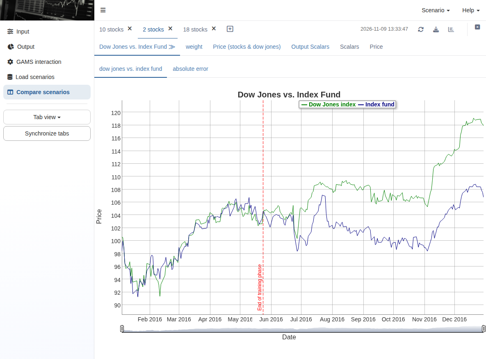

.. admonition:: Tip

   If you have opened scenarios in the split or pivot view mode and switch to the tab view, the scenarios from these modes are pre-selected in the *load* dialog so that you can easily continue
   using them.

.. _synchronize-tabs:

.. _comparison-mode:

Synchronize tabs
^^^^^^^^^^^^^^^^

The *synchronize tabs* option makes comparing scenarios more convenient. It can be used in both the split view and the tab view. As soon as this option is activated via the *synchronize tabs*
button in the navigation bar, the switch to another dataset of a scenario is also performed for all other open scenarios. This means that if you change the dataset to be displayed in one scenario
(e.g. switch from 'Price' to 'absolute error' in the image above), the view also changes for all the other scenario(s) loaded in the comparison mode.

.. admonition:: Tip

   For many operations in MIRO there are shortcuts. Especially when comparing scenarios it can be helpful to switch through the different tabs with shortcuts. You can display all keyboard shortcuts
   via the command palette. The command palette can be activated by pressing ``Ctrl`` + ``Alt`` + ``Space`` or by navigating to *Help* → *Command palette*!

.. _data-concept:

Data concept
------------

.. _data-concept-2:

To understand the concept of data exchange between the GAMS model and its MIRO application, let's start with the following illustration:

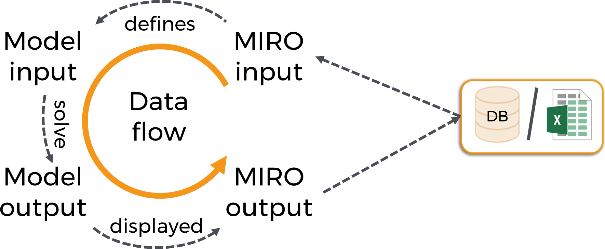

#. Data is loaded into the MIRO interface. These come either from the internal database, from external data sources such as Excel or GDX or are entered manually, but they do NOT come directly from
   the GAMS model.
#. When clicking on solve, the data visible in the MIRO input section is sent to the GAMS model. All data of affected symbols in the model will be overwritten. Symbols that are not visible in MIRO
   are not touched.
#. The model is now run with the updated data.
#. Afterwards the results are sent to MIRO and displayed in the output section. From there, data can be saved in the internal database and/or exported as a file.

A little more detail:

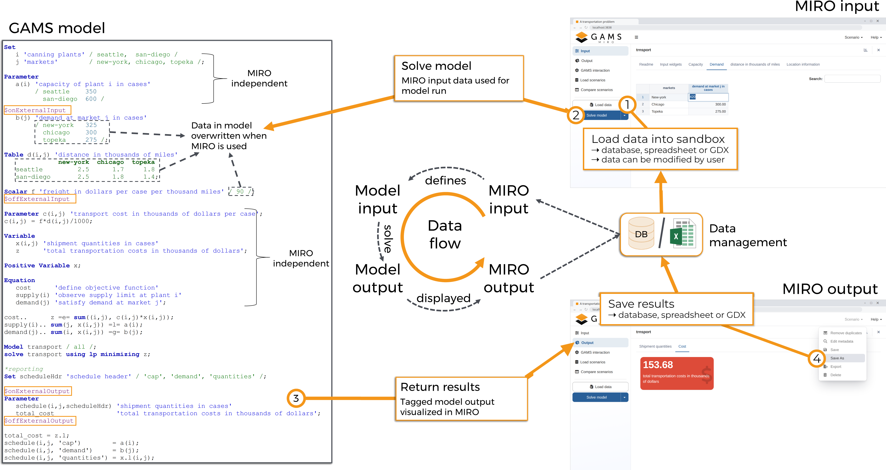

.. _na-zero-eps:

.. dropdown:: Advanced: Working with *NAs*, *zeros* and *EPS*

   Special attention should be paid to the communication of *zeros*, *NAs* and *EPS* between GAMS and MIRO. The following rules describe how the data is communicated in detail:

   - **0:**
     The data communication between GAMS and MIRO is done via GDX. *Zeros* are not stored in GDX files. A value of *zero* in GAMS is therefore not communicated with MIRO and is not visible there. If a
     GAMS symbol is displayed as a table in MIRO - i.e. the symbol is pivoted by using the `table statement <./model.html#display-tables>`__ or by using the `MIRO-side pivoting
     option <./widgets.html#table-option-pivot>`__ - the cells of these missing values are empty.
   - **EPS:**
     The use of the special value *EPS* is required when you want to store *zeros* in a GDX file. In MIRO, a *0* is displayed for the corresponding entries. If a GAMS model is solved out of MIRO,
     *zeros* are stored in the GDX file. In the model these can then be interpreted as *zeros* by using the GAMS option
     `$onEps <https://www.gams.com/latest/docs/UG_DollarControlOptions.html#DOLLARonoffeps>`__. If this option is not set, *zeros* are omitted.
   - **NA:**
     *NAs* in GAMS become *NAs* in MIRO and vice versa. But: *NAs* are only displayed in the default input tables used in MIRO and only if the table is not pivoted (see above). In output tables (or in
     input tables where the option to use `large amounts of data <./widgets.html#input-bigdata-table>`__ is enabled), *NAs* are displayed as blank cells.

.. _scenario-concept:

Scenario concept
----------------

In addition to the data concept, MIRO's scenario concept also needs to be understood.

.. _create-excel:

.. admonition:: What is a scenario ?

   - We call the collection of input and output datasets that result from a particular model run and which are communicated with MIRO a *scenario*.
   - The MIRO user interface can be seen as a sandbox. Data that is loaded into the interface is therefore located in this sandbox as a *sandbox scenario*.
   - Scenarios from the database can be loaded into the sandbox. The data of the sandbox scenario can be modified. Data modifications can come from local files or can be entered manually. A click
     on *save* overwrites the original scenario in the database with the modified data. Alternatively, a new scenario can be created using *save as*. The original scenario in the database remains
     unchanged then.
   - A sandbox scenario can also be initially created as an empty scenario independent of the database and then filled with data (GDX, Excel, CSV). A scenario created in this way initially does not
     have a name. As long as a scenario is unnamed, i.e. it is not saved in the database with an individual name, the data is shown exclusively in the interface and gets lost if the MIRO
     application is closed.
   - `Attachments <#file-attachments>`__ are part of a scenario. If attachments are added to a sandbox scenario, they are included when saving this scenario.

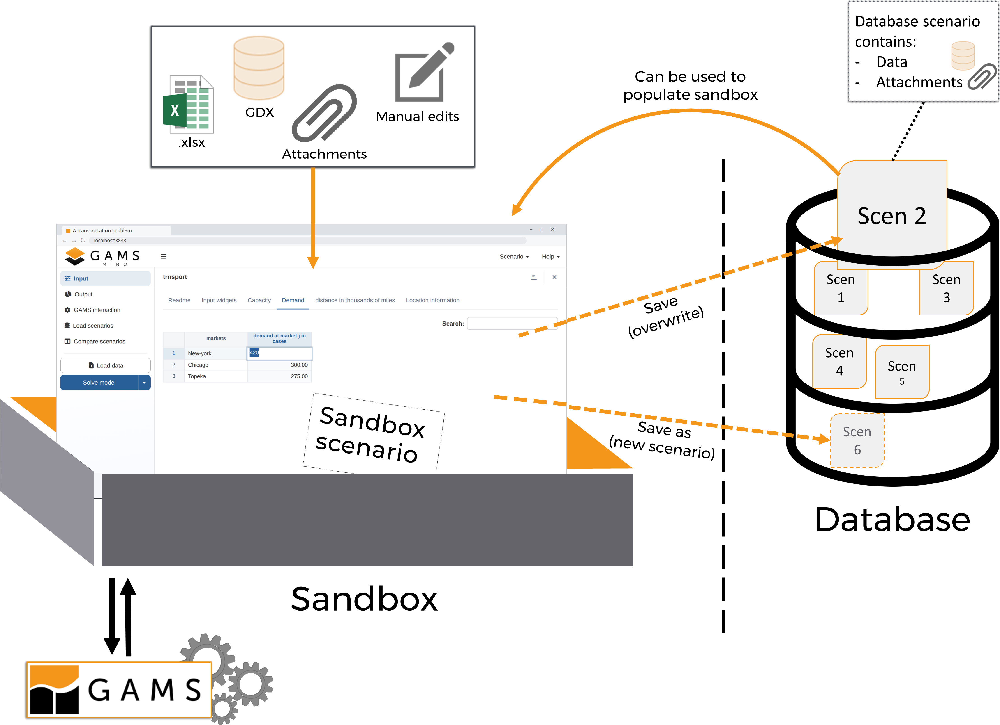

.. _scenario-metadata:

Scenario metadata
-----------------

In addition to the classic data of a scenario, which is visualized in the form of tables, widgets and graphics and with which the user interacts primarily for and after a model run, a scenario also
consists of metadata. Metadata can be edited under *Scenario* → *Edit metadata*. This includes the following:

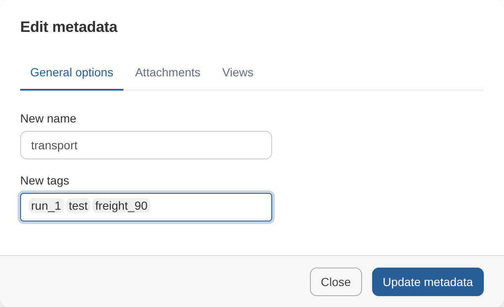

.. _metadata-general:

General options
~~~~~~~~~~~~~~~

In the *general options* tab you can change the scenario name and add/edit scenario tags. As mentioned above, you can search for a given tag in the database. Thus, tags can be used to better find a
saved scenario or a set of scenarios that share certain attributes.

.. _file-attachments:

Attachments
~~~~~~~~~~~

With the *attachments* option, you can attach files to the (sandbox) scenario you currently have open. These can be files of any format. MIRO distinguishes between attachments that can be seen and
read by your GAMS model and files that can not be seen. For example, if you want to provide data to your model that doesn't need to be visible/modifiable in the UI (e.g. in the form of a GDX
container or Excel files), attachments that your model can read are what you are looking for. In case you just want to add some report about a particular scenario, which is irrelevant for the GAMS
model, you should not allow the model to read this file. Note that all files that you allow your model to read need to be first downloaded into the working directory before GAMS is executed. Thus,
it is advisable to select only those files to be readable that are actually relevant for the optimization run.

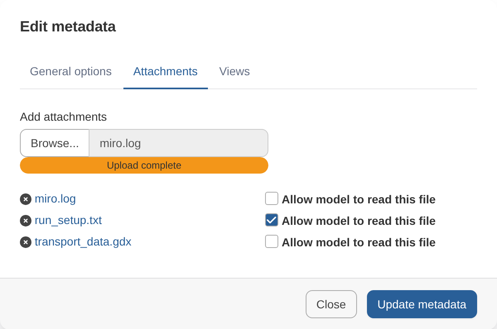

Besides this type of attachments, there are also *output attachments* which allow you to automatically attach files after a GAMS run has been successfully completed. This lets you store additional
results alongside the ones displayed in the UI. You can also use such an attachment for the next GAMS run with this scenario. Read more about output attachments
`here <./configuration_general.html#general-output-attach>`__.

.. admonition:: Note

   Attachments added to a sandbox scenario are not automatically saved! If you want to apply the changes to a database scenario, you have to *save* it.

.. _metadata-views:

Views
~~~~~

Views are a special type of attachments that store configurations of renderers. An example is the `pivot table <./charts.html#pivot-chart>`__ renderer. Here a view is a snapshot of the current
configuration:

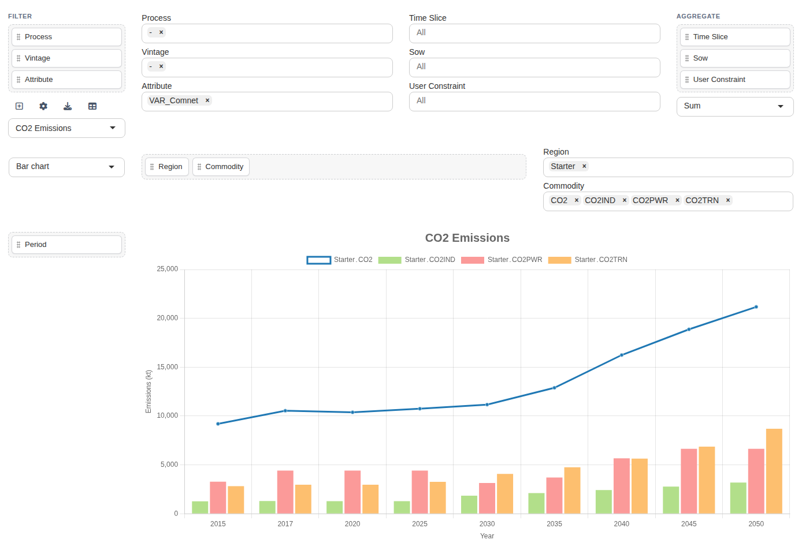

Views can either be bound to a scenario like attachments or registered app-wide. From now on, scenario-specific views will be referred to as ``local`` views, while app-wide views will be
referred to as ``global`` views. You can import and export view configurations in the form of JSON files. Each view has an id that has to be unique per GAMS symbol.

.. admonition:: Tip

   Views can also be `imported automatically <#startup-import>`__ when a MIRO application is started by placing the JSON file(s) in the folder ``data_<modelname>``. Note that views are always tied to
   a scenario. If you want to store views for a scenario called "my-scenario", you would have a GDX file called ``my-scenario.gdx`` as well as a views file called ``my-scenario_views.json`` inside the
   ``data_<modelname>`` directory. So the file name of the views must start with the name of the scenario you want to attach them to and end with ``_views.json``.

To get a more intuitive understanding of what a view is, the following videos give an example that leads through the most important aspects. With the `pivot table <./charts.html#pivot-chart>`__
renderer, we can filter and aggregate input and output data by dragging and dropping domains. The video below shows how a few actions draw a stacked bar chart of the shipment quantities between
canning plants and markets. By clicking the ``Add View`` button we can attach a ``local`` view to the current scenario. This allows us to return to a configuration later in our analysis.

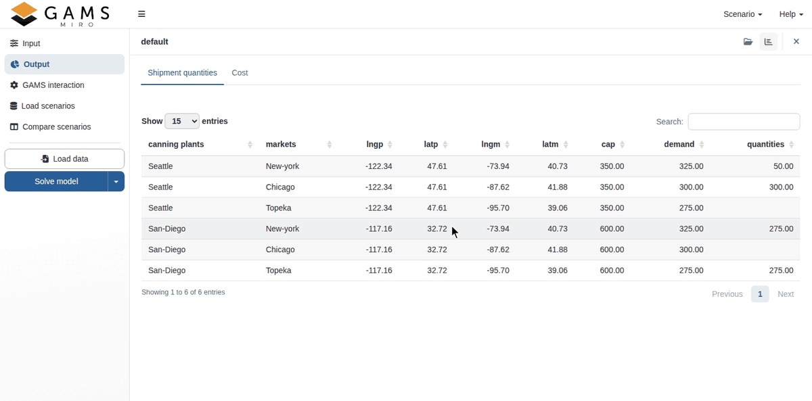

We can import, download, and remove ``local`` views by navigating to the *Scenario* → *Edit metadata* → *Views* dialog. By clicking the *Export* button, the selected views are saved in the
*Download* folder as a JSON file, which we can use to share with others or to include as global views in the app.

Global views are bundled with a MIRO app and are scenario-independent. A local view can *shadow* a global view if it has the same name as the global view. This means that when you apply this view,
the configuration of the local view is applied. When the local view is removed, the global view is applied again.

Global views can be bundled with an application by placing a JSON file with the filename ``views.json`` in the *conf\_<modelname>* directory. This file can also be created automatically by
configuring the views via the Configuration Mode.

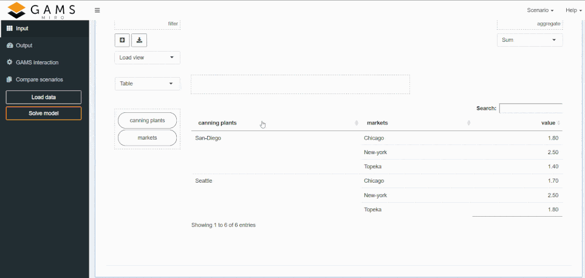

.. _access-permissions:

Access permissions / Scenario sharing
~~~~~~~~~~~~~~~~~~~~~~~~~~~~~~~~~~~~~

If multiple users have access to the same MIRO app, they can share scenarios. Shared scenarios can be loaded from the database into the sandbox in the same way as your own scenarios.

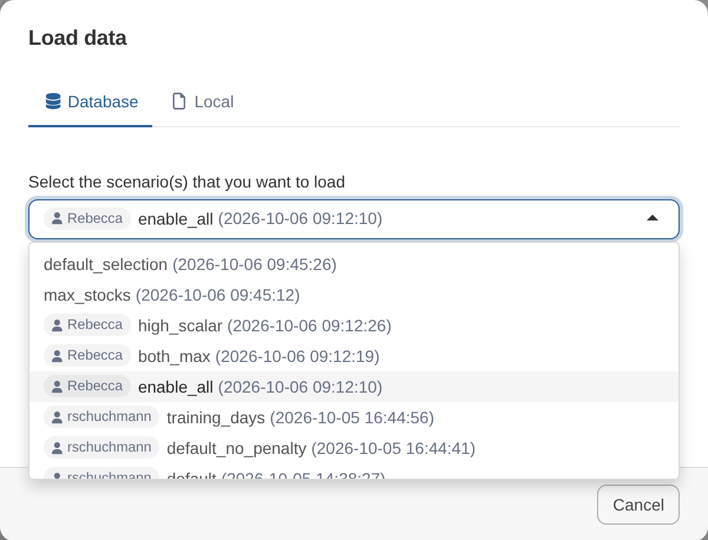

Since scenario sharing is much more powerful using MIRO Server, you can find more information about this in the `MIRO Server section <./server_general.html#scenario-sharing>`__.

| **Scenario sharing using MIRO Desktop:**
| Scenarios can also be shared in MIRO Desktop. However, unlike MIRO Server, MIRO Desktop does not offer sophisticated user management including user groups. Users of a local MIRO Desktop
  application are automatically assigned to the only group available, 'users'. As a consequence, scenarios can be shared either with all users ('users' group) or with no users.

.. admonition:: Note

   In contrast to the database used by `GAMS MIRO Server <./server.html>`__, the database for MIRO Desktop is not designed for concurrent use. We therefore recommend to use one database per user
   for MIRO Desktop applications.

.. _performance-aspects:

Performance Aspects
-------------------

The size and/or complexity of a GAMS model does not affect the performance of a MIRO application. As the `data concept <#data-concept>`__ shows, only data declared as external input and output
(data contract) is communicated between the model and the application. The amount of data to be exchanged as well as the complexity of its visualization influence the performance of your
application. Important factors are:

- Number of symbols that are communicated with MIRO
  The more symbols you want to display in MIRO, the more tables and charts need to be set up. MIRO renders most of them lazily, that is, only when the user actually activates a particular tab.
  However, each of the symbols has a slight overhead and you should ask yourself whether displaying all of them is really necessary. For example, it is usually not a good idea to declare each
  domain set separately as external input. Instead, use the `Implicit Set Definition <https://www.gams.com/latest/docs/UG_SetDefinition.html#UG_SetDefinition_ImplicitSetDefinition>`__ feature of
  GAMS! This not only saves rendering time in MIRO, but is often better for the user experience as it simplifies data entry. As a rule of thumb, try to limit the number of symbols in your data
  contract to 50.
- Amount of data that is communicated with MIRO
  Each dataset is displayed in MIRO in the form of a table and a graph. The larger the amount of data, the more computationally intensive this process becomes. In addition, the rendering of
  graphics can vary in complexity. While a simple pie chart is usually rendered fairly quickly, graphs that contain `animations <./charts.html#animation>`__ can take significantly more time. In the
  case of very large amounts of data that are only displayed in MIRO for visualization purposes, it may make sense from a performance point of view to communicate only parts of the data with MIRO
  or to visualize only sections of it, e.g. by aggregating data.
- Table tool to use
  MIRO provides several table tools for input symbols, each of which has its advantages and disadvantages. The default input data tool provides a spreadsheet-like feel. However, all data is held in
  the user's browsers, which becomes problematic when dealing with large amounts of data. If you have larger data sets (>10,000 records and >10 columns), MIRO offers the `Big Data
  Table <./widgets.html#input-bigdata-table>`__ as well as the `MIRO Pivot Table <./widgets.html#input-pivot-table>`__. With these two table types, most of the data is kept on the server side and
  only fractions of the data are kept in the user's browser. This allows for much larger data sets (>3 million records).
- `Attachments <./start.html#file-attachments>`__ provide a convenient way to communicate large amounts of data from MIRO to the GAMS model without significantly impacting application performance.
  Since attachments are communicated as a file and therefore do not require data to be rendered, they require very few computational resources.

.. _whats-next:

What's Next
-----------

If you are using an existing MIRO application, you are now ready to work with input data, execute optimization jobs, manage scenarios, and analyze results.

If you do not have a MIRO application yet, the next step is to prepare your own GAMS or GAMSPy model for MIRO. The `Model Preparation <./model.html>`__ guide explains how to define the MIRO data
contract and transform a model into a fully functional MIRO application.

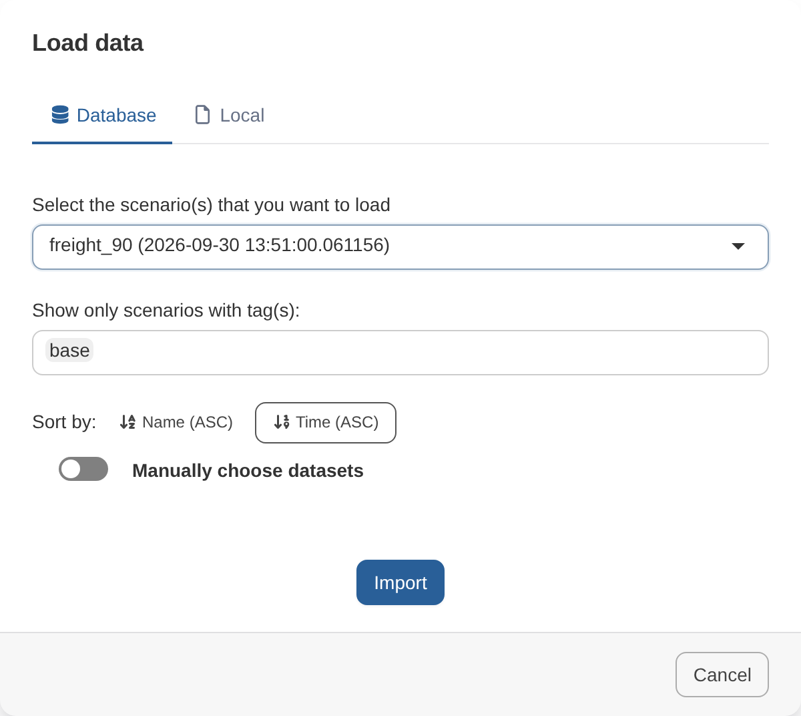

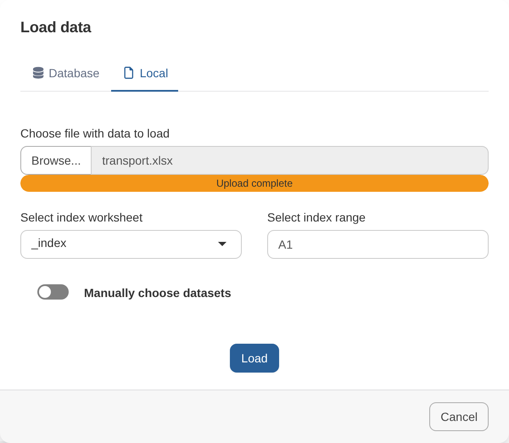

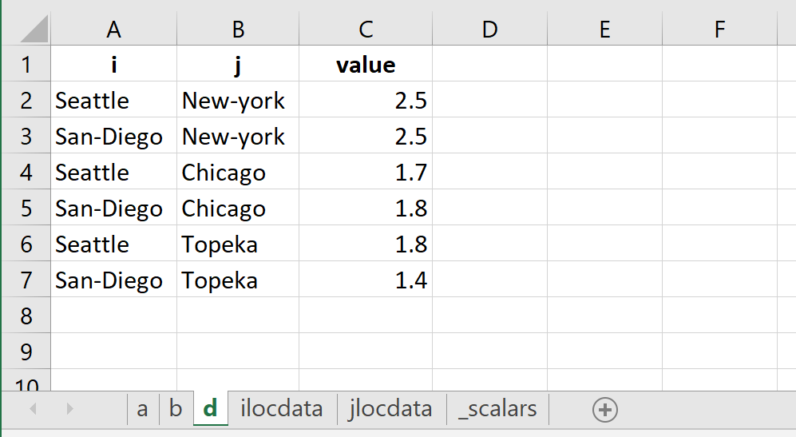

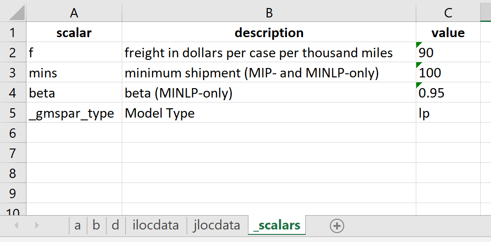

.. |Separate sheets per scalar| image:: ../assets/images/import_excel_scalars_sep.png
   :class: miro-image-max-height-175pt

.. |Scalar variable / equation| image:: ../assets/images/import_excel_vareq.png
   :class: miro-image-max-height-175pt

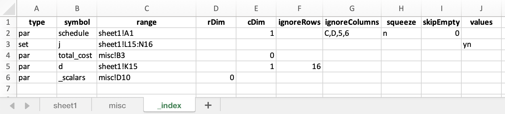

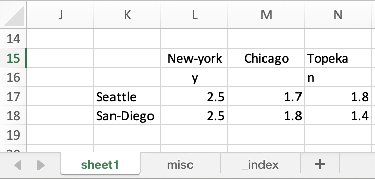

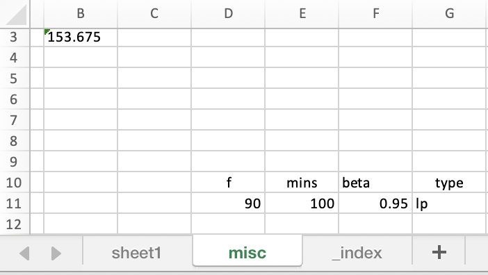

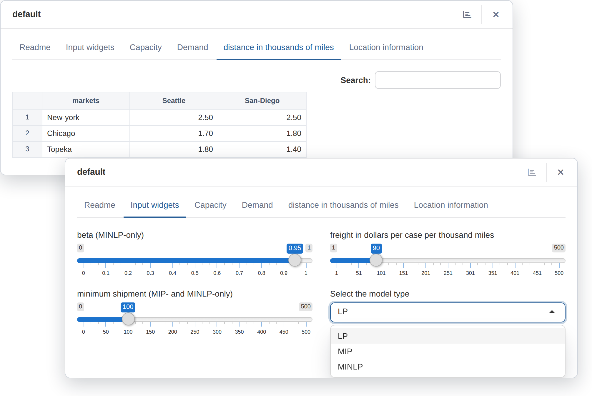

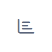

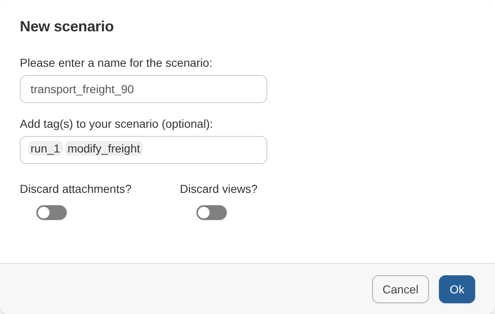

