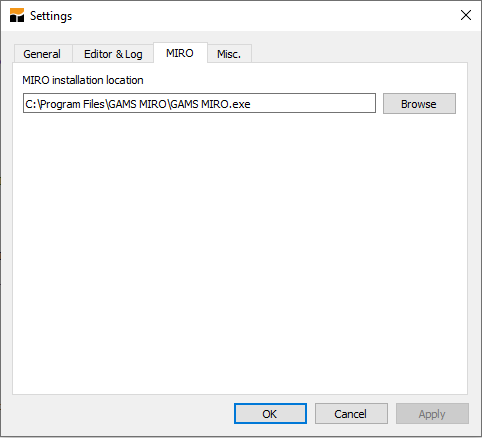
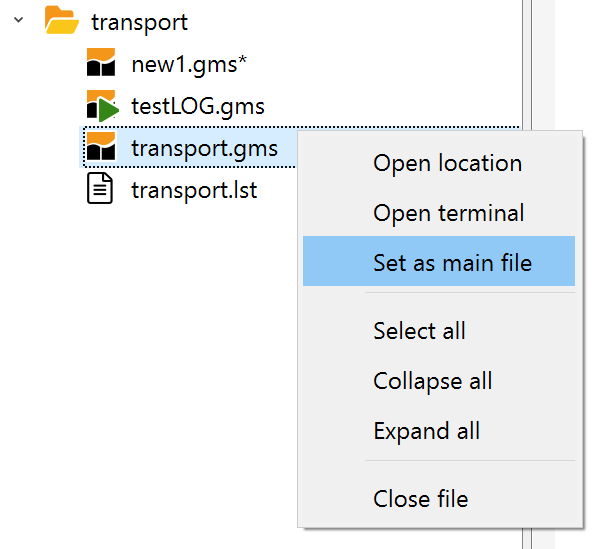
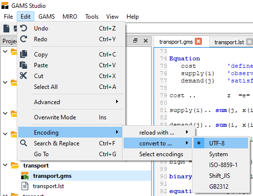
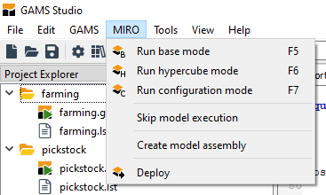
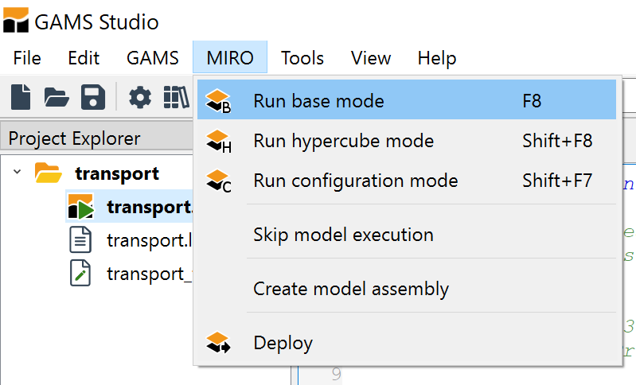
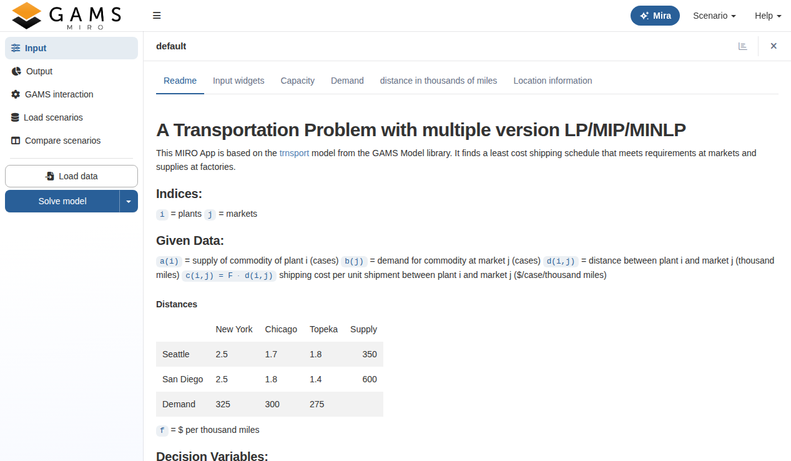
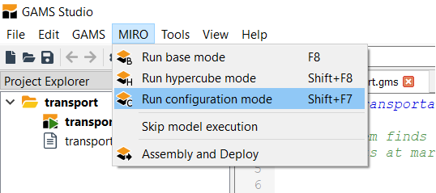
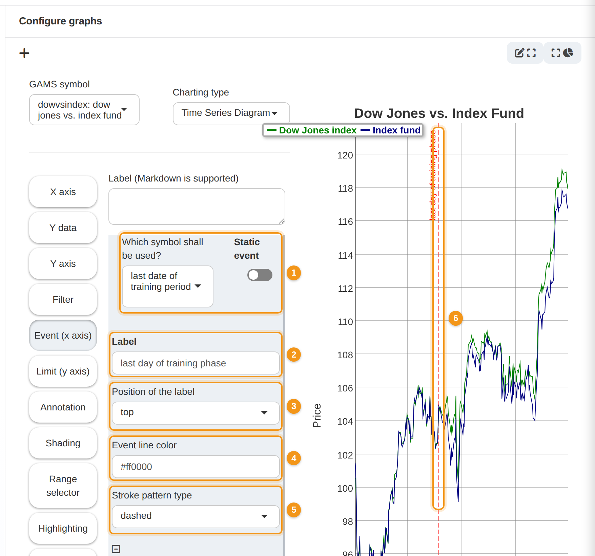
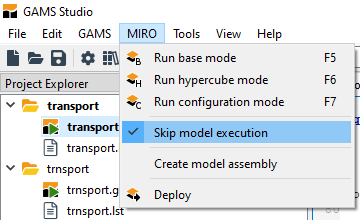
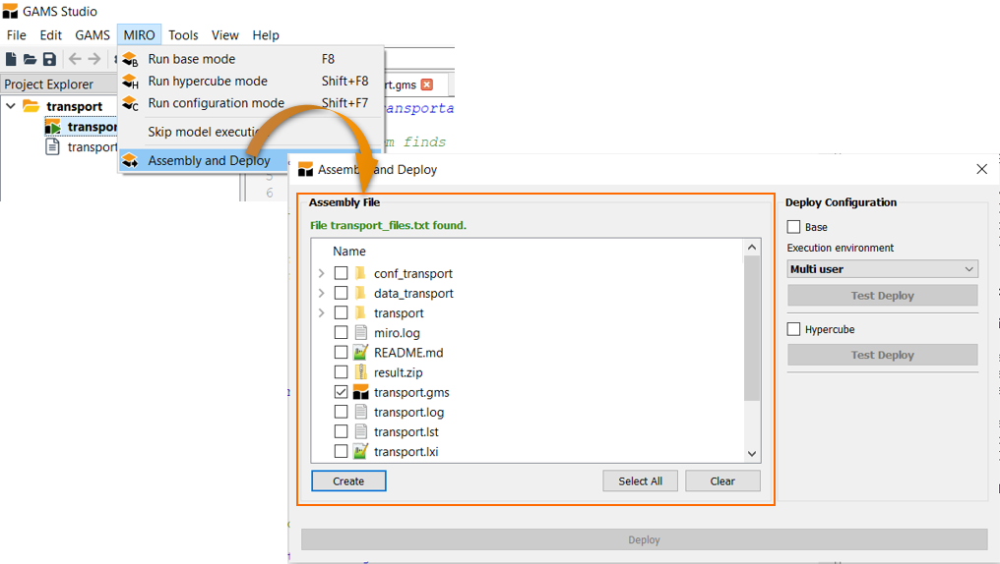

GAMS Studio integration
=======================

.. _studio-introduction:

Introduction
------------

In this section we show you how to use `GAMS Studio <https://www.gams.com/latest/docs/T_STUDIO.html>`__ for the development and deployment of your MIRO apps. The new integrated development environment for GAMS has built-in functionality of the most important interactions with MIRO. In this section we only give an overview of these. Different aspects are explained in more detail in corresponding linked chapters.

.. role:: miro-path(code)

.. admonition:: Note:
   :class: warning

   GAMSPy users should use the `GAMSPy CLI <https://gamspy.readthedocs.io/en/latest/user/advanced/miro.html>`__ instead of GAMS Studio.

.. _studio-general:

General
-------

.. _miro-installation-location:

MIRO installation location
~~~~~~~~~~~~~~~~~~~~~~~~~~

After installing GAMS MIRO, make sure that Studio and MIRO know about each other. In Studio go to *File* → *Settings* → *Remote* and check whether the MIRO installation location is correct:

.. admonition:: Note:
   :class: warning

   There is a known issue in GAMS Studio when it comes to specifying the MIRO location on macOS. Make sure that the path does not stop at :miro-path:`/Applications/GAMS MIRO.app`, but points to the executable inside the app bundle: :miro-path:`/Applications/GAMS MIRO.app/Contents/MacOS/GAMS MIRO`. The :miro-path:`/Contents/MacOS/GAMS MIRO` part is always the same and needs to be appended to the path of the app bundle.

.. _studio-main-file:

Main file in Studio
~~~~~~~~~~~~~~~~~~~

GAMS Studio is not executing the file currently visible in the editor, but the file which is set as main file in the corresponding group in the `project explorer <https://www.gams.com/latest/docs/T_STUDIO.html#STUDIO_PROJECT_EXPLORER>`__. Make sure that the model you want to use for MIRO is marked as the *main file*. If this is not the case, you can change it by right clicking on the file in the project explorer → *set as main file*:

.. _studio-file-encoding:

File encoding
~~~~~~~~~~~~~

Your GAMS model files need to be encoded with UTF-8. In GAMS Studio this is the default file encoding from version 0.14.5 on. You can change the encoding of your file via *Edit* → *Encoding* → *convert to* ... → *UTF-8*. Other file encodings are not supported in GAMS MIRO!

.. _studio-miro-interaction:

MIRO interaction
~~~~~~~~~~~~~~~~

All interaction between GAMS Studio and MIRO can be found in the MIRO menu:

.. _studio-base-mode:

Run Base Mode
-------------

This option starts the MIRO Base Mode. In the Base Mode, you can supply your models with input data, generate, display and save the results of your optimization as well as compare different scenarios with each other, everything visually supported by various plotting tools.

.. _studio-configuration-mode:

Run Configuration Mode
----------------------

This option starts the MIRO Configuration Mode. Here, you can create plots and widgets or change certain settings with a few mouse clicks, visually supported by a live preview.

.. _studio-skip-execution:

Skip model execution
--------------------

In the MIRO menu of GAMS Studio there is the entry "Skip model execution". If this option is activated, the model is not executed before MIRO is started, but MIRO is called directly instead. This can be helpful if the model takes a long time to be solved.

But: This option should be used with caution!

If the model execution is skipped, the GAMS/MIRO `data contract <./start.html#data-concept>`__ is not created or refreshed. This means that changes made in the model are not communicated to MIRO. If you have a model that takes a long time to be solved and you don't want to run through it in order to launch MIRO, you can simply set the GAMS option `*a=c* <https://www.gams.com/latest/docs/UG_GamsCall.html#GAMSAOaction>`__ (action=compile) instead of the option "Skip model execution". This will only compile the model which is sufficient to update the data contract. Note that in this case a new default scenario is created, but it contains only the data that is available after the compilation phase (most of the time only input data).

.. _studio-create-assembly:

Create model assembly
---------------------

If you want to `deploy <#studio-deploy>`__ a fully configured app, MIRO needs to know about the files that belong to your model. This is primarily the main model file, but also all files necessary to calculate all inputs and outputs, e.g. files that are included in the model. To tell MIRO about these files, go to *Assembly and Deploy*. In the *Assembly File* section select those folders and files which are needed. If you select a folder, all files in it will be included. If you want to use only single files of a folder, you have to expand the folder and select the corresponding file(s). When you are finished, click on *create*.

.. _studio-deploy:

Deploy
------

When the MIRO app is completely configured it can be deployed, i.e. exported and installed so that it can be easily shared with end users. No further changes to the model or the configuration can be made once it is deployed.

.. image:: ../assets/images/deployment/deploy.png
   :alt: Deploy MIRO model
   :class: miro-image-max-height-425pt
   :align: center

In GAMS Studio, select *Assembly and Deploy*. In the *Deploy Configuration* section you need to decide how your model shall be executed (*execution environment*). There are three options:

1. Multi-user: This option allows your app to be used by multiple users simultaneously. Your model files are extracted at a random location, which is different for each user, and your model is executed from there.
2. Single-user: Your model is executed inside the model directory. No extraction of your model files is required, but this means that you can NOT have multiple users accessing your MIRO app at the same time.
3. Local multi-user (uses *idir*): With this third option, your model is again executed from a random location, but this time no model data is extracted here. Instead, GAMS is executed with an `input directory <https://www.gams.com/latest/docs/UG_GamsCall.html#GAMSAOinputdir>`__ pointing to the path where your model files are located. Choose this option ONLY if you have many large files that belong to your model and extracting them would take a long time. Be aware that due to the fact that ``idir`` is used, your model might break! For example, if you use ``$call`` or the execution-time equivalent ``execute`` (or related functions), the relative paths used in these calls will no longer exist (since the `curdir <https://www.gams.com/latest/docs/UG_GamsCall.html#GAMSAOcurdir>`__ is now a random location). The solution is to prefix all these relative paths with ``%gams.idir1%``. For example, in order to import an Excel file ``test.xlsx``, GDXXRW needs to be called like this: ``$call gdxxrw i=%gams.idir1%test.xlsx``. Alternatively, you can also use absolute paths (e.g. via ``$setNames "%gams.input%" fp fn fe`` (see `here <https://www.gams.com/latest/docs/UG_DollarControlOptions.html#DOLLARsetnames>`__).

   Adjusting all affected paths is potentially a lot of work, so we strongly advise against using this option unless you know what you are doing!

.. admonition:: Note:
   :class: warning

   With MIRO version 2.1, the Hypercube Mode is deprecated and and no longer exists as a separate mode. You can now submit Hypercube jobs from the Base Mode if you are using GAMS MIRO with a `GAMS Engine backend <./server.html>`__ (GAMS MIRO Server or GAMS MIRO Desktop - boosted by GAMS Engine). You can find the most recent documentation `here <./hc-module.html>`__.

.. admonition:: Advice
   :class: warning

   We advise you to test your MIRO app before distributing it. GAMS Studio offers an option *test deployment*. This simulates how your end users will experience the MIRO app (e.g. for the *Base Mode* MIRO is launched in the specified execution environment). In particular, you should check whether you forgot to include important files in the `model assembly <#studio-create-assembly>`__.
