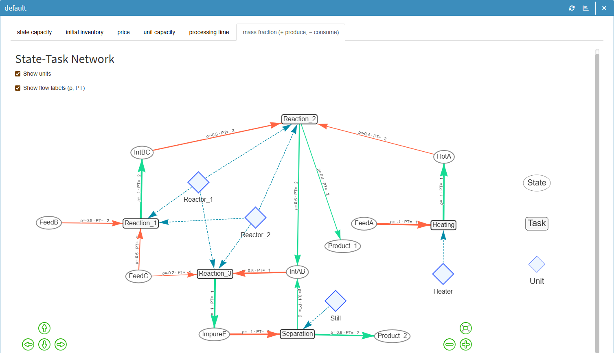
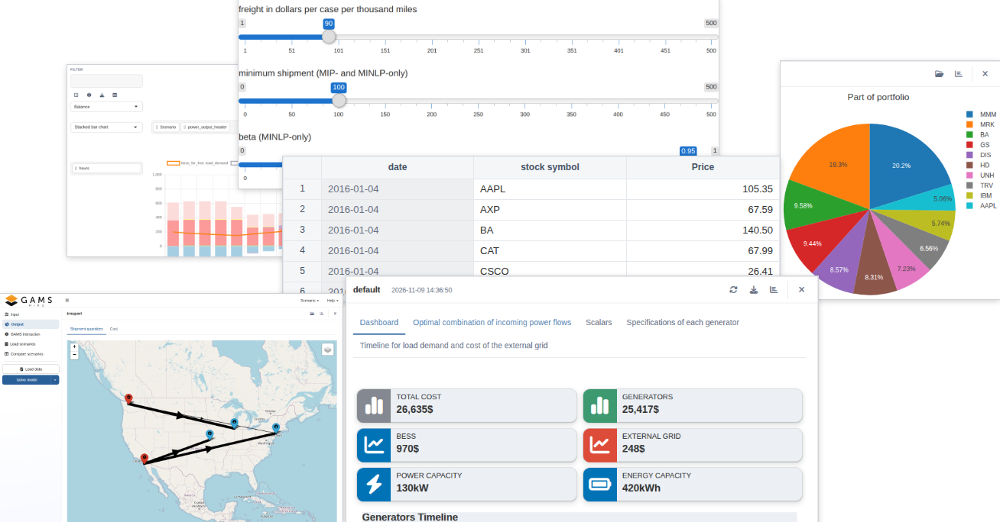
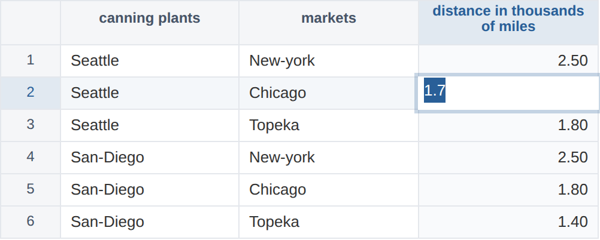
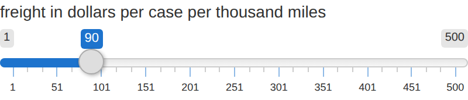
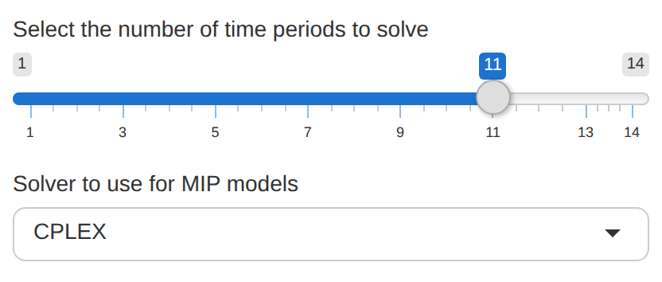

Advanced Configuration
======================

.. _custom-renderers:

Custom Renderers
----------------

GAMS MIRO allows you to use your own custom renderers for your datasets. In this section we will show you how to create really sophisticated custom graphics.

|Result of custom renderer - Map with markers|

.. _custom-renderer-how-to:

How to use a custom renderer
~~~~~~~~~~~~~~~~~~~~~~~~~~~~

In order to visualize a dataset, you will need to write two functions: a placeholder where your graphs etc. will later be rendered as well as the rendering function itself. To learn more about the
concepts of this dual component approach, visit the website for the R Shiny framework that GAMS MIRO is based upon: https://shiny.rstudio.com/. In particular, we are using `Shiny
Modules <https://shiny.rstudio.com/articles/modules.html>`__ to realize the interface between MIRO and your custom renderer functions. The template for the two components of every custom renderer
is as follows:

.. code:: r

   mirorenderer_<symbolName>Output <- function(id, height = NULL, options = NULL, path = NULL){
     ns <- NS(id)
   }

   renderMirorenderer_<symbolName> <- function(input, output, session, data, options = NULL, path = NULL, rendererEnv = NULL, views = NULL, attachments = NULL, outputScalarsFull = NULL, ...){
   }

Note that you need to replace <symbolName> with the name of the GAMS symbol you want to use this renderer for. Let's go through this code step by step. As mentioned, for each custom renderer we
need to specify two functions: one that generates the placeholder and one that fills this placeholder with data. The name of the placeholder function must be postfixed with "Output" and the name of
the function that specifies the actual rendering must be prefixed with the keyword "render". Let's get back to our *transport* example. We would like to see the flow of goods visualized on a map.
The GAMS symbol that contains the flow data is called optSched. Thus, our initial template looks like this:

.. code:: r

   mirorenderer_optschedOutput <- function(id, height = NULL, options = NULL, path = NULL){
     ns <- NS(id)
   }
   renderMirorenderer_optsched <- function(input, output, session, data, options = NULL, path = NULL, rendererEnv = NULL, views = NULL, attachments = NULL, outputScalarsFull = NULL, ...){
   }

.. admonition:: Note

   MIRO expects your renderer names to follow this strict convention. Note that the symbol name in your renderer name should be converted to all lowercase. Even if the symbol in GAMS is called
   optSched, the renderer function name should be mirorenderer_optschedOutput and renderMirorenderer_optsched.

.. admonition:: Note

   Custom renderer scripts must be located in a folder named: renderer\_<modelname> in your model directory. The name of the renderer file should be: mirorenderer\_<symbolname>.R.

Both functions take a number of parameters. Let's start with the placeholder function: Each custom renderer has its own ID. In order to avoid `name
collisions <https://en.wikipedia.org/wiki/Name_collision>`__ with other custom renderers or functions of GAMS MIRO, we need to prefix our input and output elements with this ID. How should we
prefix our custom input and output functions, though? Fortunately, Shiny provides us with the function: ``NS()``. This function takes the ID of our custom renderer as its input and returns a
function (functions that return functions are often called *closures* in R) that does the prefixing for us. Thus, whenever we want to specify a new input or output element, we simply hand the ID we
would like to use for this element over to this prefixing function (which in our case is bound to the ``ns`` variable). We can also specify a height for our renderer as well as the path
where the renderer files are located. We can also pass additional options to our renderer functions.

Let's get back to our example. As we would like to visualize our optimized schedule on an interactive map, we choose the popular `Leaflet <https://leafletjs.com>`__ library. Fortunately, there is
already an R/Shiny interface for this library: `Leaflet for R <https://rstudio.github.io/leaflet/>`__. This R package comes with the two functions: ``leafletOutput()`` that generates the placeholder
and ``renderLeaflet()`` that renders a Leaflet map object created by the ``leaflet()`` function which takes our dataframe as its first argument. So let's put the pieces together and extend our code:

.. code:: r

   mirorenderer_optschedOutput <- function(id, height = NULL, options = NULL, path = NULL){
     ns <- NS(id)
     leaflet::leafletOutput(ns("map"), height = height)
   }
   renderMirorenderer_optsched <- function(input, output, session, data, options = NULL, path = NULL, rendererEnv = NULL, views = NULL, attachments = NULL, outputScalarsFull = NULL, ...){
     output$map <- leaflet::renderLeaflet(leaflet::leaflet(data))
   }

Note that we used the aforementioned ``ns()`` function to prefix the ID ("map") that we chose for our Leaflet element. Just like any other placeholder element, the function ``leafletOutput()``
generates an element that can be accessed via the list-like ``output`` object.

| Inside our rendering function we assign this object the Leaflet map that is created by the ``renderLeaflet()`` function. In case you find the whole concept of having an output function, a rendering
  function, an output object etc. still very confusing, you should take a look at the `official tutorial series <https://shiny.rstudio.com/tutorial/written-tutorial/lesson1/>`__ for the Shiny
  framework.
| To summarize: elements that generate data can be accessed by the ``input`` object; elements that transform data to some form of visualization via the ``output`` object and any
  user-specific information via the ``session`` object.

.. _cr-package-note:

.. admonition:: Note

   If you use functions from packages other than ``shiny`` or the R base packages, make sure you specify the package/namespace that exports this function. In our example, the functions
   ``leafletOutput``, ``renderLeaflet`` and ``leaflet`` are exported from the package ``leaflet``. So we need to use the *double colon operator* to access them (e.g. ``leaflet::leafletOutput``).

The data that you want to visualize is supplied to your rendering function by the ``data`` argument - an R `tibble <https://cran.r-project.org/web/packages/tibble/vignettes/tibble.html>`__,
a data structure that is very similar to a Data Frame. In case you specified `additional datasets <./charts.html#custom-graphics>`__ to be communicated with your custom renderer, ``data``
will be a named list of *tibbles* where the names are the GAMS symbol names. In addition, the values of all input and output scalars can be accessed via the argument ``outputScalarsFull`` (a tibble with
the columns *scalar*, *description*, *value*). The function argument ``path`` is a string (a one-dimensional character vector) that specifies the absolute path to your renderer\_<modelname>
directory. This is useful if you want to include external files in your custom renderer functions. Optional parameters that you want to pass to the renderer can be accessed via the argument
``options`` - a (nested) list.

.. _cr-package-note-2:

.. admonition:: Note

   Scalar variables are not added to ``outputScalarsFull``, since they have the attributes ``level``, ``marginal``, ``lower``, ``upper``, and ``scale`` and are therefore
   not true scalars. To access them you need to include ``_scalarsve_out`` in your additional datasets.

.. admonition:: Tip:
   :class: tip

   The list ``options`` always has a nested list with the key ``_metdata_``, which gives you access to the metadata of the symbol to render, such as the symbol type (set, parameter, ...)
   and header information (header name, alias, type). For example, the symbol type can be accessed as follows: ``options[["_metadata_"]][["symtype"]]``.

Now that we are familiar with the template that every custom renderer builds upon, we are still missing one fundamental concept so that we can use our custom renderer: binding the renderer to
dataset(s) we wish to visualize.

This binding of GAMS parameter to renderer function is specified - just like any other renderer binding - in the <modelname>.json file; more precisely the dataRendering section. Let's assume that
in our transportation example the GAMS parameter that specifies the optimal schedule is defined as optSched(lngp, latp, lngm, latm, plant, market) where (lngP,latP) and (lngm, latm) are the
coordinates of the plants and markets respectively. Our transport.json file should then look like this:

.. code:: text

   {
      "dataRendering":{
         "optSched":{
            "outType":"mirorenderer_optsched",
            "height":"700",
            "options":{
               "title":"Optimal transportation schedule"
            }
         }
      }
   }

As you can see we bound the GAMS parameter optSched to our new custom renderer mirorenderer_optsched. Furthermore, we specified a parameter: title that can be accessed by our custom renderer via
the options list.

If we decided to run our MIRO app now, we still would not be able to see anything other than a blank area. Thus, we will need to fill our renderer with some life:

.. code:: r

   mirorenderer_optschedOutput <- function(id, height = NULL, options = NULL, path = NULL){
     ns <- NS(id)
     tagList(
       textOutput(ns("title")),
       leaflet::leafletOutput(ns("map"))
     )
   }
   renderMirorenderer_optsched <- function(input, output, session, data, options = NULL, path = NULL, rendererEnv = NULL, views = NULL, attachments = NULL, outputScalarsFull = NULL, ...){
     output$title <- renderText(options$title)
     output$map   <- leaflet::renderLeaflet(leaflet::leaflet(data) %>%
                                              leaflet::addTiles() %>%
                                              leaflet::addMarkers(~lngp, ~latp, label = ~plant)
     )
   }

We have added a new placeholder for the title. Note the use of the ``tagList()`` function. Since every R function has a single return value which is either the last evaluated expression of the
function or the argument to the first ``return()`` function that is encountered in the function body, we need to return a list object. A ``tagList()`` is simply a list with an additional
attribute to identify that the elements are html tags.

Within our rendering function, we set the title, add the default `OpenStreetMap <https://www.openstreetmap.org>`__ tiles as well as some markers for our plants.

.. admonition:: Note

   The syntax ``~lngp`` that you see here is simply a shorthand for ``data$lngp`` - the pipe operator ``a(x) %>% b(y)`` a shorthand for ``tmp <- a(x); b(tmp, y)``

If you run your app now, you will be able to see a map with markers at the coordinates of the plants as you specified them in your GAMS sets: ``lngp`` and ``latp``. When you hover
over the markers, you will be able to see the names of the plants as defined by the set: ``plants``. You can see a screenshot of the result below: |image1|
If you read until this point, you might have noticed that there is a parameter in the renderer function that we did not talk about yet: ``rendererEnv``. This parameter is a static R environment
that is persistent across different calls to the renderer function. Each time the data of your widget is updated (e.g. due to the user loading a new scenario from the database), your renderer
function is called. One case where this can become problematic is when you make use of `observers <https://shiny.rstudio.com/reference/shiny/0.14/observe.html>`__ in your renderer functions. Every
time your renderer function is called, all observers are re-registered, which leads to duplicated observers. To avoid this problem, you must ensure that observers are cleaned up when they are no
longer needed. You do this by assigning them to the ``rendererEnv`` environment. An example where this is extensively used is the model ``tsp``, which can be found in the MIRO model
library.

You now know everything you need in order to get started writing your own custom renderers! Congratulations! In case you create a new renderer that you would like to share so that others can
benefit from your work as well, please `contact us <mailto:miro@gams.com>`__!

.. _additional-datasets:

Additional datasets
~~~~~~~~~~~~~~~~~~~

A custom renderer can use the data of other GAMS symbols (a renderer for an output symbol can use the data from both input and output symbols, while a renderer for an input symbol can only access
other input symbols). For example - let's stay with the above example of a map - the geographical information can come from other symbols than the transport data. For a custom renderer to access
this data, the corresponding symbols must be specified in the <modelname>.json file under ``"additionalData"``:

.. code:: text

   {
      "dataRendering":{
         "optSched":{
            "outType":"mirorenderer_optsched",
            "height":"700",
            "options":{
               "title":"Optimal transportation schedule"
            },
            "additionalData": ["symbol_a", "symbol_b"]
         }
      }
   }

The ``data`` object can be used to access the data within your custom renderer. It will be a named list of tibbles. For example, to access ``symbol_a``, use ``data[[symbol_a]]`` to access the
specific tibble.

.. note::

   All symbols that a custom renderer should use must be included in the GAMS/MIRO `data contract <./model.html#data-contract>`__.

.. note::

   Custom renderers always receive the full, `unfiltered <#widgets-dependencies>`__ data.

.. _additional-r-packages:

Additional R packages
~~~~~~~~~~~~~~~~~~~~~

In a custom renderer you can include any R packages that are not part of MIRO. This allows you to use all data visualization and data processing capabilities of R. In order for such packages to be
installed when starting a MIRO application, they must be specified in the <modelname>.json file at the configuration of the corresponding symbol under ``"packages"``:

.. code:: text

   {
      "dataRendering":{
         "optSched":{
            "outType":"mirorenderer_optsched",
            "height":"700",
            "options":{
               "title":"Optimal transportation schedule"
            },
            "additionalData": ["symbol_a", "symbol_b"],
            "packages": ["package_a", "package_b"]
         }
      }
   }

Note that these additional packages are installed but not loaded! This means that when you call the function, you must explicitly specify the package name using the *Double Colon Operator*:
pkg::name(...). See also the `info box <#cr-package-note>`__ in the previous section.

.. admonition:: Tip

   Additional R packages are installed in the `workspace <./download.html#miro-workspace>`__ of GAMS MIRO the first time a MIRO application is started.

.. _custom-renderer-views:

Views
~~~~~

In cases where your renderers are interactive, you might want to allow users to store the current state of your renderer and load it later with a single click. This is what *MIRO views* were
designed for. A MIRO view can be any (nested) list that is JSON serializable. Views are bound to a particular GAMS symbol and each view has a unique id. One example of a renderer where the MIRO
views API is used is the `pivot table <./charts.html#pivot-chart>`__ renderer.

You might have already seen that there is another argument in the renderer function that we have not yet talked about: the ``views`` argument. This is a reference to an instance of the views
R6 class. You can get, add and remove views as well as register callbacks via this object. The following section explains how to use the API.

Get view data
^^^^^^^^^^^^^

.. code:: r

   views$get(session, id = NULL, filter = c("all", "global", "local"))

Arguments
"""""""""

======= ===================================================================================================================================
session The ``session`` object passed to the custom renderer or the name of a GAMS symbol
id      id of the view to load
filter  Whether to retrieve app-wide ``global`` views only, scenario-specific ``local`` views only, or ``all`` views.
======= ===================================================================================================================================

Value
"""""

In case ``id`` is ``NULL``: a named list where the names are the ids of the views and the values are the view data.

In case ``id`` is not ``NULL``: a list with the data of the view. Will throw an error of class error_not_found in case the id provided does not exist.

Description
"""""""""""

This method allows you to retrieve the data of views registered for the symbol. You can retrieve either the data of all views (``id`` is ``NULL``) or the data of a specific view
(``id`` not ``NULL``).

Example
"""""""

.. code:: r

   # myViews <- list(filter1 = list(filter = list(element1 = "Value 1", element2 = c("Value 2", "Value 4"))),
   #                 filter2 = list(filter = list(element3 = "Value 7")))

   views$get(session, "filter1")
   #> $filter
   #> $filter$element1
   #> [1] "Value 1"
   #>
   #> $filter$element2
   #> [1] "Value 2" "Value 4"

   views$get(session)
   #> $filter1
   #> $filter1$filter
   #> $filter1$filter$element1
   #> [1] "Value 1"
   #>
   #> $filter1$filter$element2
   #> [1] "Value 2" "Value 4"
   #>
   #>
   #>
   #> $filter2
   #> $filter2$filter
   #> $filter2$filter$element3
   #> [1] "Value 7"

   views$get(session, "filter3")
   #> Error: View with id: filter3 could not be found.

Get view ids
^^^^^^^^^^^^

.. code:: r

   views$getIds(session, filter = c("all", "global", "local"))

Arguments
"""""""""

======= ===================================================================================================================================
session The ``session`` object passed to the custom renderer or the name of a GAMS symbol
filter  Whether to retrieve app-wide ``global`` views only, scenario-specific ``local`` views only, or ``all`` views.
======= ===================================================================================================================================

Value
"""""

Character vector with the view ids registered for the symbol.

Description
"""""""""""

Retrieves the view ids that are currently registered for the symbol. It is equivalent to ``names(views$get(session))``.

Example
"""""""

.. code:: r

   # myViews <- list(filter1 = list(filter = list(element1 = "Value 1", element2 = c("Value 2", "Value 4"))),
   #                 filter2 = list(filter = list(element3 = "Value 7")))

   views$getIds(session)
   #> [1] "filter1" "filter2"

Add view
^^^^^^^^

.. code:: r

   views$add(session, id, viewConf)

Arguments
"""""""""

======== ======================================================================================
session  The ``session`` object passed to the custom renderer or the name of a GAMS symbol
id       id of the view to add
viewConf The view configuration
======== ======================================================================================

Description
"""""""""""

Adds/registers a new view. The view configuration can be any JSON serializable list. If a view with the same id already exists for the symbol, the previous view is replaced. In case the current
renderer is read-only (not a sandbox scenario), an error of class error_readonly is thrown. You can test whether the renderer is read-only with the method ``views$isReadonly(session)``.

Example
"""""""

.. code:: r

   # myViews <- list(filter1 = list(filter = list(element1 = "Value 1", element2 = c("Value 2", "Value 4"))),
   #                 filter2 = list(filter = list(element3 = "Value 7")))

   views$add(session, "filter3", list(filter = list(element4 = "Value 10")))

Remove view
^^^^^^^^^^^

.. code:: r

   views$remove(session, id)

Arguments
"""""""""

======= ======================================================================================
session The ``session`` object passed to the custom renderer or the name of a GAMS symbol
id      id of the view to remove
======= ======================================================================================

Description
"""""""""""

Removes a local view with the specified id. If no view with this id exists, an error of class error_not_found is thrown. In case the current renderer is read-only (not a sandbox scenario), an error
of class error_readonly is thrown. You can test whether the renderer is read-only with the method ``views$isReadonly(session)``. Note that global views cannot be removed.

Example
"""""""

.. code:: r

   # myViews <- list(filter1 = list(filter = list(element1 = "Value 1", element2 = c("Value 2", "Value 4"))),
   #                 filter2 = list(filter = list(element3 = "Value 7")))

   views$get(session)
   #> $filter1
   #> $filter1$filter
   #> $filter1$filter$element1
   #> [1] "Value 1"
   #>
   #> $filter1$filter$element2
   #> [1] "Value 2" "Value 4"
   #>
   #>
   #>
   #> $filter2
   #> $filter2$filter
   #> $filter2$filter$element3
   #> [1] "Value 7"

   views$remove(session, "filter2")

   views$get(session, "filter1")
   #> $filter
   #> $filter$element1
   #> [1] "Value 1"
   #>
   #> $filter$element2
   #> [1] "Value 2" "Value 4"

   views$remove(session, "filter2")
   #> Error: View with id: filter2 does not exist, so it could not be removed.

Register update callback
^^^^^^^^^^^^^^^^^^^^^^^^

.. code:: r

   views$registerUpdateCallback(session, callback)

Arguments
"""""""""

======== ======================================================================================
session  The ``session`` object passed to the custom renderer or the name of a GAMS symbol
callback a callback function
======== ======================================================================================

Description
"""""""""""

You can register a callback function that is triggered whenever the view data of a symbol is modified **outside** the renderer. This happens when a user modifies the view data via the `metadata
dialog <./start.html#metadata-views>`__. Note that the callback function is not triggered by the methods ``views$add`` or ``views$remove`` described above.

Example
"""""""

.. code:: r

   updateCallback <- function(){
     print(sprintf("View data changed from outside! New view ids: %s.",
                   views$getIds(session)))
   }

   views$registerUpdateCallback(session, updateCallback)

.. _custom-renderer-attachments:

Attachments
~~~~~~~~~~~

Custom renderers and custom input widgets can access existing `attachments <./start.html#file-attachments>`__ as well as add new ones. So, for example, if your model run depends on the existence of
a certain attachment, the user can be shown a hint in the custom widget whether this attachment already exists or not. Furthermore, a corresponding upload field can be displayed, which can be used
to add missing attachments. This is just one of many possibilities offered by the attachments interface. Attachments are bound to a MIRO scenario and each attachment has a unique id.

Attachments can be retrieved, downloaded, added and removed via the ``attachments`` argument of a custom renderer function. As with the ``views`` argument, this is a reference to an
instance of the attachments R6 class. The following section explains how to use the API.

Get attachment ids
^^^^^^^^^^^^^^^^^^

.. code:: r

   attachments$getIds()

Value
"""""

Character vector with the attachment ids that are part of the sandbox scenario.

Description
"""""""""""

Retrieves the attachment ids that are currently registered for the scenario.

Example
"""""""

.. code:: r

   attachments$getIds()
   #> [1] "file1.txt" "file2.gdx" "file3.xls"

Add Attachment
^^^^^^^^^^^^^^

.. code:: r

   attachmenets$add(session, filePaths, fileNames = NULL, overwrite = FALSE, execPerm = NULL)

Arguments
"""""""""

========= ==========================================================================================================================================================================
session   The ``session`` object passed to the custom renderer or ``NULL`` if used from a `custom data connector <configuration_json_only.html#custom-import-export>`__
filePaths Character vector with file paths to read data from
fileNames Custom name(s) of the file(s) (optional)
overwrite Boolean that specifies whether existing files should be overwritten
execPerm  Vector with execute permissions (must be NULL or logical vector with the same length as ``filePaths``). By default, all files have execute permissions.
========= ==========================================================================================================================================================================

Description
"""""""""""

Adds/registers new attchment(s). These can be files from the local file system, files created in the renderer itself, files accessed from a REST API call or any others. Attachments can be saved
under a new name. If an attachment with the same name already exists, it can be overwritten. In addition, it can be specified whether the attachment may be `read by the underlying GAMS
model <./start.html#file-attachments>`__. In case the current renderer is read-only (not a sandbox scenario), an error of class error_readonly is thrown. You can test whether the renderer is
read-only with the method ``attachments$isReadonly(session)``. Attachments must not exceed the maximum size of ``50 MB``. If an attachment is added that exceeds this size, an error of the
error_max_size class is raised. In addition, a maximum of ``20`` attachments can be added per scenario. If this limit is exceeded, an error of class error_max_no is thrown. If a scenario
with a name that already exists is added, an error of the error_duplicate_files class is raised.

Example
"""""""

In the example below, an attachment is added using the shiny `fileInput <https://shiny.rstudio.com/reference/shiny/latest/fileInput.html>`__ widget that triggers an observer when the user uploads a
local file.

.. code:: r

   observeEvent(input$fileInput, {
     file <- input$fileInput
     filePath <- file$datapath
     attachments$add(session, filePath, "custom_attachment.txt", overwrite = TRUE, execPerm = FALSE)
   })

   attachments$getIds()
   #> [1] "custom_attachment.txt"

Save attachments
^^^^^^^^^^^^^^^^

.. code:: r

   attachments$save(filePaths, fileNames, overwrite = TRUE)

Arguments
"""""""""

========= ==================================================================================================================================================
filePaths Character vector where to save files. Either directory name or directory + filename (in the latter case the length of ``fileNames`` must be 1).
fileNames Character vector with names of the files to download
overwrite Whether to overwrite existing files.
========= ==================================================================================================================================================

Description
"""""""""""

Stores file(s) at given location(s). If the user should be able to download attachments directly in the custom renderer, this is possible with the ``save`` method. Also, it can be used to
access the data of an attachment in the custom renderer and process it further. For this purpose the attachment can be saved to disk and read from there.

Example
"""""""

In the example below, a `download handler <https://shiny.rstudio.com/reference/shiny/latest/downloadHandler.html>`__ is used to write an attachment *file.txt* to disk. If the *file.txt* is not
found in the attachments, an *error.txt* file is downloaded instead.

.. code:: r

   output$downloadButton <- downloadHandler(
     filename = function(){
       if(!"file.txt" %in% attachments$getIds()){
         return("error.txt")
       }
       return("file.txt")
     },
     content = function(file){
       if(!"file.txt" %in% attachments$getIds()){
         return(writeLines("error", file))
       }
       attachments$save(file, "file.txt")
     }
   )

Set execution permission
^^^^^^^^^^^^^^^^^^^^^^^^

.. code:: r

   attachments$setExecPerm(session, fileNames, execPerm)

Arguments
"""""""""

========= ==========================================================================================================================================================================
session   The ``session`` object passed to the custom renderer or ``NULL`` if used from a `custom data connector <configuration_json_only.html#custom-import-export>`__
fileNames Vector of file names
execPerm  Logical vector (same length as ``fileNames`` or length 1) that specifies whether files can be read/executed by GAMS
========= ==========================================================================================================================================================================

Description
"""""""""""

Sets read/execute permission for particular attachment(s). Note that all files that you allow your model to read must first be downloaded to the working directory before GAMS is run. It is
therefore advisable to select as readable only those files that are actually relevant for the optimization run.

Example
"""""""

.. code:: r

   attachments$getIds()
   #> [1] "file1.txt" "file2.gdx" "file3.xls"

   attachments$setExecPerm(session, "file1.txt", execPerm = TRUE)

Remove attachment
^^^^^^^^^^^^^^^^^

.. code:: r

   attachments$remove(session, fileNames, removeLocal = TRUE)

Arguments
"""""""""

=========== ==========================================================================================================================================================================
session     The ``session`` object passed to the custom renderer or ``NULL`` if used from a `custom data connector <configuration_json_only.html#custom-import-export>`__
fileNames   File name(s) of attachment(s) to remove
removeLocal Whether to remove file(s) from disk
=========== ==========================================================================================================================================================================

Description
"""""""""""

Removes attachment(s) with the specified filename(s). If no attachment with this name exists, an error of class error_not_found is thrown. In case the current renderer is read-only (not a sandbox
scenario), an error of class error_readonly is thrown. You can test whether the renderer is read-only with the method ``attachments$isReadonly(session)``.

Example
"""""""

.. code:: r

   attachments$getIds()
   #> [1] "file1.txt" "file2.gdx" "file3.xls"

   attachments$remove("file1.txt", removeLocal = FALSE)

   attachments$getIds()
   #> [1] "file2.gdx" "file3.xls"

.. _custom-renderer-metadata:

Metadata
~~~~~~~~

In addition to views and attachments, `custom data importers/exporters <configuration_json_only.html#custom-import-export>`__ have access to the other scenario metadata such as name, owner and
tags.

Interacting with the ``metadata`` object works like a list (implemented as `R6 active bindings <https://r6.r-lib.org/articles/Introduction.html#active-bindings>`__). To get an attribute like
the scenario ``name``, use the subset operator (e.g. ``metadata$name``). To set an attribute, use the assignment operator (e.g. ``metadata$name <- "test"`` to set the scenario name to
*test*). The available attributes are listed below.

Get/Set scenario name
^^^^^^^^^^^^^^^^^^^^^

.. code:: r

   metadata$name
   metadata$name <- "test"

Description
"""""""""""

Retrieves/sets the name of the sandbox scenario. Throws condition with class ``error_bad_name`` when trying to assign a bad name (contains only whitespace or is more than 64 characters long).

Get/Set scenario tag(s)
^^^^^^^^^^^^^^^^^^^^^^^

.. code:: r

   metadata$tags
   metadata$tags <- c("tag1", "tag2")

Description
"""""""""""

Retrieves/sets the tags of the sandbox scenario. Throws condition with class ``error_bad_tags`` when trying to assign bad tags (tags that contain only whitespace, or the cumulative number of
characters of all tags is more than 1000).

Get/Set scenario modification time
^^^^^^^^^^^^^^^^^^^^^^^^^^^^^^^^^^

.. code:: r

   metadata$lastModified
   metadata$lastModified <- Sys.time()

Description
"""""""""""

Retrieves/sets the last modified time. Throws condition with class ``error_bad_time`` when trying to assign an object that is not sub-class of ``POSIXct``

Get scenario owner (read only)
^^^^^^^^^^^^^^^^^^^^^^^^^^^^^^

.. code:: r

   metadata$owner

Description
"""""""""""

Retrieves the name of the scenario owner. Throws condition with class ``error_locked`` when trying to assign new value to it.

.. _migrate-custom-renderers:

Migrate renderers from MIRO 1.x
~~~~~~~~~~~~~~~~~~~~~~~~~~~~~~~

The custom renderers you created with MIRO 1.x will also work with MIRO 2.0. You will only encounter problems if you try to use these renderers in the Configuration Mode. To make your old renderers
compatible with the Configuration Mode of MIRO 2.0, you must follow the rules below:

- A renderer is now bound to a specific symbol.
- Renderers can be shared by different symbols, but they always belong to one of them.
- This means that the name of the output and renderer functions should be: mirorenderer\_<symbolName>Output and renderMirorenderer\_<symbolName> respectively.
- Renderer files must be named mirorenderer\_<symbolname>.R.
- Only one output/render function may be declared per file.

.. _widgets-ranges:

Widgets with ranges
-------------------

.. admonition:: Tip

   Widgets with ranges are only available for double-dash parameters!

We covered the basics of how to use widgets for your scalar inputs as well as command line parameters. Let's now take a look at how widgets that return two scalars instead of one are treated. Those
widgets include a slider with two handles (also referred to as a slider range) and a date range selector:

The lower value (or starting date of the date range) is postfixed with ``_lo`` and the upper value (or end date of the date range) is postfixed with ``_up``. This means that if
you specified a slider range for your double dash parameter ``--RANGE``, you can access the lower value of the range with ``%RANGE_LO%`` and the upper value with ``%RANGE_UP%`` while
``%RANGE%`` will not be set at all. Let's look at the following example: We would like to specify a time window that we want to fetch stock data for. Thus, we define a new double dash
parameter ``--TW`` that we want to be visualized in the form of a date range selector. We add the following JSON snippet to our <modelname>.json configuration file:

.. code:: text

   {
     "inputWidgets": {
       "_gmspar_TW": {
          "alias": "time window",
          "widgetType": "daterange",
          "label": "Time window",
          "start": "2018-02-20",
          "end": "2019-02-20",
          "min": "2017-01-01",
          "max": "2019-12-31",
          "autoclose": true,
          "noHcube": true
       },
       [...]

In our model, we can access the lower and upper value of this slider via the compile time variables ``%TW_LO%`` and ``%TW_UP%``.

.. _widgets-dependencies:

Dependencies among widgets
--------------------------

MIRO allows you to set the limits of your sliders as well as the choices of dropdown widgets by data from other symbols.

An example is the *pickstock* model. Here, the number of stocks you can select for your portfolio can not be larger than the number of stocks in your dataset. Similarly, the number of days you can
use to train your model must not be larger than the number of days you have in the stock price dataset. The slider attributes - namely the maximum value that can be selected - should change
according to the price data the user uploads. Thus, we also have forward dependencies here.

.. admonition:: Note

   For more sophisticated dependencies (e.g. conditional filtering of tables based on values of drop-down menus, etc.) use `custom input
   widgets <./configuration_json_only.html#custom-input-widgets>`__.

.. _jsonfiles:

Configuration via JSON files
----------------------------

The configuration of MIRO is mainly done via one JSON file. After the first start of a MIRO app, the following files are located in <modeldirectory>/conf\_<modelname>:

<modelname>_io.json
~~~~~~~~~~~~~~~~~~~~

   This `file <./faqs.html#file-io>`__ describes the `data contract <./model.html#data-contract>`__ between MIRO and GAMS and is generated automatically each time MIRO is run in `development
   mode <./model.html#development-mode>`__. All GAMS symbols that are marked in your GAMS model with the ``$onExternalInput`` / ``$offExternalInput`` and ``$onExternalOutput`` /
   ``$offExternalOutput`` tags are listed here. You won't ever have to modify this file!

<modelname>.json
~~~~~~~~~~~~~~~~~

   All the configuration of MIRO happens in this JSON file, e.g. transport.json. When you use the Configuration Mode to configure your app, this file is automatically generated and modified. Here
   you can customize the general appearance of MIRO, set symbol-specific options, adjust the functionality and much more. Furthermore, all the graphics and widgets are specified here. If you're
   using a version control system like Git, you should check this file in to keep track of any changes made to the configuration of your app.

.. admonition:: Note

   If you don't start MIRO via GAMS Studio but via the command line, the JSON files are not created automatically. Read more about this `here <./getting_started.html#start-via-command-line>`__.

|Custom visualization options|
In case you want to change the appearance of MIRO or display a scalar input symbol as a slider, this information must be stored in the <modelname>.json file in JSON syntax. When you first launch
MIRO for a new model, the <modelname>.json file is almost empty:

.. _config-start:

.. code:: text

   {}

Each adjustment you want to make must be captured within the curly braces of this file.

| To ensure that the configuration is correct in terms of syntax and content, all JSON files are validated against a schema in the background. Only if the validation is successful the application
  starts. If a schema is violated, an error message is displayed.
| The schemas are located in <MIRORoot>/miro/conf. For the <modelname>_io.json this is the schema <MIRORoot>/miro/conf/io_config_schema.json and for the <modelname>.json the schema
  <MIRORoot>/miro/conf/config_schema.json is used. Since the latter file is used for the configuration, only the corresponding schema is of interest. You can have a look at it
  `here <./schema.html>`__.

.. admonition:: Tip

   In the sections on configuring widgets and charts, you can also find examples of what the configuration looks like in JSON.

.. _widgets-tables:

Example: tables
~~~~~~~~~~~~~~~

Let's get back and extend our demo model *transport*. We will do this by adjusting the file transport.json in order to to adapt MIRO to our needs.

GAMS MIRO comes with several options on how you can feed your `model <faqs.html#def-model>`__ with input data. By default, GAMS input parameters, sets and scalars are displayed in an editable
table:

|editable table|
The corresponding GAMS declaration statement looks like this: ``Parameter d(i,j) 'distance in thousands of miles';``. By default, every cell in the table is editable and rows can be inserted and
removed. If you only want to allow your users to edit certain tables or even only certain columns within a table, you can customize the visualization for the underlying GAMS parameter. You do so by
adding this kind of information to the transport.json file. For example, if we decide that the table for our parameter d should not be editable, this information needs to be added to our JSON file
as follows:

.. _table-readonly:

.. code:: text

   {
     "inputWidgets": {
       "d": {
         "widgetType": "table",
         "readonly": true
       }
     }
   }

.. _widgets-scalars:

Example: scalars
~~~~~~~~~~~~~~~~

Let's get back to our *transport* app. In the `previous section <#table-readonly>`__ we configured the table of parameter d so that it is no longer editable. We achieved this by writing the
corresponding information into the transport.json file. Now we extend the configuration of our app further by adding information about how to display the scalar value f ('*freight in dollars per
case per thousand miles*'). Instead of displaying it in a table, we want to use a *slider*:

.. _scalar-slider:

.. code:: text

   {
     "inputWidgets": {
       "d": {
         "widgetType": "table",
         "readonly": true
       },
       "f": {
         "widgetType": "slider",
         "alias": "Freight in dollars per case per thousand miles",
         "label": "Select the freight costs",
         "min": 1,
         "max": 500,
         "default": 90,
         "step": 1
       }
     }
   }

When we restart our app, the scalar is now automatically removed from the *Scalars* table and instead rendered as a separate widget:

|Input widgets for scalar values|
In the sections on `widgets <./widgets.html>`__ and `charts <./charts.html>`__ you will find a JSON example for each widget or chart type.

.. _widgets-commandLine:

.. raw:: html

   

Command line parameters
~~~~~~~~~~~~~~~~~~~~~~~

We have already mentioned the possibility of `setting GAMS command line parameters via MIRO <./model.html#command-line>`__. Since `GAMS
Options <https://www.gams.com/latest/docs/UG_GamsCall.html#UG_GamsCall_SpecifyingOptionsThroughTheCommandLine>`__ and `Double Dash
Parameters <https://www.gams.com/latest/docs/UG_GamsCall.html#UG_GamsCall_DoubleDashParametersEtcSimpleExample>`__ are specified via the command line in GAMS, they can not be tagged in the GAMS
code with ``$onExternalInput`` / ``$offExternalInput``. To be able to set them from MIRO, they can be specified in the <modelname>.json file. In order for MIRO to recognize whether your symbol is a
double dash parameter or a GAMS option, you must prefix the symbol name with either ``_gmspar_`` for double dash parameters or ``_gmsopt_`` for GAMS options.

.. admonition:: Note

   Both, GAMS options and double-dash parameters can be displayed as a slider, dropdown menu, checkbox, text input or numeric input. For double-dash parameters date(-range) selector and slider
   range are also available.

Let's assume you want MIRO to call your GAMS model with the double dash parameter ``--numberPeriods``, which can be set to a value between 1 and 14. You also want to be able to select the MIP solver
to use. As you have licenses for CPLEX, Gurobi and XPRESS, you can only use either of these three solvers. Thus, your <modelname>.json file could look as follows:

.. code:: text

   {
     "inputWidgets": {
       "_gmspar_numberPeriods": {
         "widgetType": "slider",
         "alias": "Number of time periods",
         "label": "Select the number of time periods to solve",
         "min": 1,
         "max": 14,
         "default": 11,
         "step": 1
       },
       "_gmsopt_mip": {
         "widgetType": "dropdown",
         "alias": "MIP Solver",
         "label": "Solver to use for MIP models",
         "choices": [
           "CPLEX",
           "GUROBI",
           "XPRESS"
         ],
         "multiple": false,
         "selected": "CPLEX"
       }
     }
   }

The resulting interface in MIRO now looks as follows:

|Input widgets for command line parameters|
.. _language-files:

Language Files
--------------

GAMS MIRO comes with the ability to change the preferred language. Setting your preferred language results in MIRO embedding the corresponding language file where all the language specific
components are specified via JSON syntax. MIRO currently ships with three of those language files: English, German and Chinese. If you would like to add another language to this list, you are more
than welcome to translate one of the existing language files. The language files are located at: <MIRORoot>/miro/conf/en.json and are validated against the `JSON
Schema <https://json-schema.org/>`__ file: <MIRORoot>/miro/conf/language_schema.json. Note that there are sometimes placeholders in the language files. Let's take the error message:
``"The value '%s' for the slider: '%s' is not of numeric type."`` for example. ``%s`` will then be replaced with the value and name of the slider by MIRO. Thus, if you create a new language file, be sure to include these placeholders
there!

If you would like to contribute your language file, so that other people can profit from your work as well, send us an email: miro@gams.com.

.. |image1| image:: ../../assets/images/custom-renderer-map.png
   :alt: Result of custom renderer - Map with markers
   :class: img-fluid

