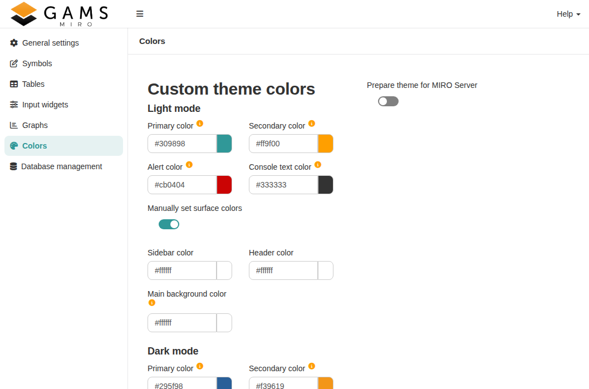
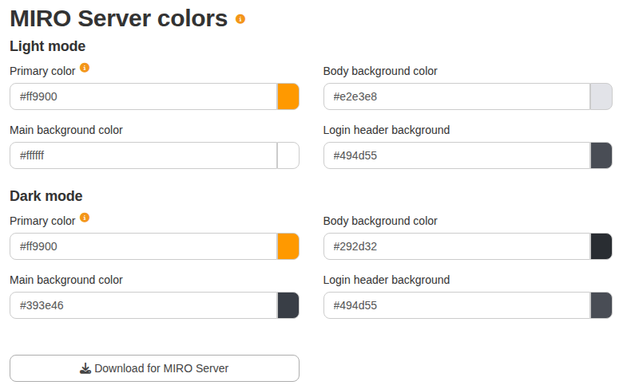
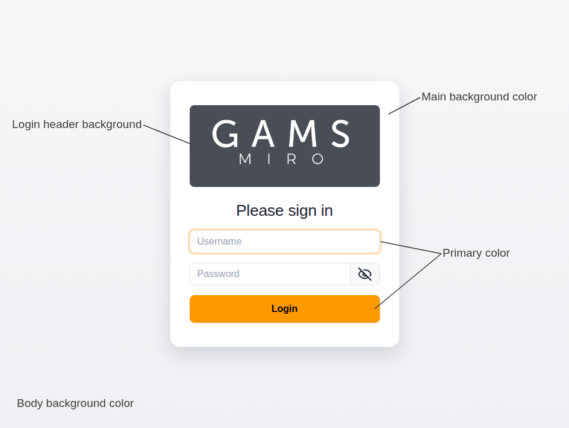

Colors
======

.. _custom-theme-colors:

Custom theme colors
-------------------

The *Custom theme colors* panel lets you brand each MIRO app - or all apps at once - by supplying just a handful of key colors. MIRO then derives a complete palette, applies it live to the running interface, and stores your choices either inside the app or as a global MIRO Desktop theme. Separate palettes can be maintained for *Light* and *Dark* mode so your design looks right in either setting.

To create a custom palette, enter the colors listed below; MIRO calculates everything else and refreshes the UI in real time while you edit.

.. list-table::
   :header-rows: 1

   * - Color
     - Purpose
   * - **Primary color**
     - Main brand color; highlights primary actions and guides user focus.
   * - **Secondary color**
     - Accents the interface, differentiates content and colors standard buttons.
   * - **Alert color**
     - Marks destructive operations such as *Delete* or *Clear*.
   * - **Console text color**
     - Text for log and listing output in the GAMS interaction pane.
   * - **Widgets background color**

       (Dark mode only)
     - Background of tables, dropdowns, sliders, etc. In Light mode this shade is derived from the primary color.
   * - **Main background color**

       (Dark mode only)
     - Background of the main window. Light mode is always white.

Three additional surface colors - **Sidebar**, **Header**, **Body background** - are auto-generated from the primary palette unless *Manually set surface colors* is checked. Toggle the checkbox to assume full control or to return to automatic calculation.

To reset a single Color, simply delete its hex value in the Color-picker and click anywhere outside the control. The picker immediately reverts to the default defined by the theme hierarchy:

1. **App-specific theme** - If the open app already has custom colors configured at startup, these act as defaults in the picker.
2. **Global desktop theme** - If no app-specific Colors exist, MIRO falls back to the global theme selected under `MIRO Desktop Preferences <./deployment.html#sbs-customize-app>`__ *→ Color theme*.

These defaults are fixed for the duration of a Configuration-mode session; changing the global theme or adding an app theme only takes effect the next time you open the editor.

Saving Options
~~~~~~~~~~~~~~

Adjust the colors until the live preview looks right, then pick the save option that fits your workflow.

.. list-table::
   :header-rows: 1

   * - Action
     - Effect
   * - **Save for this app**
     - Embeds the palette in the app. The colors ship with exported apps and cannot be modified later.
   * - **Save for all apps**
     - Stores a global theme used by every MIRO app on the device. Can be enabled under `MIRO Desktop Preferences <./deployment.html#sbs-customize-app>`__ *→ Color theme → Custom*. Color themes embedded in an app (button '*Save for this app*') overwrite the global theme.
   * - **Delete for this app**
     - Removes the app-specific theme and reverts to the global default.

.. _miro-server-colors:

MIRO Server colors
------------------

If you use MIRO Server and want to use a custom color theme for all apps hosted there, you can prepare the required file here. In addition to the `Custom theme colors <#custom-theme-colors>`__ which define the colors inside a MIRO application, the colors of the MIRO Server login screen and the app overview page can also be customized.

.. admonition:: Note:
   :class: warning

   Color themes embedded in an app (button '*Save for this app*' in `Custom theme colors <#custom-theme-colors>`__) overwrite a global MIRO Server theme. However, this does not affect the login screen and the app overview page.

To create a custom palette, enter the colors listed below;

.. list-table::
   :header-rows: 1

   * - Color
     - Purpose
   * - **Primary color**
     - Main brand color; highlights primary actions and guides user focus.
   * - **Body background color**
     - Color for the canvas behind nearly everything on the page.
   * - **Main background color**
     - Background of the main window.
   * - **Login header background**
     - Color for the strip at the top of the sign-in screen that houses the logo.

In the screenshot below you can see where which color is used on the login page.

If you are happy with the colors, you can export a *colors_custom.css* file by clicking on the button *Download for MIRO Server*. Continue `here <./server_setup.html#server-customize>`__ to see how to integrate the file into MIRO Server.
