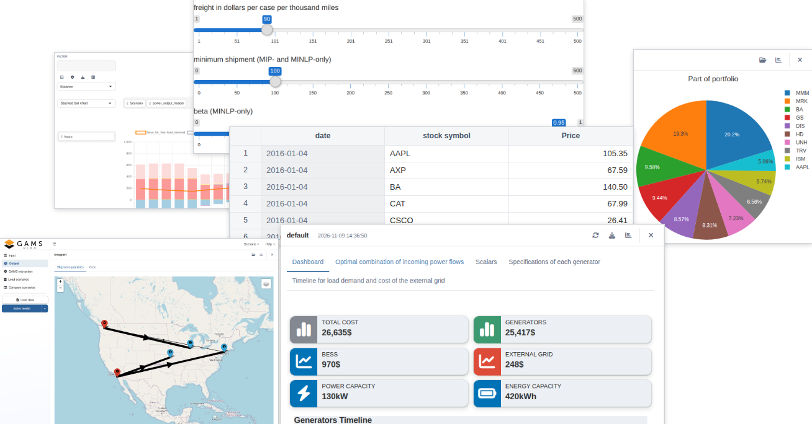
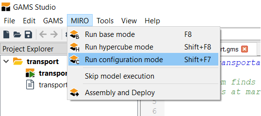

Configuration
=============

.. _intro:

Introduction
------------

In this section you will learn how to customize GAMS MIRO. As you saw previously when creating your first app, MIRO launches without any further configuration. However, you will find that there are a lot of configuration possibilities to adapt MIRO to your specific model.

The configuration is done via a `graphical configuration interface <#configurationMode>`__, with which you can create plots and widgets or change certain settings with a few mouse clicks, visually supported by a live preview. In addition, the configuration can also be done `manually via a JSON file <./configuration_advanced.html#jsonfiles>`__. In fact, all the graphical Configuration Mode does is create this JSON file.

.. _configurationMode:

.. raw:: html

   

Configuration Mode
------------------

This chapter shows how to configure MIRO using the graphical interface. For those who feel more comfortable writing JSON, section `Configuration via JSON <./configuration_advanced.html#jsonfiles>`__ shows how to configure a MIRO app without using the graphical interface.

The *Configuration Mode* is directly accessible via GAMS Studio:

In order to launch the Configuration Mode via the command line, the environment variable ``MIRO_MODE=config`` needs to be set instead of ``MIRO_MODE=base``. The other steps (see `here <./getting_started.html#start-via-command-line>`__) remain the same.

.. admonition:: Note
   :class: warning

   Changes made in Configuration Mode are effective after a restart of the MIRO application.

The Configuration Mode is categorized as follows:

.. _cards-wrapper:

.. grid:: 1 2 3 3
   :gutter: 2

   .. grid-item-card::
      :text-align: center
      :link: configuration_general.html
      :link-type: url

      .. raw:: html

         <i class="miro-card-icon fa-solid fa-cog" aria-hidden="true"></i>

      General settings
      ^^^

      Appearance and general behavior of the app

   .. grid-item-card::
      :text-align: center
      :link: configuration_symbols.html
      :link-type: url

      .. raw:: html

         <i class="miro-card-icon fa-solid fa-edit" aria-hidden="true"></i>

      Symbols
      ^^^

      Symbol naming, ordering, grouping, etc.

   .. grid-item-card::
      :text-align: center
      :link: configuration_tables.html
      :link-type: url

      .. raw:: html

         <i class="miro-card-icon fa-solid fa-table" aria-hidden="true"></i>

      Tables
      ^^^

      Global table and individual output table settings

   .. grid-item-card::
      :text-align: center
      :link: widgets.html
      :link-type: url

      .. raw:: html

         <i class="miro-card-icon fa-solid fa-sliders-h" aria-hidden="true"></i>

      Input widgets
      ^^^

      How to communicate input data with GAMS.

   .. grid-item-card::
      :text-align: center
      :link: charts.html
      :link-type: url

      .. raw:: html

         <i class="miro-card-icon fa-solid fa-chart-bar" aria-hidden="true"></i>

      Graphs
      ^^^

      Visualization of input and output data

   .. grid-item-card::
      :text-align: center
      :link: configuration_colors.html
      :link-type: url

      .. raw:: html

         <i class="miro-card-icon fa-solid fa-palette" aria-hidden="true"></i>

      Colors
      ^^^

      Configure custom themes

   .. grid-item-card::
      :text-align: center
      :link: configuration_database.html
      :link-type: url

      .. raw:: html

         <i class="miro-card-icon fa-solid fa-database" aria-hidden="true"></i>

      Database management
      ^^^

      Backup, restore or remove the database.

.. _not-in-configuration-mode:

Options not Available in Configuration Mode
-------------------------------------------

With the `Configuration Mode <#configurationMode>`__ we pursue the goal that a user can completely configure a MIRO application without having to `write any JSON <./configuration_advanced.html#jsonfiles>`__ code. However, there are a few advanced options that are not yet available in the Configuration Mode and will have to be configured manually. The following sections describe these options:

- `Custom data connectors <./configuration_json_only.html#custom-import-export>`__: Connect MIRO with external sources and exchange data in any format
- `Custom input widgets <./configuration_json_only.html#custom-input-widgets>`__: Create your own input widgets
- `Dashboard scenario comparison <./configuration_json_only.html#dashboard-compare>`__: Configure a dashboard for scenario comparison
- `Custom scenario comparison <./configuration_json_only.html#custom-compare-mode>`__: Specify custom scenario comparison modules
- `Drop-down menu in input table <./configuration_json_only.html#table-dropdown>`__: Use dropdown menus instead of freely editable cells
- `Column validation in input table <./configuration_json_only.html#table-validate-columns>`__: Validate manual edits by the user against predefined criteria
- `Column width of an input table <./configuration_json_only.html#table-colwidths>`__: Adjust the column width of individual tables
- `Default Views in Pivot Compare Mode <./configuration_json_only.html#pivot-compare-default-view>`__: Define a view that is shown first in Pivot Compare Mode
- `Hypercube module: Widget groups <./configuration_json_only.html#hcube-widget-groups>`__: Group widgets in the Hypercube submission dialog

.. _advanced:

Advanced topics
---------------

.. _widgets-advanced:

The following more `advanced topics <./configuration_advanced.html>`__ are covered in subsequent chapters:

- `Custom Renderers <./configuration_advanced.html#custom-renderers>`__: Create sophisticated custom graphics
- `Widgets with ranges <./configuration_advanced.html#widgets-ranges>`__: Widgets that return two scalars instead of one
- `Dependencies among widgets <./configuration_advanced.html#widgets-dependencies>`__: Define interdependencies between parameters
- `Configuration via JSON files <./configuration_advanced.html#jsonfiles>`__: Configure MIRO without using the Configuration Mode
- `Language Files <./configuration_advanced.html#language-files>`__: Translate MIRO into another language

.. toctree::
   :caption: Configuration
   :maxdepth: 2
   :hidden:

   configuration_general
   configuration_symbols
   widgets
   configuration_tables
   charts
   configuration_colors
   configuration_database
   configuration_advanced
   configuration_json_only
