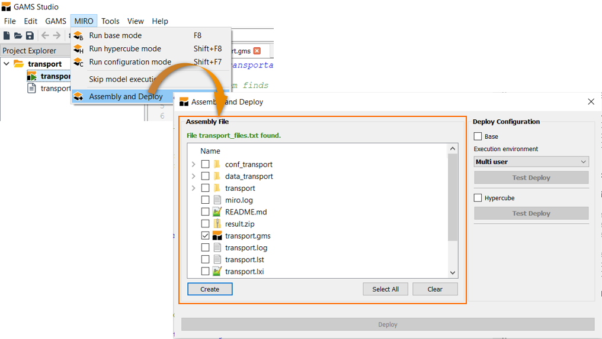
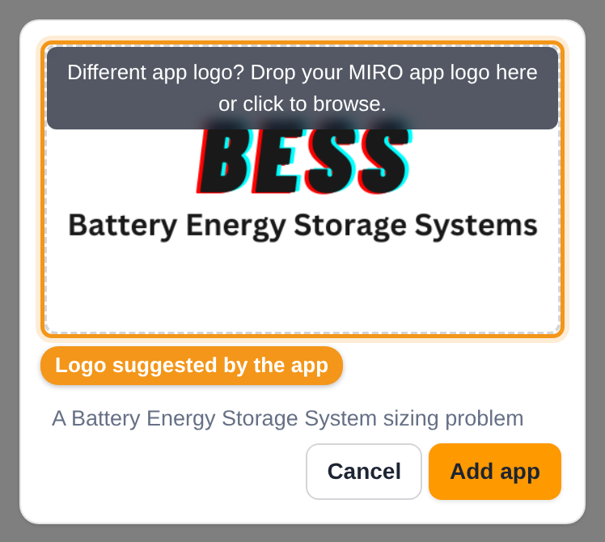
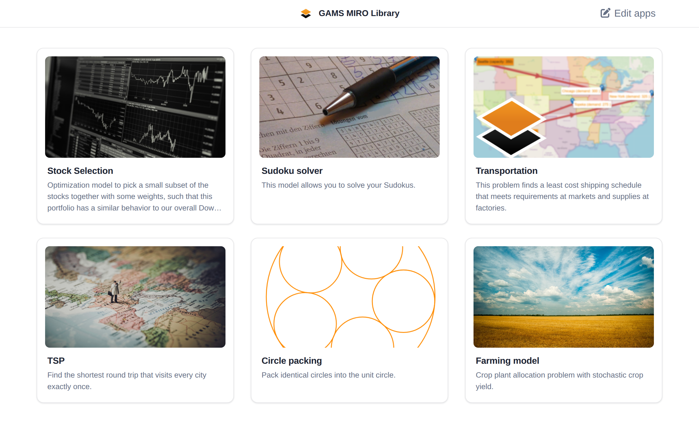
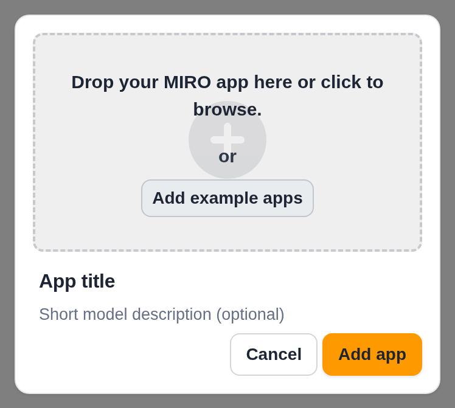
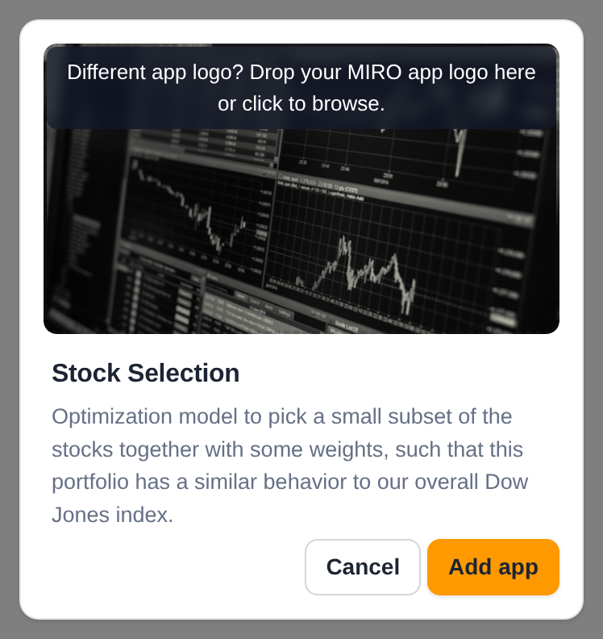
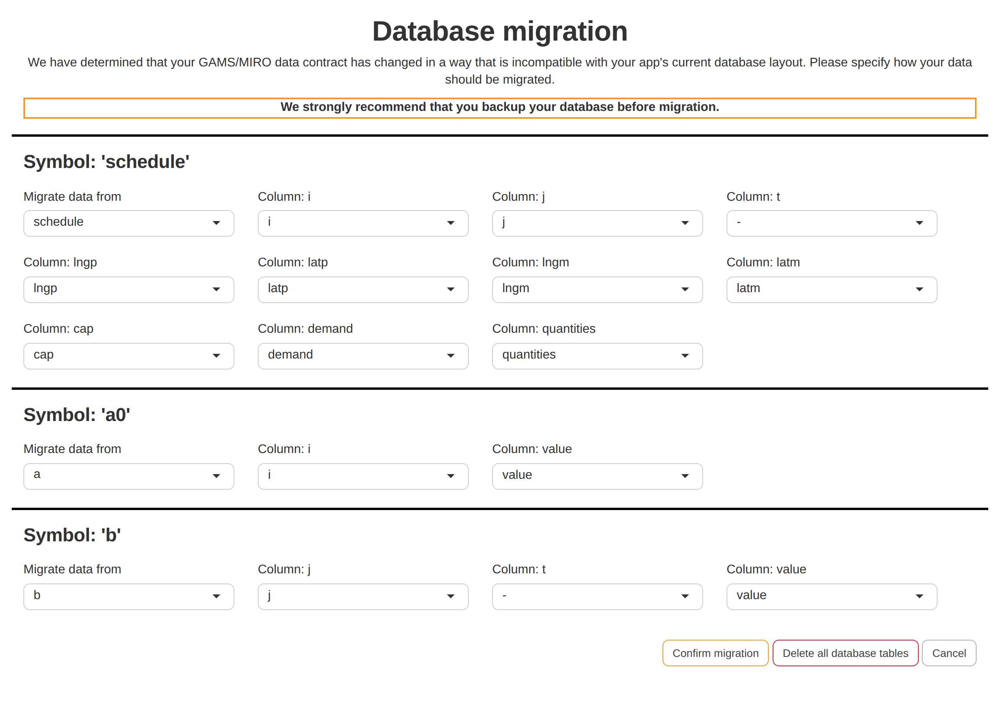

Deployment
==========

.. _deployment-introduction:

Introduction
------------

Once you are happy with the MIRO application you developed, you can deploy it. This chapter guides you through this process.

Deploying a MIRO application is the process of exporting and installing your app so that it can be easily shared and used in the daily business of your end users. Before you can deploy an app, it needs to be fully set up: no further changes to the model or the configuration can be made once it is deployed. In case you did not configure your MIRO app yet, read the chapters about `model preparation <./model.html>`__ and `configuration <./customize.html>`__.

In order to deploy a MIRO app, you first need to create a `model assembly file <#model-assembly-file>`__. All other things described in the following section, like logo, title, web app manifest file, signing the app, are optional.

.. _sbs-create-app:

Create an app bundle
--------------------

.. _model-assembly-file:

Model assembly file
~~~~~~~~~~~~~~~~~~~

Before you export your app bundle, MIRO needs to know about the files that belong to your model. This is primarily the main model file, but also all files necessary to calculate all inputs and outputs, e.g. files that are included in the model. To tell MIRO about these files, create a text file in the root directory of your model called ``<modelname>_files.txt`` or use *GAMS Studio* to create this file for you. For the latter go to *MIRO* → *Assembly and Deploy*. In the *Assembly File* section you can select those folders and files which are needed. If you select a folder, all files in it will be included. If you want to use only single files of a folder, you have to expand the folder and select the corresponding file(s).

.. admonition:: Attention
   :class: warning

   Files or folders created by MIRO (e.g. ``conf_<modelname>``, ``data_<modelname>``, ``static_<modelname>``) do not need to be included in the assembly file. MIRO knows about these files and includes them automatically.

If you want to create the text file on your own, specify the relative paths to the files that are part of your model separated by a new line. An example for a model named ``example`` can be found below:

.. rubric:: example_files.txt

.. code-block:: text

   example.gms
   data
   inc/inc1.inc
   inc/inc2.inc

This would result in the files ``example.gms``, ``inc/inc1.inc``, ``inc/inc2.inc`` and the entire directory ``data`` to be included.

.. _bundle-scenarios:

.. _bundling-data-with-your-app:

Bundling Data with your App
~~~~~~~~~~~~~~~~~~~~~~~~~~~

In case you want to distribute scenario data with your MIRO application, you can do so by simply placing MIROSCEN, GDX, CSV or XLSX files in the ``data_<modelname>`` directory. When your MIRO app is started for the first time, these datasets will be stored in the MIRO database. The filename is used as the scenario name. To learn more, read the chapter on `importing multiple scenarios on startup <./start.html#startup-import>`__. Note that the owner of these scenarios is the user that launches the MIRO app for the first time!

.. _default-logo:

Default Logo
~~~~~~~~~~~~

When adding the MIRO app to the MIRO library, the user has the option to choose a logo to quickly identify your app. If you want to suggest a logo, simply place an image (format: png/jpg/jpeg; aspect ratio: 8 × 5 fits best) with the name ``app_logo`` inside the ``static_<modelname>`` folder before deploying. When a user imports your app, this logo will be suggested to them. If no such file is found, a default logo is used.

**Note**: The ``app_logo`` logo described here is located in the same folder, but is independent of the logo `set in the Configuration Mode <./configuration_general.html#app-logo>`__.

.. _favicon:

Favicon
~~~~~~~

A favicon, short for "favorites icon", is a small, typically 16x16 pixel icon associated with a website or web application, displayed in the browser's address bar, tab, and bookmarks. To customize the favicon for your application, particularly when running on MIRO Server or accessing it via a browser in MIRO Desktop, simply place a file named ``favicon.ico`` in the ``static_<modelname>`` directory. Please ensure that the ``favicon.ico`` file does not exceed 100KB in size. This will override the default favicon, providing a unique visual identity for your app.

.. _default-title-description:

Default Title and Description
~~~~~~~~~~~~~~~~~~~~~~~~~~~~~

When adding a new MIRO app to the library, a user can specify an app title as well as a short description. If you want to provide defaults for these, you can do so via a JSON file ``app_info.json`` inside the ``static_<modelname>`` folder. The JSON file has to have the following structure:

.. code:: json

   {
       "title": "Example app",
       "description": "This is my first MIRO app"
   }

.. _app-metadata:

App Metadata
~~~~~~~~~~~~

In addition to the title and description, you can also specify the app's version and authors. Both fields can contain any string up to 100 characters in length (the *"authors"* field is an array of strings).

The version information is displayed in the top right corner of your application tile in the library, while the authors are shown in the bottom right corner. In MIRO Server, this information is only visible in the admin panel. Example:

.. code:: json

   {
       "title": "Example app",
       "description": "This is my first MIRO app",
       "version": "1.0.0",
       "authors": ["GAMS Development Corp."]
   }

.. _app-id:

App ID
~~~~~~

Each MIRO app has its own identifier. When using MIRO Server, the app ID determines the `URL <./server_administration.html#direct-app-link>`__ under which the app can be reached. The ID is also used to access an app via the MIRO Server `REST API <./server_api.html>`__. Within a MIRO instance (MIRO Desktop or MIRO Server), each ID must be unique. The default app id is the lowercase modelname, i.e. the lowercase name of the main GMS file (without .gms extension).

An app id must meet the following requirements:

- Max. 60 characters
- Must only contain lowercase ASCII characters, digits, ``_`` or ``-``
- Has to start with a lowercase ASCII character or digit

If the default app id does not meet the requirements (note that the default ID is always derived with lowercase characters), an alternative id must be specified manually. This can be done in the ``app_info.json`` inside the ``static_<modelname>`` folder.

.. code:: json

   {
       "title": "Example app",
       "description": "This is my first MIRO app",
       "appId": "my_app123"
   }

Note that unlike the title and description, the app id cannot be changed after the app has been deployed.

.. tip::

   The app id can be used to register multiple MIRO apps based on the same model by assigning an individual ID for each app.

.. _app-environment:

App Environment
~~~~~~~~~~~~~~~~

**MIRO Server only**

When writing custom code, such as `custom data connectors <configuration_json_only.html#custom-import-export>`__ or `custom renderers <./configuration_advanced.html#custom-renderers>`__, you may need to use secrets like API keys. Additionally, you may want to give administrators the ability to customize certain parts of your app when they add it to the library. In both cases, environment variables can be very useful.

To help administrators set these variables correctly, you can document them in the ``app_info.json`` file. To do this, you can add a new ``"environment"`` section:

.. code:: json

   {
       "title": "Advanced app",
       "description": "This is a more advanced app",
       "appId": "advanced_app123",
       "environment": {
         "MIRO_IMPORTER_API_KEY": {
           "description": "API key for custom importer"
         },
         "MIRO_RENDERER_SHOW_ADVANCED": {
           "description": "Show advanced options in renderer (yes/No)",
           "value": "no"
         }
       }
   }

As you can see, we have documented two environment variables required by our app: ``MIRO_IMPORTER_API_KEY`` and ``MIRO_RENDERER_SHOW_ADVANCED``. For each variable, we can provide a description as well as a default value, which the administrator can modify when adding the app.

These variables can then be accessed in your R code as follows: ``Sys.getenv("MIRO_IMPORTER_API_KEY", NULL)`` (second argument is the default value if variable is unset).

.. _web-app-manifest:

Make your App Mobile Friendly
~~~~~~~~~~~~~~~~~~~~~~~~~~~~~

If you plan to deploy your app on `MIRO Server <./server.html>`__, you can add a custom `web app manifest <https://developer.mozilla.org/en-US/docs/Web/Manifest>`__. This allows you to customize the name, logo, and more when your app is added to a user's home screen. To create a custom manifest, simply create a new ``manifest.json`` file in the ``static_<modelname>`` directory of your app. You can use the following template:

.. code:: json

   {
       "theme_color": "#ffffff",
       "background_color": "#ffffff",
       "display": "standalone",
       "start_url": "..",
       "short_name": "MIRO app",
       "name": "This is a GAMS MIRO app",
       "icons": [
           {
               "src": "logo192.png",
               "sizes": "192x192",
               "type": "image/png"
           },
           {
               "src": "logo512.png",
               "sizes": "512x512",
               "type": "image/png"
           }
       ]
   }

Make sure you also add the two icons ``logo192.png`` (192x192 pixels) and ``logo512.png`` (512x512 pixels) to the ``static_<modelname>`` directory. They will be used when adding your app to the home screen on Android devices. For iOS devices, add another icon named ``apple-touch-icon.png`` with a size of 180x180 pixels. The ``pickstock`` sample application contains a manifest that you can use as a reference.

.. admonition:: Attention
   :class: warning

   There is a known issue where the ``apple-touch-icon.png`` does not display properly on Apple devices.

.. _sbs-sign-app:

Sign your MIRO Apps
~~~~~~~~~~~~~~~~~~~

MIRO applications contain a lot of code (the GAMS model, custom renderers, etc.) that can be used for malicious purposes. To better protect you from these harmful apps, MIRO allows you to sign apps so you can be sure they come from developers you trust. To ensure the authenticity of an app, MIRO uses asymmetric encryption. The first time you import an app from an untrusted developer, you are asked if you want to trust that developer. To identify the developer, the fingerprint of the developer's `RSA <https://en.wikipedia.org/wiki/RSA_(cryptosystem)>`__ public key is displayed. This fingerprint can be transmitted through a different channel than the one you used to get the app.

In the following section we will explain how developers of MIRO apps can sign their apps.

To sign your apps, you need to have an RSA keypair. If you do not already have one, you can create one e.g. using your SSH client: on macOS/Linux you can use `OpenSSH <https://www.openssh.com>`__: ``>ssh-keygen -t rsa`` or `PuTTY <https://www.putty.org>`__ on Windows: open the PuTTYgen tool, select RSA with a size of at least 2048 bits, follow the instructions and store the private key. Afterwards, you will need to convert your key to the PEM format. To do so, load the private key with PuTTYgen, go to the *Conversions* menu and select *Export OpenSSH key (force new file format)*.

Once you have your private key, you should create a directory called ``signature`` in the *MIRO workspace path*. The location of the *MIRO workspace path* can be found in the *Preferences* window. Inside the ``signature`` directory, place your key file and name it ``private-key.pem``. If you have encrypted your key with a passphrase, place a file named ``key-passphrase`` (no extension) next to your private key. This file should contain only the passphrase for your key.

Public keys that you have trusted are stored (in PEM format) in a directory named: ``known_keys`` in your *MIRO workspace path*.

.. note::

   If you want to know how signing and validating MIROAPP files works in detail, read `here <./file_formats.html#signed-miroapp-file>`__.

.. _export-app:

Export app
~~~~~~~~~~

Once you specified the files that belong to your model, you are ready to export your MIRO app!

.. tab-set::

   .. tab-item:: GAMS

      .. _deploy-gams:

      .. image:: ../../assets/images/deployment/deploy.png
         :alt: Deploy MIRO model
         :class: miro-image-max-height-350pt

      In GAMS Studio, select *Assembly and Deploy*. In the *Deploy Configuration* section, you need to decide how your model shall be executed (*execution environment*). There are three options:

      #. Multi-user: This option allows your app to be used by multiple users simultaneously. Your model files are extracted at a random location, which is different for each user, and your model is executed from there.
      #. Single-user: Your model is executed inside the model directory. No extraction of your model files is required, but this means that you can NOT have multiple users accessing your MIRO app at the same time.
      #. .. _local-multi-user:

         Local multi-user (uses *idir*): With this third option, your model is again executed from a random location, but this time no model data is extracted here. Instead, GAMS is executed with an `input directory <https://www.gams.com/latest/docs/UG_GamsCall.html#GAMSAOinputdir>`__ pointing to the path where your model files are located. Choose this option ONLY if you have many large files that belong to your model and extracting them would take a long time. Be aware that due to the fact that ``idir`` is used, your model might brake! For example, if you use ``$call`` or the execution-time equivalent ``execute`` (or related functions), the relative paths used in these calls will no longer exist (since the `curdir <https://www.gams.com/latest/docs/UG_GamsCall.html#GAMSAOcurdir>`__ is now a random location). The solution is to prefix all these relative paths with ``%gams.idir1%``. For example, in order to import an Excel file ``test.xlsx``, GDXXRW needs to be called like this: ``$call gdxxrw i=%gams.idir1%test.xlsx``. Alternatively, you can also use absolute paths (e.g. via ``$setNames "%gams.input%" fp fn fe`` (see `here <https://www.gams.com/latest/docs/UG_DollarControlOptions.html#DOLLARsetnames>`__).

      Adjusting all affected paths is potentially a lot of work, so we strongly advise against using this option unless you know what you are doing!

      .. admonition:: Advice
         :class: warning

         We advise you to test your MIRO app before distributing it. GAMS Studio offers an option *test deployment*. This simulates how your end users will experience the MIRO app (MIRO is launched in the specified execution environment). In particular, you should check whether you forgot to include important files in the `model assembly file <#model-assembly-file>`__.

      If everything is set, click on *Deploy*. That's it! A new file ``<modelname>.miroapp`` is created in your model directory. You can now distribute this MIRO app directly to your end users!

      .. _export-cl:
      .. dropdown:: Advanced: Export MIRO app using the command line

         In case you want to use the command line instead of GAMS Studio to export your MIRO app, you should proceed as follows: First, set the environment variable ``MIRO_BUILD`` to ``true`` and ``MIRO_MODEL_PATH`` to the absolute path of your main ``.gms`` file (see `here <./getting_started.html#start-via-command-line>`__ for more information on how to set these environment variables on your operating system). The environment variables used to control what execution mode to choose are listed in the following table:

         +------------------------------+---------------------------------------------------------+
         | Execution mode               | Environment variables                                   |
         +==============================+=========================================================+
         | Multi-user                   | ``MIRO_USE_TMP=true`` and ``MIRO_BUILD_ARCHIVE=true``   |
         +------------------------------+---------------------------------------------------------+
         | Single-user                  | ``MIRO_USE_TMP=false`` and ``MIRO_BUILD_ARCHIVE=false`` |
         +------------------------------+---------------------------------------------------------+
         | Local multi-user (uses idir) | ``MIRO_USE_TMP=true`` and ``MIRO_BUILD_ARCHIVE=false``  |
         +------------------------------+---------------------------------------------------------+

         .. admonition:: Test deployment
            :class: warning

            In order to test the deployment you chose, set ``MIRO_DEV_MODE`` to ``true``, ``MIRO_BUILD`` to ``false`` and ``MIRO_TEST_DEPLOY`` to ``true``.

   .. tab-item:: GAMSPy

      .. _deploy-gamspy:

      In order to deploy a GAMSPy/MIRO app, you first need to create a `model assembly file <#model-assembly-file>`__. If everything is set, simply run the command below. That's it! A new file ``<modelname>.miroapp`` is created in your model directory. You can now distribute this MIRO app directly to your end users!

      .. code-block:: console

         > gamspy run miro --mode="deploy" --model <path_to_your_model> [--path <path_to_your_MIRO_installation>]

      where ``<path_to_your_model>`` is the path to your main *.py* file and ``<path_to_your_MIRO_installation>`` is the path to your MIRO executable file (e.g. ``C:\Program Files\GAMS MIRO\GAMS MIRO.exe`` on Windows, ``/Applications/GAMS MIRO.app`` on macOS or or ``/usr/bin/com.gams.miro`` on Debian/Ubuntu if installed via ``.deb`` file or ``~/GAMS-MIRO-2.9.0.AppImage`` on other Linux distros). You can omit ``--path`` in case MIRO is installed in one of the standard locations on Windows or macOS.

      Note that you can also set the MIRO installation path as an environment variable: ``MIRO_PATH``, so that you do not have to enter it every time you use the GAMSPy CLI.

.. note::

   If you want to learn more about the file structure of MIROAPP files, see the `chapter on File Formats <./file_formats.html>`__.

.. _sbs-install-app:

.. _install-the-miro-app:

Install the MIRO App
--------------------

To install a new MIRO app, launch GAMS MIRO Desktop. You will see your personal MIRO Desktop library with all the MIRO apps you have installed.

To add a new app to the library, either double click the app in your file browser (only on Windows/macOS) or click on "Edit" (``Ctrl`` + ``E`` or ``⌘`` + ``E`` on macOS) and drag&drop the app onto the "+" button. Alternatively, you can click on the "+" button and browse to the location of the new app manually.

Once MIRO validated the new app, you can assign a title, a short description as well as a logo.

Once you are happy with the setup, click on *Add app*. Your app is now installed in your library and you can launch it by clicking the *Launch* button.

.. _sbs-customize-app:

.. _customize-your-installed-miro-apps:

Customize your Installed MIRO Apps
----------------------------------

The MIRO Desktop interface offers several ways to control the behavior of your MIRO apps. To access these settings click on File → Preferences (or GAMS MIRO → Preferences if you are on macOS). Alternatively, press ``F7`` (or ``⌘`` + ``,`` on macOS). You will notice that there are three categories of settings: *General* settings, settings related to *Paths* and to the *Environment*. In the *General* category you can specify whether you want to launch your MIRO apps in a new window of the MIRO Launcher or in your default browser. You can set the language, the color theme, specify the level of detail of information to be logged as well as the number of days you want your log files to be stored for (-1 being no limit).

In the *Paths* section, you can control the location where your MIRO apps are stored/loaded from and the location where log files are kept. Additionally, in case you want to use a specific GAMS version or the MIRO Launcher was unable to locate GAMS automatically, you can set the path to GAMS here. On Linux, you can also specify the path to the required R installation here.

+-----------------+-------------------------------------+------------------------------------------------------------------------------------------------------------------------------------------------------------------------------------------------------------------------------------------------------------------------------------------------------------------------------------------+
|                 | Option                              | Description                                                                                                                                                                                                                                                                                                                              |
+=================+=====================================+==========================================================================================================================================================================================================================================================================================================================================+
| **General**     | Launch MIRO apps in your browser?   | If this option is set, MIRO applications are started in the users default web browser. If not set, the internal chromium browser is used instead.                                                                                                                                                                                        |
+-----------------+-------------------------------------+------------------------------------------------------------------------------------------------------------------------------------------------------------------------------------------------------------------------------------------------------------------------------------------------------------------------------------------+
|                 | Language                            | Sets the language. The user can choose between English, German and Chinese. Further languages are planned.                                                                                                                                                                                                                               |
+-----------------+-------------------------------------+------------------------------------------------------------------------------------------------------------------------------------------------------------------------------------------------------------------------------------------------------------------------------------------------------------------------------------------+
|                 | Color theme                         | Sets the color theme for all apps. The following themes are available: "Default theme", "Black and white", "Green forest", "Tawny", "Dark blue", "Red wine". if you have created a `custom theme <./configuration_colors.html#custom-theme-colors>`__ for all apps, another entry "Custom" will appear here.                             |
+-----------------+-------------------------------------+------------------------------------------------------------------------------------------------------------------------------------------------------------------------------------------------------------------------------------------------------------------------------------------------------------------------------------------+
|                 | Logging level                       | Determines the logging scope. *TRACE* = very high, *FATAL* = very low                                                                                                                                                                                                                                                                    |
+-----------------+-------------------------------------+------------------------------------------------------------------------------------------------------------------------------------------------------------------------------------------------------------------------------------------------------------------------------------------------------------------------------------------+
|                 | Number of days log files are stored | A value of -1 means that the logs are never deleted.                                                                                                                                                                                                                                                                                     |
+-----------------+-------------------------------------+------------------------------------------------------------------------------------------------------------------------------------------------------------------------------------------------------------------------------------------------------------------------------------------------------------------------------------------+
| **Paths**       | MIRO workspace path                 | Path to the working directory of GAMS MIRO. Deployed apps, scenario data and log files are stored here. On Windows the default location is ``C:\Users\<username>\.miro``                                                                                                                                                                 |
+-----------------+-------------------------------------+------------------------------------------------------------------------------------------------------------------------------------------------------------------------------------------------------------------------------------------------------------------------------------------------------------------------------------------+
|                 | GAMS path                           | Path to the GAMS installation folder.                                                                                                                                                                                                                                                                                                    |
+-----------------+-------------------------------------+------------------------------------------------------------------------------------------------------------------------------------------------------------------------------------------------------------------------------------------------------------------------------------------------------------------------------------------+
|                 | Python path                         | Path to the Python installation folder. Note that both GAMSPy and all other third-party dependencies for this Python interpreter must be installed for your GAMSPy-MIRO application to work.                                                                                                                                             |
+-----------------+-------------------------------------+------------------------------------------------------------------------------------------------------------------------------------------------------------------------------------------------------------------------------------------------------------------------------------------------------------------------------------------+
|                 | Log path                            | Location where the log files should be saved.                                                                                                                                                                                                                                                                                            |
+-----------------+-------------------------------------+------------------------------------------------------------------------------------------------------------------------------------------------------------------------------------------------------------------------------------------------------------------------------------------------------------------------------------------+
|                 | R path (Linux only)                 | Path to the R location. A current R version (3.6 or later) is required for using GAMS MIRO. Since R is bundled with MIRO on Windows and MacOS, this option is only available on Linux systems.                                                                                                                                           |
+-----------------+-------------------------------------+------------------------------------------------------------------------------------------------------------------------------------------------------------------------------------------------------------------------------------------------------------------------------------------------------------------------------------------+
| **GAMS Engine** | Execution of models on GAMS Engine? | If enabled, GAMS jobs will be `run in the cloud <./server.html>`__ instead of on the local machine.                                                                                                                                                                                                                                      |
+-----------------+-------------------------------------+------------------------------------------------------------------------------------------------------------------------------------------------------------------------------------------------------------------------------------------------------------------------------------------------------------------------------------------+
|                 | Engine URL                          | URL where GAMS Engine is hosted, e.g. ``https://engine.gams.com``.                                                                                                                                                                                                                                                                       |
+-----------------+-------------------------------------+------------------------------------------------------------------------------------------------------------------------------------------------------------------------------------------------------------------------------------------------------------------------------------------------------------------------------------------+
|                 | Namespace                           | The *namespace* to solve the model in. Engine uses these namespaces to organize GAMS models. Your user account needs at least write and execute permissions on that namespace. Further information can be found `here <https://www.gams.com/engine/administration.html#namespaces>`__.                                                   |
+-----------------+-------------------------------------+------------------------------------------------------------------------------------------------------------------------------------------------------------------------------------------------------------------------------------------------------------------------------------------------------------------------------------------+
|                 | Login via                           | Login method to use. Options supported by MIRO are: *Username/Password* for logging in with username and password, *JWT* for logging in with an authentication token (can e.g. be generated from the Engine UI) or using an `LDAP/OAuth2/OIDC identity provider <https://www.gams.com/engine/administration.html#identity-providers>`__. |
+-----------------+-------------------------------------+------------------------------------------------------------------------------------------------------------------------------------------------------------------------------------------------------------------------------------------------------------------------------------------------------------------------------------------+

.. _custom-environments:

**Environment**

In the *Environment* section, you can import a customized environment to be used by your MIRO apps. This is useful, for example, if you want to run custom analysis scripts that require external software not in your PATH or to store credentials to be used by `custom data connectors <./configuration_json_only.html#custom-import-export>`__.

Environment files are JSON files of the following form:

.. code:: json

   {
       "ENV_VAR_1": "VAL_1",
       "ENV_VAR_2": "VAL_2"
   }

Environment variables names must consist solely of uppercase letters, digits and '\_' (underscore) and must not start with a digit. Note that the ``PATH`` environment variable is special in that MIRO prepends it to the already existing ``PATH``.

As an example, let's say we want to run the analysis script that comes with the *pickstock* example. We do this by first setting up a Python environment for it:

.. tab-set::

   .. tab-item:: Windows

      .. _venv-win:

      .. code-block:: console

         > python -m venv venv
         > venv\Scripts\activate.bat
         (venv) > pip install jupyter pandas matplotlib
         (venv) > python <path_to_gams>\apifiles\Python\api_39\setup.py build -b %TEMP% install

   .. tab-item:: macOS / Linux

      .. _venv-unix:

      .. code-block:: console

         > python -m venv venv
         > source venv/bin/activate
         (venv) > pip install jupyter pandas matplotlib
         (venv) > python <path_to_gams>/apifiles/Python/api_39/setup.py build -b ${TMPDIR} install

Now all we have to do is tell MIRO to use this Python environment by adding it to the ``PATH`` via the following environment file:

.. code:: json

   {
       "PATH": "<path_to_venv>/venv/bin"
   }

.. _db-migration:

.. _database-migration:

Database migration
------------------

From time to time, you may want to update your MIRO application. Most updates, such as changing the layout of your application, adjusting the renderers, or even improving your GAMS model, are not problematic. It gets more complicated when you change the GAMS/MIRO data contract, i.e. anything between the ``$onExternalInput`` / ``$offExternalInput`` or ``$onExternalOutput`` / ``$offExternalOutput`` tags. MIRO stores all of your application's data in a relational database. This means that every time you change the domains of a symbol (add/remove/rename indices) or remove/rename external input and/or output symbols, the database must be migrated to the new data contract. Fortunately, MIRO offers a *Migration Wizard* to assist you with this process.

Let's look at an example where we have added a time dimension to the *transport* example model:

You can see that we need to migrate data from the three symbols: ``schedule``, ``a0`` and ``b``. The symbols ``schedule`` and ``b`` now have an additional dimension ``t``. Before this new version, we did not have this dimension, so we choose ``-`` here to indicate that this data is missing. If we were to load a scenario that was saved with an old version of our app, the data in these columns would be marked as *NA*.

As we renamed the symbol ``a`` to ``a0``, we indicate that data for symbol ``a0`` should come from ``a``.

Note that as an alternative to migrating existing data, we also have the option to remove all existing data by clicking the ``Delete all database tables`` button in the lower left corner.

.. warning::

   Before you migrate the data, you should perform a backup of your database. If you are using MIRO Desktop, you can do this via the `Configuration Mode <./configuration_database.html>`__. For MIRO Server, please refer to the official `PostgreSQL documentation <https://www.postgresql.org/docs/current/backup.html>`__.
