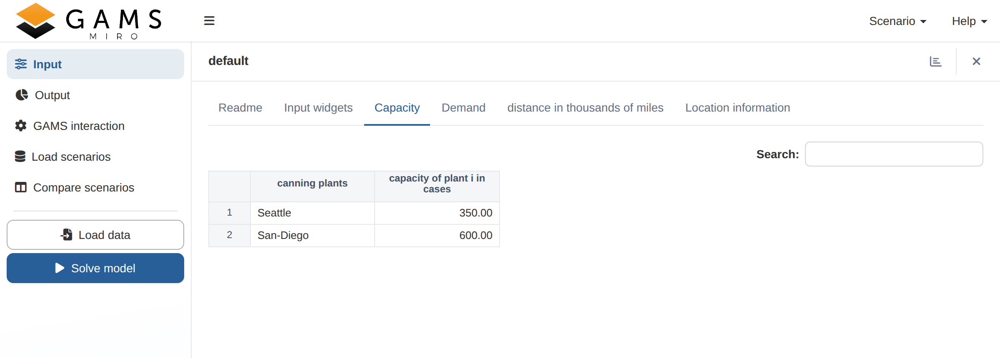
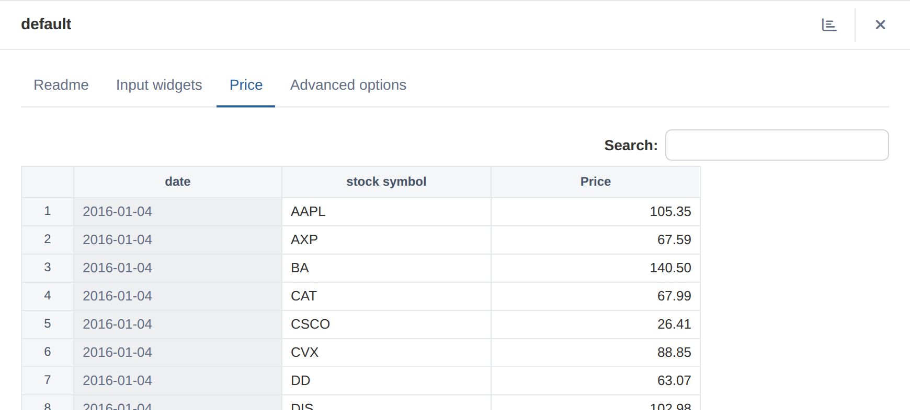
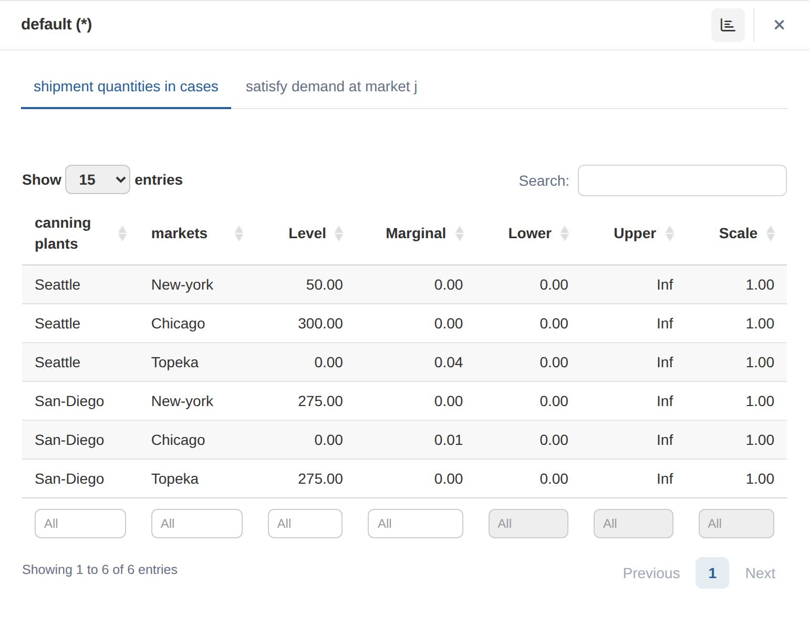
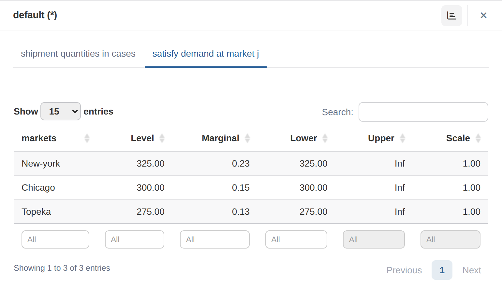
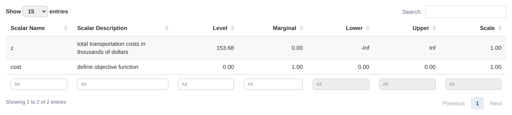
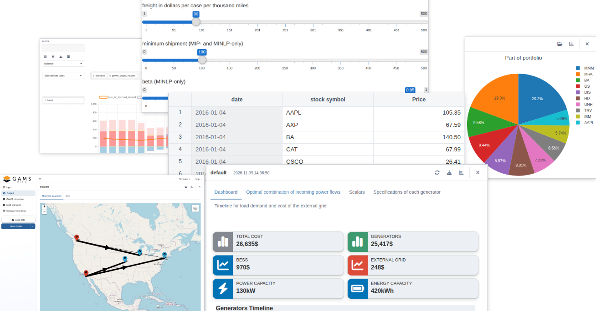

Model preparation
=================

.. _introduction-section:

.. _introduction:

Introduction
------------

.. _model-1:

Let's now turn a GAMS model into a MIRO app. When developing GAMS MIRO, we focused on automating this process and making it possible with very few adjustments to your model. In order to get started, it's a good idea to have a look at the GAMS code of the `demo applications <./download.html#demo-section>`__.

The model *transport* is one of these demo applications that come with your GAMS MIRO installation. However, for illustration purposes we now take the original *trnsport.gms* model from the GAMS `Model Library <https://www.gams.com/latest/gamslib_ml/libhtml/>`__.

If you want to join us in going step by step from the "raw" model to our first MIRO app, download the corresponding file from the Model Library and put it in a directory of your choice.

.. admonition:: Case sensitivity
   :class: warning

   MIRO specific files and directories (*conf\_<modelname>*, *data\_<modelname>*, *static\_<modelname>*, *renderer\_<modelname>*, *scripts\_<modelname>* and *<modelname>_files.txt*) must be lower case!

.. _creating-section:

.. _turn-your-gams-model-into-a-gams-miro-app:

Turn your GAMS model into a GAMS MIRO app
-----------------------------------------

.. _model-adjustments:

Model adjustments
^^^^^^^^^^^^^^^^^

.. tab-set::

   .. tab-item:: GAMS

      .. raw:: html

         

      Every GAMS model can be deployed with MIRO in just a few steps. First, those GAMS symbols that you want to be visible in the interface need to be declared. This can be done by wrapping the corresponding *symbol declarations* with the tags ``$onExternalInput`` / ``$offExternalInput`` for input data and ``$onExternalOutput`` / ``$offExternalOutput`` for output data. These tags can be used multiple times within a model. Symbols which are not tagged won’t be visible in the web interface.

      The code below shows a small example:

      .. code:: gams

         $onExternalInput
         Parameter
             symbol_1(dim1, dim2)  'Displayed in MIRO (model input data)'
             symbol_2(dim3)        'Displayed in MIRO (model input data)';
         $offExternalInput

         Parameter
             symbol_3(dim4)        'NOT displayed in MIRO';

      Here, the parameters ``symbol_1`` and ``symbol_2`` are declared between the tags ``$onExternalInput`` and ``$offExternalInput``. They will be visible in MIRO (e.g. as tables).
      ``symbol_3``, on the other hand, was declared outside the keywords. This parameter will not be visible in MIRO (however, of course it is still available as a GAMS symbol in your model).

   .. tab-item:: GAMSPy

      .. raw:: html

         

      Every GAMSPy model can be deployed with MIRO in just a few steps. First, those GAMS symbols that you want to be visible in the interface need to be annotated. This can be achieved by adding ``is_miro_input=True`` for input data and ``is_miro_output=True`` for output data in the constructors of the GAMSPy symbols. Symbols without these arguments won't be visible in the web interface.

      The code below shows a small example:

      .. code:: python

         symbol_1 = Parameter(m, name="symbol_1", domain=[dim1, dim2], is_miro_input=True)
         symbol_2 = Parameter(m, name="symbol_2", domain=[dim3], is_miro_input=True)
         symbol_3 = Parameter(m, name="symbol_3", domain=[dim4])

      Here, the parameters ``symbol_1`` and ``symbol_2`` are defined using ``is_miro_input=True``. They will be visible in MIRO (e.g. as tables). ``symbol_3`` will not be visible in MIRO (however, of course it is still available as a GAMS symbol in your model).

The following GAMS symbols can be used in GAMS MIRO:

- `Sets <https://www.gams.com/latest/docs/UG_SetDefinition.html>`__
- `Parameters <https://www.gams.com/latest/docs/UG_DataEntry.html#UG_DataEntry_Parameters>`__ / `Tables <https://www.gams.com/latest/docs/UG_DataEntry.html#UG_DataEntry_Tables>`__
- `Scalars <https://www.gams.com/latest/docs/UG_DataEntry.html#UG_DataEntry_Scalars>`__
- `Singleton Sets <https://www.gams.com/latest/docs/UG_SetDefinition.html#UG_SetDefinition_SingletonSets>`__
- `Variables (output only) <https://www.gams.com/latest/docs/UG_Variables.html>`__
- `Equations (output only) <https://www.gams.com/latest/docs/UG_Equations.html>`__
- `GAMS Options (not for GAMSPy) <https://www.gams.com/latest/docs/UG_GamsCall.html#UG_GamsCall_SpecifyingOptionsThroughTheCommandLine>`__
- `Double dash parameters (not for GAMSPy) <https://www.gams.com/latest/docs/UG_GamsCall.html#UG_GamsCall_DoubleDashParametersEtcSimpleExample>`__

The configuration of GAMS Options and double dash parameters differs from the other symbols. Learn more about this `here <#command-line>`__.

.. admonition:: File encoding
   :class: warning

   Your GAMS model files need to be encoded with UTF-8. In GAMS Studio you can change the encoding of your file via *Edit* → *Encoding* → *convert to* ... → *UTF-8*. Other file encodings are not supported in GAMS MIRO!

   .. image:: ../../assets/images/studio/encoding_studio.png
      :alt: File encoding in GAMS Studio

.. tab-set::

   .. tab-item:: GAMS

      .. raw:: html

         

      **Example:**
      Let's try this for the model *trnsport* now. This is what the input data section of the model looks like when we have loaded it from the GAMS Model Library:

      .. code:: gams

         Set
            i 'canning plants' / seattle,  san-diego /
            j 'markets'        / new-york, chicago, topeka /;

         Parameter
            a(i) 'capacity of plant i in cases'
                 / seattle    350
                   san-diego  600 /

            b(j) 'demand at market j in cases'
                 / new-york   325
                   chicago    300
                   topeka     275 /;

         Table d(i,j) 'distance in thousands of miles'
                       new-york  chicago  topeka
            seattle         2.5      1.7     1.8
            san-diego       2.5      1.8     1.4;

         Scalar f 'freight in dollars per case per thousand miles' / 90 /;

         Parameter c(i,j) 'transport cost in thousands of dollars per case';

      Let's import some of the data from MIRO, namely the parameters ``a``, ``b`` and ``d`` as well as the scalar ``f``. In order to tell MIRO that you want these symbols to come from there, we now flag them with the mentioned annotations in the symbol declarations:

      .. code:: gams

         Set
            i 'canning plants' / seattle,  san-diego /
            j 'markets'        / new-york, chicago, topeka /;

         $onExternalInput
         Parameter
            a(i) 'capacity of plant i in cases'
                 / seattle    350
                   san-diego  600 /

            b(j) 'demand at market j in cases'
                 / new-york   325
                   chicago    300
                   topeka     275 /;

         Table d(i,j) 'distance in thousands of miles'
                       new-york  chicago  topeka
            seattle         2.5      1.7     1.8
            san-diego       2.5      1.8     1.4;

         Scalar f 'freight in dollars per case per thousand miles' / 90 /;
         $offExternalInput

      There's one thing that needs to be considered here: We have decided to display the parameter ``a`` with the index ``i`` in MIRO and the parameter ``b`` with the index ``j``. It is therefore possible for us to make changes to the elements of i and j from within MIRO (i.e. modify the elements of i and/or j). However, as we declared i and j outside of the ``$on-/offExternalInput`` tags, we would get domain violations if we were to modify the set elements! To get around this problem, we will use the ``<`` `operator <https://www.gams.com/latest/docs/UG_SetDefinition.html#UG_SetDefinition_ImplicitSetDefinition>`__:

      .. code:: gams

         Set
            i 'canning plants'
            j 'markets';

         $onExternalInput
         Parameter
            a(i<) 'capacity of plant i in cases'
                 / seattle    350
                   san-diego  600 /

            b(j<) 'demand at market j in cases'
                 / new-york   325
                   chicago    300
                   topeka     275 /;

         [...]
         $offExternalInput

      This ``<`` `operator <https://www.gams.com/latest/docs/UG_SetDefinition.html#UG_SetDefinition_ImplicitSetDefinition>`__ causes the sets ``i`` and ``j`` to be defined implicitly via the parameters ``a`` and ``b`` (see also `here <#implicit-set>`__). Alternatively, we could declare the first column of the tables a and b to be `readonly <widgets.html#table-option-readonlycol>`__ in order to prevent domain violations.

      In addition, we want MIRO to display the variables of the model. To do so, we simply tag the declaration statement of the variables:

      .. code:: gams

         $onExternalOutput
         Variable
            x(i,j) 'shipment quantities in cases'
            z      'total transportation costs in thousands of dollars';
         $offExternalOutput
         Positive Variable x;

         [...]

      That's it. We defined both input and output data for use in MIRO. If you use GAMS Studio, the model is now ready to be launched in MIRO. If you use the command line instead, please follow `these steps <./getting_started.html#start-via-command-line>`__ before starting MIRO.

   .. tab-item:: GAMSPy

      .. raw:: html

         

      **Example:**
      Let's try this for the model *trnsport* now. This is what the input data section of the model looks like in the example application:

      .. code:: python

         # Sets
         i = Set(m, name="i", records=["seattle", "san-diego"], description="canning plants")
         j = Set(m, name="j", records=["new-york", "chicago", "topeka"], description="markets")

         [...]

         # Data
         a = Parameter(m, name="a", domain=[i], records=capacities, description="capacity of plant i in cases")
         b = Parameter(m, name="b", domain=[j], records=demands, description="demand at market j in cases")
         d = Parameter(m, name="d", domain=[i, j], records=distances, description="distance in thousands of miles")
         f = Parameter(m, name="f", records=90, description="freight in dollars per case per thousand miles")

      Let's import some of the data from MIRO, namely the parameters ``a``, ``b`` and ``d`` as well as the scalar ``f``. In order to tell MIRO that you want these symbols to come from there, we now flag them with the mentioned argument ``is_miro_input=True``:

      .. code:: python

         # Sets
         i = Set(m, name="i", records=["seattle", "san-diego"], description="canning plants")
         j = Set(m, name="j", records=["new-york", "chicago", "topeka"], description="markets")

         [...]

         # Data
         a = Parameter(m, name="a", domain=[i], records=capacities, is_miro_input=True, description="capacity of plant i in cases")
         b = Parameter(m, name="b", domain=[j], records=demands, is_miro_input=True, description="demand at market j in cases")
         d = Parameter(m, name="d", domain=[i, j], records=distances, is_miro_input=True, description="distance in thousands of miles")
         f = Parameter(m, name="f", records=90, is_miro_input=True, description="freight in dollars per case per thousand miles")

      There's one thing that needs to be considered here: We have decided to display the parameter ``a`` with the index ``i`` in MIRO and the parameter ``b`` with the index ``j``. It is therefore possible for us to make changes to the elements of i and j from within MIRO (i.e. modify the elements of i and/or j). However, as we did not include i and j in MIRO, we would get domain violations if we were to modify the set elements! To get around this problem, we will use `Implicit Set Definition <https://gamspy.readthedocs.io/en/latest/user/basics/set.html#implicit-set-definition-via-domain-forwarding>`__ via the ``domain_forwarding`` attribute:

      .. code:: python

         i = Set(m, name="i", records=["seattle", "san-diego"], description="canning plants")
         j = Set(m, name="j", records=["new-york", "chicago", "topeka"], description="markets")
         a = Parameter(m, name="a", domain=[i], records=capacities, domain_forwarding=True, is_miro_input=True, description="capacity of plant i in cases")
         b = Parameter(m, name="b", domain=[j], records=demands, domain_forwarding=True, is_miro_input=True, description="demand at market j in cases")

      This `Implicit Set Definition <https://gamspy.readthedocs.io/en/latest/user/basics/set.html#implicit-set-definition-via-domain-forwarding>`__ causes the sets ``i`` and ``j`` to be defined implicitly via the parameters ``a`` and ``b`` (see also `here <#implicit-set>`__). Alternatively, we could declare the first column of the tables a and b to be `readonly <widgets.html#table-option-readonlycol>`__ in order to prevent domain violations.

      In addition, we want MIRO to display the variables of the model. To do this, we simply assign the argument ``is_miro_output=True`` to the corresponding symbol constructors:

      .. code:: python

         # Variables
         x = Variable(m, name="x", domain=[i, j], type="Positive", is_miro_output=True, description="shipment quantities in cases")
         z = Variable(m, name="z", is_miro_output=True, description="total transportation costs in thousands of dollars")

      That's it. We defined both input and output data for use in MIRO and the model is ready to be launched in MIRO.

.. _launch-miro:

Launch MIRO
^^^^^^^^^^^

.. tab-set::

   .. tab-item:: GAMS

      .. raw:: html

         

      To launch MIRO from within GAMS Studio, simply click on *Run Base Mode*.

      .. image:: ../../assets/images/studio/launch-miro-btn.png
         :alt: Launch MIRO button
         :class: miro-image-max-height-175pt

      .. tip::

         In order to launch MIRO via the command line, please follow the steps explained `here <./getting_started.html#start-via-command-line>`__.

   .. tab-item:: GAMSPy

      .. raw:: html

         

      In order to launch the MIRO app for this model via the `GAMSPy CLI <https://gamspy.readthedocs.io/en/latest/user/advanced/miro.html>`__, we simply run the following command:

      .. code-block:: console

         > gamspy run miro --mode="base" --model <path_to_your_model> [--path <path_to_your_MIRO_installation>]

      where ``<path_to_your_model>`` is the path to the *transport.py* file and ``<path_to_your_MIRO_installation>`` is the path to your MIRO executable file (e.g. ``C:\Program Files\GAMS MIRO\GAMS MIRO.exe`` on Windows, ``/Applications/GAMS MIRO.app`` on macOS or ``~/GAMS-MIRO-2.9.0.AppImage`` on Linux). You can omit ``--path`` in case MIRO is installed in one of the standard locations on Windows or macOS.

      Note that you can also set the MIRO installation path as an environment variable: ``MIRO_PATH``, so that you do not have to enter it every time you use the GAMSPy CLI.

Congratulations! Your first MIRO app is now up and running!

With the basic configuration you can load data, modify it from within the interface and start or stop a GAMS job. You also have access to the *log* and *listing* (*lst*) files of GAMS as well as all files generated during the run. When the model has finished the execution phase successfully, the results can be examined. Since MIRO is connected to a database, you can store results there, fetch previously saved results and modify them or use them to compare with other scenarios.

.. tip::

   After the startup, you will find new configuration files in the directory where your model is located. You can read more about the startup process and related files `here <./model.html#development-files>`__.

.. _data-contract:

.. _the-gamsmiro-data-contract:

The GAMS/MIRO data contract
^^^^^^^^^^^^^^^^^^^^^^^^^^^

All GAMS symbols, which are marked with the ``$onExternalInput`` / ``$offExternalInput`` or ``$onExternalOutput`` / ``$offExternalOutput`` tags (in GAMSPY: ``is_miro_input=True`` or ``is_miro_output=True``) define the *GAMS/MIRO data contract*. This contract contains the metadata of all included symbols and is generated automatically each time MIRO is run in `development mode <./model.html#development-mode>`__. It is stored in the *<modelname>_io.json* file located in the *conf\_<modelname>* directory.

.. warning::

   The *<modelname>_io.json* file should never be touched!

The database schema that GAMS MIRO uses internally depends directly on the structure of the symbols in the data contract. When you launch a MIRO application for the first time, database tables are created according to this schema. If you change the structure of your data contract in a way that is incompatible with the current database layout, MIRO will prompt you with a `database migration wizard <deployment.html#db-migration>`__ to migrate your data.

.. _gams-symbols:

GAMS symbols
------------

In this section we will see how the various GAMS symbols (sets, parameters, variables, etc.) can be imported and exported into/from MIRO.

**Note**: GAMS symbols do not have to be displayed in MIRO. It is clearer and usually even advisable to integrate only those symbols that should be visible and modifiable by the end user.

**Note**: It is not possible to use the same GAMS symbol both as input and output data in MIRO. However, there is an option to `use output data as input data <./configuration_symbols.html#symbol-links>`__.

.. _display-set:

.. _sets:

Sets
^^^^

.. tab-set::

   .. tab-item:: GAMS

      .. raw:: html

         

      Sets are basic elements of a GAMS model. In this chapter we will see how they can be integrated into MIRO.
      To integrate a set in MIRO, declare it between the ``$onExternalInput`` / ``$offExternalInput`` tags:

      .. code:: gams

         $onExternalInput
         Set i 'canning plants'
             j 'markets';
         $offExternalInput

   .. tab-item:: GAMSPy

      .. raw:: html

         

      Sets are basic elements of a GAMS model. In this chapter we will see how they can be integrated into MIRO.
      To integrate a set in MIRO, set the ``is_miro_input`` argument to ``True``:

      .. code:: python

         i = Set(m, name="i", records=["seattle", "san-diego"], is_miro_input=True, description="canning plants")
         j = Set(m, name="j", records=["new-york", "chicago", "topeka"], is_miro_input=True, description="markets")

      If a set is declared in this way, it is displayed in MIRO as a table in a separate tab. Set tables consist of one column for the set elements and one column for the explanatory text of each set element (element text).
      Since the sets ``i`` and ``j`` are displayed in MIRO, their elements will be defined via MIRO.

      **Note**: Be careful when you want to load both a set and a parameter whose domain this set is part of! You will end up with two distinct tables, one for the set and one for the parameter. If you now change the domain of the parameter but not the set, you will end up with domain violations!

      **Implicit set definition**

.. tab-set::

   .. tab-item:: GAMS

      .. raw:: html

         

      Populating a set can be done implicitly. This means that you don't import the set elements explicitly, but implicitly via a certain parameter. Instead of two tables, you end up with a single table, and your MIRO users won't run into ugly domain violations. This can be accomplished using the `Implicit Set Definition <https://www.gams.com/latest/docs/UG_SetDefinition.html#UG_SetDefinition_ImplicitSetDefinition>`__ (or: *Domain Defining Symbol Declarations*). In the following example, the sets are declared outside the ``$onExternalInput`` / ``$offExternalInput`` tags. However, they are defined implicitly by the parameter ``d(i<,j<)``, which is defined by data coming from MIRO.

      .. code:: gams

         Set i 'canning plants'
             j 'markets';

         $onExternalInput
         Parameter d(i<,j<) 'distance in thousands of miles';
         $offExternalInput

      The ``<`` signs signal GAMS that the sets ``i`` and ``j`` will be defined implicitly via the parameter ``d``.

   .. tab-item:: GAMSPy

      .. raw:: html

         

      Populating a set can be done implicitly. This means that you don't import the set elements explicitly, but implicitly via a certain parameter. Instead of two tables, you end up with a single table, and your MIRO users won't run into ugly domain violations. This can be accomplished using the `Implicit Set Definition <https://gamspy.readthedocs.io/en/latest/user/basics/set.html#implicit-set-definition>`__. In the following example, the sets are declared without the ``is_miro_input=True`` argument. However, they are defined implicitly by the parameter ``d``, which is defined by data coming from MIRO, via the ``domain_forwarding`` argument.

      .. code:: python

         i = Set(m, name="i", description="canning plants")
         j = Set(m, name="j", description="markets")
         d = Parameter(m, name="d", domain=[i,j], domain_forwarding=True, is_miro_input=True, description="distance in thousands of miles")

      The ``domain_forwarding`` argument signals GAMSPy that the sets ``i`` and ``j`` will be defined implicitly via the parameter ``d``.

.. _display-parameters:

.. _parameters:

Parameters
^^^^^^^^^^

By default, parameters are displayed in MIRO in tabular form. In the default configuration, each *index* of a GAMS parameter is displayed in a separate column. The last column contains the parameter *values*.

Example:
In this example the parameter *price* has been tagged for use in MIRO:

.. tab-set::

   .. tab-item:: GAMS

      .. raw:: html

         

      .. code:: gams

         Set date   'date'
             symbol 'stockSymbol';

         $onExternalInput
         Parameter price(date<,symbol<) 'Price';
         $offExternalInput

   .. tab-item:: GAMSPy

      .. raw:: html

         

      .. code:: text

         date = Set(m, name="date", description="date")
         symbol = Set(m, name="symbol", description="symbol")

         price = Parameter(m, name="price", domain=[date,symbol], domain_forwarding=True, is_miro_input=True, description="Price")

      When we start GAMS MIRO and load the default scenario that was automatically created, we see the following input screen:

.. _no-header:

In this example the parameter ``price`` has two indices: ``date`` and ``symbol``. Each index is shown in a separate column named after the explanatory text of the corresponding set (or in case no explanatory text is available, the name of the symbol). The value column of a parameter is always called *value* and aliased with the explanatory text of the parameter. This type of representation of a GAMS parameter is what we call the *parameter view* or *list view*.

.. _display-tables:

.. _tables:

Tables
^^^^^^

.. warning::

   Please read the notes about the communication of `tables in MIRO <#table-miro>`__ before using them!

.. _table-general:

.. _general:

General
"""""""

Tabular data can be declared and initialized in GAMS using a `table statement <https://www.gams.com/latest/docs/UG_DataEntry.html#UG_DataEntry_Tables>`__ (in GAMSPy: ``is_miro_table=True``). For two and higher-dimensional parameters this provides an easier and more concise method of data entry than the list based approach, since - at least in smaller tables - each label appears only once.

A symbol declared as a table in GAMS is also displayed as such in MIRO. Each set element of the last index is displayed in a separate column. We call this the *table view* of a parameter.

.. note::

   In MIRO only the elements of the last index of a parameter are used as columns with the table statement.

Let's take the output parameter ``schedule`` of the *transport* model as an example:

.. tab-set::

   .. tab-item:: GAMS

      .. raw:: html

         

      .. code:: gams

         Set
            i           'canning plants'  / seattle,  san-diego /
            j           'markets'         / new-york, chicago, topeka /
            scheduleHdr 'schedule header' / lngP, latP, lngM, latM, cap, demand, quantities /;

         $onExternalOutput
         Parameter schedule(i,j,scheduleHdr) 'shipment quantities in cases';
         $offExternalOutput

   .. tab-item:: GAMSPy

      .. raw:: html

         

      .. code:: python

         i = Set(m, name="i", description="canning plants")
         j = Set(m, name="j", description="markets")
         scheduleHdr = Set(m, name="scheduleHdr", records=["lngP", "latP", "lngM", "latM", "cap", "demand", "quantities"], description="schedule header")

         schedule = Parameter(m, name="schedule", domain=[i,j,scheduleHdr], is_miro_output=True, description="shipment quantities in cases")

      The parameter ``schedule`` reports on transport volumes and also provides information on the geodata of the locations of plants and markets. Declared as a normal parameter, the symbol looks like this in MIRO:

         .. image:: ../../assets/images/no-multi-col-table.png
            :alt: Table without Demand and Production time columns
            :class: miro-image-max-height-275pt

      When using the table statement instead, the elements of the last index set ``schedule header`` become separate columns:

.. tab-set::

   .. tab-item:: GAMS

      .. raw:: html

         

      .. code:: gams

         Set
            i           'canning plants'  / seattle,  san-diego /
            j           'markets'         / new-york, chicago, topeka /
            scheduleHdr 'schedule header' / lngP, latP, lngM, latM, cap, demand, quantities /;

         $onExternalOutput
         Table schedule(i,j,scheduleHdr) 'shipment quantities in cases';
         $offExternalOutput

      .. image:: ../../assets/images/multi-col-table.png
         :alt: Table with Demand and Production time columns
         :class: miro-image-max-height-175pt

      .. tip::

         Instead of changing the symbol declaration directly you can also do it afterwards:

         .. code:: gams

            $onExternalInput
            Parameter symbol(a,b,c) 'some text';
            Table symbol;
            $offExternalInput

   .. tab-item:: GAMSPy

      .. raw:: html

         

      .. code:: python

         i = Set(m, name="i", description="canning plants")
         j = Set(m, name="j", description="markets")
         scheduleHdr = Set(m, name="scheduleHdr", records=["lngP", "latP", "lngM", "latM", "cap", "demand", "quantities"], description="schedule header")

         schedule = Parameter(m, name="schedule", domain=[i,j,scheduleHdr], is_miro_output=True, is_miro_table=True, description="shipment quantities in cases")

      .. image:: ../../assets/images/multi-col-table.png
         :alt: Table with Demand and Production time columns
         :class: miro-image-max-height-175pt

.. _table-miro:

.. _tables-in-miro:

Tables in MIRO
""""""""""""""

The usage of a table statement affects the `data contract <./model.html#data-contract>`__ between GAMS and MIRO. Instead of the last dimension of the symbol, its elements are now communicated as columns. The database schema that GAMS MIRO uses internally depends directly on the data contract between GAMS and MIRO, i.e. the structure of your exported parameters, equations, variables, and quantities. When you save a scenario for the first time, database tables are created according to this schema. If you change the structure of your data contract in a way that is incompatible with the current database layout, MIRO will prompt you with a `database migration wizard <deployment.html#db-migration>`__ to migrate your data.

.. tip::

   Unlike using the GAMS table method, the `pivot option <./widgets.html#table-option-pivot>`__ set in the MIRO Configuration Mode, does NOT affect the structure of the data contract. The number of columns are therefore variable. If you just want to display all elements of a set side by side in a separate column you should use this option instead.

**If there is a MIRO-internal pivot option, why use a table statement in GAMS at all?**
The most important aspect here is *visualization*:

As already mentioned, using the table statement affects the data contract between GAMS and MIRO and thus, since MIRO only knows about the columns of a symbol, the information MIRO has access to. As an example, let's look at the symbol ``schedule`` of the *transport* model again:

.. tab-set::

   .. tab-item:: GAMS

      .. raw:: html

         

      .. code:: gams

         Set
            i           'canning plants'  / seattle,  san-diego /
            j           'markets'         / new-york, chicago, topeka /
            scheduleHdr 'schedule header' / lngP, latP, lngM, latM, cap, demand, quantities /;

         $onExternalOutput
         Parameter schedule(i,j,scheduleHdr) 'shipment quantities in cases';
         $offExternalOutput

   .. tab-item:: GAMSPy

      .. raw:: html

         

      .. code:: python

         i = Set(m, name="i", description="canning plants")
         j = Set(m, name="j", description="markets")
         scheduleHdr = Set(m, name="scheduleHdr", records=["lngP", "latP", "lngM", "latM", "cap", "demand", "quantities"], description="schedule header")

         schedule = Parameter(m, name="schedule", domain=[i,j,scheduleHdr], is_miro_output=True, description="shipment quantities in cases")

      We want to use this symbol to display a `map <./charts.html#map-chart>`__ in MIRO. On this map, markers are to be set based on the geodata available in the symbol. If the symbol is used as a normal parameter, columns ``i``, ``j`` and ``scheduleHdr`` are communicated with MIRO. The geographic information is now only available as elements of the last dimension. In the `Configuration Mode <./customize.html#configurationMode>`__ we now see only the one value column ``scheduleHdr`` for selection:

         .. image:: ../../assets/images/no-multi-col-map.png
            :alt: Map configuration without Table statement
            :class: miro-image-max-height-225pt

         However, the map tool needs one column each for latitude and longitude information to set a marker. Hence, we can't configure a map this way.
         Now let's use a table statement for that symbol instead:

.. tab-set::

   .. tab-item:: GAMS

      .. raw:: html

         

      .. code:: gams

         Set
          i           'canning plants'  / seattle,  san-diego /
          j           'markets'         / new-york, chicago, topeka /
          scheduleHdr 'schedule header' / lngP, latP, lngM, latM, cap, demand, quantities /;

         $onExternalOutput
         Table schedule(i,j,scheduleHdr) 'shipment quantities in cases';
         $offExternalOutput

   .. tab-item:: GAMSPy

      .. raw:: html

         

      .. code:: python

         i = Set(m, name="i", description="canning plants")
         j = Set(m, name="j", description="markets")
         scheduleHdr = Set(m, name="scheduleHdr", records=["lngP", "latP", "lngM", "latM", "cap", "demand", "quantities"], description="schedule header")

         schedule = Parameter(m, name="schedule", domain=[i,j,scheduleHdr], is_miro_output=True, is_miro_table=True, description="shipment quantities in cases")

      The elements previously included in the last dimension are now communicated with MIRO as columns. This allows us to specify markers now:

         .. image:: ../../assets/images/multi-col-map.png
            :alt: Map configuration with Table statement
            :class: miro-image-max-height-250pt

         .. tip::

            Instead of a table with the geographic information in the header, we can also use a parameter or even a set that contains all latitude and longitude information in separate domains:

            .. tab-set::

               .. tab-item:: GAMS

                  .. raw:: html

                     

                  .. code:: gams

                     $onExternalOutput
                     Parameter schedule(i,j,latP, lngP, latM, lngM) 'shipment quantities in cases';
                     $offExternalOutput

                     schedule('Seattle',  'New-York', '47.608013', '-122.335167', '40.730610', '-73.935242') = 50;
                     schedule('Seattle',  'Chicago',  '47.608013', '-122.335167', '41.881832', '-87.623177') = 300;
                     schedule('San-Diego','New-York', '32.715736', '-117.161087', '40.730610', '-73.935242') = 275;
                     schedule('San-Diego','Topeka',   '32.715736', '-117.161087', '39.056198', '-95.695312') = 275;

               .. tab-item:: GAMSPy

                  .. raw:: html

                     

                  .. code:: python

                     schedule = Parameter(m, name="schedule", domain=[i,j,latP,lngP,latM,lngM], is_miro_output=True, description="shipment quantities in cases")

                     schedule['Seattle',  'New-York', '47.608013', '-122.335167', '40.730610', '-73.935242'] = 50
                     schedule['Seattle',  'Chicago',  '47.608013', '-122.335167', '41.881832', '-87.623177'] = 300
                     schedule['San-Diego','New-York', '32.715736', '-117.161087', '40.730610', '-73.935242'] = 275
                     schedule['San-Diego','Topeka',   '32.715736', '-117.161087', '39.056198', '-95.695312'] = 275

            The geographic information is then no longer available in numerical form, but the map tool interprets the data properly.

Maps and Gantt charts are examples of tools that require separate columns for information such as geodata, start/end time etc. Other tools allow pivoting of the parameters internally. Example:

In the model Pickstock there is the parameter *Price*, which contains all stock symbols of the Dow Jones index with their daily prices for a period of one year:

.. tab-set::

   .. tab-item:: GAMS

      .. raw:: html

         

      .. code:: gams

         Set date                 'date'
             symbol               'stock symbol';
         $onExternalInput
         Parameter price(date<,symbol<) 'Price';
         $offExternalInput

   .. tab-item:: GAMSPy

      .. raw:: html

         

      .. code:: python

         date = Set(m, name="date", description="date")
         symbol = Set(m, name="symbol", description="stock symbol")

         price = Parameter(m, name="price", domain=[date,symbol], domain_forwarding=True, is_miro_input=True, description="Price")

      .. image:: ../../assets/images/single-col-line-table.png
         :alt: Parameter Price
         :class: miro-image-max-height-250pt

      We want to configure a line chart in which the price trend of each stock symbol is plotted separately. Now MIRO needs the price information of each symbol for each date. The problem is that - as with the map configuration in the previous example - MIRO only knows about one value column: *Price*. Hence, we cannot distinguish between the prices of individual stocks. In the resulting line chart a single line is plotted which contains all prices of all stock symbols:

         .. image:: ../../assets/images/single-col-line.png
            :alt: Line chart configuration without Table statement
            :class: miro-image-max-height-250pt

      Notice, however, that there is an important difference between the previous example and this one. In the previous example, the structure of the table was independent of the data: when a new shipment is added, we simple add another row to the table. The number and names of the columns is static! Now the structure of the table depends on the data. If we were to import data from another stock index - say the French CAC40 - the table would have 40 columns with totally different names. Thus, the pivoting - the transformation of the table from the list view to the table view - has to be done internally: In the section *Filters & Domains* we can can select a domain we want to pivot. If we select the domain *stock symbol* here, the tool plots a line for each individual stock symbol:

         .. image:: ../../assets/images/single-col-line-domain.png
            :alt: image1
            :class: miro-image-max-height-300pt

      The internal pivoting is available for the chart types `Bar chart <./charts.html#bar-chart>`__, `Scatter plot <./charts.html#scatter-chart>`__, `Line chart <./charts.html#line-chart>`__, `Bubble chart <./charts.html#bubble-chart>`__, `Histogram <./charts.html#histogram-chart>`__ and `Time series diagram <./charts.html#timeseries-chart>`__. Read more `here <./charts.html#group-domain>`__.

      To sum up: If the structure of your table is fixed (that is, it does NOT depend on the data), you can declare the GAMS symbol as a table. This is especially important if you want to visualize your data in the form of a map or Gantt chart. If the structure of your table is not rigid but depends on the data, you must declare it as a parameter and not as a table.

.. _table-restrictions:

.. _restrictions:

Restrictions
""""""""""""

There are some restrictions when using the GAMS Table statement. Only sets whose elements are not populated from MIRO can be used as headers. In other words: The explicit or implicit *definition* of the set needs to be done independent of MIRO (e.g. coming from an external Excel file, a corporate database or defined right inside your GAMS model). Only sets where the number of elements as well as the values of those elements are fixed can be used as header. Anything else would be a violation of the above rule: Declare a table ONLY if the structure of this table (that is, the number and names of the columns) does not depend on the data. If this rule is not fulfilled, GAMS will automatically drop the "table request" and declare the symbol as a parameter instead. In GAMSPy, an exception is raised if this rule is not fulfilled.

.. tab-set::

   .. tab-item:: GAMS

      .. raw:: html

         

      In the following examples, the symbol declared as a table in GAMS would still be displayed in the regular list view:

      - The set of the of the affected parameter index is declared between the ``$on-/offExternalInput`` tags.
        Example:

        .. code:: gams

           $onExternalInput
           Set date   'date'
               symbol 'stockSymbol';

           Table price(date,symbol) 'Price';
           $offExternalInput

        Here, the sets ``date`` and ``symbol`` are declared to be MIRO input elements. This means that they are populated from MIRO. At the same time the set ``symbol`` should serve as header for the parameter ``price``. As a dynamic number of set elements would result in a dynamic number of columns, this constellation is not allowed in the table view.

      - The set of the of the affected parameter index is `defined implicitly <https://www.gams.com/latest/docs/UG_SetDefinition.html#UG_SetDefinition_ImplicitSetDefinition>`__.
        Example:

        .. code:: gams

           Set date   'date'
               symbol 'stockSymbol';

           $onExternalInput
           Table price(date<,symbol<) 'Price';
           $offExternalInput

        Here, the sets are declared outside the ``$on-/offExternalInput`` tags but the definition, i.e. the population with elements, takes place implicitly via the data statement ``price(date<,symbol<)``. The ``<`` `signs <https://www.gams.com/latest/docs/UG_SetDefinition.html#UG_SetDefinition_ImplicitSetDefinition>`__ signal that the sets ``date`` and ``price`` will be defined implicitly via the parameter ``price`` (see also `here <#implicit-set>`__). The set ``symbol`` should be the header of parameter ``price`` but at the same time the set ``symbol`` is implicitly defined in MIRO by parameter ``price``. To avoid conflicts, the parameter ``price`` is displayed in the list view.

      - Only multi-dimensional parameters can be pivoted. In the following example the parameter ``oneDim`` would be displayed in list view even when the table statement is used:

        .. code:: gams

           $onExternalInput
           Table oneDim(dom1) 'One dimension';
           $onExternalOutput

      - Since the domains of a parameter declared with the table statement are static, `Universal Sets <https://www.gams.com/latest/docs/UG_SetDefinition.html#UG_SetDefinition_UniversalSet>`__ cannot be used as the last index position:

        .. code:: gams

           $onExternalInput
           Table someParameter(dom1, dom2, *) '* as last index';
           $onExternalOutput

   .. tab-item:: GAMSPy

      .. raw:: html

         

      In the following examples, the symbol declared as a table in GAMSPy will trigger an exception:

      - The set of the of the affected parameter index is part of the MIRO app.
        Example:

        .. code:: python

           date = Set(m, name="date", is_miro_input=True, description="date")
           symbol = Set(m, name="symbol", is_miro_input=True, description="stock symbol")

           price = Parameter(m, name="price", domain=[date,symbol], is_miro_input=True, is_miro_table=True, description="Price")

        Here, the sets ``date`` and ``symbol`` are declared to be MIRO input elements. This means that they are populated from MIRO. At the same time the set ``symbol`` should serve as header for the parameter ``price``. As a dynamic number of set elements would result in a dynamic number of columns, this constellation is not allowed in the table view and GAMSPy raises an Exception.

      - The set of the of the affected parameter index is `defined implicitly <https://gamspy.readthedocs.io/en/latest/user/basics/set.html#implicit-set-definition>`__.
        Example:

        .. code:: python

           date = Set(m, name="date", description="date")
           symbol = Set(m, name="symbol", description="stock symbol")

           price = Parameter(m, name="price", domain=[date,symbol], domain_forwarding=True, is_miro_input=True, is_miro_table=True, description="Price")

        Here, the sets are not included in the MIRO app but the definition, i.e. the population with elements, takes place implicitly via the ``domain_forwarding`` attribute. This attribute signals GAMSPy that the sets ``date`` and ``symbol`` will be defined implicitly via the parameter ``price`` (see also `here <#implicit-set>`__). The set ``symbol`` should be the header of parameter ``price`` but at the same time the set ``symbol`` is implicitly defined in MIRO by parameter ``price``. To avoid conflicts, GAMSPy raises an exception.

      - Only multi-dimensional parameters can be pivoted. In the following example, the parameter ``oneDim`` parameter cannot be defined as a table:

        .. code:: python

           oneDim = Parameter(m, name="oneDim", domain=[dom1], is_miro_input=True, is_miro_table=True, description="One dimension")

      - Since the domains of a parameter declared with the table statement are static, `Universal Sets <https://gamspy.readthedocs.io/en/latest/user/basics/set.html#the-universal-set-as-set-identifier>`__ cannot be used as the last index position:

        .. code:: python

           someParameter = Parameter(m, name="someParameter", domain=[dom1,dom2,*], is_miro_input=True, is_miro_table=True, description="* as last index")

.. _display-scalars:

.. _scalars:

Scalars
^^^^^^^

.. tab-set::

   .. tab-item:: GAMS

      .. raw:: html

         

      The handling of `scalars <https://www.gams.com/latest/docs/UG_DataEntry.html#UG_DataEntry_Scalars>`__ and 0- or 1-dimensional `singleton sets <https://www.gams.com/latest/docs/UG_SetDefinition.html#UG_SetDefinition_SingletonSets>`__ (≤ 1 domains and dimensions) differs from the previously discussed GAMS symbols.

      .. note::

         Scalars and 0- or 1-dimensional singleton sets are collected in a joint table in the interface by default.
         In case you want each widget to be displayed on a separate sheet, there is an `option to do so <./configuration_symbols.html#aggregate-widgets>`__.

      They are merged in a joint table in the interface by default. This means that all scalars defined in the GAMS model within the ``$on``/``offExternalInput`` and -``output`` are shown in MIRO in one single table called ``scalars``. The same is also true for output scalars. These are summarized in the results section in a table called ``scalars_out``. This saves screen real estate and also makes adding new scalars easy as all you have to do is add a new row to the ``scalars`` table. Thus, it improves compactness and flexibility - the database schema stays fixed even when you add or remove certain scalars.

      Example:

      .. code:: gams

         $onExternalInput
         Scalar f    'freight in dollars per case per thousand miles' / 90 /
                minS 'minimum shipment (MIP- and MINLP-only)' / 100 /
                beta 'beta (MINLP-only)' / 0.95 /;
         Singleton Set  single  'Singleton Set'    / element  /;
         $offExternalInput

      Here we have declared the scalar input data ``f``, ``minS`` and ``beta`` as well as a singleton set ``single`` between the input tags. In MIRO, they are all displayed in the same table:

      .. image:: ../../assets/images/scalars-table.png
         :alt: Visualization of scalars and singleton sets in a table
         :class: miro-image-max-height-200pt

      Instead of representing an input scalar as a row in a table you can display it using one of the *input widgets* MIRO supports. Scalar values are well suited for representation as a slider, dropdown menu, checkbox, numeric input or date selector. You can learn more about this in the section about `widgets <./widgets.html>`__.

      .. tip::

         In the `batch load module <./start.html#scenario-loading>`__ you can search for scalar data of a scenario, making it easy to find scenarios.

   .. tab-item:: GAMSPy

      .. raw:: html

         

      The handling of `scalars <https://gamspy.readthedocs.io/en/latest/user/basics/parameter.html#scalars>`__ and 0- or 1-dimensional `singleton sets <https://gamspy.readthedocs.io/en/latest/user/basics/set.html#singleton-sets>`__ (≤ 1 domains and dimensions) differs from the previously discussed symbols.

      .. note::

         Scalars and 0- or 1-dimensional singleton sets are collected in a joint table in the interface by default.
         In case you want each widget to be displayed on a separate sheet, there is an `option to do so <./configuration_symbols.html#aggregate-widgets>`__.

      They are merged in a joint table in the interface by default. This means that all scalars in the GAMSPy model that are visble in MIRO are shown in the app in one single table called ``scalars``. The same is also true for output scalars. These are summarized in the results section in a table called ``scalars_out``. This saves screen real estate and also makes adding new scalars easy as all you have to do is add a new row to the ``scalars`` table. Thus, it improves compactness and flexibility - the database schema stays fixed even when you add or remove certain scalars.

      Example:

      .. code:: python

         f = Parameter(m, name="f", is_miro_input=True, records=90)
         minS = Parameter(m, name="minS", is_miro_input=True, records=100)
         beta = Parameter(m, name="beta", is_miro_input=True, records=0.95)

         single = Set(m, name="single", is_miro_input=True, is_singleton = True, records = ["element"])

      Here we have declared the scalar input data ``f``, ``minS`` and ``beta`` as well as a singleton set ``single`` to be used in MIRO. They are all displayed in the same table:

      .. image:: ../../assets/images/scalars-table.png
         :alt: Visualization of scalars and singleton sets in a table
         :class: miro-image-max-height-200pt

      Instead of representing an input scalar as a row in a table you can display it using one of the *input widgets* MIRO supports. Scalar values are well suited for representation as a slider, dropdown menu, checkbox, numeric input or date selector. You can learn more about this in the section about `widgets <./widgets.html>`__.

      .. tip::

         In the `batch load module <./start.html#scenario-loading>`__ you can search for scalar data of a scenario, making it easy to find scenarios.

.. _display-sinset:

.. _singleton-sets:

Singleton Sets
^^^^^^^^^^^^^^

.. tab-set::

   .. tab-item:: GAMS

      .. raw:: html

         

      A `singleton set <https://www.gams.com/latest/docs/UG_SetDefinition.html#UG_SetDefinition_SingletonSets>`__ in GAMS is a special set that has at most one element (zero elements are allowed as well). Like other sets, singleton sets may have a domain with several dimensions. As already explained `here <#display-scalars>`__, 1-dimensional singleton sets are displayed together with scalars in a joint table. Multi-dimensional singleton sets, on the other hand, are each displayed in a separate table.

      Example:

      .. code:: gams

         $onExternalInput
         Singleton Set
            multidim(i,j)  'multidimensional singleton set'  / seattle.topeka 'this is an explanatory text'/
            multidim2(i,j) 'another multidimensional singleton set' / seattle.chicago /;
         $offExternalInput

      .. image:: ../../assets/images/singleton-multi-table.png
         :alt: Visualization of multidimensional singleton sets in a table
         :class: miro-image-max-height-150pt

      .. raw:: html

         

      What singleton sets and scalar values have in common is a symbol name and an explanatory text. However, the value is different. Unlike scalars (a numeric value), singleton sets can have a label and an element text. To be able to display both in the scalars table in MIRO, label and element text are shown in the value column and separated with a double pipe ('\|\|').

      .. code:: gams

         $onExternalInput
         Singleton Set i 'set description'    / 'label' elementtext /;
         Scalar        a 'scalar description' / 5 /;
         $offExternalInput

      .. image:: ../../assets/images/singleton-set.png
         :alt: Singleton set in MIRO
         :class: miro-image-max-height-150pt

      .. tip::

         .. raw:: html

            

         Both the element label and the element text of a Singleton Set can be migrated to compile time variables using the Dollar Control Options `eval.Set <https://www.gams.com/latest/docs/UG_DollarControlOptions.html#DOLLARevalset>`__, `evalGlobal.Set <https://www.gams.com/latest/docs/UG_DollarControlOptions.html#DOLLARevalglobalset>`__, and `evalLocal.Set <https://www.gams.com/latest/docs/UG_DollarControlOptions.html#DOLLARevallocalset>`__. For more information see `here <#command-line>`__.

   .. tab-item:: GAMSPy

      .. raw:: html

         

      A `singleton set <https://gamspy.readthedocs.io/en/latest/user/basics/set.html#singleton-sets>`__ in GAMSPy is a special set that has at most one element (zero elements are allowed as well). Like other sets, singleton sets may have a domain with several dimensions. As already explained `here <#display-scalars>`__, 1-dimensional singleton sets are displayed together with scalars in a joint table. Multi-dimensional singleton sets, on the other hand, are each displayed in a separate table.

      Example:

      .. code:: python

         s = pd.Series(
             index=pd.MultiIndex.from_tuples([("seattle", "topeka", "this is an explanatory text")])
         )
         t = pd.Series(
             index=pd.MultiIndex.from_tuples([("seattle", "chicago")])
         )

         multidim =  Set(m, name="multidim", domain = [i,j], is_miro_input=True, records = s)
         multidim2 = Set(m, name="multidim", domain = [i,j], is_miro_input=True, records = t)

      .. image:: ../../assets/images/singleton-multi-table.png
         :alt: Visualization of multidimensional singleton sets in a table
         :class: miro-image-max-height-150pt

      What singleton sets and scalar values have in common is a symbol name and an explanatory text. However, the value is different. Unlike scalars (a numeric value), singleton sets can have a label and an element text. To be able to display both in the scalars table in MIRO, label and element text are shown in the value column and separated with a double pipe ('\|\|').

      .. code:: python

         i = Set(m, name="i", is_singleton=True, is_miro_input=True, records = [("label", "elementtext")], description="set description")
         a = Parameter(m, name="a", is_miro_input=True, records = 5, description="scalar description")

      .. image:: ../../assets/images/singleton-set.png
         :alt: Singleton set in MIRO
         :class: miro-image-max-height-150pt

.. _display-var:

.. _variables:

Variables
^^^^^^^^^

`Variables <https://www.gams.com/latest/docs/UG_Variables.html>`__ are entities whose values are unknown until after a model has been solved. For this reason, variables can only be integrated into MIRO to show results. Therefore, if we want to display a variable in MIRO, we need to declare it between the ``$onExternalOutput`` / ``$offExternalOutput`` tags (in GAMSPY: ``is_miro_output=True``) .

Another property of variables: While a GAMS parameter has a single value associated with each unique label combination, a variable has several (``level``, ``marginal``, ``lower bound``, ``upper bound`` and ``scale``). When you tag a variable to be displayed in MIRO, all of its attributes will be displayed. If you are only interested in a subset of these attributes, you need to assign them to a parameter and tag this parameter for display in MIRO.

In the following example we display the variable ``x(i,j)`` in MIRO.

.. tab-set::

   .. tab-item:: GAMS

      .. raw:: html

         

      .. code:: gams

         $onExternalOutput
         Variable x(i,j) 'shipment quantities in cases';
         $offExternalOutput

   .. tab-item:: GAMSPy

      .. raw:: html

         

      .. code:: python

         x = Variable(m, name = "x", domain = [i,j], is_miro_output=True, description = "shipment quantities in cases")

The resulting table then looks as follows:

.. _display-eq:

.. _equations:

Equations
^^^^^^^^^

Equations are treated identically with variables, i.e. they have a fixed number of 4 value columns, namely ``level``, ``marginal``, ``lower bound``, ``upper bound`` and ``scale``.
Example:

.. tab-set::

   .. tab-item:: GAMS

      .. raw:: html

         

      .. code:: gams

         $onExternalOutput
         Equation demand(j)   'satisfy demand at market j';
         $offExternalOutput

   .. tab-item:: GAMSPy

      .. raw:: html

         

      .. code:: python

         demand = Equation(m, name = "demand", domain = [j], is_miro_output=True, description = "satisfy demand at market j")

This leads to the following table:

.. _display-scalar-vareq:

.. _scalar-variables-equations:

Scalar Variables & Equations
^^^^^^^^^^^^^^^^^^^^^^^^^^^^

As with the scalars, 0-dimensional variables and equations are also specially handled to save space. Examples for 0-dimensional variables and equations are the objective function value and the objective function. Since the dimension of both types is the same, 0-dimensional variables and equations are displayed together in one table (similar to `scalars and 0/1-dimensional singleton sets <#display-scalars>`__).

.. tab-set::

   .. tab-item:: GAMS

      .. raw:: html

         

      .. code:: gams

         $onExternalInput
         Variable z      'total transportation costs in thousands of dollars';
         Equation cost   'define objective function';
         $offExternalInput

   .. tab-item:: GAMSPy

      .. raw:: html

         

      .. code:: python

         z = Variable(m, name = "z", is_miro_output=True, description = "total transportation costs in thousands of dollars")
         cost = Equation(m, name = "cost", is_miro_output=True, description = "define objective function")

.. _command-line:

.. _command-line-parameters:

Command line parameters
^^^^^^^^^^^^^^^^^^^^^^^

In addition to GAMS symbols like parameters and scalars, MIRO allows you to set command line parameters (`GAMS Options <https://www.gams.com/latest/docs/UG_GamsCall.html#UG_GamsCall_SpecifyingOptionsThroughTheCommandLine>`__ and `Double dash parameters <https://www.gams.com/latest/docs/UG_GamsCall.html#UG_GamsCall_DoubleDashParametersEtcSimpleExample>`__). There are two different approaches for the configuration of these double-dash parameters and GAMS options.

.. note::

   GAMS Options and Double dash parameters are not available in GAMSPy.

- **Command line:**
  While sets, parameters, scalars etc. are declared directly in the GAMS code and can therefore be tagged with ``$onExternalInput`` / ``$offExternalInput`` (i.e. be part of the GAMS/MIRO data contract), command line parameters lack such a formal declaration. To be able to set them from MIRO, you can specify them in the `Configuration Mode <./customize.html#configurationMode>`__ (or in the `<modelname>.json <./configuration_advanced.html#widgets-commandLine>`__ file). If a GAMS option or a double dash parameter is set via MIRO, your GAMS model will automatically be called with these command line parameters.

  **Note:**
  The information about GAMS options and double-dash parameters associated with a scenario is lost when a scenario is exported in the form of GDX, xlsx or CSV files. When exporting a `miroscen file <./start.html#miroscen>`__, however, the information is not lost.

- **Singleton Sets:**
  Both the element label and the element text of a set can be migrated to compile time variables using the Dollar Control Options `eval.Set <https://www.gams.com/latest/docs/UG_DollarControlOptions.html#DOLLARevalset>`__, `evalGlobal.Set <https://www.gams.com/latest/docs/UG_DollarControlOptions.html#DOLLARevalglobalset>`__, and `evalLocal.Set <https://www.gams.com/latest/docs/UG_DollarControlOptions.html#DOLLARevallocalset>`__. Since Singleton Sets are handled, communicated and stored like any other GAMS symbol, this approach has the advantage (in contrast to the method above) that the information about command line parameters is not lost during GDX, xlsx or CSV export.

  .. code:: gams

     $onExternalInput
     Singleton Set i 'set description'    / 'label' elementtext /;
     $offExternalInput

     $eval.set fn i.te

     $log What you see here is the %fn%

  .. image:: ../../assets/images/singleton-set-log.png
     :alt: image3
     :class: miro-image-max-height-150pt

  .. tip::

     If a Singleton Set is used to define a compile time variable in the GAMS model, it can be helpful to `only communicate the element text of the singleton set <./widgets.html#dropdown-option-clearvalue>`__!

.. _create-custom:

.. _custom-configuration:

Custom configuration
--------------------

When the basic interface - the data contract - between a GAMS model and MIRO is configured, you can start customizing MIRO to leverage its full potential. Have a look at the `next chapter <./customize.html>`__ and learn how to customize MIRO.

.. _development-mode:

Development mode
----------------

When using GAMS MIRO, it is important to understand the differences between the development and deployment of an application. In the development phase, the interface between GAMS model and MIRO application is defined, graphics and widgets are configured and general options are specified. You usually start the MIRO app via GAMS Studio or the command line during that time. The `deployment mode <./deployment.html>`__, on the other hand, describes phase where both the configuration and the data contract between GAMS and MIRO stays fixed and the end users start working with your model.

.. _development-files:

.. _files-and-directories:

Files and directories
^^^^^^^^^^^^^^^^^^^^^

The following steps are run through during the application startup in development mode:

#. The GAMS model is parsed. All symbols declared between the ``$onExternalInput`` / ``$offExternalInput`` and ``$onExternalOutput`` / ``$offExternalOutput`` tags (in GAMSPY: ``is_miro_input=True`` or ``is_miro_output=True``) are included in the GAMS/MIRO data contract and are visible in the interface from now on. If not yet existing, a folder *conf\_<modelname>* is created in the model directory where the data contract is stored in the file `<modelname>_io.json <./faqs.html#file-io>`__.
#. The data of the tagged symbols is extracted from the model and stored in the directory ``data_<modelname>`` as a GDX file `default.gdx <./faqs.html#file-gdx>`__. From this GDX file a special scenario named *default* is automatically saved in the MIRO database when MIRO is started.

.. tip::

   You can use the ``data_<modelname>`` folder to automatically import multiple scenarios into your database when MIRO is launched. Files inside this folder will be stored in the MIRO database the next time your MIRO app is launched! The name of the file determines the name of the scenario. This way you can easily import several scenarios at once. For more information, see `here <./start.html#startup-import>`__.

#. If available, the configuration file `<modelname>.json <./faqs.html#file-config>`__ in the *conf\_<modelname>* folder is parsed. It contains the configuration of an app created by the user (graphics, widgets, general settings, etc.). If the file does not yet exist, it is created empty.
#. In MIRO, several initialization steps are performed. These include setting up internal data structures.
