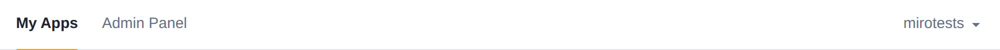
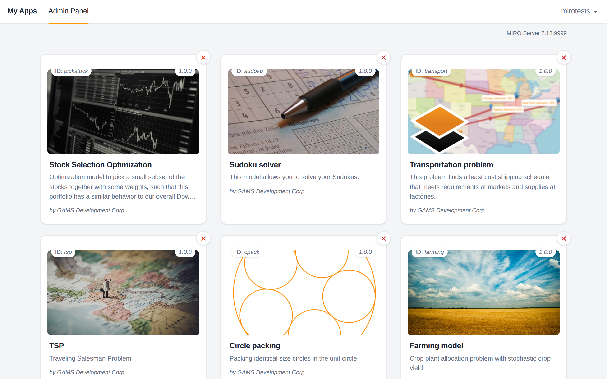
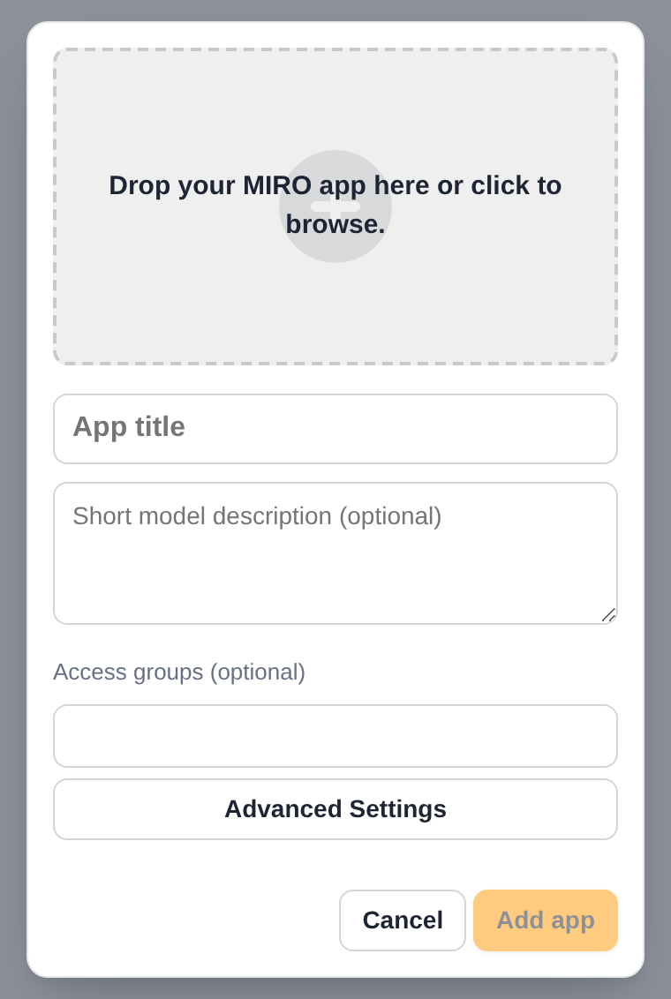
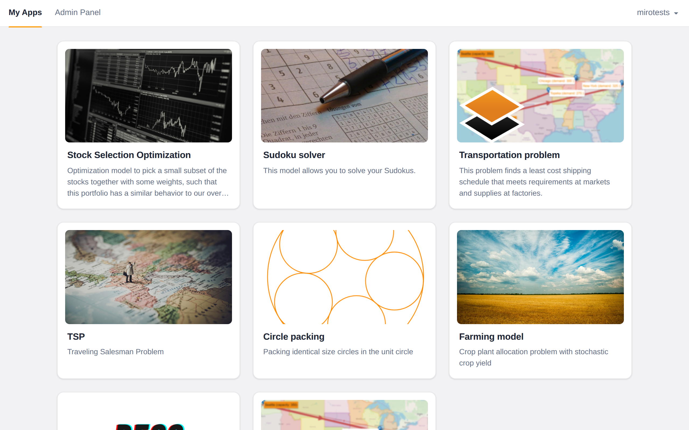
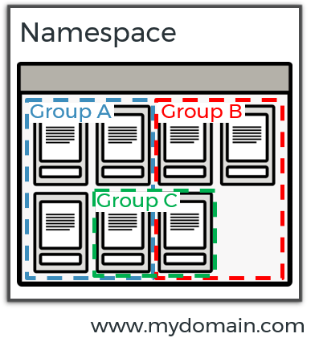
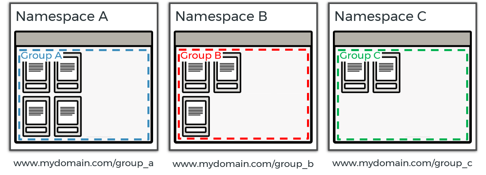

Administration
==============

.. _authentication-user-management:

User Management
---------------

MIRO Server uses the authentication service of GAMS Engine. To
access MIRO Server, a user must satisfy one of the following
conditions:

- **Have execute permission** on the namespace to be used in
  GAMS Engine.
- **Be a member of a user group** that has been granted access
  to an app registered in MIRO.

In other words: Either you are an Engine user with the required
execute permission, **or** you belong to a group that has been
assigned to at least one MIRO app.

- **User management** (inviting users, creating groups, adding
  users to groups) is done through the `GAMS Engine
  UI <https://gams.com/engine/clients.html#engine-ui>`__.
- **App management** (adding/removing apps, assigning/removing
  groups to apps) is done through the `MIRO Server Admin
  Panel <#admin-panel>`__.

If you decide to use MIRO Server without authentication (e.g.
to showcase applications as in the case of the `MIRO
Gallery <https://miro.gams.com>`__), you need to register one
GAMS Engine user, e.g. a user ``anonymous``. Anyone accessing
your MIRO apps will then use this GAMS Engine user under the
hood for authentication. You will need the credentials of that
user in `step 6 of the
installation <./server_setup.html#step6>`__. You can also
provide the credentials of this user via the ``.env`` file in
the *miro_server* directory:

.. list-table::
   :header-rows: 1

   * - Environment Variable Name
     - Environment Variable Value
     - Example
   * - GMS_MIRO_ENGINE_ANONYMOUS_USER
     - Username of anonymous user
     - miro_server_anonymous
   * - GMS_MIRO_ENGINE_ANONYMOUS_PWD
     - Password of anonymous user
     - t@qHwt%3Mh

If you do not provide the credentials of the anonymous
Engine user, the apps can be launched but not
solved/submitted to Engine.

.. _admin-panel:

The admin panel
---------------

.. _admin-access:

Access
~~~~~~

In the Admin panel of MIRO Server you can add new MIRO apps and
delete existing ones. Among other things, access to individual
apps can also be controlled here via a user group system.

A user with `read, write and execute
permissions <https://www.gams.com/engine/administration.html#namespaces>`__
on the namespace that MIRO Server uses will be considered as a
MIRO Server administrator. As an administrator, the tab 'Admin
Panel' is additionally displayed next to the 'Home' tab:

.. tip::

   In addition to interactively managing apps and scenarios
   via the admin panel, this can also be done via a `REST
   API <./server_api.html>`__.

A click on *Admin Panel* opens a overview with all deployed
apps:

**How to access the admin panel when using MIRO Server without
authentication:**

When MIRO Server is used without authentication, there is no
login screen anymore. Everyone accessing the MIRO Server
landing page will end up on the
`library <./server_general.html#app-overview>`__. Accordingly,
there is no longer a distinction between admininistrator and
normal user (i.e. there is no admin panel button). In this case
you can reach the admin panel via a `direct
link <#direct-app-link>`__, just like with MIRO apps. The app
id is *admin* in this case:
`mydomain.com/app_direct/admin/ <mydomain.com/app_direct/admin/>`__

.. _add-app:

Add apps
~~~~~~~~

As with the local MIRO Desktop library, a new MIRO app
(`miroapp <./deployment.html#sbs-create-app>`__ file) can be
added easily via drag & drop or by clicking on the last tile:

The dialog that opens shows a preview of the deployed app
including logo, title and description, which can be modified.
Note that the maximum file size for the logo is 1 mb.

Further settings that can be made before adding the app:

- Access groups (optional):
  By default, any Engine user who has access to the namespace
  used by MIRO Server can see all apps. To limit who is allowed
  to use the app you want to add, you can optionally assign
  *access groups*. A user who is not a member of one (or more)
  of the assigned access groups does not see the app in the app
  overview and cannot reach it via direct link (see an
  `example <#user-groups>`__). All GAMS Engine groups of the
  namespace used by MIRO Server in which the MIRO administrator
  is a member or has access rights are available for selection.
  `Learn how to create groups and add users in GAMS
  Engine <https://www.gams.com/engine/administration.html#user-groups>`__.

- **Advanced Settings (optional):**

  .. _app-environment:

  Clicking this button opens a dialog where you can configure
  advanced options, such as environment variables or default
  scenario permissions. Environment variables are especially
  useful if your app includes custom R code, such as `custom
  data
  connectors <configuration_json_only.html#custom-import-export>`__
  or `custom
  renderers <./configuration_advanced.html#custom-renderers>`__,
  that require secrets like API keys to connect to external
  systems.

  Default scenario permissions specify which users and groups
  are pre-filled when a new scenario is saved. Users can review
  and modify these permissions before finalizing the save.

  The scenario owner is always included automatically, in
  addition to any users or groups specified here. If no default
  users or groups are set (the fields are left empty), only the
  scenario owner will have read, write, and execute
  permissions.

  **Language**: While the `global language
  setting <./server_setup.html#global-language>`__ applies to
  all apps, the app environment can be used to change the
  language of an individual app. This allows the use of apps in
  different languages within one MIRO Server instance. The
  environment variable ``MIRO_LANG`` specifies the language.
  Available languages currently are English ('en'), Chinese
  ('cn') and German ('de').

  .. image:: ../../assets/images/server/miro-lang.png
   :alt: Change the language for one app
   :class: miro-image-max-height-400pt

  **Color theme**: The same applies to color themes. The
  environment variable ``MIRO_THEME`` can be used to overwrite
  the `global color
  theme <./server_setup.html#global-colortheme>`__ of an
  individual app. Available themes are listed below.

  - Default theme (value: "default")
  - Black and white ("blackandwhite")
  - Green forest ("forest")
  - Tawny ("tawny")
  - Dark blue ("darkblue")
  - Red wine ("redwine")

When all settings are done, add the app by clicking on 'Save'.
The app is then validated and added to the library.

.. _scenario-data:

**Scenario data:** All scenarios that are `bundled with the
app <./deployment.html#bundle-scenarios>`__ are stored in the
MIRO Server database. The user who adds the app will become the
scenario owner. All users with access to the app have read and
execute permissions for these scenarios.

.. _edit-remove-app:

Edit and remove apps
~~~~~~~~~~~~~~~~~~~~

**Edit apps:**

You can edit existing apps by clicking on an app tile. This
opens the same dialog as when you add a new app.

**Remove apps:**

To remove an app, click on the
× icon in the upper right corner of an app tile. If you want to
keep the database with all the scenario data of the app you
want to delete, you can specify this in the following step.

.. _add-scenarios:

Add scenario data
~~~~~~~~~~~~~~~~~

In addition to the possibility of `bundling scenario data with
an app <./deployment.html#bundle-scenarios>`__, scenarios can
also be added subsequently by dragging and dropping the data
files (*gdx*, *miroscen*, *xlsx*, *xlsm*, *xls*, *zip*) onto
the respective app.

The following rules apply:

- Up to 10 scenarios can be added at once.
- Scenarios are assigned to the user who adds them.
- The scenarios are made available (read and execute
  permissions) to all users who have access to the app.

.. _access-apps:

Access MIRO apps
----------------

.. _app-library:

MIRO Server library
~~~~~~~~~~~~~~~~~~~

The landing page of MIRO Server shows the MIRO Server library.
It lists all apps that a user has access to and is very similar
to the app `library of MIRO
Desktop <./deployment.html#sbs-install-app>`__. Each app is
displayed in a separate tile and can be launched from there:

.. _direct-app-link:

Direct links
~~~~~~~~~~~~

In addition to the app overview of the MIRO Server library,
apps can also be accessed via a direct link. There are two
slightly different variants. In both variants the `app
id <./deployment.html#app-id>`__ is part of the link. By
default, this ID is the lowercase name of the main GMS file
(without the .gms extension), but it can be customized during
app development.

- <miro_server_url>/app/<app_id> (e.g.
  `https://miro.gams.com/gallery/app/transport/ <https://miro.gams.com/gallery/app/transport/>`__):
  When accessing a MIRO app under this link, the app itself
  will be available via an iframe. The top of the page contains
  the navigation bar which brings you back to the landing page
  of MIRO Server (library).
- <miro_server_url>/app_direct/<app_id> (e.g.
  `https://miro.gams.com/gallery/app_direct/transport/ <https://miro.gams.com/gallery/app_direct/transport/>`__):
  Directly access the MIRO app without the iframe and
  navigation bar.

  .. admonition:: Info:
     :class: success

     Within the iframe that is displayed under
     /app/<app_id>, the /app_direct/<app_id> link is used to
     display the MIRO app.

.. _app-access:

Controlling app access
----------------------

If several MIRO apps are used, it may make sense to make certain
apps accessible only to certain users. There are two possible ways
to do this.

.. _user-groups:

User Groups
~~~~~~~~~~~

In GAMS Engine users can be assigned to groups (read more about
user groups in the `GAMS Engine
documentation <https://www.gams.com/engine/administration.html#user-groups>`__).
These groups can be used to control who can see which MIRO app
hosted on MIRO Server. In the following example, there are
three groups A, B and C. Users in group A have access to 4
apps, users in group B have access to 3 other apps. Group C
users can access 2 apps, one of which is also used by another
group.

All users access MIRO Server via the same URL. However, as a
member of a group, you don't see anything from other apps from
other groups.

.. tip::

   A user can also be a member of multiple groups.

.. note::

   User groups to be used in MIRO Server must be lowercase.
   Groups that contain uppercase letters are ignored.

Creating user groups and assigning users to them is done
quickly. So it's very easy to control who can access which apps
with this approach.

- `Learn how to create groups and add users in GAMS
  Engine <https://www.gams.com/engine/administration.html#user-groups>`__
- `Learn how to control which group can see which app on MIRO
  Server. <#add-app>`__

.. _multiple-instances:

Multiple MIRO Server instances
~~~~~~~~~~~~~~~~~~~~~~~~~~~~~~

In this approach, users are separated from each other not by
groups, but by separate MIRO Server instances. The example
setup is as follows: There are 3 different MIRO Server
instances, each accessible under a different URL. The MIRO
server instances all access the same GAMS Engine instance, but
use different namespaces. Using groups is of course still
possible, but not necessary in this example.

.. note::

   Note that in this setup it is not possible to share
   individual apps with multiple groups. Apps have to be
   added and maintained separately in each MIRO Server
   instance. Except that they use the same GAMS Engine, the
   three instances have nothing to do with each other.
