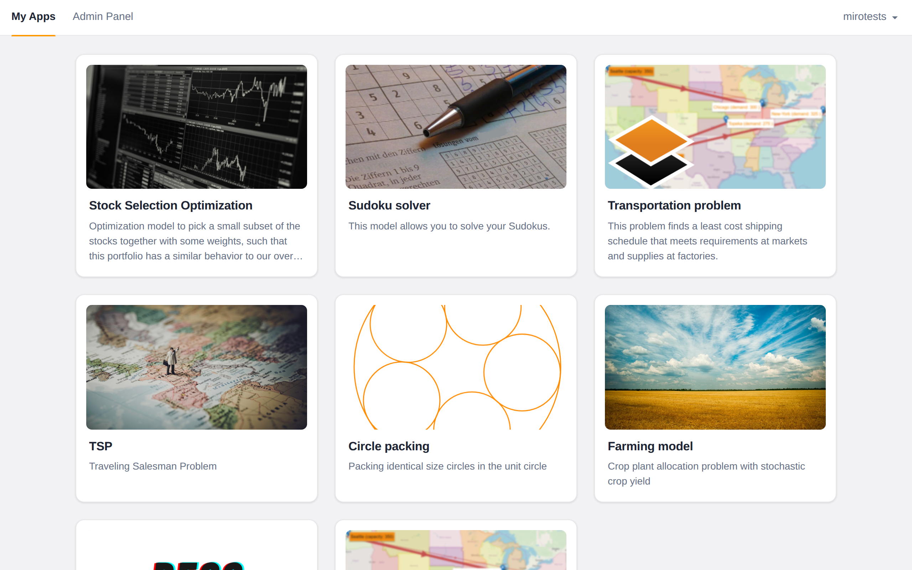
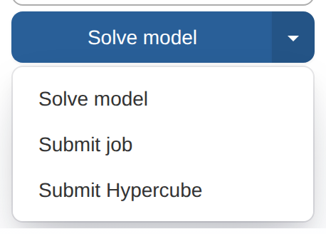
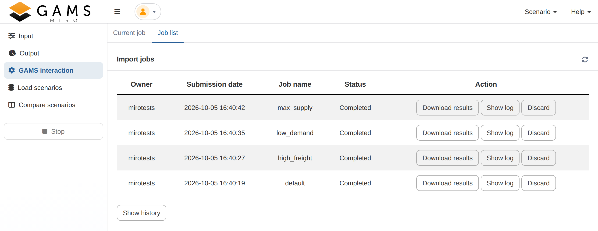
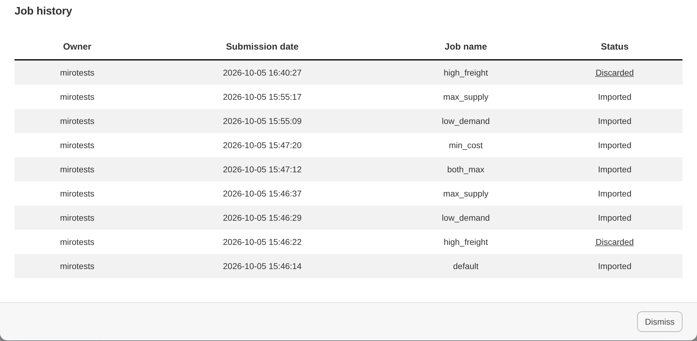
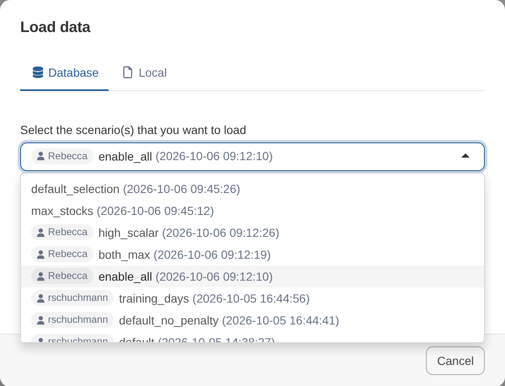
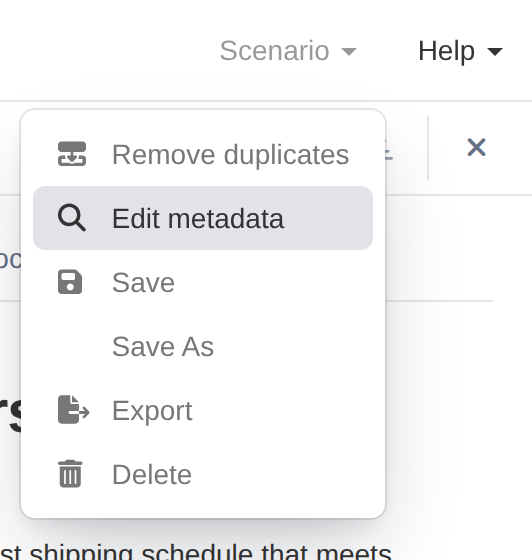
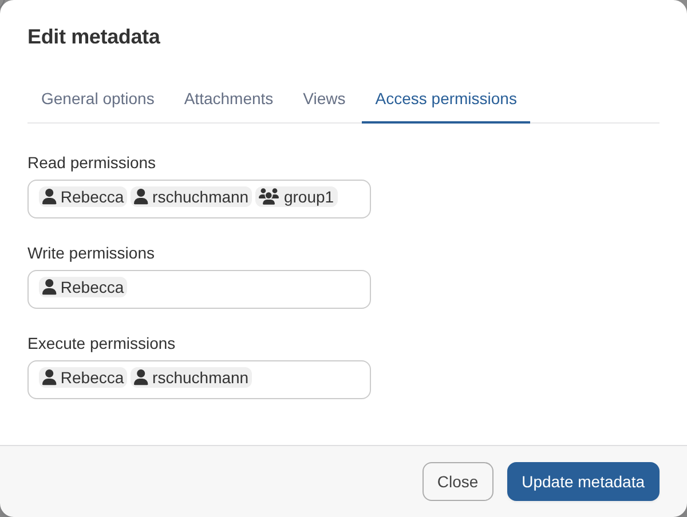
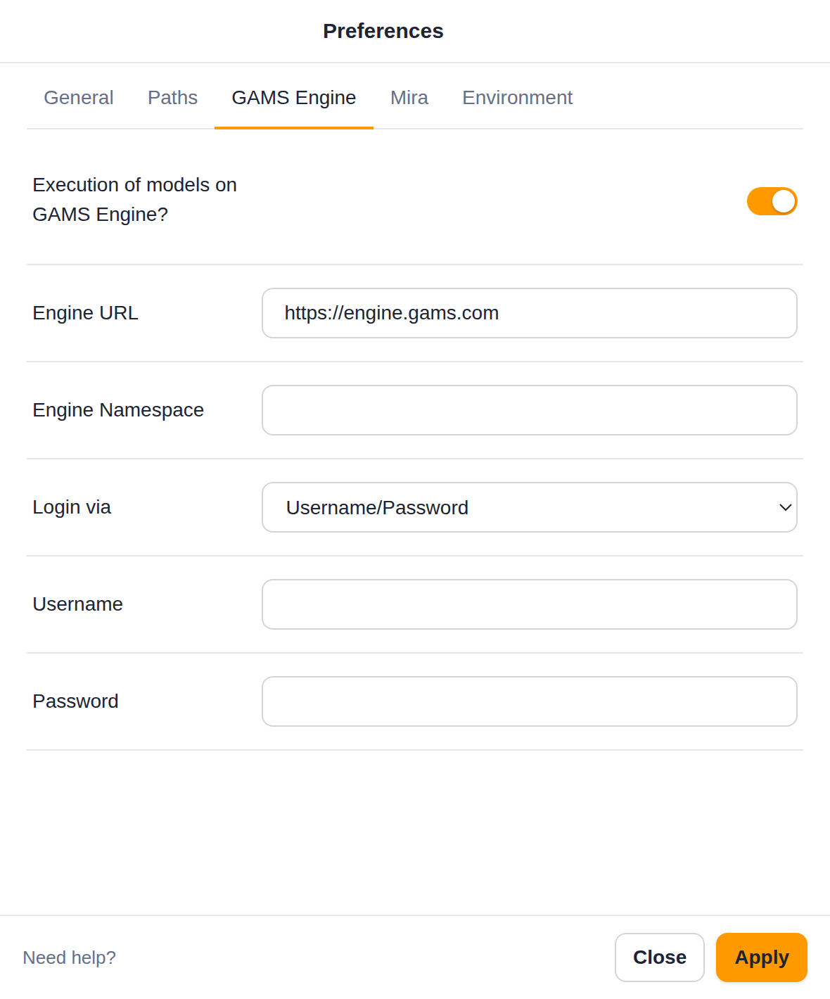

Moving to the cloud
====================

.. raw:: html

   

GAMS MIRO Server
----------------

With GAMS MIRO Server, the model calculations and the MIRO
applications themselves are moved to the cloud. Apps deployed
with MIRO Server can be accessed from any device with a modern
web browser. Local MIRO or GAMS installations and licenses are
no longer necessary. This makes MIRO Server the most convenient
solution when it comes to making apps available to end users
all over the world. All you need as a user is a URL, valid
credentials (optional) and you are ready to go.

A detailed overview of the MIRO Server architecture can be
found `here <./server_architecture.html>`__.

.. _app-overview:

Besides the benefits of making them easily accessible, central
hosting of MIRO apps also brings other aspects into focus:

- `Asynchronous solving <#solve-async>`__: Submit jobs and log
  back in later to get the results.
- `Scenario sharing <#scenario-sharing>`__: Share scenarios of
  your MIRO application(s) with other users easily from within
  the app.
- `User- and group
  management <./server_administration.html#user-groups>`__: Map
  structures of your work environment by dividing MIRO users
  into groups with different privileges. Decide who can see
  which apps and/or who has control over adding new ones.
- App updates: Update MIRO apps without the risk of
  interrupting running applications.

.. _solve-async:

Asynchronous Solving
~~~~~~~~~~~~~~~~~~~~

Jobs that are solved with GAMS Engine in the cloud are always
processed asynchronously. This has the following advantages:

- You can submit several jobs in a row without having to wait
  for the results of previous jobs.
- A MIRO application does not have to keep running during the
  calculations, i.e. you can close the application and return
  at a later time to view the results.

Instead of a normal 'Solve Model' button like in MIRO Desktop,
a dropdown menu appears in a MIRO app running under MIRO
Server:

The choices are:

- **Solve model:**

  The workflow is identical to the synchronous solving in MIRO
  Desktop. After clicking on *Solve model* the view changes to
  the *GAMS interaction* section, where log and listing files
  are shown during the calculations (if they are not hidden).
  After solving the view changes to the output section.

  Note that unlike MIRO Desktop, the job is now executed
  asynchronously. You can therefore close the MIRO app during
  the calculations. From the moment you log out and log back
  in, the job will be treated as a job that you submitted by
  clicking *submit job* rather than *solve model*. This means
  no log will be displayed anymore in the *GAMS interaction*
  section. Also, the results are not loaded automatically after
  solving. Instead the job is moved to the `job
  list <#job-list>`__. From there you can get the results after
  finishing the calculations.

- **Submit job:**
  A submitted job is put directly into the `job
  list <#job-list>`__. No log is displayed, and results are not
  automatically loaded into the interface. Instead, the results
  can be imported later. Submitting a job in this way makes
  sense especially if you want to solve multiple jobs in a row
  without waiting for the results to come in.

- **Submit Hypercube:**
  Submits a batch of jobs with varying scalar parameters,
  referred to as a `Hypercube job <./hc-module.html>`__. See
  the corresponding chapter for details.

If your GAMS Engine backend supports
`instances <https://gams.com/engine/administration.html#instances>`__
(e.g., Engine SaaS), you can decide which instance to use for
each run. When you select *Submit job* or *Submit Hypercube*, a
dialog opens with your default instance already chosen, but you
can change it there. If you want to update your default
instance - especially important when running jobs via the
*Solve* button, which does not offer a selection dialog - go to
*Help* → *Engine Settings*. In this dialog, you can view your
remaining volume and disk quotas and set a different default
instance.

.. _job-list:

Job list
~~~~~~~~

The job list in the GAMS interaction section lists all
submitted jobs that are still running or whose results have not
yet been imported. It shows for each submitted job the owner,
the submission date and the specified job name. In addition,
the current status (*scheduled*, *running* or *completed*) is
visible.

Results that have not yet been imported or are still pending
can be discarded. As soon as a job has finished, the results
can be loaded into the sandbox with a click on *Download
results*. Note that this does not save a scenario in the
database.

If you want to see jobs that previously have been imported or
discarded, you can do so by clicking on *Show history*:

.. _scenario-sharing:

Scenario Sharing
~~~~~~~~~~~~~~~~

.. _share-rules:

Rules for scenario sharing
^^^^^^^^^^^^^^^^^^^^^^^^^^

If several users have access to the same MIRO Server app,
they can share scenarios. Shared scenarios can be loaded
from the database into the sandbox in the same way as your
own scenarios.

The following rules apply:

- Scenarios can be shared with individual users and/or with
  user groups.
- Scenarios can only be shared with groups or users of a
  group in which you are a member yourself.
  `Inviters <https://www.gams.com/engine/administration.html#user-management>`__
  can also see users in groups of invitees of which they
  themselves are not members. Admins can see all users and
  groups.
- The user who shares a scenario with others is the scenario
  owner. The scenario owner is displayed to other users when
  they load a shared scenario into their sandbox.
- Scenarios can be stored under the same name in the
  database if the owner is different.
- Access permissions are assigned to a shared scenario. As
  scenario owner you decide about who has read, write and/or
  execute permissions. Users with read permissions can load
  the owner's scenario but are not authorized to edit or
  execute it. The scenario is marked with a lock symbol (🔒).
  Write permissions give you the right to change the
  scenario (data) and save it again. With execute
  permissions you are authorized to solve the scenario.
- It is not possible to revoke the owner's access
  permissions.
- Users with read access can duplicate the scenario via the
  "Save as" button. They become the owner of this new
  scenario.
- For the time a scenario is opened in MIRO, it is locked
  for other users. This prevents conflicts arising when a
  scenario is used concurrently. Locked scenarios can be
  opened in readonly mode by others (and also saved under a
  new name). A lock symbol (🔒) next to the scenario name
  indicates the readonly status. Users with write
  permissions for the scenario are additionally informed
  about this via a notification in the lower right corner of
  the screen.

  .. grid:: 1 1 2 2

     .. grid-item::

        .. image:: ../../assets/images/readonly_scenario.png
           :alt: Scenario in readonly mode
           :class: miro-image-max-height-100pt

     .. grid-item::

        .. image:: ../../assets/images/locked_scenario.png
           :alt: Locked scenario notification
           :class: miro-image-max-height-100pt

.. _share-scenario:

Share a scenario
^^^^^^^^^^^^^^^^

The information about whether a scenario should be shared
with others is controlled in the 'Access permissions' tab
under Scenario → Edit metadata.

In the example below, Rebecca is scenario owner. She gives
the single user 'rschuchmann' and the group 'group 1' read
permission for her scenario. Since she does not want her
scenario data to be changed, she decides not to give write
permissions to any other user. Members of 'group 1' usually
only look at results and do not want to start optimization
runs. Therefore, Rebecca only grants execution rights to
"rschuchmann".

.. _miro-desktop-remote:

GAMS MIRO Desktop - Boosted by GAMS Engine
------------------------------------------

With *GAMS MIRO Desktop - Boosted by GAMS Engine*, you can
solve GAMS jobs in the cloud with your locally running MIRO
applications. This setup requires GAMS Engine (read more about
the installation of GAMS Engine
`here <https://www.gams.com/engine/installation.html>`__). To
switch from running your optimization jobs on your local
machine to solving them in the cloud, open your MIRO Desktop
library, go to *Preferences* → *GAMS Engine* and check the
"Execution of models on GAMS Engine" checkbox. This setting
affects all deployed MIRO apps (started via the MIRO Desktop
library) and all MIRO apps in development (started via GAMS
Studio or the command line). A form opens in which you must
enter the Engine URL (e.g. ``https://engine.gams.com`` if you
are using Engine SaaS), an Engine
`namespace <https://www.gams.com/engine/administration.html#namespaces>`__
for which you have at least write and execute rights, as well
as your login data. More about the user management of GAMS
Engine can be found
`here <https://www.gams.com/engine/administration.html#user-management>`__.

If you are a developer and want to use a not yet deployed MIRO
app with Engine, you need to create the *model assembly file*
first. With this you tell MIRO which files belong to the GAMS
model. This is primarily the main model file, but also all
files necessary to calculate all inputs and outputs, e.g. files
that are included in the model. Read more about the model
assembly file `here <./deployment.html#model-assembly-file>`__.

If a MIRO application runs with GAMS Engine backend, jobs are
solved `asynchronously <#solve-async>`__. All submitted jobs
can be found and imported in the `joblist <#job-list>`__ in the
GAMS interaction section.

.. _model-on-server:

Does my model run on a server?
------------------------------

When a model is sent from MIRO to GAMS Engine, it is executed
in a Linux environment. This means that Windows-only tools like
`GDXXRW <https://www.gams.com/latest/docs/T_GDXXRW.html>`__ are
not available and a corresponding call in the model will lead
to an error on GAMS Engine. Furthermore it has to be considered
that Linux is case-sensitive. It should therefore be ensured
that file system calls (file paths as well as file names) from
within the model code are correctly capitalized. The model is
executed in an isolated environment ("container"). Therefore it
is important that file paths can be applied correctly (e.g. no
hardcoded absolute paths).
