Widgets
=======

Introduction
------------

*Input widgets* are all items that communicate input data with GAMS. While these are primarily tables for multidimensional GAMS symbols, various widgets can be used for scalar input data. Examples
of such widgets include: sliders, dropdown menus, date selectors or checkboxes.

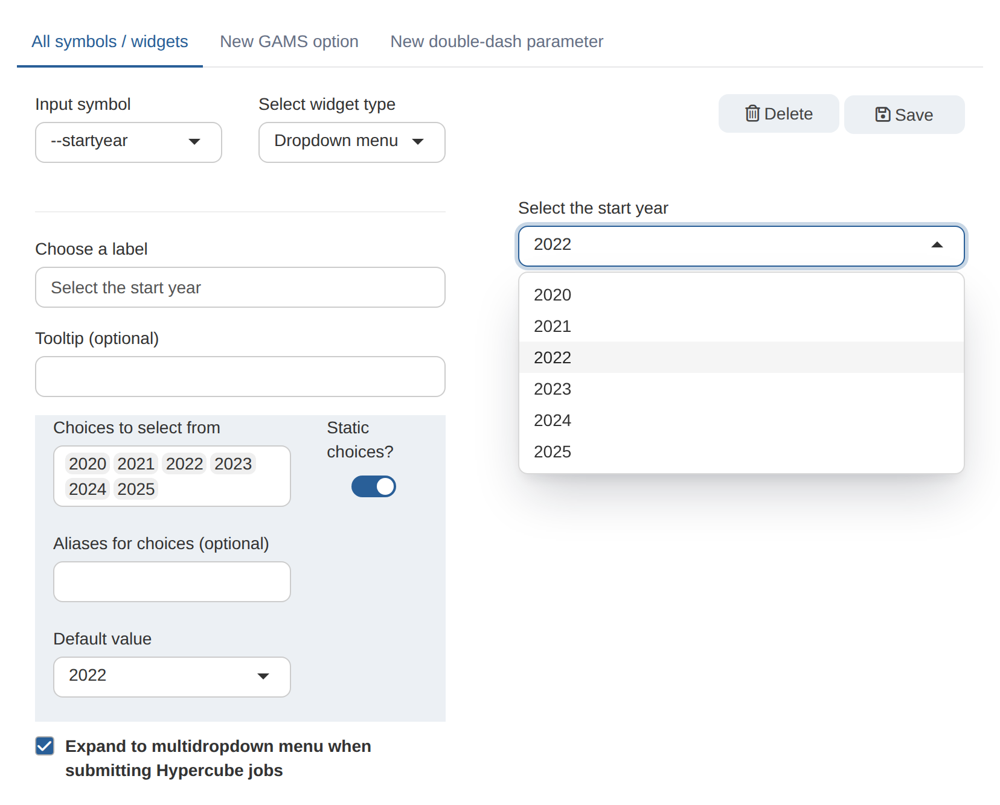

The symbol type to be configured can be selected at the top. The options are:

- **All symbols / widgets**

  This option must be selected if we want to configure a GAMS symbol. Furthermore, already configured GAMS options and double dash parameters are listed here, so that the existing configuration
  can be changed / removed.

  .. admonition:: Note

     After configuring a widget for a scalar GAMS symbol, the symbol is automatically removed from the *Scalars* table and rendered as a widget instead.

- **New GAMS option** / **New double dash parameter**

  As the name suggests, `GAMS options <https://www.gams.com/latest/docs/UG_GamsCall.html#UG_GamsCall_SpecifyingOptionsThroughTheCommandLine>`__ and `double-dash
  parameters <https://www.gams.com/latest/docs/UG_GamsCall.html#UG_GamsCall_DoubleDashParametersEtcSimpleExample>`__ can be configured here as an input widget.
  Since those parameters are specified via the command line in GAMS, they can not be tagged in the GAMS code with ``$onExternalInput`` / ``$offExternalInput``. So that they can be set for a GAMS
  run via MIRO, they must be explicitly specified in the configuration.

If a GAMS option or a double dash parameter is set via MIRO, your GAMS model will automatically be called with these command line parameters. The values the user selected are therefore available
to the GAMS model at `compile time <https://www.gams.com/latest/docs/UG_GamsCall.html#UG_GamsCall_TwoPass>`__.

| Example:
| If we set the double dash parameter ``numberPeriods`` to 11 and for the GAMS option ``mip`` we select CPLEX from within MIRO, then the GAMS model is run with:

.. code-block:: text

   gams <modelname>.gms --numberPeriods=11 MIP=CPLEX

.. admonition:: Warning

   The following GAMS options are reserved by GAMS MIRO and can not be configured: ``idir1, curdir, trace, traceopt``

.. _widget-table:

Table
-----

.. _widget-table-configuration:

.. rubric:: Configuration

By default, every cell in an input table is editable and rows can be inserted and removed. If you only want to allow your users to edit certain tables or even only certain columns within a table,
you can customize the table for the underlying GAMS parameter. You can also use a different type of table to enter your data. For example, if you have large amounts of data (>100,000 records) in
your table, we recommend using either the *Big Data Table* or the *pivot* table. In addition, input tables can be annotated with Markdown syntax. This way you can give your users additional
information, e.g. what kind of data should be entered here and in which format.

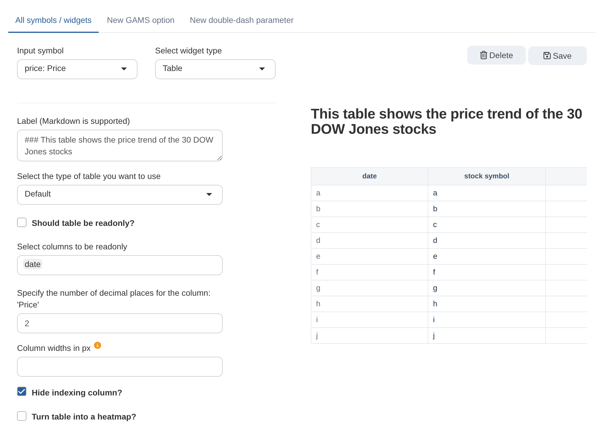

.. _widget-table-options:

.. rubric:: Available Options

**Default table:**

The following options are available for the standard (default) table in MIRO, which works similar to a spreadsheet.

.. _table-option-readonly:

.. dropdown:: Should table be read-only?

   This option prevents the user from making manual changes in the input table of a scenario. If active, the table can only be filled with scenario data from the database/local files.

.. _table-option-pivot:

.. dropdown:: Select a column to pivot

   This option allows you to pivot a table column of a symbol, i.e. to have a new column from each of the elements in this column:

   .. image:: ../../assets/images/configuration_mode/widget_table_pivot.png
    :alt: Pivot column
    :class: miro-image-max-height-400pt

   Unlike the `table statement <./model.html#table-miro>`__ in the GAMS model itself (``Table symbolname;``), this option does not affect the `data contract <./model.html#data-contract>`__ between
   GAMS and MIRO. Hence, the columns of the symbol remain variable, since the symbol itself is communicated in list format. The pivoting of the configured column then happens "live" in the MIRO
   application.
   Variable columns do not only mean that the column elements can change their names. It is also possible to add or delete whole columns. On the GAMS model side, this is equivalent to adding or
   deleting a set element of the affected index.

   .. admonition:: Note

    Instead of pivoting a single column, the `MIRO pivot table <#input-pivot-table>`__ can be used in case you want to interactively filter, pivot or aggregate columns.

   When using the pivot option, note the following:

   - The table columns displayed with the pivot option can no longer be sorted alphabetically or numerically.

   - Furthermore, it is not possible to add or delete columns in the symbol table if it is either read-only or displayed as a heatmap.

   .. _avoid-table:

   Now let's look at a case where we should probably **avoid** using this pivot functionality: For this we look at the parameter ``Price`` of the *Pickstock* model:

   .. code:: gams

    Set date   'date'
        symbol 'stockSymbol';

    $onExternalInput
    Parameter price(date,symbol) 'Price';
    $offExternalInput

   If we decide to pivot the set ``symbol``, we would end up with a table where all stock symbols (``AAPL``, ``AXP``, ``BA``, etc.) are displayed in a separate
   column:

   .. image:: ../../assets/images/expand-table.png
    :alt: Visualization of expanded table
    :class: miro-image-max-height-175pt

   A table width quickly increases when the number of set elements of the header index gets large. A total of - for example - 30 stocks to be represented in a table would lead to 30 additional
   columns. In this case, the *list view* might be more clear.

.. _table-option-fixedColumnsLeft:

.. raw:: html

   

.. dropdown:: Fix columns that are not pivoted?

   This option is available if a table has more than one value column. This can be the case for `pivoted tables <#table-option-pivot>`__ and for GAMS tables. When enabled, all columns that are not
   pivoted (i.e. all non-value columns) are fixed to the left side of the table and remain visible even when scrolling horizontally.

   .. image:: ../../assets/images/configuration_mode/table_fixedColumnsLeft.png
    :alt: Column fixed to the left
    :class: miro-image-max-height-75pt

.. _table-option-readonlycol:

.. dropdown:: Select columns to be readonly

   This option prevents the user from making manual changes in selected columns of the input table. Note that this option is only available for table columns that have not been pivoted (see option
   above).

   .. image:: ../../assets/images/configuration_mode/widget_table_ui_readonlycols.png
    :alt: Heatmap
    :class: miro-image-max-height-400pt

.. _table-option-colwidths:

.. dropdown:: Column widths

   Sets the column width (in pixels) of each column in the table. The Configuration Mode supports the specification of one column width for all columns of the table. To specify the width of each
   column individually, the `<modelname>.json <./faqs.html#file-config>`__ file must be `modified manually <./configuration_json_only.html#table-colwidths>`__.

.. _table-option-decimals:

.. dropdown:: Specify the number of decimal places for the column

   Use this option to specify the number of decimal places for numeric columns. This function is not available if columns are `pivoted <#table-option-pivot>`__.

.. _table-option-hide-indexing-column:

.. dropdown:: Hide indexing column?

   Option to hide indexing column in input tables.

.. _table-option-heatmap:

.. dropdown:: Turn table into a heatmap?

   Turns the table into a heatmap.

   .. image:: ../../assets/images/configuration_mode/widget_table_ui.png
    :alt: Heatmap
    :class: miro-image-max-height-400pt

.. _widget-table-json:

.. rubric:: JSON example

Default input table with label, without index column, 'date' column is readonly.

.. code:: text

 {
   "inputWidgets": {
     "price": {
       "widgetType": "table",
       "tableType": "default",
       "readonly": false,
       "readonlyCols": "date",
       "hideIndexCol": true,
       "heatmap": false,
       "label": "This table shows the price trend of the 30 DOW Jones stocks"
     }
   }
 }

.. _input-bigdata-table:

**Big Data table:**

The following options are available for the Big Data table. This table type is intended for situations in which large amounts of data are to be displayed within a table. Instead of a long, 1-page
table, a multi-page table is displayed. Only the data currently visible on the client side is loaded in this table.

.. _table-option-readonly-bigdata:

.. dropdown:: Should table be read-only?

   This option prevents the user from making manual changes in the input table of a scenario. If active, the table can only be filled with scenario data from the database/local files.

.. _table-option-pivot-bigdata:

.. dropdown:: Select a column to pivot

   See `previous section <#table-option-pivot>`__

   .. image:: ../../assets/images/configuration_mode/widget_table_ui_big.png
    :alt: Big Data table
    :class: miro-image-max-height-400pt

.. _widget-bigdata-table-json:

.. rubric:: JSON example

Big data input table.

.. code:: text

 {
   "inputWidgets": {
     "price": {
       "widgetType": "table",
       "tableType": "bigdata",
       "readonly": false,
       "label": "This table shows the price trend of the 30 DOW Jones stocks"
     }
   }
 }

.. _input-pivot-table:

**MIRO Pivot Table:**

The following options are available for the MIRO Pivot Table. This table type is also capable of handling large amounts of data (> 1 million records). It allows you to interactively filter, pivot
or aggregate data. See `here <./charts.html#pivot-chart>`__ for more information about the MIRO Pivot Table. The configuration of this table can be done directly from the preview on the right side.

.. admonition:: Note

 The MIRO Pivot Table has no concept of "order" because the table can be sorted interactively by changing the order of the rows. When you add or change UELs, they are always appended to the
 underlying data source. So when MIRO passes the data to GAMS, you cannot rely on the order of the elements coming from this table type. If you need UELs in a certain order, you should either use
 one of the other input table types or declare the sets you need sorted as additional external input (instead of using the `implicit set
 definition <https://www.gams.com/latest/docs/UG_SetDefinition.html#UG_SetDefinition_ImplicitSetDefinition>`__).

.. _widget-pivot-table-json:

.. rubric:: JSON example

MIRO Pivot input table.

.. code:: text

 {
   "inputWidgets": {
     "price": {
       "options": {
           "aggregationFunction": "sum",
           "cols": {
               "symbol": null
           },
           "fixedColumns": true,
           "hideEmptyCols": true,
           "hidePivotControls": false,
           "pivotRenderer": "table",
           "rows": "date",
           "tableSummarySettings": {
               "colEnabled": true,
               "colSummaryFunction": "max",
               "rowEnabled": false,
               "rowSummaryFunction": "sum"
           }
       },
       "readonly": false,
       "tableType": "pivot",
       "widgetType": "table"
     }
   }
 }

.. _widget-slider:

Slider
------

.. _widget-slider-configuration:

.. rubric:: Configuration

Sliders are useful in situations where the user has to select a numeric value from a range.

Example:

Let's configure a widget for our *transport* model. For the scalar value *freight* a slider is a good choice.
From the list of available symbols we choose the desired scalar, select *slider* as widget tye and give it a label, which then appears above the slider.
Next, we specify the upper and lower bounds of the slider, the default value as well as the step size.

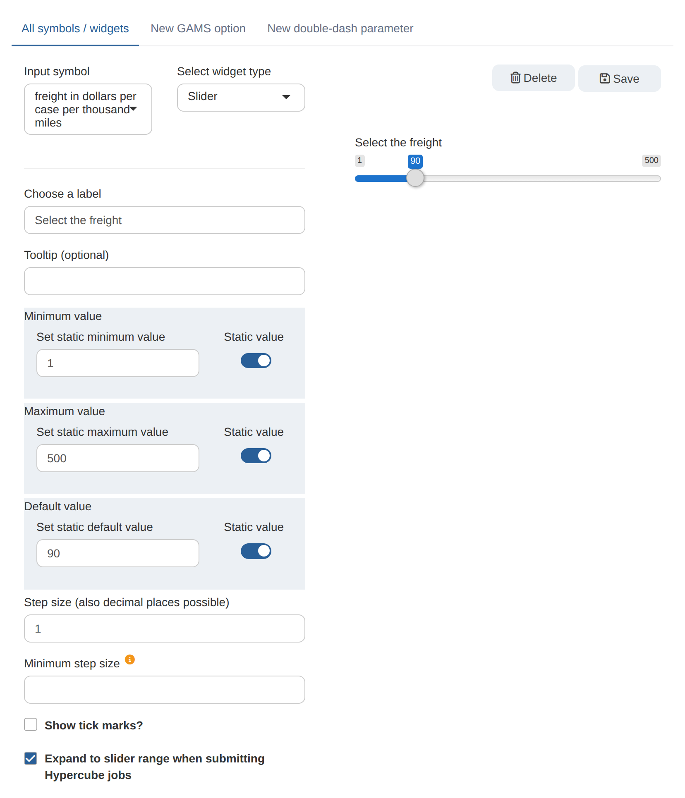

When we are satisfied with the selected configuration, we click "save". A confirmation that the configuration has been updated successfully will appear:

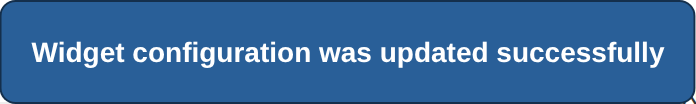

.. _widget-slider-options:

.. rubric:: Available Options

The following options are available for a slider widget:

.. _slider-option-name:

.. dropdown:: Enter the element name as it should be displayed in a tab

   With this option the tab name of the symbol is defined, see screenshot below. The default value of the element name is the explanatory text of the symbol.

   .. admonition:: Note

    If all scalar widgets are displayed in the same tab (see `aggregate widgets <./configuration_symbols.html#aggregate-widgets>`__ in the general options), then the name specified here is not
    displayed at all.

   .. image:: ../../assets/images/configuration_mode/widget_slider_aggregate.png
    :alt: Element name
    :class: miro-image-max-height-400pt

.. _slider-option-label:

.. dropdown:: Choose a label

   If a label has been specified, it will be displayed above the slider. In the example below the label *select the maximum number of stocks* is used. A label is optional.

   .. image:: ../../assets/images/configuration_mode/widget_slider_label.png
    :alt: Element label
    :class: miro-image-max-height-50pt

.. _slider-option-tooltip:

.. dropdown:: Tooltip (optional)

   If a tooltip has been specified, it will be displayed when the mouse pointer is moved over the info icon. A tooltip is optional.

   .. image:: ../../assets/images/configuration_mode/widget_slider_tooltip.png
    :alt: Label tooltip
    :class: miro-image-max-height-75pt

.. _slider-option-minmaxdef:

.. dropdown:: Minimum / maximum / default value

   *Minimum / maximum value*: Both a minimum and a maximum value are required for a slider. These define the range from which the user can select values.
   *Default value*: A default value is the initial value of the slider i.e. the slider value set when starting the application. This is optional. If the value does not fall between the minimum and
   maximum values, a warning is issued. If this value is not specified, the minimum value is used as the default value. As soon as data is loaded which contains a value for the slider symbol, the
   slider is set to that value.

   All three parameters can be set either statically or dynamically. If the range of the slider is independent of the data loaded, it is a good idea to configure it as a static slider. This means, for
   example, that the lower and upper limits of a slider are always 1 and 10. Scenario data does not change these.

   .. image:: ../../assets/images/configuration_mode/widget_slider_static.png
    :alt: Static values
    :class: miro-image-max-height-60pt

   .. _dynamic-limits:

   **Dynamic limits**:
   Sometimes it makes sense to adapt the limits to the data. An example for this can be found in the demo model *pickstock*. Here, two sliders are used. With one of the sliders, the user can select
   the *maximum number of stocks*, with the other one the *number of training days*.

   .. image:: ../../assets/images/configuration_mode/slider3.png
    :alt: Configuration of a slider (3)
    :class: miro-image-max-height-150pt

   In both sliders the maximum value - the upper limit - results from the input data of the parameter *Price*.

   .. _input-symbol-price:

   .. image:: ../../assets/images/configuration_mode/slider4.png
    :alt: Configuration of a slider (4)
    :class: miro-image-max-height-200pt

   The maximum value for the *maximum number of stocks* is 30, since the data set *Price* that is currently loaded contains 30 stocks. If the user deletes e.g. all values of the stock *AAPL* from
   the data, the maximum value of the slider changes to 29. The same is true for the second slider: the *number of training days*. Here the maximum value of 252 results from the number of available
   *dates* in *price*.
   In the Configuration Mode we can easily define such dynamic limits. For the first slider the configuration looks as follows:

   .. image:: ../../assets/images/configuration_mode/slider5.png
    :alt: Configuration of a slider (4)
    :class: miro-image-max-height-250pt

   The *Static value?* box is unchecked for the maximum value. Since the maximum slider value should result from the data of the symbol *price*, the corresponding header *stock symbol* in which the
   stocks are contained is selected (see `table above <#input-symbol-price>`__). The *operator* is set to *count* since we want to count all stock symbols in our data to set the maximum value.

   For the calculation of such limits from the data, the following operators are available:

   .. image:: ../../assets/images/configuration_mode/slider7.png
    :alt: Configuration of a slider (5)
    :class: miro-image-max-height-200pt

   More on Dependencies among widgets can be found `here <./configuration_advanced.html#widgets-dependencies>`__.

.. _slider-option-step:

.. dropdown:: Step size

   The step size specifies the interval between each selectable value on the slider. The value must be greater than 0 and must not exceed the total range of the slider.

   .. image:: ../../assets/images/configuration_mode/widget_slider_step.png
    :alt: Step size
    :class: miro-image-max-height-40pt

.. _slider-option-minstep:

.. dropdown:: Minimum step size

   .. note::

      The minimum step size is only relevant when submitting a Hypercube job. It defines the minimum interval that can be used for a range slider when submitting a Hypercube job.

      .. image:: ../../assets/images/configuration_mode/widget_sliderrange_minstep_example_marked.png
         :alt: Sliderrange with step size of 5 and minimum step size of 1
         :class: miro-image-max-height-50pt

   When submitting a `Hypercube job <./hc-module.html>`__ and a slider range is used, scenarios are generated depending on the specified step size. Example: We configure a single slider with a lower
   bound of 70, an upper bound of 100 and a step size of 5. When submitting a Hypercube job, this single slider becomes a slider range with the same limits and the same step size. In the image below
   the selected limits of 75 to 90 and a step size of 5 result in 4 different variants (75, 80, 85, 90), i.e. 4 scenarios to be calculated.

   .. image:: ../../assets/images/configuration_mode/widget_sliderrange_step_example.png
    :alt: Sliderrange with step size of 5
    :class: miro-image-max-height-50pt

   The *minimum step size* sets the minimum value the user can specify as step size when submitting a Hypercube job. The value may be lower than the regular step size. For example, if the slider above
   is configured with a regular step size of 5, the limits of the slider can be set in increments of 5. However, the step size for scenario generation on the right side can differ, e.g. be set in
   smaller intervals. If set to 1, this would result in 16 scenarios (75, 76, 77, ..., 89, 90).

   .. image:: ../../assets/images/configuration_mode/widget_sliderrange_minstep_example.png
    :alt: Sliderrange with step size of 5 and minimum step size of 1
    :class: miro-image-max-height-50pt

.. _slider-option-tick:

.. dropdown:: Show tick marks?

   Tick marks are displayed below the sliders and help to visually divide the entire slider width.

   Slider without tick marks:

   .. image:: ../../assets/images/configuration_mode/widget_slider_label.png
    :alt: Slider without tick marks
    :class: miro-image-max-height-50pt

   Slider with tick marks:

   .. image:: ../../assets/images/configuration_mode/widget_slider_tick.png
    :alt: Slider with tick marks
    :class: miro-image-max-height-60pt

.. _slider-option-expand:

.. dropdown:: Should element be expanded automatically when submitting a Hypercube job?

   As explained in detail in the `corresponding chapter <./hc-module.html#hcube-config>`__, widgets will be expanded when submitting a Hypercube job. With the option available here, the automatic
   extension of a widget can be switched off. The picture below shows extended widgets.

   .. image:: ../../assets/images/batch_img/regular_batch.png
    :alt: Expand for Hypercube job
    :class: miro-image-max-height-400pt

.. _widget-slider-json:

.. rubric:: JSON example

Slider with dynamic upper bound.

.. code:: text

 {
   "inputWidgets": {
     "maxstock": {
       "label": "Select the maximum number of stocks",
       "tooltip": "This is a tooltip",
       "min": 1,
       "default": 3,
       "step": 1,
       "max": "card(price$symbol)",
       "widgetType": "slider"
     }
   }
 }

.. _widget-sliderrange:

Range slider
------------

.. _widget-sliderrange-configuration:

.. rubric:: Configuration

A range slider returns two numeric values. For this reason, such a slider is not suitable for GAMS scales, but only for GAMS command line parameters, i.e. double-dash parameters.

Example:

In the Configuration Mode we define a double-dash parameter *--range* with the bounds *1* and *100*. The lower default value shall be *42* and the upper default value *75*:

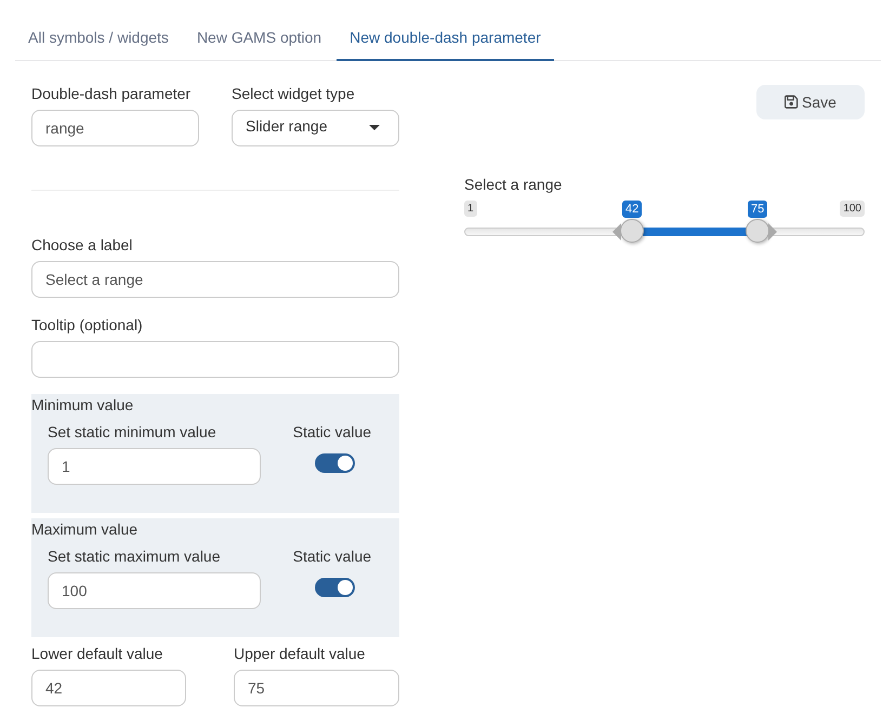

In the GAMS model we can access the selected range with ``%RANGE_LO%`` for the lower value and ``%RANGE_UP%`` for the upper value.

More on widgets with ranges can be found `here <./configuration_advanced.html#widgets-ranges>`__.

.. rubric:: Range sliders for Hypercube jobs

A range slider in Base Mode becomes a range slider with an additional checkbox when submitting a Hypercube job:

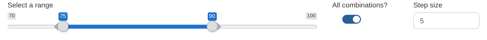

With this checkbox you can determine if the selected range of the slider should result in a single scenario (*All combinations?* unchecked) or if all possible combinations within this range should
be used (*All combinations?* checked). In the example above - *All combinations?* is checked - the selected step size determines which scenarios are generated for the Hypercube job. With a step
size of 5 this would result in 10 different symbol ranges / scenarios:

- 75 - 90

- 80 - 90

- 85 - 90

- 90 - 90

- 75 - 85

- 80 - 85

- 85 - 85

- 75 - 80

- 80 - 80

- 75 - 75

An unchecked *All combinations?* would result in a single scenario. In this scenario, the symbol would have a range from 75 to 90.

.. _widget-sliderrange-options:

.. rubric:: Available Options

The available options of a range slider are identical to those of a `normal slider <#widget-slider-options>`__. The only difference is that instead of a single default value, two of these values
need to be specified.

.. _widget-sliderrange-json:

.. rubric:: JSON example

Note: In order for MIRO to recognize whether the symbol is a double dash parameter or a GAMS option, they are prefixed with either ``_gmspar_`` for double dash parameters or ``_gmsopt_`` for
GAMS options.

.. code:: text

 {
   "inputWidgets": {
     "_gmspar_range": {
       "widgetType": "slider",
       "min": 1,
       "max": 100,
       "default": 42,
       "step": 1,
       "ticks": false,
       "noHcube": false,
       "label": "Select a range",
       "tooltip": "This is a tooltip"
     }
   }
 }

.. _widget-checkbox:

Checkbox
--------

.. _widget-checkbox-configuration:

.. rubric:: Configuration

A checkbox returns 0 or 1 and is therefore suitable for use in binary decisions.

Example:

Configuration of a GAMS Scalar *binaryDecision* as a checkbox:

.. code:: gams

 $onExternalInput
 Scalar binaryDecision 'binary decision' / 0 /;
 $offExternalInput

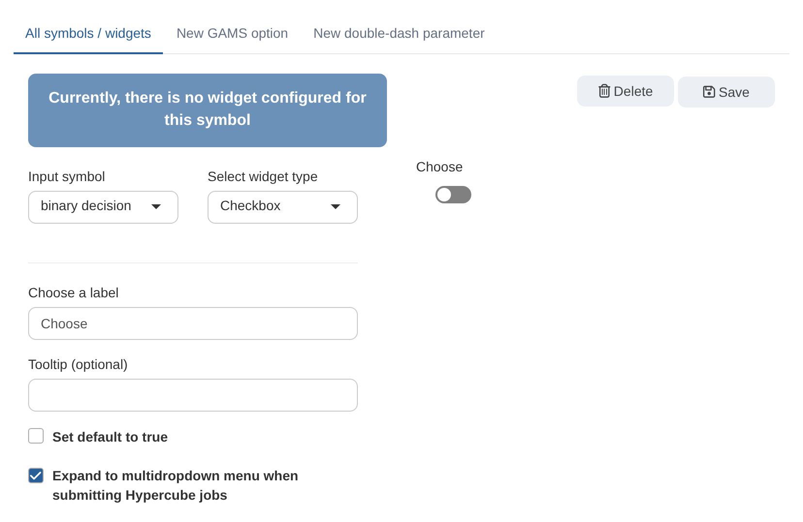

.. _widget-checkbox-options:

.. rubric:: Available Options

The following options are available for a checkbox widget:

.. _checkbox-option-name:

.. dropdown:: Enter the element name as it should be displayed in a tab

   With this option the tab name of the symbol is defined. For an example see the `same option <#slider-option-name>`__ for a slider. The default value of the element name is the explanatory text of
   the symbol.

.. _checkbox-option-label:

.. dropdown:: Choose a label

   If a label has been specified, it will be displayed above the checkbox. For an example see the `same option <#slider-option-label>`__ for a slider.

.. _checkbox-option-tooltip:

.. dropdown:: Tooltip (optional)

   If a tooltip has been specified, it will be displayed when the mouse pointer is moved over the info icon. A tooltip is optional. For an example see the `same option <#slider-option-tooltip>`__ for
   a slider.

.. _checkbox-option-default:

.. dropdown:: Default value

   The default value specifies the initial state of the checkbox (checked or unchecked).

.. _checkbox-option-expand:

.. dropdown:: Should element be expanded automatically when submitting a Hypercube job?

   As explained in detail in the `corresponding chapter <./hc-module.html#hcube-config>`__, widgets will be expanded when submitting a Hypercube job. When submitting a Hypercube job, a checkbox
   becomes a multi dropdwon menu with the entries *yes* and *no*. With the option available here, the automatic expansion of a widget can be switched off.

.. _widget-checkbox-json:

.. rubric:: JSON example

.. code:: text

 {
   "inputWidgets": {
     "_gmsopt_keep": {
       "widgetType": "checkbox",
       "label": "Keep process directory?",
       "value": 1,
       "noHcube": true,
       "class": "checkbox-material",
       "tooltip": "This is a tooltip"
     }
   }
 }

.. _widget-dropdown:

Dropdown menu
-------------

.. _widget-dropdown-configuration:

.. rubric:: Configuration

.. _singleton-set-dropdown:

Besides normal GAMS scalars, a dropdown menu can also be used for singleton sets. Unlike scalars, singleton sets can have a label and an element text instead of a numeric value. What is specified
as *choices* when configuring the dropdown menu is communicated as the element *label* between MIRO and GAMS. The *alias* assigned to the dropdown choice defines the *element text* in the model.
Read more about Singleton Sets in MIRO `here <./model.html#display-sinset>`__.

Example:

Dropdown menu for a Singleton Set with model types as choices:

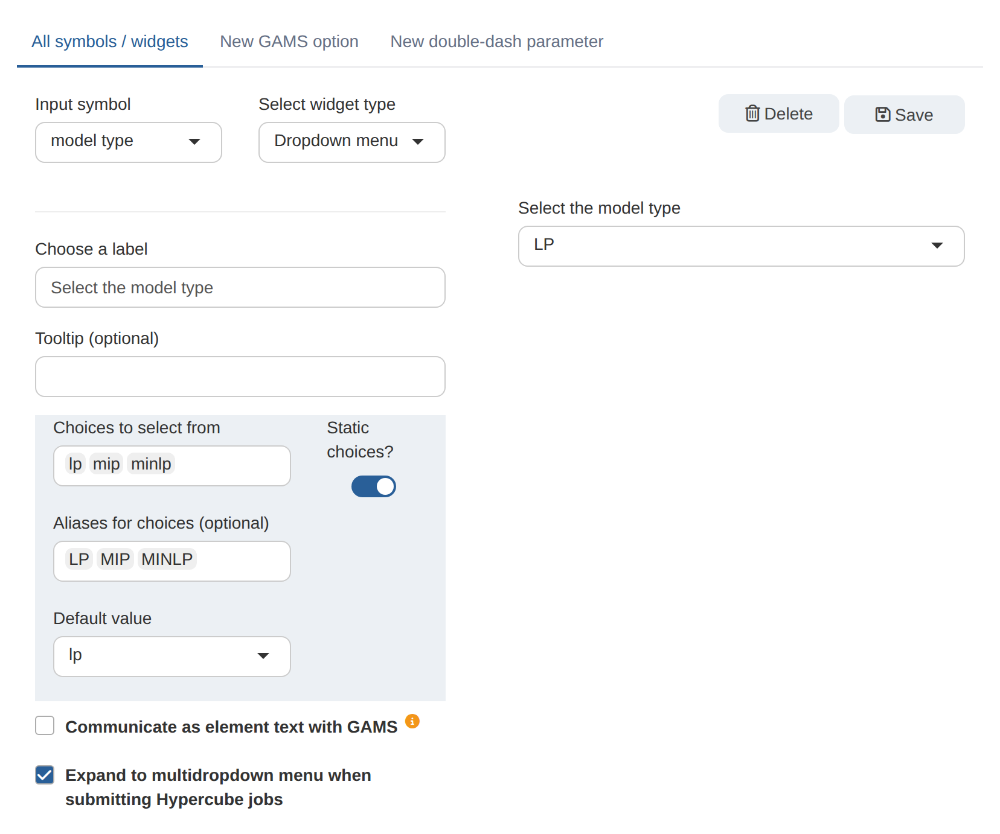

The *model type* for which the dropdown menu is configured, is a GAMS Singleton Set (symbol name: *typeSelect*):

.. code:: gams

 Set t      'Available model types' / lp, mip, minlp /;

 $onExternalInput
 Singleton Set typeSelect(t) 'model type' / lp /;
 $offExternalInput

 [...]

 $eval.Set type typeSelect.TL;

 solve transport%type% using %type% minimizing z;

The value of the singleton set which comes from MIRO is stored in the compile-time variable *type* by using the Dollar Control Option
`eval.Set <https://www.gams.com/latest/docs/UG_DollarControlOptions.html#DOLLARevalset>`__. This can then be used (in compile time) to run the desired model.

.. admonition:: Tip

 If you configure a dropdown menu and you want a choice to be *nothing*, use the symbol "\_" as a choice. MIRO treats an underscore internally as if nothing is set.

.. admonition:: Tip

   Similar to the dynamic limits of a slider, the selectable options of a dropdown menu can be `filled dynamically <#dropdown-option-choices>`__, depending on the loaded data.

.. _widget-dropdown-options:

.. rubric:: Available options

The following options are available for a checkbox widget:

.. _dropdown-option-name:

.. dropdown:: Enter the element name as it should be displayed in a tab

   With this option the tab name of the symbol is defined. For an example see the `same option <#slider-option-name>`__ for a slider. The default value of the element name is the explanatory text of
   the symbol.

.. _dropdown-option-label:

.. dropdown:: Choose a label

   If a label has been specified, it will be displayed above the dropdown menu. For an example see the `same option <#slider-option-label>`__ for a slider.

.. _dropdown-option-tooltip:

.. dropdown:: Tooltip (optional)

   If a tooltip has been specified, it will be displayed when the mouse pointer is moved over the info icon. A tooltip is optional. For an example see the `same option <#slider-option-tooltip>`__ for
   a slider.

.. _dropdown-option-choices:

.. dropdown:: Static Choices / dynamic choices

   As with a slider, the values/elements of a dropdown menu can be filled either statically or dynamically. Static choices remain unchanged, regardless of the loaded data. In contrast to this the
   selectable elements of a dropdown menu with dynamic choices are filled depending on the loaded data.

   .. _static-dropdown:

   .. rubric:: Static choices:

   For a static dropdown menu the following options are available:

   - Choices to select from:

   Here, a list of values to select from in the resulting dropdown menu is specified.
   - Aliases for choices:

   If aliases are given, then an alias — rather than the choice — is displayed to the user. Aliases are optional. The choice-alias mapping follows the order in which the elements are specified. If
   aliases are given, the number of aliases must match the number of choices.
   - Default value:

   The default value specifies the initial selection of the dropdown menu. This option is only available for static dropdown menus.

   Example: Configuration of a dropdown menu with static choices:

   .. image:: ../../assets/images/configuration_mode/widget_dropdown_static1.png
    :alt: Static dropdown menu configration
    :class: miro-image-max-height-200pt

   The user then gets the following dropdown menu:

   .. image:: ../../assets/images/configuration_mode/widget_dropdown_static2.png
    :alt: Static dropdown menu
    :class: miro-image-max-height-150pt

   .. _dynamic-dropdown:

   .. rubric:: Dynamic choices:

   In the following example a dropdown menu with dynamic choices is configured in the model *Pickstock* for a *Singleton Set*:

   .. code:: gams

    $onExternalInput
    Singleton Set stock 'stock' / AAPL /;
    $offExternalInput

   The dropdown menu should always contain all stocks that are included in the existing data. Note that this example is not part of the *Pickstock* demo model.

   The following options are available when using dynamic choices.

   - Select symbol and header to depend upon:

     If the selection options of a dropdown menu are to be filled dynamically, the set from whose elements the choices are to be derived must be specified. For this purpose, those symbols are
     available which are used as `input symbols <./model.html#model-adjustments>`__ in MIRO (i.e. those symbols which were tagged with ``$onExternalInput`` / ``$offExternalInput`` in the GAMS
     model). In this example the symbol *Price* is used, which contains all stocks:

     .. image:: ../../assets/images/table-form.png
        :alt: Symbol price
        :class: miro-image-max-height-150pt

     .. image:: ../../assets/images/configuration_mode/widget_dropdown_dynamic1.png
        :alt: Symbol selection
        :class: miro-image-max-height-125pt

     .. admonition:: Tip

        Instead of a single symbol, all input symbols whose domain the selected set is part of can be used to fill the drop-down menu with data. To do this, simply remove the selected symbol. An *All*
        is shown then:

        .. image:: ../../assets/images/configuration_mode/widget_dropdown_dynamic_all.png
           :alt: All symbols
           :class: miro-image-max-height-125pt

     Next, we specify the column of the symbol *Price* where the data for the drop-down menu should come from. Since we are interested in the individual stocks, we select the column *stock symbol*.

     .. image:: ../../assets/images/configuration_mode/widget_dropdown_dynamic2.png
        :alt: Symbol header selection
        :class: miro-image-max-height-125pt

     .. admonition:: Note

        Only unique elements of a column are extracted. If an element is contained more than once in the selected column, duplicate entries are removed.

     .. admonition:: Note

        Only those headers / columns that contain `set elements <https://www.gams.com/latest/docs/UG_SetDefinition.html>`__ of the selected symbol can be specified. Value columns cannot be used to
        fill the dropdown choices.

     These two options are sufficient to dynamically fill the choices of the dropdown menu.

   - Should the symbol table(s) be filtered depending on the selection in the dropdown menu?:

     This option is optional.

     .. image:: ../../assets/images/configuration_mode/widget_dropdown_dynamic3.png
        :alt: Table filtering
        :class: miro-image-max-height-125pt

     When active, it has the following effects: The user selects a stock in the dropdown menu (e.g. *AAPL*).

     .. image:: ../../assets/images/configuration_mode/widget_dropdown_dynamic4.png
        :alt: Filter selection
        :class: miro-image-max-height-200pt

     This has the consequence that all tables containing stock symbols are filtered according to this selection. Only those rows with *AAPL* are displayed:

     .. image:: ../../assets/images/configuration_mode/widget_dropdown_dynamic5.png
        :alt: Filtered table
        :class: miro-image-max-height-250pt

     .. admonition:: Tip

        The filter is used exclusively for visual support. A table filtered in this way is always transferred to the GAMS model as a whole, i.e. unfiltered, regardless of what is currently displayed
        in the interface.

.. _dropdown-option-clearvalue:

.. dropdown:: Communicate as element text with GAMS?

   .. admonition:: Tip

    This option is intended for the use of singleton sets to define compile-time variables in the GAMS model. Using singleton sets instead of command line parameters has the advantage that their
    information is not lost during GDX, xlsx or CSV export. Read more about this topic `here <./model.html#command-line>`__.

   Singleton sets can have an element label and an element text. If the set is configured as a dropdown menu, both components will be communicated with GAMS by default. If this option is activated,
   the choice of the dropdown menu will become the element text of the set, whereas the label will be set to the empty string. This allows for the communication of strings between MIRO and GAMS while
   preserving the UEL order.

   Migrating a singleton set into a compile time variable can be done using the `$eval.set <https://www.gams.com/latest/docs/UG_DollarControlOptions.html#DOLLARevalset>`__ method. Since the variable
   should be filled by the element text, the attribute *TE* has to be used: ``$eval.Set VARNAME SETID.TE``. Note that aliases for the dropdown menu choices must be configured to use this option!

.. _dropdown-option-expand:

.. dropdown:: Should element be expanded automatically when submitting a Hypercube job?

   As explained in detail in the `corresponding chapter <./hc-module.html#hcube-config>`__, widgets will be expanded when submitting a Hypercube job (a dropdown menu becomes a multi dropdown menu).
   With the option available here, the automatic expansion of a widget can be switched off.

.. _widget-dropdown-json:

.. rubric:: JSON example

Static dropdown menu:

.. code:: text

 {
   "inputWidgets": {
     "type": {
       "widgetType": "dropdown",
       "choices": ["lp", "mip", "minlp"],
       "aliases": ["LP", "MIP", "MINLP"],
       "selected": "lp",
       "noHcube": false,
       "clearValue": false,
       "multiple": false,
       "label": "Select the model type",
       "tooltip": "This is a tooltip"
     }
   }
 }

.. _widget-multidropdown:

Multidropdown menu
------------------

.. _widget-multidropdown-configuration:

.. rubric:: Configuration

.. admonition:: Note

 A multi-dropdown menu can only be used for one-dimensional, dynamic sets.

Example: Model *Pickstock*. We define a new dynamic set *subdate(date)*. In MIRO we want to fill the elements of *subset* via a multi-dropdown menu.

.. code:: gams

 Set       date                 'date'
           symbol               'stock symbol';

 $onExternalInput
 Parameter price(date<,symbol<) 'Price';
 $offExternalInput

 [...];

 $onExternalInput
 set       subdate(date)        'subset of dates' /2016-01-04/;
 $offExternalInput

In the Configuration Mode we can configure a multi-dropdown menu for symbol *subdate*:

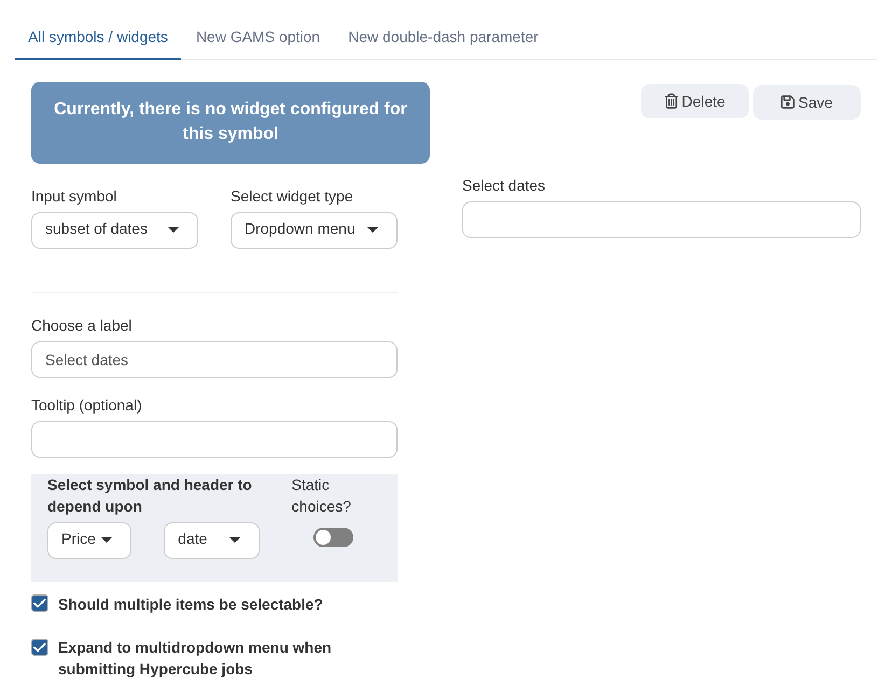

.. admonition:: Note

 The only difference between configuring a single and a multi-dropdown menu is the checkbox *Should multiple items be selectable?*.

Note that we do not use static choices for the dropdown menu but fill the choices with all dates of the symbol *price*. Furthermore, we activate the option that the table of symbol *price* shall be
filtered based on the user's selection in the dropdown menu of *subdate*. This means that if the user selects one or more dates in the dropdown menu, only the entries containing these dates are
visible in the *Price* table. More information on dependencies among widgets can be found in the options of a dynamic `dropdown menu <#dropdown-option-choices>`__ and
`here <./configuration_advanced.html#widgets-dependencies>`__.

In the MIRO application the result of this configuration looks like this:

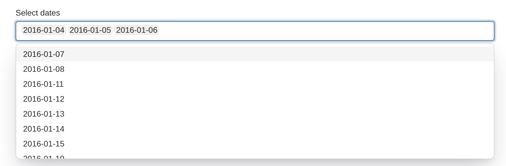

.. _widget-multidropdown-options:

.. rubric:: Available options

The available options of a multidropdown menu are identical to those of a `single dropdown menu <#widget-dropdown-options>`__. The only exception is that the option to `communicate the value as
element text with GAMS <#dropdown-option-clearvalue>`__ cannot be set for a multi-dropdown menu.

.. _widget-multidropdown-json:

.. rubric:: JSON example

.. code:: text

 {
   "inputWidgets": {
     "subdate": {
       "widgetType": "dropdown",
       "selected": "",
       "noHcube": false,
       "multiple": true,
       "label": "Select dates",
       "tooltip": "This is a tooltip",
       "choices": "$price$date$"
     }
   }
 }

.. _widget-date:

Date selector
-------------

.. _widget-date-configuration:

.. rubric:: Configuration

Returns a date string in the format yyyy-mm-dd.

Example:

Date selector for Singleton Set *singleDate*:

.. code:: gams

 $onExternalInput
 Singleton Set singleDate 'single date' / 2016-01-01 /;
 $offExternalInput

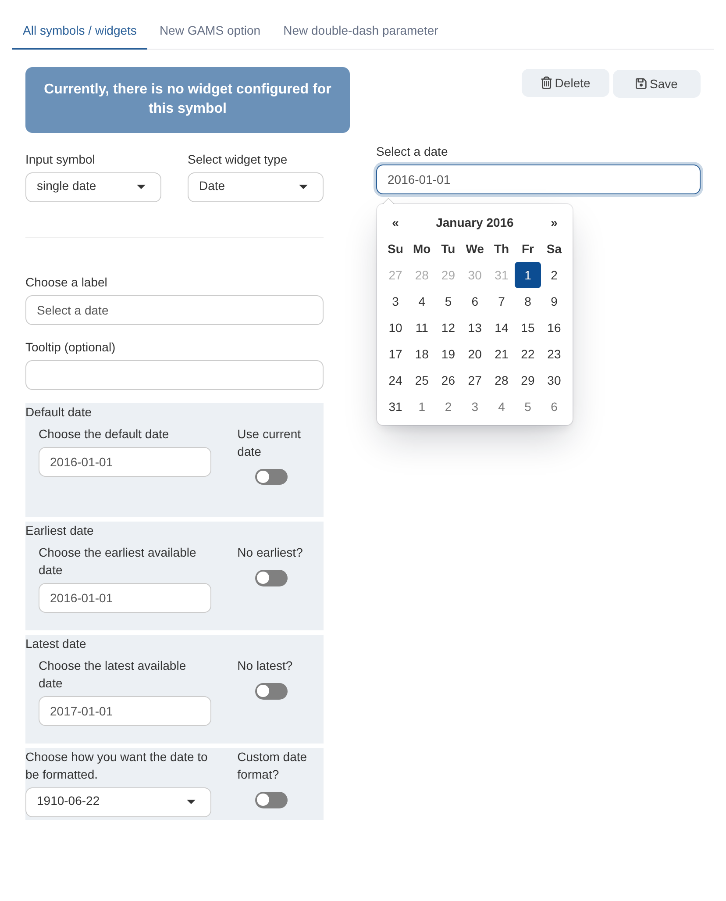

.. _widget-date-options:

.. rubric:: Available options

The following options are available for a date selector widget:

.. _date-option-name:

.. dropdown:: Enter the element name as it should be displayed in a tab

   With this option the tab name of the symbol is defined. For an example see the `same option <#slider-option-name>`__ for a slider. The default value of the element name is the explanatory text of
   the symbol.

.. _date-option-label:

.. dropdown:: Choose a label

   If a label has been specified, it will be displayed above the date selector. For an example see the `same option <#slider-option-label>`__ for a slider.

.. _date-option-tooltip:

.. dropdown:: Tooltip (optional)

   If a tooltip has been specified, it will be displayed when the mouse pointer is moved over the info icon. A tooltip is optional. For an example see the `same option <#slider-option-tooltip>`__ for
   a slider.

.. _date-option-minmaxdef:

.. dropdown:: Default / earliest / latest date

   When configuring a date selector, the earliest and the latest date that can be selected by the user can be specified. Dates outside this range cannot be selected. In addition, a specific date can
   be set as the default date. The dates for the earliest and the latest selectable date are optional. If required, they can be set statically by specifying a fixed date. The default date is not
   optional. Here either a static date string can be specified or the option *Use current date* can be activated. The current date is then always selected as the default.

.. _date-option-format:

.. dropdown:: Choose how you want the date to be formatted

   This option specifies the format of the date to display in the browser. The defaults is *yyyy-mm-dd*. This setting does not affect the actual format of the string the widget returns.

.. _date-option-range:

.. dropdown:: What date range should be displayed per default?

   Specifies the start screen of the date overview. The start screens *Month*, *Year* and *Decade* are available.

   .. grid:: 3
      :gutter: 2

      .. grid-item-card:: Month

         .. image:: ../../assets/images/configuration_mode/widget_date_month.png
            :alt: Month view
            :class: miro-image-max-height-400pt

      .. grid-item-card:: Year

         .. image:: ../../assets/images/configuration_mode/widget_date_year.png
            :alt: Year view
            :class: miro-image-max-height-400pt

      .. grid-item-card:: Decade

         .. image:: ../../assets/images/configuration_mode/widget_date_decade.png
            :alt: Decade view
            :class: miro-image-max-height-400pt

   If you click on a year, the monthly overview opens. From there, you can click on a month to go to the detailed day view.

.. _date-option-start:

.. dropdown:: What day shall be the start of the week?

   This option determines the day of the week with which each line of the date overview should begin.

   .. grid:: 2
      :gutter: 2

      .. grid-item-card:: Start on Sunday

         .. image:: ../../assets/images/configuration_mode/widget_date_start.png
            :alt: Start on Sunday
            :class: miro-image-max-height-400pt

      .. grid-item-card:: Start on Monday

         .. image:: ../../assets/images/configuration_mode/widget_date_start2.png
            :alt: Start on Monday
            :class: miro-image-max-height-400pt

.. _date-option-disable:

.. dropdown:: Select weekdays that you want to disable

   Individual weekdays can be deactivated in the date overview, so that the corresponding days are not selectable by the user.

.. _date-option-close:

.. dropdown:: Should datepicker be closed immediately when a date is selected?

   If active, the date overview of the widget will be closed as soon as a date is clicked. Otherwise, the widget remains open and closes only when you click outside the datepicker.

.. _date-option-expand:

.. dropdown:: Should element be expanded automatically when submitting a Hypercube job?

   As explained in detail in the `corresponding chapter <./hc-module.html#hcube-config>`__, widgets will be expanded when submitting a Hypercube job. With the option available here, the automatic
   extension of a widget can be switched off.

   .. image:: ../../assets/images/batch_img/regular_batch.png
    :alt: Expand for submitting a Hypercube job
    :class: miro-image-max-height-400pt

.. _widget-date-json:

.. rubric:: JSON example

.. code:: text

 {
   "inputWidgets": {
     "singledate": {
       "widgetType": "date",
       "format": "yyyy-mm-dd",
       "startview": "month",
       "weekstart": 0,
       "autoclose": true,
       "noHcube": false,
       "label": "Select a date",
       "tooltip": "This is a tooltip",
       "value": "2016-01-01",
       "min": "2016-01-01",
       "max": "2017-01-01"
     }
   }
 }

.. _widget-daterange:

Daterange selector
------------------

.. _widget-daterange-configuration:

.. rubric:: Configuration

Returns two dates. For more on widget ranges, see `here <./configuration_advanced.html#widgets-ranges>`__.

Example:

Date range selector for double-dash parameter *date*:

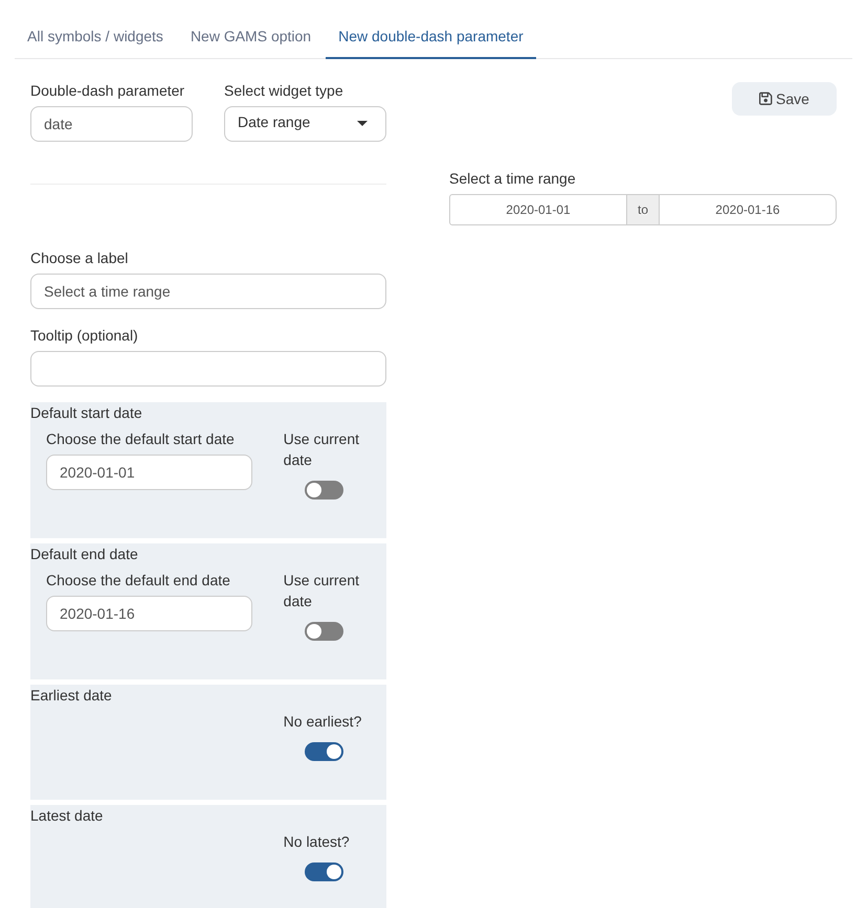

.. _widget-daterange-options:

.. rubric:: Available options

The available options of a date range selector are almost identical to those of a `date selector <#widget-date-options>`__. The following options are available in addition to a date selector:

.. _daterange-option-default:

.. dropdown:: Default dates

   Since the widget is used for date *ranges* the date range selector needs two default dates instead of one. The configuration of these does not differ from that of the `standard date
   selector <#date-option-minmaxdef>`__.

   .. image:: ../../assets/images/configuration_mode/widget_daterange_separator.png
    :alt: Date range separator
    :class: miro-image-max-height-60pt

.. _daterange-option-separator:

.. dropdown:: Select the separator between start and end date selector

   With this option you can determine what should be displayed between the two date selectors (default: "*to*").

   Example with two different separators:

   .. image:: ../../assets/images/configuration_mode/widget_daterange_separator.png
    :alt: Date range separator
    :class: miro-image-max-height-60pt

.. _widget-daterange-json:

.. rubric:: JSON example

.. code:: text

 {
   "inputWidgets": {
     "_gmspar_date": {
       "widgetType": "daterange",
       "format": "yyyy-mm-dd",
       "startview": "month",
       "weekstart": 0,
       "separator": " to ",
       "autoclose": true,
       "noHcube": false,
       "label": "Select a time range",
       "tooltip": "This is a tooltip",
       "start": "2020-01-01"
     }
   }
 }

.. _widget-textbox:

Text input
----------

.. _widget-textbox-configuration:

.. rubric:: Configuration

Returns the entered text.

Example:

Text input for double-dash parameter *comment*:

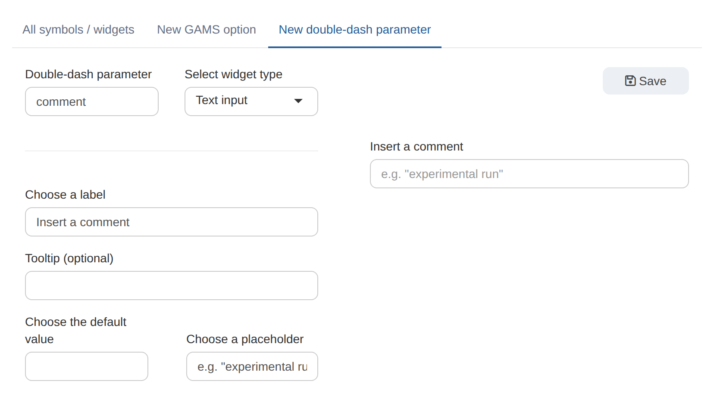

.. _widget-textbox-options:

.. rubric:: Available options

The following options are available for a text input widget:

.. _textbox-option-name:

.. dropdown:: Enter the element name as it should be displayed in a tab

   With this option the tab name of the symbol is defined. For an example see the `same option <#slider-option-name>`__ for a slider. The default value of the element name is the explanatory text of
   the symbol.

.. _textbox-option-label:

.. dropdown:: Choose a label

   If a label has been specified, it will be displayed above the text input. For an example see the `same option <#slider-option-label>`__ for a slider.

.. _textbox-option-tooltip:

.. dropdown:: Tooltip (optional)

   If a tooltip has been specified, it will be displayed when the mouse pointer is moved over the info icon. A tooltip is optional. For an example see the `same option <#slider-option-tooltip>`__ for
   a slider.

.. _textbox-option-default:

.. dropdown:: Choose the default value

   The default value is the initial value of the text input i.e. the text set when starting the application. This is optional.

.. _textbox-option-placeholder:

.. dropdown:: Choose a placeholder

   A placeholder is a text that is displayed in the text box as long as no input has been made by the user. This is primarily for orientation purposes. A placeholder is optional.

.. _textbox-option-clearvalue:

.. dropdown:: Communicate as element text with GAMS?

   .. admonition:: Tip

    This option is intended for the use of singleton sets to define compile-time variables in the GAMS model. Using singleton sets instead of command line parameters has the advantage that their
    information is not lost at any time, e.g. during GDX export. Read more about this topic `here <./model.html#command-line>`__.

   Singleton sets can have an element label and an element text. When configured as a text input, both components can be communicated with GAMS by using a double pipe ('\|\|') as separator:

   .. image:: ../../assets/images/configuration_mode/widget_textbox_clearvalue.png
    :alt: Element name
    :class: miro-image-max-height-60pt

   If this option is activated, the entire content of the text input widget is communicated as the element text of the singleton set to GAMS. The element label in turn is communicated as an empty
   string. Migrating a singleton set into a compile time variable in GAMS can then be done using the `$eval.set <https://www.gams.com/latest/docs/UG_DollarControlOptions.html#DOLLARevalset>`__ method.
   Since the variable should be filled by the element text, the attribute *TE* has to be used: ``$eval.Set VARNAME SETID.TE``.

   .. admonition:: Text input and Singleton Sets

    If a text input is used for a Singleton Set and you want to communicate both its label and its element text via GAMS MIRO, you must use a double pipe ('\|\|') as separator:

    .. image:: ../../assets/images/configuration_mode/widget_textbox_clearvalue.png
      :alt: Element name
      :class: miro-image-max-height-150pt

    Find more information `here <./model.html#singleton-set-separator>`__.

.. _widget-textbox-json:

.. rubric:: JSON example

.. code:: text

 {
   "inputWidgets": {
     "_gmspar_comment": {
       "widgetType": "textinput",
       "value": "",
       "placeholder": "e.g. \"experimental run\"",
       "label": "Insert a comment",
       "tooltip": "This is a tooltip"
     }
   }
 }

.. _widget-numeric:

Numeric input
-------------

.. _widget-numeric-configuration:

.. rubric:: Configuration

Returns a number.

Example:

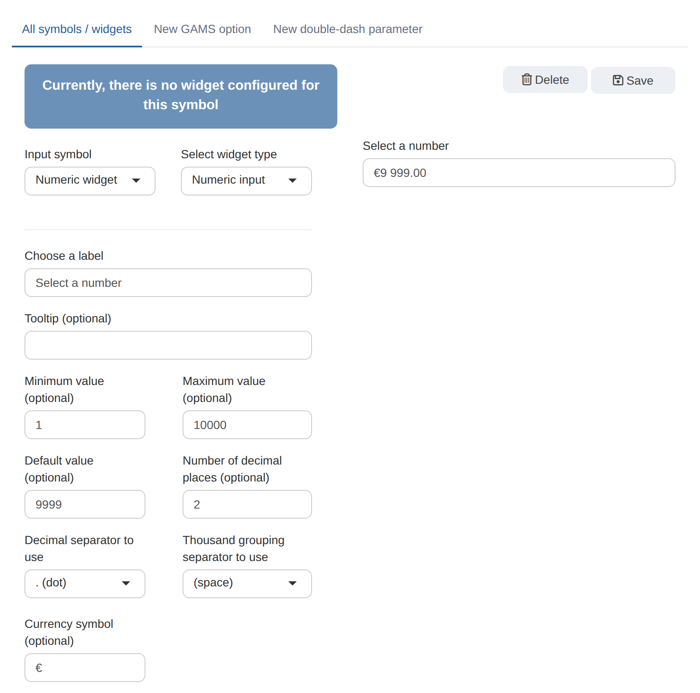

.. _widget-numeric-options:

.. rubric:: Available options

The following options are available for a numeric input widget:

.. _numeric-option-name:

.. dropdown:: Enter the element name as it should be displayed in a tab

   With this option the tab name of the symbol is defined. For an example see the `same option <#slider-option-name>`__ for a slider. The default value of the element name is the explanatory text of
   the symbol.

.. _numeric-option-label:

.. dropdown:: Choose a label

   If a label has been specified, it will be displayed above the numeric input. For an example see the `same option <#slider-option-label>`__ for a slider.

.. _numeric-option-tooltip:

.. dropdown:: Tooltip (optional)

   If a tooltip has been specified, it will be displayed when the mouse pointer is moved over the info icon. A tooltip is optional. For an example see the `same option <#slider-option-tooltip>`__ for
   a slider.

.. _numeric-option-default:

.. dropdown:: Default value

   A default value is the initial value of the numeric input i.e. the value set when starting the application. This is optional.

.. _numeric-option-minimum:

.. dropdown:: Minimum value

   Specifies the minimum valid value for the widget. This is optional.

.. _numeric-option-maximum:

.. dropdown:: Maximum value

   Specifies the maximum valid value for the widget. This is optional.

.. _numeric-option-decimal-places:

.. dropdown:: Number of decimal places

   Defines the default number of decimal places to show on the formatted value, and keep for the precision

.. _numeric-option-decimal-separator:

.. dropdown:: Decimal separator to use

   Defines the decimal separator character to be used. Default: "." (dot).

.. _numeric-option-thousand-separator:

.. dropdown:: Thousand grouping separator to use

   Defines the thousand grouping separator character to be used. Default: "," (comma).

.. _numeric-option-sign:

.. dropdown:: Currency symbol

   Places a symbol in front of the entered value, e.g. a dollar sign. This option is used exclusively for visual support. Only the number is returned as value. This is optional.

.. _widget-numeric-json:

.. rubric:: JSON example

.. code:: text

 {
   "inputWidgets": {
     "maxstock": {
       "widgetType": "numericinput",
       "value": 4,
       "min": 0,
       "max": 30,
       "sign": null,
       "label": "Select the maximum number of stocks",
       "tooltip": "This is a tooltip"
     }
   }
 }
