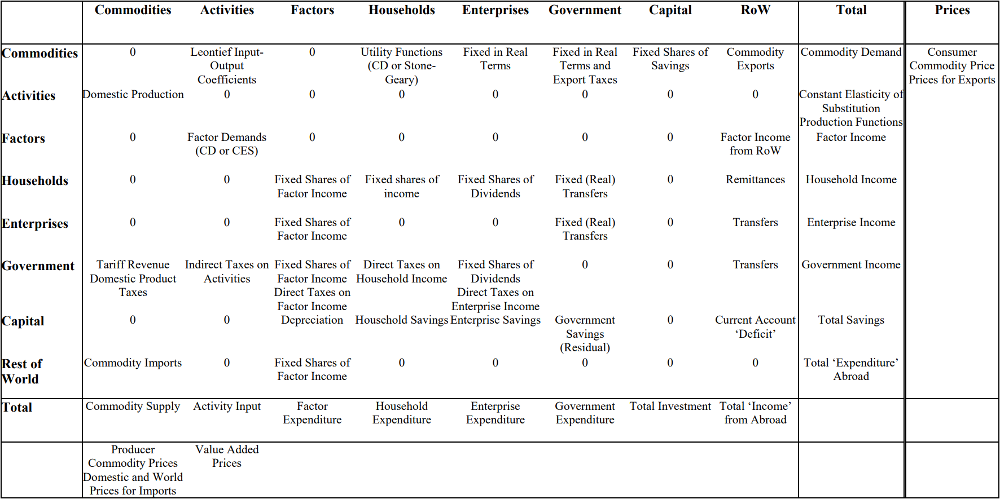

# Modeling the Impact of Domestic Policies and Global Shocks

There is an increasing demand to evaluate country level impacts of domestic policies and
shocks to the world economy. However, the models used to assess these impacts are often
complex; requiring substantial training to use. This user-friendly interface enables users to
run their own (simple) policy scenarios &amp; visualise results using the same type of models
used for in-depth impact assessment. A user guide is available [here](static_stg1/GAMS_MIRO_CGE_Model_Interface.pdf).

The interface uses a national Computable General Equilibrium (CGE) model, STAGE 1
([McDonald, 2007](https://www.cgemod.org.uk/stage.html)), calibrated to a Social Accounting Matrix
([SAM](https://en.wikipedia.org/wiki/Social_accounting_matrix)) for South Africa. A CGE model is
a whole economy model based on economic theory, populated with real economic data
which depicts an economy in a given year. The model is a deterministic system of equations
which represents the behaviour of firms, households, and governments. CGE models can be
used to assess impacts of a range of policies on economic variables. The model used here
is run in comparative static mode, allowing for a comparison of the state of the economy
before and after a policy change or change in world economic conditions.

The model and user interface are licenced under [Creative Commons BY](http://creativecommons.org/licenses/by/4.0/).
For detailed background information about the model, you can find the technical documentation
[here](https://www.cgemod.org.uk/stage.pdf). Online training in the model is
available [here](https://www.cgemod.org.uk/training.html). For enquiries related to the content of the user interface,
contact [Lindsay Shutes](mailto:lindsayjshutes@gmail.com) at Elevate Economics. For MIRO specific
and technical questions contact [GAMS Software GmbH](mailto:support@gams.com).

Disclaimer: The material and information contained in the user interface is for general information purposes only.
The proprietors accept no liability for consequences arising from the use of the interface or data and models therein.
Any reliance placed on such material is therefore strictly at the user’s own risk.

## Quick start

#### Input
- Define domestic policies and global shocks by changing slider values in the input tabs.
    - 'World prices' tab: Scenarios to examine the impact of changes in world prices.
    - 'Tax policy' tab: Scenarios to examine the impact of changing tax rates
- 'Assumptions' tab: Specify how government maintains fixed spending commitments when government revenues change
- 'South Africa SAM' tab: Pivot table that shows the South Africa Social Accounting Matrix.
  The pivot table has pre-defined views that can be browsed.
- 'Expenditure/Income shares South Africa SAM' tabs:  Pivot tables that show expenditure/income shares.
  The pivot tables have pre-defined views that can be browsed.

#### Output
The output section contains a dashboard of results arising from the last scenario run in – or loaded
into the interface. The dashboard is navigated via the ‘tiles’ on the right-hand side of the screen.
The tiles show headline
results for the current scenario.

#### Scenario Comparison
Load saved scenarios via the 'Load scenarios' section.
Choose which scenarios you want to include, click 'Choose selected scenarios' and then 'Dashboard compare'.

Note that if you use the app in the MIRO gallery, your scenarios will be deleted after closing the app.

#### Explore further
The user interface allows for ‘what-if’ type analysis. Additional scenarios can easily be run to evaluate
other scenarios under alternative assumptions such as different magnitudes of tax policy and/or world
price changes, and alternative government financing options. Multiple scenarios can also be run to
decompose the observed impacts; e.g., an initial scenario in which all import prices rise by 10% could be
decomposed into a 10% rise in the import price of each commodity group separately, thus identifying
the main drivers of the impacts.

## The Social Accounting Matrix
The following table shows the SAM and the Behavioural Relationships in detail:

<picture>
  <source srcset="static_stg1/SAM_dark.png" media="(prefers-color-scheme: dark)">
  
</picture>

## Glossary
### World price changes

<table><thead><tr><th>Abbreviation</th><th>Account Type</th></tr></thead><tbody><tr><td>World price changes</td><td>World price changes</td></tr><tr><td>Agriculture</td><td>Agriculture, livestock, forestry, fishing</td></tr><tr><td>Minerals</td><td>Minerals</td></tr><tr><td>Food</td><td>Food products</td></tr><tr><td>Industrial</td><td>Textiles, petrol, chemicals, metals, mineral products, machinery, vehicles, other manufacturing</td></tr><tr><td>Services</td><td>Trade, transport, and communications, services</td></tr><tr><td>Exchange rate</td><td>Exchange rate in domestic currency per unit of world currency (increase = depreciation) </td></tr></tbody></table>

### Social Accounting Matrix

<table><thead><tr><th>Abbreviation</th><th>Definition</th></tr></thead><tbody><tr><td>c_</td><td>Commodity accounts</td></tr><tr><td>m_</td><td>Margin accounts</td></tr><tr><td>a_</td><td>Activity accounts</td></tr><tr><td>h_</td><td>Household accounts</td></tr><tr><td>f_</td><td>Factor tax accounts</td></tr><tr><td>VATTAX</td><td>Value added taxes</td></tr><tr><td>IMPTAX</td><td>Import duties</td></tr><tr><td>EXPTAX</td><td>Export taxes</td></tr><tr><td>ECTAX</td><td>Excise duty</td></tr><tr><td>SALTAX</td><td>Sales taxes</td></tr><tr><td>INDTAX</td><td>Production taxes</td></tr><tr><td>FACTTAX</td><td>Factor taxes</td></tr><tr><td>DIRTAX</td><td>Direct income taxes</td></tr><tr><td>GOVT</td><td>Government</td></tr><tr><td>ENT</td><td>Enterprises</td></tr><tr><td>KAP</td><td>Savings/Investment</td></tr><tr><td>DSTOC</td><td>Stock Changes</td></tr><tr><td>ROW</td><td>Rest of World</td></tr></tbody></table>

### Government financing

Additional government revenue comes from government borrowing or raising the income tax rate.

### Macroeconomic indicators (nominal)

<table><thead><tr><th>Abbreviation</th><th>Account Type</th></tr></thead><tbody><tr><td>GDP</td><td>Gross Domestic Product</td></tr><tr><td>Absorption</td><td>Final demand from private, enterprise and government consumption, and investment</td></tr><tr><td>Production</td><td>Total value of production</td></tr><tr><td>Exports</td><td>Total value of exports</td></tr><tr><td>Imports</td><td>Total value of imports</td></tr><tr><td>GovtSavings</td><td>Government balance</td></tr><tr><td>IncomeTaxScaling</td><td>Scaling of income tax rate used to maintain fixed government balance</td></tr></tbody></table>

### Activity groups

<table><thead><tr><th>Abbreviation</th><th>Account Type</th></tr></thead><tbody><tr><td>Primary</td><td>Agriculture, minerals</td></tr><tr><td>Manufacturing</td><td>Food products, textiles, petrol, chemicals, mineral and metal products, machinery, vehicles, other manufacturing</td></tr><tr><td>Services</td><td>Utilities, construction, trade, transport, communications, services</td></tr><tr><td>Agriculture</td><td>Agriculture</td></tr><tr><td>Minerals</td><td>Minerals</td></tr><tr><td>Food</td><td>Food products</td></tr><tr><td>Industry</td><td>Textiles, petrol, chemicals, mineral and metal products, machinery, vehicles, other manufacturing</td></tr><tr><td>Utilities</td><td>Utilities</td></tr><tr><td>Construction</td><td>Construction</td></tr><tr><td>Services</td><td>Trade, transport, communications, services</td></tr></tbody></table>

### Factors

Land,
Capital, and
Labour grouped by ethnicity (African, Coloured and Asian, White) and skill type (unskilled, skilled)

### Households

Households grouped by ethnicity (African, Coloured and Asian, White) and education level (low, mid, high)

### Government indicators

<table><thead><tr><th>Abbreviation</th><th>Account Type</th></tr></thead><tbody><tr><td>Income</td><td>Government income</td></tr><tr><td>TaxRevenue</td><td>Government tax revenue</td></tr><tr><td>Consumption</td><td>Government consumption (nominal)</td></tr><tr><td>RealConsumption</td><td>Government consumption (real)</td></tr><tr><td>Savings</td><td>Government savings (positive) or borrowing (negative)</td></tr></tbody></table>

## Note
STAGE_1 is an earlier version of the STAGE family of CGE models.
It is used here as a compact and accessible example model for learning
and demonstration purposes within GAMS MIRO.

More recent versions of STAGE are available and may provide additional
features and enhancements. For current documentation and information on
the STAGE model family, please see: https://www.cgemod.org.uk/stage.html
